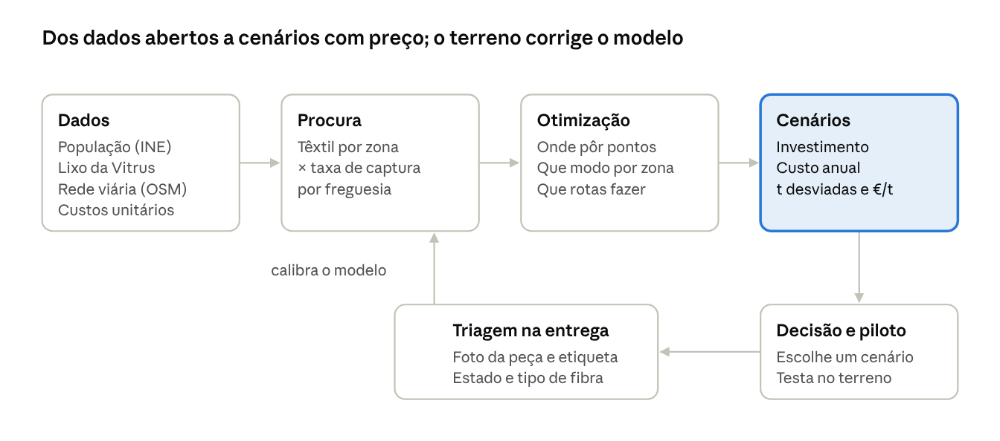

# Novelo

*Hack4Guimarães 2035 · 19 de outubro de 2026 · Hélder Gonçalves e Flávio Fernandes*

**Recolha seletiva de têxteis, desenhada ao menor custo.** Proposta para o Desafio 5 (TexVitrus) do Hack4Guimarães 2035.

## O problema

Em Guimarães, 5,4% do lixo indiferenciado é têxtil, acima da média europeia (4,7%) e nacional (cerca de 4%). São entre 1.300 e 2.650 toneladas por ano que vão para aterro ou incineração sem serem separadas (estimativa nossa a partir dos dados do município).

- **A obrigação já existe.** A recolha seletiva de têxteis é exigida desde 1 de janeiro de 2025, e o município fixou a meta de aumentar a recolha seletiva em 30%.
- **A conta muda em 2028.** A Diretiva (UE) 2025/1892 obriga cada Estado-Membro a ter, até 17 de abril de 2028, um regime em que os produtores pagam a recolha, triagem, preparação para reutilização e reciclagem.
- **O território torna-o caro.** Guimarães tem 156 277 habitantes em 55 freguesias com ocupação dispersa. O porta a porta pode não compensar, e colocar contentores ao acaso também não.
- **Ninguém tem os dados.** A triagem é manual, as microempresas têxteis deitam retalhos no lixo urbano sem registo, e só 4 dos 27 operadores licenciados na zona reciclam ou valorizam têxteis.

A pergunta da Vitrus Ambiente é simples: como garantir têxtil reutilizável e reciclável com o menor investimento e o menor custo de operação?

## A solução

O Novelo é uma ferramenta de decisão que desenha a rede de recolha de têxteis ao menor custo e mostra, lado a lado, quanto custa cada cenário.

| Peça | O que faz | O que o decisor ganha |
| --- | --- | --- |
| **Simulador da rede** | Estima quanto têxtil há em cada zona, escolhe onde pôr pontos de recolha, que modo usar em cada zona e que rotas fazer | Cenários com investimento, custo anual, toneladas desviadas do aterro e €/t |
| **Triagem na entrega** | Uma foto da peça e outra da etiqueta classificam-na como reutilizável, reciclável ou rejeito e indicam o destino da fibra | Dados de qualidade por ponto de recolha, que hoje não existem |
| **Incentivo e destino** | Liga as entregas ao sistema PAYT e estima toneladas por tipo de fibra para a indústria do Vale do Ave | Mais captura sem mais contentores, e material com destino de valor |

**Três modos de recolha, combinados por zona.** A poupança está em não usar o mesmo modo em todo o lado:

1. **Pontos em locais existentes** (juntas, escolas, supermercados, ecocentros): investimento quase nulo.
2. **Contentores de rua**: só onde a densidade justifica.
3. **Recolha a pedido**: nas zonas dispersas, aproveitando rotas que já lá passam.

## Como funciona

Cada entrega triada no terreno devolve dados reais de quantidade e qualidade, e o modelo fica mais certo a cada ciclo.

## Impacto e porquê agora

O Novelo transforma uma obrigação legal num plano com preço. É útil já para a câmara e, a partir de 2028, para quem vai pagar a recolha.

| Para quem | O que resolve |
| --- | --- |
| **Vitrus Ambiente / Câmara de Guimarães** | Cumprir a meta de recolha seletiva sem investir às cegas; menos têxtil no indiferenciado, que tem custo de tratamento e enrola nas máquinas |
| **Futuras entidades gestoras da RAP têxtil** | Saber quanto custa recolher por tonelada em cada tipo de território, para negociar com os municípios |
| **Indústria e operadores do Vale do Ave** | Fluxos de material triado por tipo de fibra, num território onde só 4 de 27 operadores licenciados fazem valorização |
| **Outros municípios** | O mesmo modelo, com os dados abertos de cada concelho: todos têm a mesma obrigação |

**Porquê agora:** a recolha seletiva já é obrigatória, Guimarães é Capital Verde Europeia em 2026 e tem um plano de ação para a circularidade têxtil que pede exatamente rotas, tipos de contentor e frequências.

## Depois do hackathon

1. **Piloto com a Vitrus (3 meses):** uma ou duas freguesias, um modo de recolha de cada tipo, medir toneladas e custo real contra o previsto.
2. **Calibração:** acertar o modelo com os dados do piloto e do PAYT.
3. **Escala:** levar o modelo a outros municípios e às entidades gestoras da RAP, com os dados abertos de cada concelho.

Em aberto: custos unitários reais da Vitrus e quem opera hoje os contentores têxteis. São as primeiras perguntas ao mentor.

## Fontes

- [Plano de Ação Integrado para a Circularidade Têxtil de Guimarães](https://urbact.eu/sites/default/files/2026-01/Guimaraes_IAP_PT.pdf), Município de Guimarães / URBACT, nov. 2025
- [Diretiva 2025/1892 que altera a Diretiva-Quadro dos Resíduos](https://www.vda.pt/pt/publicacoes/insights/diretiva-20251892-que-altera-a-diretiva-quadro-dos-residuos-diretiva-200898ce/28063/), VdA, out. 2025
- [Resumo oficial do ato final, Diretiva (UE) 2025/1892](https://oeil.europarl.europa.eu/oeil/en/procedure-document-summary/pdf?id=1845495), Parlamento Europeu
- Desafio 5 TexVitrus, slide oficial do Hack4Guimarães 2035
