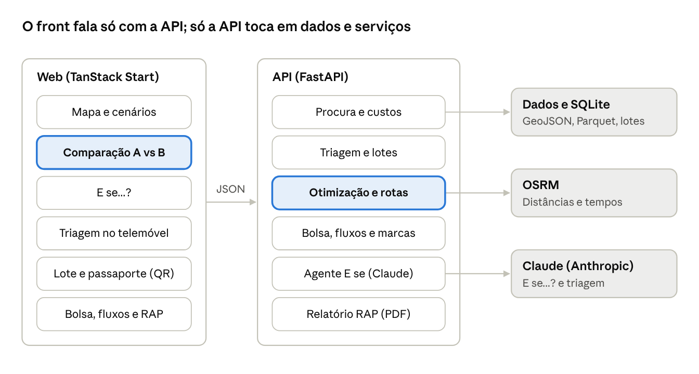

# Novelo: guia de desenvolvimento

*Hack4Guimarães 2035 · 19 de outubro de 2026 · Hélder Gonçalves e Flávio Fernandes*

Tudo o que a equipa precisa para construir o Novelo em 5 dias: arquitetura, [features](02-features.md), [deploy](03-deploy-coolify.md), [dados e modelo](04-dados-e-modelo.md), [backlog](05-backlog.md) e [demo](06-demo-e-entrega.md).

## Arquitetura



O coração é o par otimização e comparação: se tudo o resto falhar, estes dois têm de funcionar para a demo.

## Stack e repositório

Um monorepo com dois serviços e um contrato: o FastAPI publica o OpenAPI, o front gera o cliente a partir dele, e nada fala com a API à mão.

| Camada | Escolha | Porquê |
| --- | --- | --- |
| Front | TanStack Start (React, SSR) + TypeScript strict + Tailwind | Rotas e loaders type-safe, SSR para a primeira carga do mapa |
| Rotas e dados | TanStack Router (file-based) + TanStack Query | Cache, invalidação e estados de carregamento sem código repetido |
| Cliente da API | `@hey-api/openapi-ts`: cliente fetch, Zod e hooks do TanStack Query | Tipos e hooks gerados do contrato; uma mudança na API parte o build se o front não acompanhar |
| Mapa | MapLibre GL | Gratuito, vetorial, camadas por freguesia |
| Gráficos | Apache ECharts (Sankey e comparação) | Sankey de raiz, bom desempenho, tema configurável |
| Back | Python 3.12 + FastAPI + Pydantic v2 + pydantic-settings | Contrato tipado e OpenAPI de graça |
| Pacotes Python | uv, com `uv.lock` | Instalação reprodutível e rápida, local e no Docker |
| Geo e otimização | GeoPandas, Shapely, Google OR-Tools | Localização (MIP) e rotas (VRP) no mesmo pacote |
| Distâncias | OSRM em contentor próprio, com o mapa recortado ao concelho | Matriz de tempos e km sem custos de API |
| IA | Claude, pela API da Anthropic: "E se...?" com saída estruturada e triagem por imagem | Um só fornecedor, saídas validadas por Pydantic |
| Relatórios | Modelo HTML + WeasyPrint | PDF com a identidade Novelo, gerado no servidor |
| QR | `segno` | QR em SVG, sem dependências nativas |
| Persistência | SQLite num volume: cenários, lotes, relatórios | Os dados de base são ficheiros versionados; o resto cabe numa base pequena |
| Pacotes JS | pnpm workspaces | Um lockfile, instalações rápidas |
| Deploy | VPS com Coolify, Docker Compose, Traefik com HTTPS automático | Um sítio, um `git push`; ver [Deploy](03-deploy-coolify.md) |

```
novelo/
  apps/
    api/
      pyproject.toml  uv.lock  Dockerfile
      src/novelo_api/
        main.py           # create_app(), routers, /health
        settings.py       # pydantic-settings: tudo o que vem do ambiente
        params.py         # params.yaml validado com Pydantic no arranque
        routers/          # zones, scenarios, whatif, triage, lots, market,
                          # flows, brands, reports (finos)
        schemas/          # modelos Pydantic = o contrato da API
        services/         # orquestração: junta domínio, dados, IA e cache
        domain/           # demand, costs, optimize, routes, lots, calibrate
                          # funções puras, sem FastAPI, 100% testadas
        ai/               # prompts versionados, ScenarioDelta, verificação
        reports/          # modelo HTML do relatório RAP
        adapters/         # osrm.py, claude.py, storage.py (I/O externo)
      tests/              # unit/, api/, evals/ (perguntas E se), fixtures/
    web/
      package.json  vite.config.ts  openapi-ts.config.ts  Dockerfile
      src/routes/         # rotas file-based do TanStack Router
      src/features/       # map/, scenarios/, compare/, whatif/, triage/,
                          # lots/, market/, flows/, reports/
      src/client/         # GERADO pelo hey-api: nunca editar à mão
      src/lib/            # queryClient, formatação pt-PT, utilitários
  data/raw/  data/processed/
  scripts/                # etl/, export_openapi.py, osrm_prepare.sh
  openapi.json            # contrato exportado, versionado
  docker-compose.yml      # produção, lido pelo Coolify
  docker-compose.dev.yml  # desenvolvimento local
  justfile                # comandos únicos: just dev, just gen, just check
  .github/workflows/ci.yml
```

## API

Tudo em JSON; geometrias em GeoJSON. Os endpoints das features estão especificados em [Features](02-features.md).

| Método | Rota | Entrada | Saída |
| --- | --- | --- | --- |
| GET | `/health` | - | `{"status":"ok"}`; usado pelo healthcheck do Coolify |
| GET | `/zones` | - | Freguesias com população e procura estimada (t/ano) |
| GET | `/candidates` | `mode?` | Locais candidatos a ponto de recolha, com tipo |
| POST | `/scenarios` | `budget_eur`, `capture_target`, `modes[]`, `params?` | Cenário: pontos, modo por zona, rotas, KPIs |
| GET | `/scenarios/{id}` | - | Cenário guardado, para o ecrã de comparação |
| POST | `/whatif` | `scenario_id`, `question` | Alteração entendida, cenário novo, comparação, explicação verificada |
| POST | `/triage` | Foto da peça + foto da etiqueta (multipart, máx. 5 MB cada) | Estado, composição, marca, destino sugerido, confiança; peça entra num lote |
| GET | `/lots` | `fiber?`, `zone?`, `state?` | Lotes com peso, composição e estado |
| GET | `/lots/{code}` | - | Passaporte público do lote (o QR aponta para aqui) |
| GET | `/market` | `fiber?` | Bolsa de fibra: lotes agregados por fibra e estado |
| POST | `/market/{code}/interest` | reciclador | Reserva do lote |
| GET | `/flows` | `scenario_id?` ou `observed=true` | Nós e ligações do Sankey, em toneladas |
| GET | `/brands` | `from?`, `to?` | Quilos por marca e composição, com tamanho da amostra |
| POST | `/reports/rap` | `scenario_ids[]` | PDF do relatório RAP |

```json
// POST /scenarios -> resposta
{
  "id": "B",
  "kpis": {
    "capex_eur": 0,
    "opex_eur_year": 0,
    "tonnes_year": 0,
    "eur_per_tonne": 0,
    "coverage_pct": 0
  },
  "points": [{"id": "...", "mode": "existing|street|on_demand", "lat": 0, "lon": 0, "tonnes_year": 0}],
  "routes": [{"vehicle": 1, "km": 0, "stops": ["..."], "geometry": {}}]
}
```

## Contrato OpenAPI e cliente gerado

O OpenAPI é a única fonte de verdade entre back e front. O fluxo tem quatro passos e corre com `just gen`:

1. **FastAPI define o contrato** com modelos Pydantic em `schemas/` e `response_model` em todas as rotas.
2. **`scripts/export_openapi.py`** escreve `openapi.json` a partir de `create_app().openapi()`, sem arrancar o servidor.
3. **`@hey-api/openapi-ts`** gera em `apps/web/src/client/` os tipos, o SDK, os esquemas Zod e os hooks do TanStack Query.
4. **A CI volta a gerar tudo** e falha se houver diferenças (`git diff --exit-code`). O cliente gerado é versionado de propósito.

**Nomes limpos no cliente.** Por omissão o FastAPI gera operation IDs longos. Usar o nome da função:

```python
# apps/api/src/novelo_api/main.py
from fastapi import FastAPI
from fastapi.routing import APIRoute

def _operation_id(route: APIRoute) -> str:
    return route.name  # list_zones -> listZonesOptions no front

def create_app() -> FastAPI:
    app = FastAPI(title="Novelo API", version="0.1.0",
                  generate_unique_id_function=_operation_id)
    ...
    return app
```

```ts
// apps/web/openapi-ts.config.ts
import { defineConfig } from '@hey-api/openapi-ts';

export default defineConfig({
  input: '../../openapi.json',
  output: 'src/client',
  plugins: ['@hey-api/client-fetch', 'zod', '@tanstack/react-query'],
});
```

```tsx
// uso num componente: nunca fetch à mão
const zones = useQuery(listZonesOptions());
const navigate = useNavigate();
const create = useMutation({
  ...createScenarioMutation(),
  onSuccess: (scenario) =>
    navigate({ to: '/cenarios/$id', params: { id: scenario.id } }),
});
```

Nos loaders das rotas, `queryClient.ensureQueryData(listZonesOptions())` pré-carrega os dados no servidor, e o componente lê-os do cache sem segundo pedido.

## Boas práticas de código

### Python (API)

- **Camadas com uma só direção:** `routers` → `services` → `domain`. O `domain` não importa FastAPI nem faz I/O; recebe dados e devolve resultados. É aí que vivem as fórmulas e é aí que estão os testes.
- **I/O isolado em `adapters/`** (OSRM, modelo de visão, SQLite), injetado com `Depends`. Nos testes troca-se por falsos.
- **Tudo tipado:** modelos Pydantic em todos os pedidos e respostas, `response_model` explícito, `mypy --strict` sem exceções.
- **Configuração só por ambiente:** `Settings(BaseSettings)` lê variáveis e falha no arranque se faltar alguma obrigatória. `params.yaml` é validado por um modelo Pydantic, com a fonte de cada valor em comentário.
- **Um formato de erro:** handlers globais devolvem `{"code", "message", "details"}`; nunca rebentar com 500 e stack trace para o cliente.
- **Otimização sem bloquear o servidor:** rotas que chamam o OR-Tools são `def` (correm em threadpool), com limite de tempo do solver (ex.: 20 s) e resultados em cache pela hash dos parâmetros. Mesma entrada, mesmo cenário: sementes fixas.
- **Logs estruturados** em JSON, com `request_id` em cada pedido.

### IA com rédea curta

- **Saídas estruturadas sempre:** o modelo devolve JSON que um modelo Pydantic valida (`ScenarioDelta`, `TriageResult`). Texto livre só na explicação final.
- **A IA não faz contas:** todos os números vêm do otimizador ou da base de dados, e um verificador rejeita qualquer número que não esteja no JSON de origem.
- **Prompts versionados** em `ai/prompts/`, com a versão guardada em cada resposta.
- **Evals na CI:** perguntas "E se...?" e etiquetas de teste com resultado esperado; a CI corre-as com respostas gravadas, e uma vez por dia contra a API real.
- **Custos e limites:** timeout por chamada, limite de pedidos por IP em `/whatif` e `/triage`, e cache por pergunta e cenário.
- **Privacidade:** fotografias apagadas depois de processadas; só se guardam marca, composição, estado e peso.

### TypeScript (web)

- `strict: true` e `noUncheckedIndexedAccess: true` no `tsconfig`.
- **Nunca `fetch` à mão:** só o cliente e os hooks gerados. Query keys vêm dos helpers gerados, não de strings.
- **Pastas por funcionalidade** em `src/features/`; componentes sem lógica de negócio, que vive em hooks ou na API.
- **Dados das rotas nos loaders** (`ensureQueryData`), parâmetros de URL validados com o `validateSearch` do Router: o estado do cenário vive na URL e pode ser partilhado.
- **Números em pt-PT** com `Intl.NumberFormat('pt-PT')`, sempre com unidade (t, €, €/t). KPIs estimados levam a etiqueta "estimativa".
- **Acessível:** cada camada do mapa tem uma tabela equivalente; contraste AA; tudo usável por teclado.

### Testes

- **Domínio:** testes unitários às fórmulas de procura e custo, com valores calculados à mão.
- **Cenário de referência:** um fixture pequeno (3 freguesias, 6 candidatos) com resultado esperado fixo; apanha regressões na otimização.
- **API:** testes com `httpx` contra `create_app()`, adapters falsos.
- **Web:** Vitest para lógica e formatação; um teste Playwright que percorre a demo de ponta a ponta.

## Qualidade e CI

Um comando local, o mesmo que a CI corre: `just check`. Se passa no portátil, passa na CI.

| Âmbito | Ferramentas | Corre em |
| --- | --- | --- |
| Python | Ruff (lint e formatação), mypy strict, pytest com cobertura do `domain/` | pre-commit e CI |
| TypeScript | Biome (lint e formatação), `tsc --noEmit`, Vitest | pre-commit e CI |
| Contrato | `just gen` + `git diff --exit-code` em `openapi.json` e `src/client/` | CI |
| Imagens | `docker build` das duas imagens | CI |
| Ponta a ponta | Playwright contra o docker compose de desenvolvimento | CI, só em PR para `main` |

**Pipeline (GitHub Actions):** jobs `api`, `web` e `contract` em paralelo; `docker` depois deles. Só com tudo verde, um último job chama o webhook de deploy do Coolify. O Coolify não faz deploy sozinho a cada push: assim nada chega à VPS sem passar a CI.

**Regras de Git:**

- `main` protegido: só por PR, com CI verde e uma aprovação.
- Branches `feat/…`, `fix/…`, `chore/…`; commits no formato Conventional Commits (`feat(api): cenários com recolha a pedido`).
- PRs pequenos: uma coisa de cada vez, revistos no mesmo dia.
- Segredos nunca no repositório: `.env.example` com os nomes, valores só no Coolify.
- A partir do fim do dia 4, só correções e polimento.
