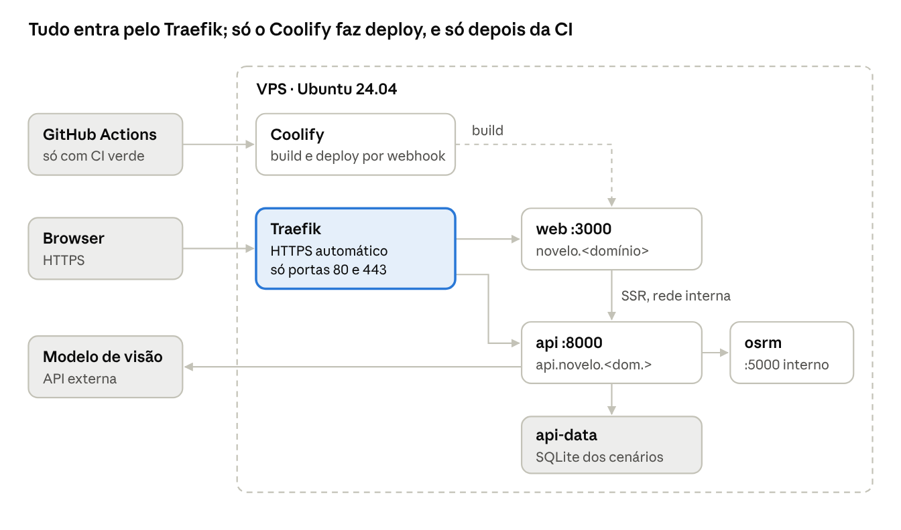

# Deploy na VPS com Coolify

Um `git push` para `main` passa pela CI e, só se tudo estiver verde, o Coolify constrói e põe no ar. A VPS só aceita tráfego web pelo Traefik.

## Como fica na VPS



O OSRM e o volume nunca são visíveis de fora; o browser só conhece os dois domínios.

## Preparar a VPS e o Coolify

Feito uma vez, no dia 1, por uma pessoa. Recomendamos uma VPS com 4 vCPU e 8 GB de RAM: a otimização e o OSRM gostam de memória, e recortar o mapa ao concelho mantém o OSRM pequeno.

1. **VPS** com Ubuntu 24.04 LTS e IP fixo.
2. **DNS:** registos A para `novelo.<domínio>`, `api.novelo.<domínio>` e `coolify.<domínio>` a apontar para o IP.
3. **Endurecer o acesso:** utilizador com sudo, login SSH só por chave, `PasswordAuthentication no`, firewall com `ufw` a deixar entrar só 22, 80 e 443 (mais 8000 até o painel ter domínio), `unattended-upgrades` ligado.
4. **Instalar o Coolify:**

    ```bash
    curl -fsSL https://cdn.coollabs.io/coolify/install.sh | sudo bash
    ```

5. **Primeiro acesso:** criar a conta de administrador logo a seguir, dar ao painel o domínio `coolify.<domínio>` (HTTPS automático) e fechar a porta 8000 no firewall.
6. **GitHub:** ligar o repositório através da GitHub App do Coolify (repositório privado, sem chaves soltas).
7. **Projeto:** criar o projeto "Novelo" com o ambiente `production`. Adicionar um recurso do tipo Docker Compose, branch `main`, ficheiro `docker-compose.yml`.
8. **Desligar o deploy automático por push.** Quem dispara o deploy é a CI, depois dos testes (ver Deploy, rollback e operação).

## Compose de produção e Dockerfiles

Três serviços, um volume, nenhuma porta publicada: o Traefik do Coolify é a única porta de entrada. Os domínios definem-se no campo Domains de cada serviço no Coolify (`novelo.<domínio>` para `web`, `api.novelo.<domínio>` para `api`); depois confirmar no Deployable Compose que as variáveis `SERVICE_URL_*` ficaram com esses valores.

```yaml
# docker-compose.yml (lido pelo Coolify)
services:
  web:
    build:
      context: .
      dockerfile: apps/web/Dockerfile
      args:
        VITE_API_URL: ${SERVICE_URL_API_8000}
    environment:
      - SERVICE_URL_WEB_3000
      - NODE_ENV=production
      - PORT=3000
      - API_INTERNAL_URL=http://api:8000
    depends_on:
      api:
        condition: service_healthy
    restart: unless-stopped
    healthcheck:
      test: ["CMD", "node", "-e", "fetch('http://127.0.0.1:3000/').then(r=>process.exit(r.ok?0:1)).catch(()=>process.exit(1))"]
      interval: 15s
      timeout: 5s
      retries: 5
      start_period: 20s

  api:
    build:
      context: .
      dockerfile: apps/api/Dockerfile
    environment:
      - SERVICE_URL_API_8000
      - APP_ENV=production
      - CORS_ORIGINS=${SERVICE_URL_WEB_3000}
      - OSRM_URL=http://osrm:5000
      - DATABASE_PATH=/data/novelo.db
      - VISION_API_KEY=${VISION_API_KEY:?}
      - LOG_LEVEL=${LOG_LEVEL:-info}
    volumes:
      - api-data:/data
    depends_on:
      - osrm
    restart: unless-stopped
    healthcheck:
      test: ["CMD", "python", "-c", "import urllib.request; urllib.request.urlopen('http://127.0.0.1:8000/health', timeout=3)"]
      interval: 15s
      timeout: 5s
      retries: 5
      start_period: 20s

  osrm:
    build:
      context: .
      dockerfile: apps/osrm/Dockerfile
    restart: unless-stopped

volumes:
  api-data:
```

**API (Python com uv, multi-stage, utilizador sem privilégios):**

```dockerfile
# apps/api/Dockerfile
FROM python:3.12-slim AS build
# fixar a versão do uv que a equipa usa localmente
COPY --from=ghcr.io/astral-sh/uv:0.8 /uv /uvx /bin/
ENV UV_COMPILE_BYTECODE=1 UV_LINK_MODE=copy UV_PYTHON_DOWNLOADS=never
WORKDIR /app
COPY apps/api/pyproject.toml apps/api/uv.lock ./
RUN --mount=type=cache,target=/root/.cache/uv \
    uv sync --frozen --no-dev --no-install-project
COPY apps/api/src ./src
RUN --mount=type=cache,target=/root/.cache/uv \
    uv sync --frozen --no-dev --no-editable
COPY data/processed ./data/processed

FROM python:3.12-slim
RUN useradd --create-home --uid 10001 app && mkdir /data && chown app:app /data
WORKDIR /app
COPY --from=build --chown=app:app /app /app
ENV PATH="/app/.venv/bin:$PATH" PYTHONUNBUFFERED=1
USER app
EXPOSE 8000
CMD ["uvicorn", "novelo_api.main:app", "--host", "0.0.0.0", "--port", "8000", \
     "--proxy-headers", "--forwarded-allow-ips", "*", "--workers", "2"]
```

**Web (TanStack Start com Nitro, saída autossuficiente em `.output`):**

```dockerfile
# apps/web/Dockerfile
FROM node:22-slim AS build
ENV PNPM_HOME=/pnpm PATH=/pnpm:$PATH
RUN corepack enable
WORKDIR /repo
COPY package.json pnpm-lock.yaml pnpm-workspace.yaml ./
COPY apps/web/package.json apps/web/
RUN --mount=type=cache,id=pnpm,target=/pnpm/store \
    pnpm install --frozen-lockfile --filter web...
COPY apps/web apps/web
ARG VITE_API_URL
ENV VITE_API_URL=$VITE_API_URL
RUN pnpm --filter web build

FROM node:22-slim
WORKDIR /app
ENV NODE_ENV=production PORT=3000
COPY --from=build --chown=node:node /repo/apps/web/.output ./.output
USER node
EXPOSE 3000
CMD ["node", ".output/server/index.mjs"]
```

No `vite.config.ts` do web: `plugins: [tanstackStart(), nitro(), viteReact()]`. No browser o cliente gerado usa `VITE_API_URL`; nos loaders que correm no servidor usa `API_INTERNAL_URL` (rede interna, sem passar pela internet).

**OSRM (dados preparados na build, sem passos manuais na VPS):**

```dockerfile
# apps/osrm/Dockerfile
FROM ghcr.io/project-osrm/osrm-backend:v5.27.1
COPY data/raw/guimaraes.osm.pbf /data/guimaraes.osm.pbf
RUN osrm-extract -p /opt/car.lua /data/guimaraes.osm.pbf \
 && osrm-partition /data/guimaraes.osrm \
 && osrm-customize /data/guimaraes.osrm \
 && rm /data/guimaraes.osm.pbf
EXPOSE 5000
CMD ["osrm-routed", "--algorithm", "mld", "/data/guimaraes.osrm"]
```

`data/raw/guimaraes.osm.pbf` é gerado uma vez por `scripts/osrm_prepare.sh`: descarrega o extrato de Portugal da Geofabrik e recorta-o com `osmium extract` à área do concelho com margem. Fica com poucos MB e vai para o repositório.

## Variáveis de ambiente e segredos

Os nomes vivem em `.env.example`, versionado; os valores só no Coolify (Environment Variables do recurso). Uma variável obrigatória em falta bloqueia o deploy (`${VAR:?}`) e a API recusa arrancar se faltar alguma no `Settings`.

| Variável | Serviço | Origem | Notas |
| --- | --- | --- | --- |
| `SERVICE_URL_WEB_3000` | web | Coolify (domínio do serviço) | `https://novelo.<domínio>` |
| `SERVICE_URL_API_8000` | api | Coolify (domínio do serviço) | `https://api.novelo.<domínio>` |
| `VITE_API_URL` | web | Build, a partir de `SERVICE_URL_API_8000` | Entra no bundle do browser: nunca pôr segredos com prefixo `VITE_` |
| `API_INTERNAL_URL` | web | Fixo no compose | `http://api:8000`, para os loaders no servidor |
| `CORS_ORIGINS` | api | A partir de `SERVICE_URL_WEB_3000` | Só o domínio do front; nunca `*` |
| `OSRM_URL` | api | Fixo no compose | `http://osrm:5000` |
| `DATABASE_PATH` | api | Fixo no compose | SQLite no volume `api-data` |
| `VISION_API_KEY` | api | **Segredo**, no Coolify | Obrigatória; rodar se for exposta |
| `LOG_LEVEL` | api | Opcional | `info` por omissão |
| `APP_ENV` | api | Fixo no compose | `production` desliga `/docs` público, se quisermos |

## Deploy, rollback e operação

**Deploy só depois da CI.** No Coolify, copiar o Deploy Webhook do recurso e criar um API token. Guardá-los como segredos do GitHub (`COOLIFY_WEBHOOK`, `COOLIFY_TOKEN`). O último job da CI, que só corre em `main` com tudo verde:

```yaml
# .github/workflows/ci.yml (excerto)
  deploy:
    needs: [api, web, contract, docker]
    if: github.ref == 'refs/heads/main'
    runs-on: ubuntu-latest
    steps:
      - name: Deploy no Coolify
        run: |
          curl --fail -sS -X GET "$COOLIFY_WEBHOOK" \
            -H "Authorization: Bearer $COOLIFY_TOKEN"
        env:
          COOLIFY_WEBHOOK: ${{ secrets.COOLIFY_WEBHOOK }}
          COOLIFY_TOKEN: ${{ secrets.COOLIFY_TOKEN }}
```

**Rollback:** reverter o commit em `main` (`git revert`), que passa pela CI e faz novo deploy. Antes da apresentação, marcar a versão da demo com uma tag (`v1.0-demo`) para saber sempre o que está no ar.

**Backups:** o único estado é a SQLite em `api-data`. Uma tarefa agendada diária (no Coolify ou num cron da VPS) faz `python -m novelo_api.backup` no contentor da API (usa a API de backup do `sqlite3` do Python, porque a imagem não traz o CLI) e copia o ficheiro para fora da VPS. Tudo o resto reconstrói-se a partir do repositório.

**Segurança:**

- Só 22, 80 e 443 abertas; SSH só por chave; nenhum serviço publica portas no compose.
- Contentores sem root; imagens base com versão fixa.
- CORS só para o domínio do front; `/triage` com limite de pedidos por IP e de tamanho de ficheiro, porque cada chamada custa dinheiro.
- `VISION_API_KEY` só existe na API; nada sensível com prefixo `VITE_`.

**Saber quando algo cai:** notificações do Coolify para deploys falhados (email ou Discord) e um monitor externo de uptime a bater em `https://api.novelo.<domínio>/health` de minuto a minuto.

**Fontes:** [Coolify, Docker Compose](https://coolify.io/docs/services/configuration/docker-compose) · [TanStack Start, Hosting](https://tanstack.com/start/latest/docs/framework/react/guide/hosting) · [Hey API, TanStack Query](https://heyapi.dev/openapi-ts/plugins/tanstack-query)
