<p align="center">
  <picture>
    <source media="(prefers-color-scheme: dark)" srcset="brand/redes/novelo-banner-2400x450-escuro.png">
    
  </picture>
</p>

<h1 align="center">Novelo</h1>

<p align="center">
  <strong>A ferramenta de decisão que desenha a recolha de têxteis de Guimarães ao menor custo.</strong><br>
  Entram um orçamento e uma meta; saem cenários comparáveis em euros, toneladas, toneladas reutilizáveis e €/t,<br>
  calculados por um otimizador sobre os dados reais da Vitrus Ambiente.
</p>

<p align="center">
  <a href="https://novelo.helder.si"></a>
  
  
  
  <br>
  
  
  
  
  
</p>

<p align="center">
  <a href="https://novelo.helder.si"><strong>Experimentar</strong></a> ·
  <a href="docs/projeto/visao-geral.md"><strong>Página do projeto</strong></a> ·
  <a href="#arrancar"><strong>Arrancar em 2 comandos</strong></a> ·
  <a href="docs/README.md"><strong>Documentação</strong></a>
</p>

<p align="center"><em>Hélder Gonçalves e Flávio Fernandes · Hack4Guimarães 2035 · Desafio 5 TexVitrus (Vitrus Ambiente)</em></p>

---

| **3 003,3 t** | **9,1%** | **+445,8 t** | **47 093 €** | **0** |
| :---: | :---: | :---: | :---: | :---: |
| de têxtil por ano ainda no lixo indiferenciado (estimativa) | do têxtil gerado é hoje recolhido à parte (estimativa) | por ano a 102,8 €/t, com 60 000 €/ano de orçamento (estimativa) | por ano de tratamento evitado, a 105,64 €/t (Vitrus): paga a operação de 45 828 € (estimativa) | contentores novos: uma viatura de têxtil, sem compactação, e os locais que já existem |

<p align="center">
  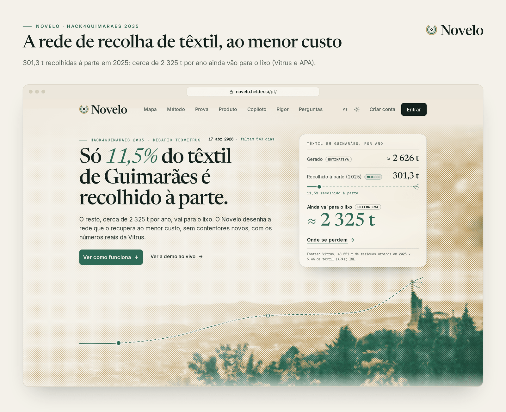
</p>

## Índice

[O problema](#o-problema) · [A resposta](#a-resposta-uma-viatura-de-têxtil-nenhum-contentor-novo) · [Em imagens](#em-imagens) · [Os números](#os-números-que-alimentam-tudo) · [O que o Novelo faz](#o-que-o-novelo-faz) · [IA](#ia-com-rédea-curta) · [Dados](#dados-e-regra-zero) · [Arquitetura](#arquitetura) · [Stack](#stack) · [Arrancar](#arrancar) · [Testes](#testes-e-qualidade) · [Estrutura](#estrutura-do-repositório) · [Produção](#produção-e-deploy) · [Segurança e RGPD](#segurança-e-rgpd) · [Marca, vídeo e pitch](#marca-vídeo-e-pitch) · [Limitações](#limitações-conhecidas-e-roteiro) · [Documentação](#documentação)

## O problema

Em 2025 Guimarães deitou cerca de **51 250 t** ao lixo indiferenciado: a Vitrus recolheu 43 050,5 t, 84,0% do total (Relatório e Contas 2025, p. 8).
Segundo a APA, 5,86% disso é têxtil (RARU 2025, p. 24). São cerca de **3 003 t por ano** que vão para o aterro (estimativa), contra **301,3 t** recolhidas à parte.
Mais de nove em cada dez quilos de têxtil acabam no lixo. Cada tonelada paga **105,64 €** de tratamento (40 €/t de taxa de gestão de resíduos e 65,64 €/t da Resinorte, valores da Vitrus).

A recolha seletiva de têxteis é obrigatória desde 1 de janeiro de 2025, e hoje paga-a só o município.
Até 17 de abril de 2028 nasce a responsabilidade alargada do produtor (Diretiva (UE) 2025/1892), mas só para as peças postas à venda depois da lei nacional (art. 22.º-A, n.º 11), e só pelo custo eficiente (n.º 12).
O têxtil que já está nas casas continua anos a pesar na câmara. Quem chegar à mesa sem saber quanto custa cada tonelada não tem como defender o seu número.

> **A pergunta da Vitrus:** como criar um serviço de recolha seletiva de têxteis pós-consumo que garanta material reutilizável e reciclável, com o menor investimento e o menor custo de operação?

## A resposta: uma viatura de têxtil, nenhum contentor novo

O mentor da Vitrus respondeu-nos a 21 e a 22 de outubro de 2026, e refizemos o modelo nos dois dias:

- **Contentores de têxtil, não.** A Vitrus não os tem nem os quer: o têxtil de contentor chega contaminado e perde a reutilização, que é onde está o valor (59,4% do recolhido em 2025; reciclar custa mais do que a fibra virgem).
- **Nem no camião do lixo.** A compactação estraga o saco, e não há viaturas livres à tarde. O caminho que a Vitrus indicou é **um meio novo de recolha**.

O Novelo desenha a rede à volta dessa **viatura de têxtil nova, sem compactação**, que parte do Estaleiro Operacional da Rua das Lameiras, em Polvoreira:

1. **Saco fechado à porta, num dia fixo por freguesia.** Seco e sem compactar.
2. **Paragens nos locais municipais que já existem e nas 86 escolas,** sem contentor novo: o saco é entregue em mão.

Com **60 000 €/ano**, o otimizador escolhe 60 pontos em 45 freguesias e o saco à porta em 4. A rede custa **45 828 €** por ano e desvia **445,8 t a 102,8 €/t**, das quais cerca de **265 t reutilizáveis**.
A captura sobe de 9,1% para cerca de 22,6%. O tratamento evitado, **47 093 €** por ano, paga a operação.
O investimento é de 57 500 €: 42 500 € na viatura e o resto nos 60 pontos. Em 8 de cada 10 simulações, o custo fica entre 82,0 e 141,3 €/t (todos estimativa).

**O que pedimos:** um piloto de 3 meses em duas freguesias, desenhado pelo próprio Novelo, para trocar os pressupostos pelos números reais.

## Em imagens

<table>
  <tr>
    <td width="50%">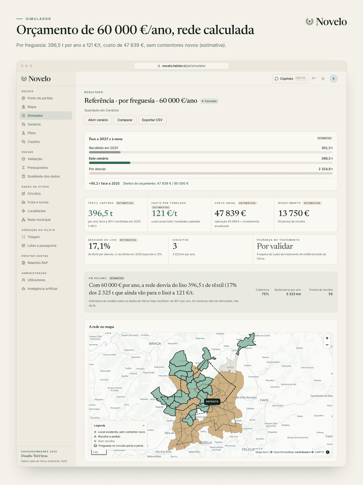<br><sub><b>Simulador.</b> Orçamento e meta entram; saem freguesias, canais, rotas e KPIs.</sub></td>
    <td width="50%">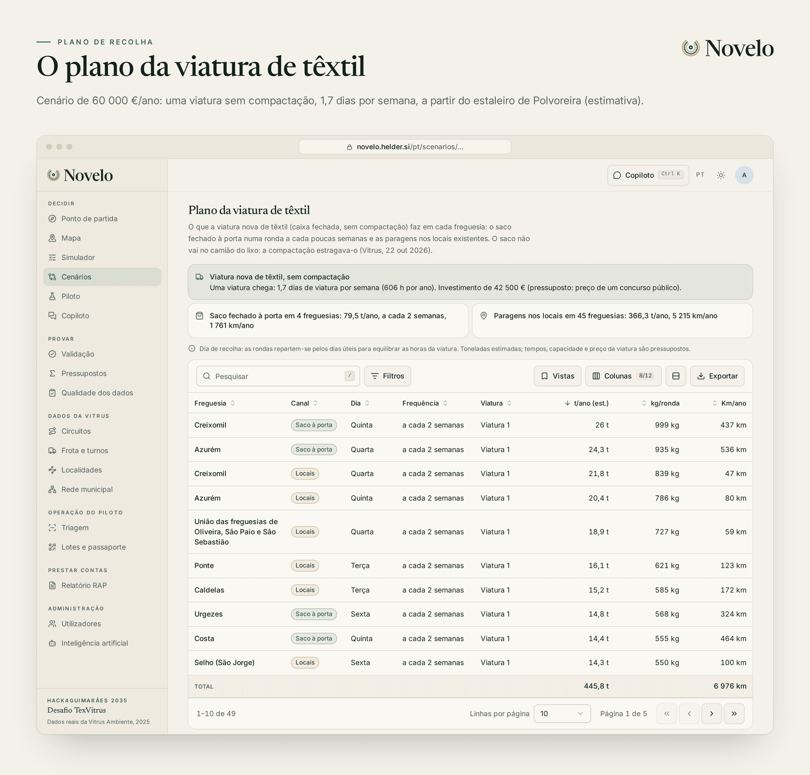<br><sub><b>Plano da viatura de têxtil.</b> O dia de cada freguesia e os quilos por ronda.</sub></td>
  </tr>
  <tr>
    <td>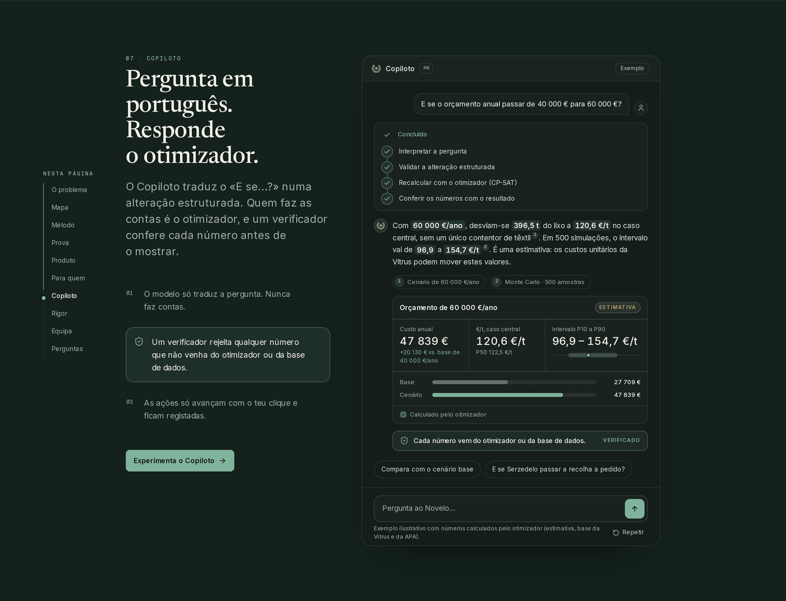<br><sub><b>Copiloto.</b> Pergunta em português; o otimizador faz as contas e um verificador confere cada número.</sub></td>
    <td>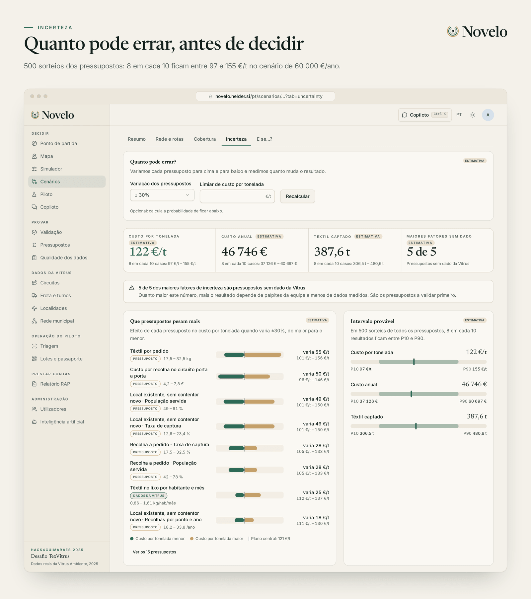<br><sub><b>Incerteza.</b> Tornado dos pressupostos e Monte Carlo (P10 a P90).</sub></td>
  </tr>
  <tr>
    <td>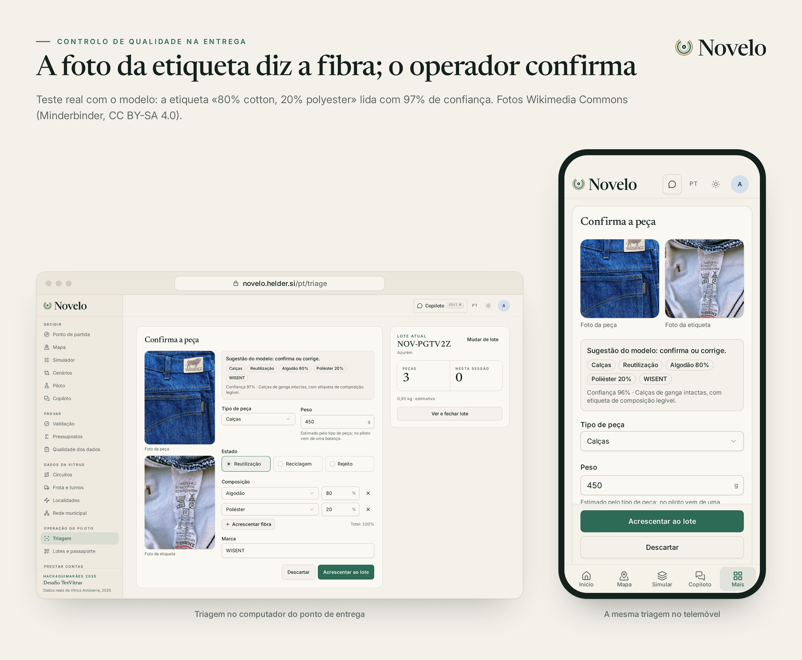<br><sub><b>Triagem na entrega.</b> Teste real: a etiqueta «80% cotton, 20% polyester» lida com 97% de confiança.</sub></td>
    <td>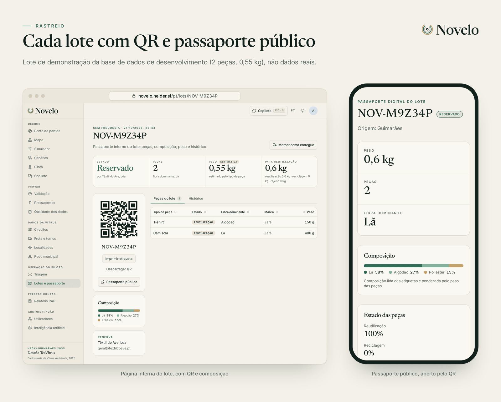<br><sub><b>Lote com QR e passaporte.</b> 4 peças triadas com o modelo real, 1,4 kg (estimativa).</sub></td>
  </tr>
  <tr>
    <td>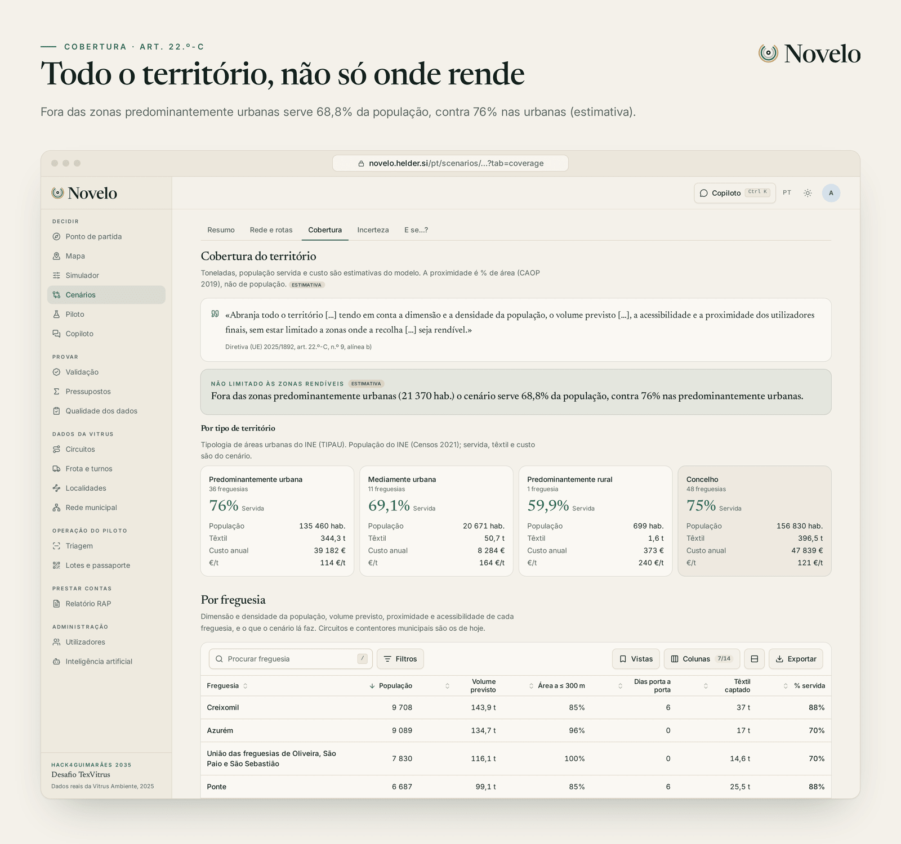<br><sub><b>Cobertura.</b> Os critérios do art. 22.º-C da diretiva, freguesia a freguesia.</sub></td>
    <td>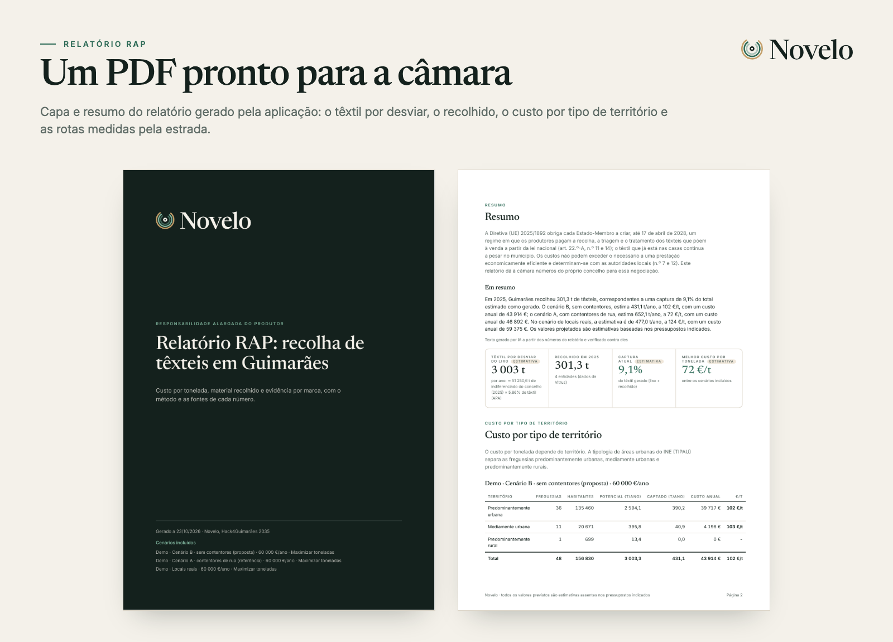<br><sub><b>Relatório RAP em PDF.</b> O dossiê para a mesa onde se fixa o custo eficiente.</sub></td>
  </tr>
</table>

<p align="center">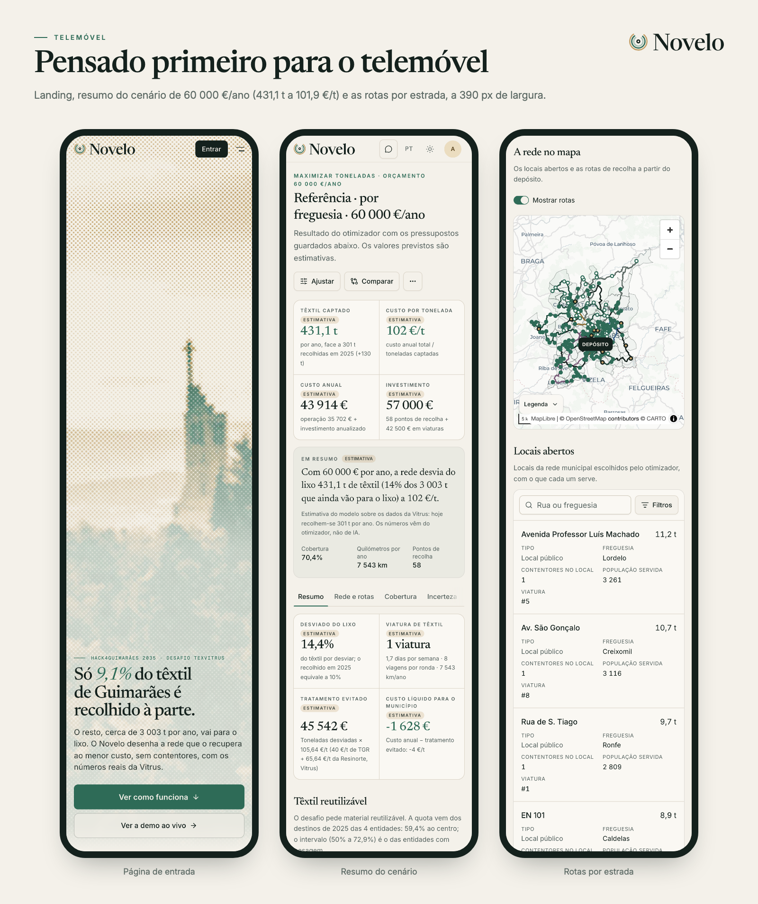</p>

## Os números que alimentam tudo

Os valores da Vitrus e do INE vêm dos ficheiros recebidos (ver [análise dos dados recebidos](docs/dados/analise-dados-recebidos.md)). O que é cálculo nosso ou
depende de um pressuposto leva "estimativa". Nada é inventado: sem fonte, não entra.

| Facto | Valor | Origem |
| --- | --- | --- |
| Têxtil recolhido em 2025 (4 entidades) | **301,3 t**, 0,16 kg por habitante e mês (1,92 kg por habitante e ano) | Vitrus (`dados_textil.xlsx`); duas das quatro entidades enviaram percentagens, não quilos, por isso o destino é em parte estimativa |
| População do concelho | **156 830** habitantes em 48 freguesias | INE, Censos 2021 (soma das freguesias) |
| Destino do recolhido | 59,4% reutilização, 26,5% reciclagem, 14,1% rejeito | Vitrus |
| Rede atual | 40 circuitos, 29 viaturas, 82 localidades, 101 turnos por semana; nenhuma viatura livre à tarde | Vitrus (`Circuitos_Viaturas_Guimaraes.xlsx`, semana de 21 a 25/09/2026; resposta do mentor, 22/10/2026) |
| Indiferenciado recolhido pela Vitrus em 2025 | **43 050,5 t**, 84,0% do concelho | Vitrus, Relatório e Contas 2025, p. 8 |
| Indiferenciado do concelho | **≈ 51 250,6 t** (43 050,5 ÷ 0,840) | **Estimativa** |
| Têxtil que ainda vai para o lixo | **≈ 3 003,3 t por ano** = 1,596 kg/hab/mês (51 250,6 × 5,86%) | **Estimativa**; 5,86% de têxtil no indiferenciado vem da APA (RARU 2025, p. 24), base indicada pela Vitrus |
| Têxtil gerado | **≈ 3 304,6 t por ano** (3 003,3 + 301,3) | **Estimativa** |
| Captura atual | **≈ 9,1%** (301,3 ÷ 3 304,6) | **Estimativa** |
| Tratamento do indiferenciado em aterro | **105,64 €/t** (40 €/t de taxa de gestão de resíduos + 65,64 €/t da Resinorte) | Vitrus (resposta do mentor, 22/10/2026); custo evitado por tonelada desviada |
| Viatura de têxtil, sem compactação | **42 500 €**, amortizada em 8 anos | Pressuposto com fonte: contrato público de Vila Nova de Gaia (TED 338951-2024) |
| Depósito | Estaleiro Operacional da Rua das Lameiras, Polvoreira | Vitrus (22/10/2026) |
| Referência francesa | 4,27 kg/hab/ano contra 1,92 em Guimarães; meta equivalente de 669,7 t | França: Refashion, fonte secundária, **por verificar**; o resto é cálculo |

<details>
<summary><b>Porque mudou a base, duas vezes</b></summary>

Usávamos 0,7 kg/hab/mês de um plano municipal (≈ 1 317 t, captura 22,9%), que a Vitrus não conhece. A 21/10/2026 a Vitrus
indicou 43 051 t × 5,4% (≈ 2 324,8 t, 11,5%). A 22/10/2026 reviu a base: 5,86% (APA, 2025) sobre o indiferenciado do concelho todo, e não só os 84,0% que recolhe.
As 301,3 t foram recolhidas à parte, fora do indiferenciado, por isso os 5,86% são o têxtil que ainda se perde
([respostas da Vitrus](docs/dados/analise-dados-recebidos.md#respostas-da-vitrus-de-22-out-2026)). O ecrã mostra sempre "estimativa".

</details>

### Cenários de referência (estimativas)

| Orçamento | Custo anual | Toneladas por ano | €/t | Tratamento evitado | Reutilizável |
| --- | ---: | ---: | ---: | ---: | ---: |
| 40 000 €/ano | 26 909 € | 378,5 t | 71,1 | ≈ 39 985 € | ≈ 224,8 t |
| **60 000 €/ano (recomendado)** | **45 828 €** | **445,8 t** | **102,8** | **47 093 €** | **264,9 t** (222,9 a 324,8) |
| 100 000 €/ano | 85 860 € | 571,2 t | 150,3 | ≈ 60 342 € | ≈ 339,3 t |
| Teto sem contentores (2 viaturas) | 170 623 € | 772,1 t | 221,0 | ≈ 81 565 € | 458,8 t |

Os valores com "≈" são cálculo nosso sobre as toneladas do cenário: × 105,64 €/t (Vitrus) e × 59,4% de reutilização (2025).
Até aos 60 000 €/ano, o tratamento evitado paga a operação; depois, o €/t sobe à medida que a rede chega às freguesias mais dispersas.

## O que o Novelo faz

Uma história, do saco ao fio: **decidir** a rede, **provar** que aguenta, **operar** cada saco até à indústria e **prestar contas** à câmara.

| Funcionalidade | Onde | Em resumo |
| --- | --- | --- |
| **Ponto de partida** | `/` | Os números reais de 2025, a lacuna para o potencial, o destino do recolhido, a comparação com referências e o relógio regulatório |
| **Simulador da rede** | `/simulator` | Orçamento (60 000 € por ano por omissão) e meta entram; saem pontos, canais e rotas. OR-Tools: CP-SAT escolhe pontos e canais, VRP faz as rotas da viatura de têxtil a partir de Polvoreira. Saco fechado à porta num dia fixo e paragem em local existente (sem contentor novo); o contentor de rua só entra como referência |
| **Cenários e comparação** | `/scenarios` | Investimento, custo anual, tratamento evitado, custo líquido, toneladas, toneladas reutilizáveis, €/t e cobertura; lado a lado, com fluxos, referência francesa, tornado e Monte Carlo (P10/P50/P90). O separador Cobertura dá a matriz por freguesia e tipo de território da diretiva (art. 22.º-C, n.º 9, b)) |
| **Pressupostos** | `/assumptions` | Cada parâmetro com valor, unidade e origem (Vitrus, contrato público, pressuposto da equipa) |
| **Piloto de 3 meses** | `/pilot` | Escolhe as freguesias de maior valor de aprendizagem e calcula as toneladas mínimas para a medição valer |
| **"E se...?"** | no cenário e no copiloto | Pergunta em português; a IA só traduz para uma alteração estruturada e o otimizador faz as contas |
| **Copiloto** | `/chat`, painel `⌘K` | Conversa em streaming com 52 ferramentas tipadas, gráficos e tabelas construídos pelo servidor, ações que só correm com confirmação, memória por utilizador, anexos e `@menções` |
| **Triagem por foto** | `/triage` | Controlo de qualidade na entrega: uma foto da peça e outra da etiqueta dão tipo, estado, composição e marca, sempre confirmadas pelo operador. A triagem não guarda as fotos; o operador pode guardar uma miniatura opcional por peça (desde 23 out 2026; ver [privacidade](docs/engenharia/privacidade-fotografias.md)) |
| **Lotes, QR e passaporte** | `/lots`, `/passport/:código` | Cada lote tem código, QR, etiqueta para imprimir e uma página pública com origem, composição, peso e histórico |
| **Bolsa de fibra** | `/market` | Lotes agregados por fibra, que os recicladores reservam. Prioridade baixa: o valor está na reutilização |
| **Evidência por marca** | `/brands` | Quilos por marca e composição, com o tamanho da amostra |
| **Relatório RAP em PDF** | `/reports` | Custo por tipo de território (TIPAU), toneladas por fibra e destino, cenários, método e fontes |
| **Mapa e rede municipal** | `/map`, `/municipal` | Freguesias (CAOP 2019) e os 2 751 contentores municipais de indiferenciado, orgânico e seletivo (**não são de têxteis**): onde o têxtil se perde e onde a viatura pode parar |
| **Dados da Vitrus** | `/circuits`, `/fleet`, `/localities`, `/data-quality` | Circuitos, localidades e alertas de qualidade; a Frota tem o calendário da semana tipo, com conflitos reais e exportação `.ics` |
| **Entrada e contas** | `/login`, `/join` | Magic link, password ou Google; entrada de evento por QR como convidado; administração de utilizadores |
| **Administração de IA** | `/admin/ai` | Modelo por tarefa, reserva, limites, orçamento mensal e custos |
| **Em qualquer ecrã** | tudo | pt-PT e inglês, tema claro e escuro, PWA instalável feita primeiro para telemóvel, acessibilidade AA, história de seis passos na primeira entrada |

Detalhe de cada uma em [docs/engenharia/features.md](docs/engenharia/features.md); o copiloto tem [documento próprio](docs/engenharia/copiloto.md).

## IA com rédea curta

O modelo (via OpenRouter) devolve JSON validado por Pydantic e **nunca faz contas**: todos os números vêm do otimizador ou da base de dados.

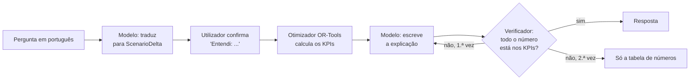

- **O que a IA faz:** percebe a pergunta, explica o resultado, lê a etiqueta e a peça nas fotos, propõe a resolução de alertas e escreve o parágrafo do relatório RAP.
- **O que a IA não faz:** contas, nem escrever valores em gráficos e tabelas (o servidor desenha-os a partir dos resultados), nem alterar dados sem um clique de confirmação.
- **Verificador de números** (`ai/verify.py`): rejeita qualquer número do texto que não exista nos resultados de origem; no copiloto, o texto já transmitido é retirado (`retract`) e reescrito uma vez.
- **Provado com o modelo real** (22 out 2026):
  - Copiloto: 155 perguntas em pt-PT e inglês, 146 aprovadas, **100% dos números verificados**, 100% de resistência a injeção de prompt ([avaliação](docs/engenharia/avaliacao-copiloto.md)).
  - Triagem: com a etiqueta legível, a composição saiu certa em todas as peças testadas (5 composições diferentes, 86% a 97% de confiança); só com a foto da peça, a fibra fica "desconhecida", porque o modelo não adivinha.
- **Custos e travões:** modelo por tarefa e orçamento mensal em `/admin/ai`; sem `OPENROUTER_API_KEY` a API arranca e as funcionalidades de IA respondem 503; sem IA, o relatório RAP sai com um texto determinístico.

Ver [IA](docs/engenharia/ia.md) e [Copiloto](docs/engenharia/copiloto.md).

## Dados e regra zero

**Regra zero:** os dados recebidos da Vitrus são obrigatórios em tudo o que for número. Um valor ou vem dos ficheiros, ou está em
[dados e modelo](docs/engenharia/dados-e-modelo.md) como pressuposto com fonte, ou leva a etiqueta "estimativa" no ecrã.

| Fonte | O que traz | Estado |
| --- | --- | --- |
| **Vitrus Ambiente** | Têxtil recolhido em 2025 por entidade e destino; circuitos, viaturas, localidades e turnos | Recebido, em uso |
| **Vitrus Ambiente, pacote QGIS de 20/10/2026** | 2 751 contentores **municipais** (indiferenciado, orgânico, seletivo), 2 026 locais e a CAOP 2019 | Recebido; base geográfica do modelo |
| **Vitrus Ambiente, 21/10/2026** | Não há contentores de têxtil e não os quer | Recebido, em uso |
| **Vitrus Ambiente, 22/10/2026** | Saco fora do compactador e viatura de têxtil nova; nenhuma viatura livre à tarde; 105,64 €/t de tratamento; depósito em Polvoreira; 5,86% (APA) sobre o indiferenciado do concelho (R&C 2025: 43 050,5 t = 84,0%) | Recebido, em uso |
| **Vitrus Ambiente** | Custos por hora e por quilómetro das viaturas (pedidos ao departamento financeiro) | **Por receber** |
| **INE** | População por freguesia (Censos 2021) e tipologia TIPAU | Em uso |
| **CAOP** | Contornos das freguesias (2019, no pacote da Vitrus) | Em uso |
| **OpenStreetMap** | Localidades geocodificadas dos circuitos (Nominatim) | Em uso (69 das 82; mais 10 no centro da freguesia CAOP pelo nome; 79 com freguesia) |

`data/raw/` guarda os originais e nunca se edita; `just etl` gera `data/processed/`; a API importa-os no arranque, de forma idempotente, com a impressão digital (SHA-256) de cada ficheiro.
Sem custos unitários da Vitrus, os custos do simulador são **pressupostos** visíveis em `/assumptions`, e a incerteza é mostrada como resultado (tornado e Monte Carlo), não como nota de rodapé.

## Arquitetura

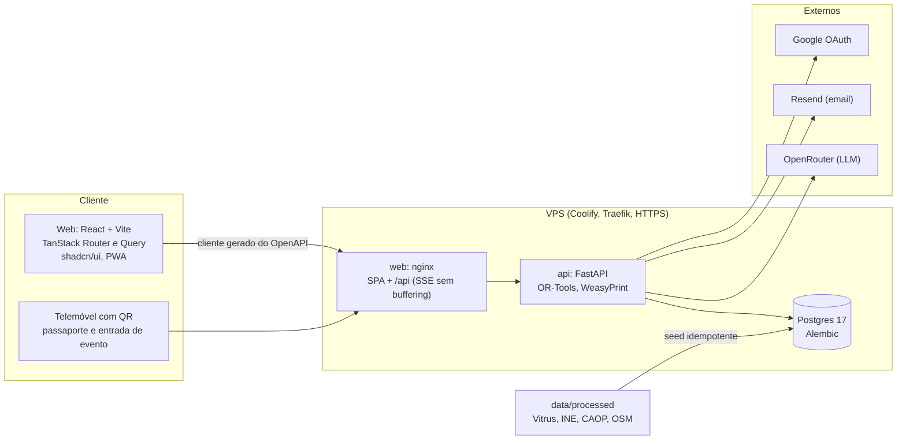

O contrato é a única fonte de verdade: o FastAPI exporta o `openapi.json` e o hey-api gera o cliente TypeScript, os hooks do TanStack Query e os esquemas Zod.
O web nunca escreve rotas nem tipos à mão; `just check-contract` falha se o contrato e o cliente divergirem. No servidor, cada funcionalidade tem
`router` fino, `service` sem FastAPI e `domain/` só com funções puras testadas à mão. Mais em [arquitetura](docs/engenharia/arquitetura.md).

## Stack

| Camada | Escolha |
| --- | --- |
| API | Python 3.12, FastAPI, SQLAlchemy 2 assíncrono, Alembic, Pydantic v2, uv |
| Otimização | OR-Tools (CP-SAT e VRP), funções puras em `domain/`, sementes fixas e limite de tempo (`SOLVER_TIME_LIMIT_S`) |
| Base de dados | PostgreSQL 17 |
| Web | React 19, Vite, TanStack Router e Query, Tailwind v4, shadcn/ui, MapLibre, ECharts, Paraglide (i18n), vite-plugin-pwa |
| Contrato | OpenAPI e hey-api (cliente, SDK, Zod, React Query) |
| IA | OpenRouter, saída estruturada validada por Pydantic, prompts versionados em `apps/api/src/novelo/ai/prompts/` |
| Autenticação | argon2, JWT em cookies HttpOnly, magic link, Google OAuth |
| Email | Resend (em dev os emails vão para o log) |
| PDF | WeasyPrint com as fontes da marca |
| Qualidade | Ruff, mypy strict, pytest, Biome, TypeScript strict, Vitest, Playwright |
| Deploy | Docker Compose no Coolify, domínio único com HTTPS |

## Arrancar

Requisitos: Docker, [just](https://github.com/casey/just), Node 22 com pnpm, [uv](https://docs.astral.sh/uv/) e, para o PDF fora do Docker, o Pango (`brew install pango`).

```bash
just setup      # cria o .env e instala as dependências
just dev        # stack completa com hot reload (Docker)
```

| Serviço | URL |
| --- | --- |
| Web | http://localhost:3190 |
| API e documentação | http://localhost:8190/api/docs (só em desenvolvimento) |
| Postgres | `localhost:5590` |
| OSRM (rotas por estrada) | `localhost:5190` |

**Credenciais de desenvolvimento** (definidas no `.env.example`, nunca usar em produção):

| O quê | Valor |
| --- | --- |
| Administrador | `admin@heldergoncalves.io` com a password `admin-novelo-dev-1` (`/login?method=password`) |
| Entrada por QR | http://localhost:3190/join?c=novelo-dev (o código `novelo-dev` só existe em desenvolvimento) |
| Emails (magic link, recuperar password, confirmação) | não saem: aparecem em `just logs api` |

Sem `OPENROUTER_API_KEY` as funcionalidades de IA respondem 503; o resto funciona. As variáveis estão descritas em [ambiente](docs/engenharia/ambiente.md).

<details>
<summary><b>Todos os comandos</b> (<code>just</code> sem argumentos lista tudo)</summary>

| Comando | O que faz |
| --- | --- |
| `just dev` / `just down` | Sobe / para a stack de desenvolvimento (`down -v` apaga a base de dados) |
| `just check-fast` | Iteração diária: API, web, marca e contrato em paralelo, com o VRP cortado nos testes |
| `just check` | O mesmo com os limites reais do solver. Corre localmente; tem de passar antes de cada push |
| `just e2e` / `just e2e-full` | Playwright contra a stack de dev: fluxos críticos (desktop) / tudo (desktop e telemóvel) |
| `just osrm-up` / `osrm-test` / `osrm-calibrate` / `osrm-refresh` | Rotas por estrada (OSRM próprio, OpenStreetMap): sobe o serviço, testes reais, calibração, dados novos ([doc](docs/engenharia/rotas-reais.md)) |
| `just gen` | Regenera `openapi.json` e o cliente TypeScript sempre que a API muda |
| `just etl` | Converte os Excel e o pacote QGIS de `data/raw` em `data/processed` |
| `just seed` | Importa `data/processed` para a base de dados (idempotente; corre sozinho no arranque da API) |
| `just fix` | Formata e corrige o que o lint conseguir |
| `just migration "msg"` / `just migrate` | Migrações Alembic |
| `just brand` / `just check-brand` | Regenera os assets da marca / mede o alinhamento do logótipo |
| `just eval-copilot` / `just eval-triage` | Avaliações com o modelo real (precisam de `OPENROUTER_API_KEY`) |
| `just build` | Constrói as imagens de produção |
| `just logs [serviço]` | Logs da stack de desenvolvimento (aqui aparecem os emails) |
| `just ui <componentes>` | Adiciona componentes shadcn/ui |
| `just api`, `just web`, `just db` | Fora do Docker |

</details>

## Testes e qualidade

`just check` é a barreira antes de cada push (não há integração contínua remota por agora). Contagens a 22 de outubro de 2026:

| Área | O que corre |
| --- | --- |
| API | **1 054 testes** de pytest em paralelo (funções puras do `domain/` com valores calculados à mão, otimizador, rotas, autenticação, relatório, copiloto com modelo falso, lotes e triagem), com Ruff e mypy strict limpos |
| Web | **432 testes** de Vitest (formatação, erros tipados, DataTable, separadores, copiloto, frota, QR, triagem); Biome e `tsc` |
| Ponta a ponta | **Playwright** em 36 ficheiros, contra a stack de `just dev`, em desktop e telemóvel (`just e2e`, `just e2e-full`; não fazem parte do `just check`) |
| Contrato | `just check-contract` falha se `openapi.json` ou o cliente gerado estiverem desatualizados |
| Marca | `just check-brand` mede o logótipo em píxeis (tolerância de 0,5 px a 512 px) |
| IA | `just eval-copilot`: **155 casos** em pt-PT e inglês, 146 aprovados, 100% dos números verificados ([avaliação](docs/engenharia/avaliacao-copiloto.md)); triagem testada com o modelo real em fotos de licença aberta |

Mais em [testes](docs/engenharia/testes.md).

## Estrutura do repositório

```
apps/api/            FastAPI (src/novelo/{core,features,domain,adapters,ai}), migrações e testes
apps/web/            React + Vite. src/client é gerado; src/components/data-table é a tabela única do produto
data/raw|processed/  Excel e pacote QGIS recebidos | CSV, JSON e GeoJSON limpos (gerados)
docs/                projeto/ · pesquisa/ · engenharia/ · dados/ · marca/ (só Markdown) · img/
brand/               símbolo, logotipos, fontes, avatares e redes (gerados por `just brand`)
video/               vídeo de apresentação em Remotion (16:9 e 9:16), a partir dos dados reais
pitch/               deck do pitch em PowerPoint, gerado por código (pptxgenjs)
scripts/             etl/, brand/, eval_*.py e export_openapi.py
.claude/             agentes e skills partilhados (Claude Code, GLM/Z.ai, ZCode)
openapi.json         contrato exportado e versionado
docker-compose.yml   produção (Coolify) · docker-compose.dev.yml desenvolvimento
```

## Produção e deploy

Cada push para `main` é construído e posto no ar pelo Coolify, a partir de `docker-compose.yml`, numa VPS, em **[novelo.helder.si](https://novelo.helder.si)**. É um só domínio: o Traefik do Coolify
dá o HTTPS e o nginx do contentor `web` serve a SPA e encaminha `/api` (com locations próprias para o stream do copiloto e para os anexos). A API arranca com
`alembic upgrade head` e o seed idempotente. Em produção, `/api/docs` e `/api/openapi.json` estão desligados e a `SECRET_KEY` tem de ter 32 ou mais caracteres.
Passo a passo, variáveis, operação e diagnóstico em [deploy](docs/engenharia/deploy.md).

## Segurança e RGPD

- **Sessão:** passwords com argon2id; JWT em cookies HttpOnly com rotação do token de renovação; tokens de uso único (magic link, recuperar password, confirmar email) guardados só como SHA-256.
- **Sem sondar contas:** o magic link e a recuperação de password respondem sempre 204; os limites de pedidos protegem as rotas sensíveis (em memória, por processo).
- **Papéis:** `admin`, `operator` e `guest` (convidado do evento: sem gestão de utilizadores, sem administração de IA, sem apagar dados, sem ações de risco alto, com limites de IA e de otimizador).
- **Entrada por QR:** pede nome e email, regista a data e a versão do consentimento e só fica ativa em produção se `QUICK_JOIN_CODE` estiver definido. Texto público em `/privacy`.
- **Fotografias da triagem:** reduzidas, enviadas ao modelo, processadas e descartadas; a triagem guarda só tipo, estado, composição, marca e peso. Nunca há dados de quem entregou a peça.
- **Miniatura opcional (novo, 23 out 2026):** só se guarda se o operador a pedir, sem metadados, com confirmação de que não há pessoas, apagada ao fim de 90 dias (configurável) ou quando quiser. Avaliação técnica interna, não aconselhamento jurídico: [privacidade das fotografias](docs/engenharia/privacidade-fotografias.md).
- **IA:** o registo de uso guarda tarefa, modelo, tokens, custo e latência, nunca prompts, imagens nem respostas. Anexos do copiloto são validados pelo conteúdo e tratados como dado, não como ordem; as memórias são varridas contra injeção de prompt.
- **Direitos:** cada utilizador exporta e apaga os seus dados do copiloto (`/chat`, Definições) e escolhe a retenção.
- **Dados municipais:** os nomes dos estabelecimentos produtores só saem a um `admin`, e nunca pelo copiloto.
- **Segredos:** só em variáveis de ambiente (Coolify em produção); `.env` nunca vai para o Git.

## Marca, vídeo e pitch

- **Marca.** Identidade calma e editorial: Linho, Tinta e Floresta, Newsreader nos títulos e Inter no texto (ambas SIL Open Font License). O símbolo são três fios quase fechados à volta de um ponto.
  `just brand` gera todos os assets a partir de uma só geometria, incluindo os fundos em **dither** ([linguagem dither](docs/marca/linguagem-dither.md)). Ver [guia de marca](docs/marca/guia-de-marca.md).
- **Vídeo.** 2 min 14 s em 16:9 e 9:16, feito em Remotion a partir dos dados reais e de ecrãs reais da app, com banda sonora original sintetizada. Ver [video/](video/README.md).
- **Pitch.** Doze diapositivos para cinco minutos, mais cinco de apoio, gerados por código com cada número dos dados. Ver [pitch/](pitch/README.md) e o [guião](docs/projeto/guiao-do-pitch.md).

Submissão até 23 de outubro de 2026 às 17h30; pitches a 26 de outubro.

## Limitações conhecidas e roteiro

Honestidade primeiro: o que o Novelo ainda não sabe ou não faz.

| Limitação | Efeito | Próximo passo |
| --- | --- | --- |
| Sem custos da Vitrus por hora e por quilómetro | €/t e custos dependem de pressupostos; mostramos o intervalo (P10 a P90) | Pedidos ao departamento financeiro da Vitrus; substituir em `/assumptions` |
| Preço da viatura de têxtil de um contrato de outro município | Investimento estimado (42 500 €, Vila Nova de Gaia) | Consulta ao mercado |
| 5,86% de têxtil no indiferenciado é a média nacional da APA, não uma caracterização local | Procura de 3 003,3 t e captura de 9,1% são estimativa | Caracterização do lixo por circuito |
| Sem quilos por mês (sazonalidade) | Modelo anual | A Vitrus só os partilha com o município |
| Taxas de captura por canal sem dados locais | Todas são pressuposto | Piloto de 3 meses |
| Triagem sem conjunto de peças com verdade-terreno | A composição pela etiqueta saiu certa nos testes, mas a exatidão não tem percentagem; estado "reciclagem" e "rejeito" ainda sem fotos de teste | `just eval-triage` com 30 ou mais peças reais no piloto |
| Perfil de furgoneta no OSRM, sem trânsito; dimensões da viatura por confirmar | Km por estrada fiáveis, minutos são um limite inferior; fallback e porta a porta dentro da freguesia usam desvio 1,3 (a calibração dá 1,4 a 1,5) | Confirmar a viatura com a Vitrus e decidir o desvio ([Rotas por estrada](docs/engenharia/rotas-reais.md)) |
| Peso das peças por tabela de pesos médios por tipo | KPI "estimativa" | Balança nos pontos do piloto |
| Códigos de zona `0308U1` a `0308U5` provisórios | Ligação por nome às freguesias CAOP | Validar com o INE |
| Planeamento da Frota é "semana tipo" | Sem datas nem horas reais | Dados de operação da Vitrus |
| Limites de pedidos em memória, por processo | Com vários processos os limites multiplicam-se | Armazenar num serviço partilhado |
| `DataTable` pagina em blocos, sem virtualização de linhas | Tabelas com milhares de linhas gastam memória no navegador | Virtualização |
| Sem integração contínua remota | `just check` corre só localmente | Quando houver tempo |

## Documentação

Índice completo em [docs/README.md](docs/README.md).

| Para quê | Onde |
| --- | --- |
| Perceber o projeto | [Visão geral](docs/projeto/visao-geral.md) (a página pública), [proposta](docs/projeto/proposta.md), [estratégia](docs/projeto/estrategia-para-ganhar.md) |
| Pitch | [Guião](docs/projeto/guiao-do-pitch.md), [narrativa](docs/projeto/narrativa-do-pitch.md), [perguntas difíceis](docs/projeto/perguntas-do-juri.md), [cenários e contingências](docs/projeto/cenarios-e-contingencias.md) |
| Falar com a Vitrus e mentores | [Perguntas aos orientadores](docs/projeto/perguntas-aos-orientadores.md), [mentores](docs/projeto/mentores.md) |
| Provas | [Pesquisa](docs/pesquisa/README.md), [registo de afirmações](docs/pesquisa/registo-de-afirmacoes.md) |
| Construir | [Arquitetura](docs/engenharia/arquitetura.md), [funcionalidades](docs/engenharia/features.md), [dados e modelo](docs/engenharia/dados-e-modelo.md), [IA](docs/engenharia/ia.md), [copiloto](docs/engenharia/copiloto.md), [ambiente](docs/engenharia/ambiente.md), [deploy](docs/engenharia/deploy.md), [testes](docs/engenharia/testes.md) |
| Dados recebidos | [Análise dos dados](docs/dados/analise-dados-recebidos.md), [contentores municipais](docs/dados/analise-contentores-municipais.md) |
| Trabalhar com agentes | [AGENTS.md](AGENTS.md), [CLAUDE.md](CLAUDE.md), [workflow](docs/engenharia/workflow-ia.md) |

## Créditos e licença

Dados da Vitrus Ambiente, INE (Censos 2021 e tipologia TIPAU), CAOP e OpenStreetMap; APA (percentagem de têxtil no RSU).
Tipografia: Inter e Newsreader (SIL Open Font License). A fotografia do hero da landing é CC BY-SA 4.0 (`apps/web/public/landing/CREDITS.md`).
As fotos da triagem em `docs/img/pagina-triagem.png` são de Minderbinder, na Wikimedia Commons (CC BY-SA 4.0).
Direitos reservados à equipa até decisão em contrário: o repositório é público, mas não tem ficheiro de licença.
