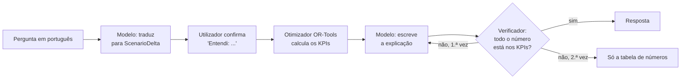
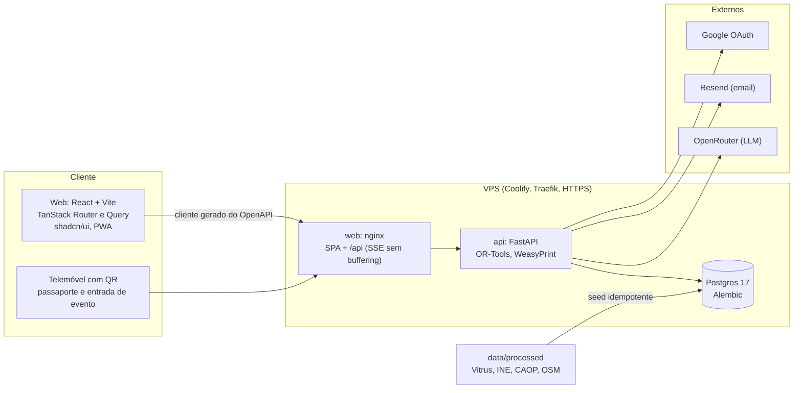

<p align="center">
  <picture>
    <source media="(prefers-color-scheme: dark)" srcset="brand/redes/novelo-banner-2400x450-escuro.png">
    
  </picture>
</p>

# Novelo

**A ferramenta de decisão que desenha a rede de recolha de têxteis de Guimarães ao menor custo.**

Projeto do Desafio 5 (TexVitrus, Vitrus Ambiente) do Hack4Guimarães 2035, por Hélder Gonçalves e Flávio Fernandes.
Em produção em **[novelo.helder.si](https://novelo.helder.si)**. O repositório é público.

O decisor define um orçamento e uma meta de captura. O Novelo devolve cenários comparáveis em euros, toneladas e €/t, calculados por um otimizador
sobre os dados reais da Vitrus, e acompanha cada saco de roupa até à fábrica, do saco ao fio.

## Índice

[O problema](#o-problema) · [Os números](#os-números-que-alimentam-tudo) · [O que o Novelo faz](#o-que-o-novelo-faz) · [IA](#ia-com-rédea-curta) · [Dados](#dados-e-regra-zero) · [Arquitetura](#arquitetura) · [Stack](#stack) · [Arrancar](#arrancar) · [Testes](#testes-e-qualidade) · [Estrutura](#estrutura-do-repositório) · [Produção](#produção-e-deploy) · [Segurança e RGPD](#segurança-e-rgpd) · [Marca](#marca) · [Hackathon](#hackathon-equipa-e-critérios) · [Limitações](#limitações-conhecidas-e-roteiro) · [Documentação](#documentação)

## O problema

Em 2025 a Vitrus recolheu 43 051 t de resíduos urbanos em Guimarães. Segundo a APA, 5,4% disso é têxtil: cerca de 2 324,8 t por ano que vão para o lixo (estimativa).
A recolha seletiva de têxteis é obrigatória desde 1 de janeiro de 2025 e, até 17 de abril de 2028, cada Estado-Membro tem de criar um regime em que os produtores
pagam a recolha, a triagem e a reciclagem das peças postas à venda a partir da lei nacional (Diretiva (UE) 2025/1892, art. 22.º-A, n.º 11 e 14); o têxtil que já está
nas casas continua anos a pesar no município. O concelho tem 156 830 habitantes (INE, Censos 2021) dispersos por 48 freguesias, o que
encarece o porta a porta. Contentores de têxtil também não são resposta: a Vitrus não os tem nem os quer, porque o têxtil de contentor chega contaminado e perde a reutilização.

A pergunta da Vitrus é simples: **como recolher mais têxtil reutilizável e reciclável com o menor investimento e o menor custo de operação?**
O Novelo responde com a camada de decisão: onde investir, que modo de recolha usar em cada zona e quanto custa cada tonelada.

## Os números que alimentam tudo

Os valores da Vitrus e do INE vêm dos ficheiros recebidos (ver [análise dos dados recebidos](docs/dados/analise-dados-recebidos.md)). O que é cálculo nosso ou
depende de um pressuposto leva "estimativa". Nada é inventado: sem fonte, não entra.

| Facto | Valor | Origem |
| --- | --- | --- |
| Têxtil recolhido em 2025 (4 entidades) | **301,3 t**, 0,16 kg por habitante e mês (1,92 kg por habitante e ano) | Vitrus (`dados_textil.xlsx`); duas das quatro entidades enviaram percentagens, não quilos, por isso o destino é em parte estimativa |
| População do concelho | **156 830** habitantes em 48 freguesias | INE, Censos 2021 (soma das freguesias) |
| Destino do recolhido | 59,4% reutilização, 26,5% reciclagem, 14,1% rejeito | Vitrus |
| Rede atual | 40 circuitos, 29 viaturas, 82 localidades, 101 turnos por semana | Vitrus (`Circuitos_Viaturas_Guimaraes.xlsx`, semana de 21 a 25/09/2026) |
| RSU recolhido pela Vitrus em 2025 | **43 051 t** | Vitrus (resposta do mentor, 21/10/2026) |
| Têxtil que ainda vai para o lixo | **≈ 2 324,8 t por ano** = 1,235 kg/hab/mês (43 051 × 5,4%) | **Estimativa**; 5,4% de têxtil no RSU vem da APA, indicado pela Vitrus |
| Têxtil gerado | **≈ 2 626,0 t por ano** (2 324,8 + 301,3) | **Estimativa** |
| Captura atual | **≈ 11,5%**; faltam cerca de **2 324,8 t** | **Estimativa** (301,3 ÷ 2 626,0) |
| Referência francesa | 4,27 kg/hab/ano contra 1,92 em Guimarães; meta equivalente de 669,7 t | França: Refashion, fonte secundária, **por verificar**; o resto é cálculo |

**Porque mudou a base (21/10/2026).** Usávamos 0,7 kg/hab/mês de um plano municipal (≈ 1 317 t, captura 22,9%). A Vitrus não conhece esse plano e indicou
os seus próprios números: 43 051 t de RSU e 5,4% de têxtil (APA). As 301,3 t foram recolhidas à parte, fora do RSU, por isso os 5,4% são o têxtil que
ainda se perde ([respostas da Vitrus](docs/dados/analise-dados-recebidos.md#respostas-da-vitrus-de-21-out-2026)). O ecrã mostra sempre "estimativa".

## O que o Novelo faz

Uma história, do saco ao fio: planear a rede, decidir em linguagem natural, seguir cada saco até à indústria e entregar à câmara o dossiê de 2028.

| Funcionalidade | Onde | Em resumo |
| --- | --- | --- |
| **Ponto de partida** | `/` | Os números reais de 2025, a lacuna para o potencial, o destino do recolhido, a comparação com referências e o relógio regulatório |
| **Simulador da rede** | `/simulator` | Orçamento (60 000 € por ano por omissão) e meta entram; saem pontos, modos e rotas. Otimizador OR-Tools: CP-SAT escolhe pontos e modos, VRP faz as rotas, combinando paragem em local existente (sem contentor novo) e recolha a pedido nos circuitos que já passam. O contentor de rua só entra como referência |
| **Cenários e comparação** | `/scenarios` | Cada cenário guarda investimento, custo anual, toneladas, €/t, cobertura e toneladas reutilizáveis (estimativa, com a quota de reutilização de 2025); compara-se lado a lado, com fluxos, referência francesa, robustez e incerteza (tornado e Monte Carlo P10/P50/P90). A fronteira de Pareto aparece no ponto de partida. O separador Cobertura dá a matriz por freguesia e tipo de território da diretiva (art. 22.º-C, n.º 9, b)) |
| **Pressupostos** | `/assumptions` | Cada parâmetro com valor, unidade e origem (Vitrus, plano, pressuposto da equipa) |
| **Piloto de 3 meses** | `/pilot` | Escolhe 2 a 4 freguesias de maior valor de aprendizagem e calcula o piso de sinal: toneladas mínimas para medir o rejeito |
| **Cobertura** | `/coverage` | Parte da população a pé de um ponto de recolha de têxteis, por freguesia. A Vitrus não tem contentores de têxtil (21/10/2026); o ecrã não inventa cobertura |
| **"E se...?"** | no cenário e no copiloto | Pergunta em português; a IA só traduz para uma alteração estruturada e o otimizador faz as contas. Um verificador rejeita números que não venham do otimizador |
| **Copiloto** | `/chat`, painel `⌘K` | Conversa em streaming com 46 ferramentas tipadas, gráficos e tabelas construídos pelo servidor, ações que só correm com confirmação, memória por utilizador, anexos e `@menções` |
| **Triagem por foto** | `/triage` | Controlo de qualidade na entrega. Uma foto da peça e, opcionalmente, outra da etiqueta dão tipo, estado, composição e marca, sempre confirmadas pelo operador. As fotos não são guardadas |
| **Lotes, QR e passaporte** | `/lots`, `/passport/:código` | Cada lote tem código, QR e uma página pública com origem, composição, peso e histórico |
| **Bolsa de fibra** | `/market` | Lotes agregados por fibra, que os recicladores reservam. Prioridade baixa: reciclar custa mais que a fibra virgem (Vitrus), o valor está na reutilização |
| **Evidência por marca** | `/brands` | Quilos por marca e composição, com o tamanho da amostra |
| **Relatório RAP/EPR em PDF** | `/reports` | Custo por tipo de território (TIPAU), toneladas por fibra e destino, cenários, método e fontes |
| **Mapa da rede** | `/map` | Freguesias (CAOP 2019), localidades e camadas dos contentores municipais (não há contentores de têxtil) |
| **Rede municipal** | `/municipal` | 2 751 contentores municipais de indiferenciado, orgânico e seletivo (**não são de têxteis**) em 6 separadores: visão geral, freguesias, locais, candidatos a têxteis, lacunas e qualidade. São a base geográfica: onde o têxtil se perde no lixo e onde a viatura já passa |
| **Dados da Vitrus** | `/circuits`, `/fleet`, `/localities`, `/data-quality` | Circuitos, localidades e alertas de qualidade; a Frota tem calendário da semana tipo (por viatura ou circuito, conflitos reais, exportação `.ics`), mapa e visão geral |
| **Entrada e contas** | `/login`, `/join` | Login por **magic link** (principal), password ou Google; entrada de evento por **QR** como convidado; confirmação de email; administração de utilizadores e convidados |
| **Administração de IA** | `/admin/ai` | Modelo por tarefa, reserva, limites, orçamento mensal e custos |
| **Produto cuidado** | tudo | pt-PT e inglês, tema claro e escuro, PWA instalável feita primeiro para telemóvel, acessibilidade AA, visita guiada na primeira entrada |

Detalhe de cada uma em [docs/engenharia/features.md](docs/engenharia/features.md); o copiloto tem [documento próprio](docs/engenharia/copiloto.md).

## IA com rédea curta

O modelo (via OpenRouter) devolve JSON validado por Pydantic e **nunca faz contas**: todos os números vêm do otimizador ou da base de dados.



- **O que a IA faz:** percebe a pergunta, explica o resultado, descreve o ecrã, lê a etiqueta e a peça nas fotos, propõe a resolução de alertas e escreve o parágrafo do relatório RAP.
- **O que a IA não faz:** contas, nem escrever valores em gráficos e tabelas (o servidor desenha-os a partir dos resultados), nem alterar dados sem um clique de confirmação.
- **Verificador de números** (`ai/verify.py`): rejeita qualquer número do texto que não exista nos resultados de origem; no copiloto, o texto já transmitido é retirado (`retract`) e reescrito uma vez.
- **Custos e travões:** modelo por tarefa e orçamento mensal no painel `/admin/ai`; sem `OPENROUTER_API_KEY` a API arranca e as funcionalidades de IA respondem 503; sem IA, o relatório RAP sai com um texto determinístico.
- **Convidados do evento** têm limites próprios de pedidos por hora e de gasto.

Ver [IA](docs/engenharia/ia.md) e [Copiloto](docs/engenharia/copiloto.md).

## Dados e regra zero

**Regra zero:** os dados recebidos da Vitrus são obrigatórios em tudo o que for número. Um valor ou vem dos ficheiros, ou está em
[dados e modelo](docs/engenharia/dados-e-modelo.md) como pressuposto com fonte, ou leva a etiqueta "estimativa" no ecrã.

| Fonte | O que traz | Estado |
| --- | --- | --- |
| **Vitrus Ambiente** | Têxtil recolhido em 2025 por entidade e destino; circuitos, viaturas, localidades e turnos | Recebido, em uso |
| **Vitrus Ambiente, pacote QGIS de 20/10/2026** | 2 751 contentores **municipais** (indiferenciado, orgânico, seletivo), 2 026 locais e a CAOP 2019 | Recebido; base geográfica do modelo |
| **Vitrus Ambiente, 21/10/2026** | 43 051 t de RSU em 2025; 5,4% de têxtil (APA); não há contentores de têxtil | Recebido, em uso |
| **Vitrus Ambiente** | Custos por recolha e quilómetro (pedidos ao departamento financeiro) | **Por receber** |
| **INE** | População por freguesia (Censos 2021) e tipologia TIPAU | Em uso |
| **CAOP** | Contornos das freguesias (2019, no pacote da Vitrus) | Em uso |
| **OpenStreetMap** | Localidades geocodificadas dos circuitos (Nominatim) | Em uso (69 das 82; mais 10 no centro da freguesia CAOP pelo nome; 79 com freguesia) |

`data/raw/` guarda os originais e nunca se edita; `just etl` gera `data/processed/`; a API importa-os no arranque, de forma idempotente, com a impressão digital (SHA-256) de cada ficheiro.
Sem custos unitários da Vitrus, os custos do simulador são **pressupostos** visíveis em `/assumptions`, e a incerteza é mostrada como resultado (tornado e Monte Carlo), não como nota de rodapé.

## Arquitetura



O contrato é a única fonte de verdade: o FastAPI exporta o `openapi.json` e o hey-api gera o cliente TypeScript, os hooks do TanStack Query e os esquemas Zod.
O web nunca escreve rotas nem tipos à mão; `just check-contract` falha se o contrato e o cliente divergirem. No servidor, cada funcionalidade tem
`router` fino, `service` sem FastAPI e `domain/` só com funções puras testadas à mão. Mais em [arquitetura](docs/engenharia/arquitetura.md).

## Stack

| Camada | Escolha |
| --- | --- |
| API | Python 3.12, FastAPI, SQLAlchemy 2 assíncrono, Alembic, Pydantic v2, uv |
| Otimização | OR-Tools (CP-SAT e VRP), funções puras em `domain/`, sementes fixas e limite de tempo (`SOLVER_TIME_LIMIT_S`) |
| Base de dados | PostgreSQL 17 |
| Web | React 19, Vite, TanStack Router e Query, Tailwind v4, shadcn/ui, MapLibre, ECharts, Paraglide (i18n), vite-plugin-pwa |
| Contrato | OpenAPI e hey-api (cliente, SDK, Zod, React Query) |
| IA | OpenRouter, saída estruturada validada por Pydantic, prompts versionados em `apps/api/src/novelo/ai/prompts/` |
| Autenticação | argon2, JWT em cookies HttpOnly, magic link, Google OAuth |
| Email | Resend (em dev os emails vão para o log) |
| PDF | WeasyPrint com as fontes da marca |
| Qualidade | Ruff, mypy strict, pytest, Biome, TypeScript strict, Vitest, Playwright |
| Deploy | Docker Compose no Coolify, domínio único com HTTPS |

## Arrancar

Requisitos: Docker, [just](https://github.com/casey/just), Node 22 com pnpm, [uv](https://docs.astral.sh/uv/) e, para o PDF fora do Docker, o Pango (`brew install pango`).

```bash
just setup      # cria o .env e instala as dependências
just dev        # stack completa com hot reload (Docker)
```

| Serviço | URL |
| --- | --- |
| Web | http://localhost:3190 |
| API e documentação | http://localhost:8190/api/docs (só em desenvolvimento) |
| Postgres | `localhost:5590` |

**Credenciais de desenvolvimento** (definidas no `.env.example`, nunca usar em produção):

| O quê | Valor |
| --- | --- |
| Administrador | `admin@heldergoncalves.io` com a password `admin-novelo-dev-1` (`/login?method=password`) |
| Entrada por QR | http://localhost:3190/join?c=novelo-dev (o código `novelo-dev` só existe em desenvolvimento) |
| Emails (magic link, recuperar password, confirmação) | não saem: aparecem em `just logs api` |

Sem `OPENROUTER_API_KEY` as funcionalidades de IA respondem 503; o resto funciona. As variáveis estão descritas em [ambiente](docs/engenharia/ambiente.md).

Comandos (`just` sem argumentos lista tudo):

| Comando | O que faz |
| --- | --- |
| `just dev` / `just down` | Sobe / para a stack de desenvolvimento (`down -v` apaga a base de dados) |
| `just check` | `check-api`, `check-web`, `check-brand` e `check-contract`. Corre localmente; tem de passar antes de cada push |
| `just gen` | Regenera `openapi.json` e o cliente TypeScript sempre que a API muda |
| `just etl` | Converte os Excel e o pacote QGIS de `data/raw` em `data/processed` |
| `just seed` | Importa `data/processed` para a base de dados (idempotente; corre sozinho no arranque da API) |
| `just fix` | Formata e corrige o que o lint conseguir |
| `just migration "msg"` / `just migrate` | Migrações Alembic |
| `just brand` / `just check-brand` | Regenera os assets da marca / mede o alinhamento do logótipo |
| `just eval-copilot` / `just eval-triage` | Avaliações com o modelo real (precisam de `OPENROUTER_API_KEY`) |
| `just build` | Constrói as imagens de produção |
| `just logs [serviço]` | Logs da stack de desenvolvimento (aqui aparecem os emails) |
| `just ui <componentes>` | Adiciona componentes shadcn/ui |
| `just api`, `just web`, `just db` | Fora do Docker |

## Testes e qualidade

`just check` é a barreira antes de cada push (não há integração contínua remota por agora). Contagens a 20 de outubro de 2026:

| Área | O que corre |
| --- | --- |
| API | **536 testes** de pytest (funções puras do `domain/`, rotas, autenticação e magic link, otimizador, relatório, copiloto com modelo falso, importação municipal), com Ruff e mypy strict limpos |
| Web | **157 testes** de Vitest (formatação, erros tipados, DataTable, separadores, copiloto, agenda da frota, QR); Biome e `tsc` |
| Ponta a ponta | **162 testes** de Playwright em 25 ficheiros, contra a stack de `just dev`, em desktop e telemóvel (`pnpm exec playwright test` em `apps/web`; não fazem parte do `just check`) |
| Contrato | `just check-contract` falha se `openapi.json` ou o cliente gerado estiverem desatualizados |
| Marca | `just check-brand` mede o logótipo em píxeis (tolerância de 0,5 px a 512 px) |
| IA | `just eval-copilot`: 78 casos em pt-PT e en; a última corrida publicada (67 casos, antes dos casos municipais) aprovou todos ([avaliação](docs/engenharia/avaliacao-copiloto.md)) |

A exatidão da triagem por foto **ainda não foi medida**: não há imagens de teste com verdade-terreno ([avaliação da triagem](docs/engenharia/avaliacao-triagem.md)).

## Estrutura do repositório

```
apps/api/            FastAPI (src/novelo/{core,features,domain,adapters,ai}), migrações e testes
apps/web/            React + Vite. src/client é gerado; src/components/data-table é a tabela única do produto
data/raw|processed/  Excel e pacote QGIS recebidos | CSV, JSON e GeoJSON limpos (gerados)
docs/                projeto/ · pesquisa/ · engenharia/ · dados/ · marca/ (só Markdown)
brand/               símbolo, logotipos, fontes, avatares e redes (gerados por `just brand`)
scripts/             etl/, brand/, eval_*.py e export_openapi.py
.claude/             agentes e skills partilhados (Claude Code, GLM/Z.ai, ZCode)
openapi.json         contrato exportado e versionado
docker-compose.yml   produção (Coolify) · docker-compose.dev.yml desenvolvimento
```

## Produção e deploy

Cada push para `main` é construído e posto no ar pelo Coolify, a partir de `docker-compose.yml`, numa VPS, em **novelo.helder.si**. É um só domínio: o Traefik do Coolify
dá o HTTPS e o nginx do contentor `web` serve a SPA e encaminha `/api` (com locations próprias para o stream do copiloto e para os anexos). A API arranca com
`alembic upgrade head` e o seed idempotente. Em produção, `/api/docs` e `/api/openapi.json` estão desligados e a `SECRET_KEY` tem de ter 32 ou mais caracteres.
Se o webhook automático falhar, o deploy faz-se à mão a partir do Coolify. Passo a passo, variáveis, operação e diagnóstico em [deploy](docs/engenharia/deploy.md).

## Segurança e RGPD

- **Sessão:** passwords com argon2id; JWT em cookies HttpOnly com rotação do token de renovação; tokens de uso único (magic link, recuperar password, confirmar email) guardados só como SHA-256.
- **Sem sondar contas:** o magic link e a recuperação de password respondem sempre 204; os limites de pedidos protegem as rotas sensíveis (em memória, por processo).
- **Papéis:** `admin`, `operator` e `guest` (convidado do evento: sem gestão de utilizadores, sem administração de IA, sem apagar dados, sem ações de risco alto, com limites de IA e de otimizador).
- **Entrada por QR:** pede nome e email, regista a data e a versão do consentimento e só fica ativa em produção se `QUICK_JOIN_CODE` estiver definido. Texto público em `/privacy`.
- **Fotografias da triagem:** reduzidas, enviadas ao modelo, processadas e descartadas; guardam-se só tipo, estado, composição, marca e peso. Nunca há dados de quem entregou a peça.
- **IA:** o registo de uso guarda tarefa, modelo, tokens, custo e latência, nunca prompts, imagens nem respostas. Anexos do copiloto são validados pelo conteúdo e tratados como dado, não como ordem; as memórias são varridas contra injeção de prompt.
- **Direitos:** cada utilizador exporta e apaga os seus dados do copiloto (`/chat`, Definições), e escolhe a retenção.
- **Dados municipais:** os nomes dos estabelecimentos produtores só saem a um `admin`, e nunca pelo copiloto.
- **Segredos:** só em variáveis de ambiente (Coolify em produção); `.env` nunca vai para o Git.

## Marca

Identidade calma e editorial: Linho, Tinta e Floresta, Newsreader nos títulos e Inter no texto (ambas SIL Open Font License). O símbolo são três fios quase fechados à volta de um ponto.
`just brand` gera todos os assets a partir de uma só geometria, incluindo os fundos em **dither** (pontos de meio-tom, ver [linguagem dither](docs/marca/linguagem-dither.md)), as imagens de partilha e os banners. Ver [guia de marca](docs/marca/guia-de-marca.md), a [direção da landing](docs/marca/landing-direcao.md) e os textos da [página do projeto](docs/marca/descricao.md).

## Hackathon, equipa e critérios

Hélder Gonçalves e Flávio Fernandes. O Hack4Guimarães 2035 avalia quatro critérios (fonte: FAQ oficial, ver [critérios](docs/projeto/criterios-de-avaliacao.md)):

| Critério | Peso | Onde o Novelo responde |
| --- | --- | --- |
| Inovação e originalidade | 25% | IA que conduz o otimizador sem fazer contas; do saco ao fio numa só ferramenta |
| Viabilidade técnica | 25% | Em produção, dados reais, pressupostos à vista, testes e contrato verificado |
| Impacto e relevância | 30% | 301,3 t reais, 2 324,8 t estimadas ainda no lixo, RAP criada até abril de 2028 |
| Apresentação e potencial de continuidade | 20% | Demo de dois minutos e pedido de um piloto de 3 meses em duas freguesias |

Submissão até 23 de outubro às 17h30; pitches a 26 de outubro.

## Limitações conhecidas e roteiro

Honestidade primeiro: o que o Novelo ainda não sabe ou não faz.

| Limitação | Efeito | Próximo passo |
| --- | --- | --- |
| Sem custos unitários da Vitrus (recolha, quilómetro, vida útil) | €/t e custos dependem de pressupostos; mostramos o intervalo (P10-P90) | Pedidos ao departamento financeiro da Vitrus; substituir em `/assumptions` |
| 5,4% de têxtil no RSU é uma média da APA, não uma caracterização local | Procura de 2 324,8 t e captura de 11,5% são estimativa | Caracterização do lixo por circuito |
| Taxas de captura por modo sem dados locais | Todas são pressuposto (já não há contentor de rua para calibrar) | Piloto de 3 meses |
| Exatidão da triagem por foto por medir | Sem verdade-terreno | `just eval-triage` com 30 ou mais peças |
| Distâncias em linha reta com fator de desvio 1,3 | Rotas aproximadas; a variável `OSRM_URL` existe mas **não há cliente OSRM** | Integrar um motor de rotas |
| Peso das peças por tabela de pesos médios por tipo | KPI "estimativa" | Balança nos pontos do piloto |
| Códigos de zona `0308U1` a `0308U5` provisórios | Ligação por nome às freguesias CAOP | Validar com o INE |
| Planeamento da Frota é "semana tipo" | Sem datas nem horas reais | Dados de operação da Vitrus |
| Limites de pedidos em memória, por processo | Com vários processos os limites multiplicam-se | Armazenar num serviço partilhado |
| Estado "A correr o otimizador..." do copiloto não mostra o progresso real do solver | Só uma indicação | Eventos de progresso |
| `DataTable` pagina em blocos, sem virtualização de linhas | Tabelas com milhares de linhas gastam memória no navegador | Virtualização |
| Agente semanal de operações (recalibra a captura com os lotes) | Não iniciado | Depois do hackathon |
| Sem integração contínua remota | `just check` corre só localmente | Quando houver tempo |

## Documentação

Índice completo em [docs/README.md](docs/README.md).

| Para quê | Onde |
| --- | --- |
| Perceber o projeto | [Visão geral](docs/projeto/visao-geral.md), [proposta](docs/projeto/proposta.md), [estratégia](docs/projeto/estrategia-para-ganhar.md), [critérios](docs/projeto/criterios-de-avaliacao.md) |
| Pitch e júri | [Narrativa](docs/projeto/narrativa-do-pitch.md), [slides](docs/projeto/pitch-slides.md), [perguntas do júri](docs/projeto/perguntas-do-juri.md), [cenários e contingências](docs/projeto/cenarios-e-contingencias.md), [visualizações por página](docs/projeto/visualizacoes-por-pagina.md) |
| Falar com mentores e Vitrus | [Perguntas aos orientadores](docs/projeto/perguntas-aos-orientadores.md), [mentores](docs/projeto/mentores.md) |
| Provas | [Pesquisa](docs/pesquisa/README.md), [registo de afirmações](docs/pesquisa/registo-de-afirmacoes.md) |
| Construir | [Arquitetura](docs/engenharia/arquitetura.md), [funcionalidades](docs/engenharia/features.md), [dados e modelo](docs/engenharia/dados-e-modelo.md), [IA](docs/engenharia/ia.md), [copiloto](docs/engenharia/copiloto.md), [ambiente](docs/engenharia/ambiente.md), [deploy](docs/engenharia/deploy.md), [backlog](docs/engenharia/backlog.md) |
| Dados recebidos | [Análise dos dados](docs/dados/analise-dados-recebidos.md), [contentores municipais](docs/dados/analise-contentores-municipais.md) |
| Trabalhar com agentes | [AGENTS.md](AGENTS.md), [CLAUDE.md](CLAUDE.md), [workflow](docs/engenharia/workflow-ia.md) |

## Créditos e licença

Dados da Vitrus Ambiente, INE (Censos 2021 e tipologia TIPAU), CAOP e OpenStreetMap; APA (percentagem de têxtil no RSU).
Tipografia: Inter e Newsreader (SIL Open Font License). Direitos reservados à equipa até decisão em contrário; o repositório é público (verificado a 20 de outubro de 2026) mas não tem ficheiro de licença. A fotografia do hero da landing é CC BY-SA 4.0 (`apps/web/public/landing/CREDITS.md`).
