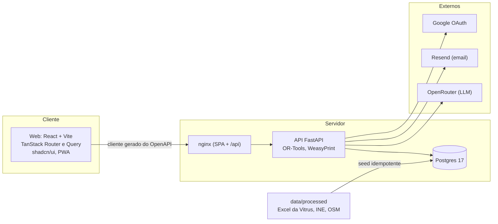

<p align="center">
  
</p>

# Novelo

**A ferramenta de decisão que desenha a rede de recolha de têxteis de Guimarães ao menor custo.**

Projeto do Desafio 5 (TexVitrus, Vitrus Ambiente) do Hack4Guimarães 2035, por Hélder Gonçalves e Flávio Fernandes.
Em produção em **[novelo.bitsapiens.io](https://novelo.bitsapiens.io)**.

O decisor define um orçamento e uma meta de captura. O Novelo devolve cenários comparáveis em euros, toneladas e €/t, calculados por um otimizador
sobre os dados reais da Vitrus, e acompanha cada saco de roupa até à fábrica, do saco ao fio.

## O problema

Em Guimarães, 5,4% do lixo indiferenciado é têxtil. A recolha seletiva é obrigatória desde 2025 e, a partir de 17 de abril de 2028, os produtores
passam a pagar (Diretiva (UE) 2025/1892). O concelho tem 156 830 habitantes dispersos por 48 freguesias. A pergunta da Vitrus é simples:
**como recolher mais têxtil reutilizável e reciclável com o menor investimento e o menor custo de operação?**

## Os números reais que alimentam tudo

Todos vêm dos ficheiros da Vitrus e do INE (ver [análise dos dados recebidos](docs/dados/analise-dados-recebidos.md)). Nada é inventado: o que não tem fonte leva a etiqueta "estimativa".

| Facto | Valor |
| --- | --- |
| Têxtil recolhido em 2025 (4 entidades) | **301,3 t** (0,16 kg por habitante e mês) |
| População do concelho (soma das freguesias, INE) | **156 830** habitantes |
| Potencial estimado (0,7 kg/hab/mês) | **≈ 1 317 t por ano** |
| Captura atual | **≈ 22,9%** do potencial, faltam cerca de 1 016 t |
| Destino do recolhido | 59,4% reutilização, 26,5% reciclagem, 14,1% rejeito |
| Rede atual | 40 circuitos, 29 viaturas, 82 localidades servidas |

## O que o Novelo faz

| Funcionalidade | Em resumo |
| --- | --- |
| **Simulador da rede** | Otimizador com OR-Tools (CP-SAT para a escolha de pontos e modos, VRP para as rotas), combinando três modos: contentor de rua, ponto em local existente e recolha a pedido aproveitando os circuitos já existentes |
| **Cenários e comparação** | Guarda cada cenário com investimento, custo anual, toneladas, €/t e cobertura; compara dois lado a lado |
| **"E se...?" em português** | O decisor pergunta em linguagem natural; a IA só traduz para uma alteração estruturada e o otimizador faz as contas. Um verificador rejeita qualquer número da explicação que não venha do otimizador |
| **Triagem por foto** | Duas fotos (peça e etiqueta) dão tipo, estado, composição e marca, sempre confirmadas pelo operador. As fotos não são guardadas |
| **Lotes, QR e passaporte** | Cada lote tem código, QR e uma página pública com origem, composição, peso e histórico |
| **Bolsa de fibra** | Lotes agregados por fibra, que os recicladores reservam |
| **Evidência por marca** | Quilos por marca e composição, com o tamanho da amostra |
| **Relatório RAP/EPR em PDF** | Custo por tipo de território (TIPAU), toneladas por fibra e destino, cenários, método e fontes |
| **Mapa da rede** | Freguesias, localidades e, a partir de 20 de outubro de 2026, os contentores |
| **Dados da Vitrus** | Circuitos, frota, localidades e alertas de qualidade, com pesquisa, filtros, ordenação, colunas visíveis e paginação |
| **Conta completa** | Login, registo, Google, confirmação de email, recuperar password, "manter sessão iniciada", administração de utilizadores |
| **Produto cuidado** | Português (pt-PT) e inglês, tema claro e escuro, PWA instalável e pensada primeiro para telemóvel, acessibilidade AA |

Detalhe de cada uma em [docs/engenharia/features.md](docs/engenharia/features.md).

## Arquitetura



O contrato é a única fonte de verdade: o FastAPI exporta o `openapi.json` e o hey-api gera o cliente TypeScript, os hooks do TanStack Query e os esquemas Zod.
O web nunca escreve rotas nem tipos à mão. Mais em [docs/engenharia/arquitetura.md](docs/engenharia/arquitetura.md).

## Stack

| Camada | Escolha |
| --- | --- |
| API | Python 3.12, FastAPI, SQLAlchemy 2 assíncrono, Alembic, Pydantic v2, uv |
| Otimização | OR-Tools (CP-SAT e VRP), funções puras em `domain/` |
| Base de dados | PostgreSQL 17 |
| Web | React, Vite, TanStack Router e Query, Tailwind v4, shadcn/ui, MapLibre, Paraglide (i18n), vite-plugin-pwa |
| Contrato | OpenAPI e hey-api (cliente, SDK, Zod, React Query) |
| IA | OpenRouter, saída estruturada validada por Pydantic, prompts versionados |
| Email | Resend (em dev, os emails aparecem no log) |
| PDF | WeasyPrint com as fontes da marca |
| Qualidade | Ruff, mypy strict, pytest, Biome, TypeScript strict, Vitest, Playwright |
| Deploy | Docker Compose no Coolify, domínio único com HTTPS |

## Arrancar

Requisitos: Docker, [just](https://github.com/casey/just), Node 22 com pnpm, [uv](https://docs.astral.sh/uv/) e, para o PDF fora do Docker, o Pango (`brew install pango`).

```bash
just setup      # cria o .env e instala as dependências
just dev        # stack completa com hot reload
```

| Serviço | URL |
| --- | --- |
| Web | http://localhost:3190 |
| API e documentação | http://localhost:8190/api/docs |
| Postgres | `localhost:5590` |

Em desenvolvimento existe um administrador: `admin@bitsapiens.io` com a password `admin-novelo-dev-1` (definido no `.env`). Os emails de recuperar password e confirmação
aparecem em `just logs api`. As variáveis estão descritas em [docs/engenharia/ambiente.md](docs/engenharia/ambiente.md).

| Comando | O que faz |
| --- | --- |
| `just check` | Lint, tipos, testes e verificação do contrato. Corre localmente; tem de passar antes de cada push |
| `just gen` | Regenera `openapi.json` e o cliente TypeScript sempre que a API muda |
| `just etl` | Converte os Excel de `data/raw` em `data/processed` |
| `just fix` | Formata e corrige o que o lint conseguir |
| `just migration "msg"` / `just migrate` | Migrações Alembic |
| `just build` | Constrói as imagens de produção |

## Dados e ETL

Os Excel recebidos ficam em `data/raw/` e nunca se editam. `just etl` limpa-os para CSV e JSON em `data/processed/`; a API importa-os para o Postgres no arranque
(idempotente), juntamente com a geografia pública (freguesias da CAOP, população do INE, tipologia TIPAU, localidades geocodificadas a partir do OpenStreetMap).
As localizações dos contentores chegam a 20 de outubro de 2026 e entram pelo mesmo fluxo. Ver [dados e modelo](docs/engenharia/dados-e-modelo.md).

## IA com rédea curta

O modelo (via OpenRouter) devolve JSON validado por Pydantic e **nunca faz contas**: todos os números vêm do otimizador ou da base de dados, e um verificador rejeita
explicações com números que não existam nos factos. Sem `OPENROUTER_API_KEY` a API arranca e as funcionalidades de IA respondem 503. Ver [docs/engenharia/ia.md](docs/engenharia/ia.md).

## Testes

- **API:** 76 testes de pytest (funções puras do `domain/`, rotas, autenticação, otimizador, relatório), com Ruff e mypy strict limpos.
- **Web:** Vitest (formatação, erros tipados) e 27 testes Playwright ponta a ponta contra a stack de desenvolvimento, em desktop e telemóvel.
- **Contrato:** `just check-contract` falha se o `openapi.json` ou o cliente gerado estiverem desatualizados.

## Deploy

Cada push para `main` é construído e posto no ar pelo Coolify, a partir de `docker-compose.yml`, em **novelo.bitsapiens.io** (um só domínio: o nginx do web serve a SPA e encaminha `/api`).
Passo a passo e variáveis em [docs/engenharia/deploy.md](docs/engenharia/deploy.md). Por agora não há integração contínua remota: `just check` corre localmente antes de cada push.

## Estrutura do repositório

```
apps/api/            FastAPI (src/novelo/{core,features,domain,adapters,ai}), migrações e testes
apps/web/            React + Vite. src/client é gerado; src/components/data-table é a tabela única do produto
data/raw|processed/  Excel recebidos | CSV e JSON limpos (gerados)
docs/                projeto/ · pesquisa/ · engenharia/ · dados/ · marca/ (só Markdown)
brand/               símbolo, logotipos, fontes e avatares
scripts/             etl/ e export_openapi.py
.claude/             agentes e skills partilhados (Claude Code, GLM/Z.ai, ZCode)
openapi.json         contrato exportado e versionado
```

## Documentação

Estratégia e pitch em [docs/projeto/estrategia-para-ganhar.md](docs/projeto/estrategia-para-ganhar.md) e [docs/projeto/narrativa-do-pitch.md](docs/projeto/narrativa-do-pitch.md); pesquisa e fontes em [docs/pesquisa/](docs/pesquisa/README.md). Índice completo em [docs/README.md](docs/README.md). Para trabalhar com agentes de código: [AGENTS.md](AGENTS.md), [CLAUDE.md](CLAUDE.md) e [docs/engenharia/workflow-ia.md](docs/engenharia/workflow-ia.md).

## Equipa e créditos

Hélder Gonçalves e Flávio Fernandes, com dados da Vitrus Ambiente, INE (Censos 2021 e tipologia TIPAU), CAOP e OpenStreetMap, e o Plano de Ação Integrado para a Circularidade
Têxtil de Guimarães (Município de Guimarães / URBACT). Tipografia: Inter e Newsreader (SIL Open Font License). Direitos reservados à equipa até decisão em contrário.
