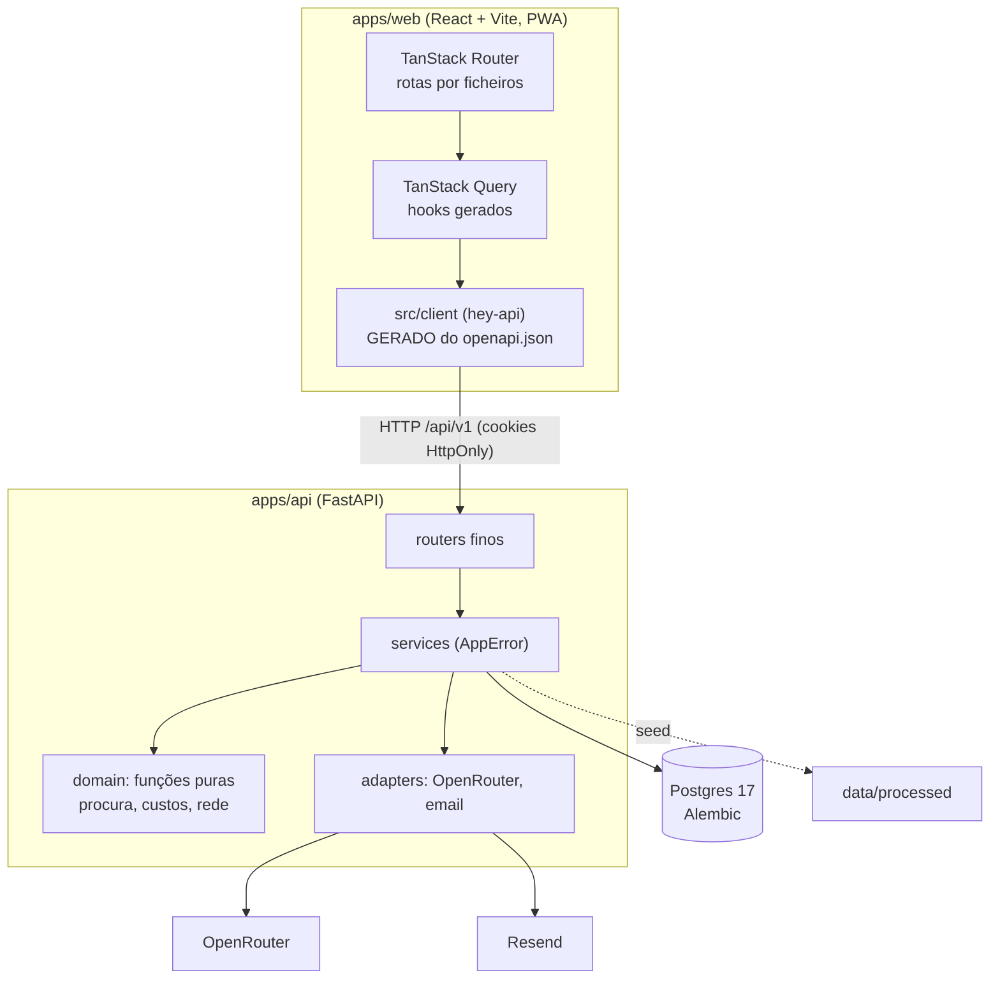

# Arquitetura

Um monorepo com duas aplicações, uma base de dados e três serviços externos. O web fala só com a API; só a API toca em dados e serviços.



## Stack e repositório

| Camada | Escolha | Porquê |
| --- | --- | --- |
| API | Python 3.12, FastAPI, SQLAlchemy 2 assíncrono, Pydantic v2, uv | Tipagem total e contrato OpenAPI automático |
| Otimização | OR-Tools: CP-SAT para pontos e modos, VRP para rotas | Resolve o problema real, com limite de tempo e sementes fixas |
| Base de dados | PostgreSQL 17, migrações Alembic | Escala, integridade e consultas simples |
| Web | React, Vite, TanStack Router e Query, Tailwind v4, shadcn/ui | SPA rápida; a API é a única fonte de dados |
| Mapa | MapLibre com estilos CARTO por omissão | Sem chave |
| i18n | Paraglide, pt-PT e inglês, prefixo de língua no URL | Mensagens tipadas, compiladas |
| PWA | vite-plugin-pwa (autoUpdate); a API nunca fica em cache | Instalável, boa em telemóvel |
| IA | OpenRouter com saída estruturada | Um fornecedor, vários modelos ([IA](ia.md)) |
| PDF | WeasyPrint com as fontes da marca | Relatório RAP |
| Deploy | Docker Compose no Coolify | Um push, um deploy ([Deploy](deploy.md)) |

```
apps/api/src/novelo/
  core/        config, base de dados, erros tipados, segurança, limites de pedidos
  features/    auth · users · textile · network · datasets · planning · lots · reports · health
  domain/      procura, custos, geografia, rede: só funções puras
  adapters/    OpenRouter e email (Resend ou log)
  ai/          prompts versionados e verificador de números
apps/web/src/
  routes/      rotas por ficheiros (_app/* exige sessão)
  features/    ecrãs por funcionalidade
  components/  ui (shadcn), data-table, page, states, sticky-actions, layout
  client/      GERADO
  lib/         formatação, erros, i18n, tema, vocabulário
```

## API

Todas as rotas vivem sob `/api/v1`. Os routers não têm prefixo; aplica-se no `main.py`. As rotas de dados são autenticadas; o passaporte do lote (`/api/v1/public/lots/{code}`) é público para o QR abrir sem sessão.

| Grupo | Exemplos |
| --- | --- |
| `auth` | `login`, `register`, `refresh`, `logout`, `me`, `verify-email`, `forgot-password`, `reset-password`, `change-password`, Google, `config` |
| `users` | listar e alterar papel e estado (só administradores) |
| `textile` | `baseline`, `flows`, `waste` |
| `network` | `circuits`, `fleet`, `localities`, `containers` |
| `datasets` | `quality`, resolver e reabrir alertas |
| `planning` | `parameters`, `zones`, `scenarios` (criar, listar, ler, renomear, apagar, fluxos) |
| `whatif` | criar, aplicar e listar perguntas "E se...?" |
| `lots` | lotes, itens, estado, `triage`, `market` e reservas, `brands` |
| `reports` | `rap` (gera o PDF), listar, `{id}/pdf` |

Erros no formato `{code, message, details}` com um `ErrorCode` tipado, publicado no OpenAPI; `apps/web/src/lib/errors.ts` traduz cada código de forma exaustiva.

## Contrato OpenAPI e cliente gerado

1. O FastAPI define o contrato; o `operationId` é o nome da função Python (`list_zones`, `create_scenario`).
2. `just gen` exporta `openapi.json` (`scripts/export_openapi.py`) e corre o hey-api (`apps/web/openapi-ts.config.ts`): cliente fetch, SDK, esquemas Zod e hooks do React Query.
3. O web usa `xxxOptions()` e `xxxMutation()` de `@/client/@tanstack/react-query.gen`. Nunca há `fetch` à mão, nem rotas ou tipos escritos à mão.
4. O `authFetch` renova a sessão em silêncio quando o token de acesso expira.
5. `just check-contract` regenera tudo e falha se `openapi.json` ou `src/client` mudarem. O cliente gerado é versionado de propósito.

## Base de dados

Postgres com migrações Alembic (`apps/api/alembic`). Tabelas por domínio:

| Domínio | Tabelas |
| --- | --- |
| Contas | `users`, `refresh_tokens`, `password_reset_tokens`, `email_verification_tokens` (tokens guardados como hash) |
| Têxtil | `textile_entities`, `textile_flows`, `waste_shares` |
| Rede | `parishes`, `localities`, `vehicles`, `circuits`, `circuit_days`, `circuit_localities`, `shift_assignments`, `fleet_capacity`, `containers` |
| Dados | `data_sources`, `data_alerts` |
| Planeamento | `parameter_sets`, `scenarios`, `whatif_runs` |
| Operação | `lots`, `lot_items`, `lot_events`, `lot_reservations`, `reports` |

`data/processed` é importado no arranque da API de forma idempotente (`just seed` também o faz). Os ficheiros de origem ficam registados com impressão digital.

## Autenticação

Palavras-passe com argon2; JWT em cookies HttpOnly com rotação do token de renovação; "manter sessão iniciada" alonga a validade (`REFRESH_TOKEN_EXPIRE_DAYS` contra `SESSION_TOKEN_HOURS`). Confirmação de email e recuperar password usam tokens de uso único guardados como hash; os emails saem pelo Resend (ou pelo log em dev). Google OAuth. Limites de pedidos nas rotas sensíveis. O primeiro administrador é criado no arranque a partir de `ADMIN_EMAIL` e `ADMIN_PASSWORD`.

## Web

- **Rotas** em `src/routes/`; dados nos `loader` com `queryClient.ensureQueryData`; estado partilhável no URL com `validateSearch`.
- **Estados obrigatórios** em todo o ecrã de dados: a carregar (skeleton), vazio, erro, sucesso (`components/states.tsx`).
- **DataTable** (`components/data-table/`): a mesma tabela em todo o produto. Em ecrãs largos é uma tabela; em telemóvel é uma lista de cartões. Cada coluna declara `cell` e, opcionalmente, `value` (para ordenar, pesquisar e filtrar), `filter`, `sortable`, `searchable`, `hideable` e `defaultHidden`. Traz pesquisa que ignora acentos, filtros por coluna com contagens, ordenação, menu de colunas, paginação (10, 25, 50 ou 100 linhas) e memória das escolhas por tabela.
- **Layout** com `Page` e `Section`, `PageHeader`, `StatStrip`, `StickyActions` (barra de ações fixa em telemóvel) e `OfflineBanner`.
- **Telemóvel primeiro:** áreas de toque de pelo menos 40 px, campos a 16 px (sem zoom no iOS), margens de segurança, diálogos que abrem como folha inferior.
- **Tema, língua e tipografia:** claro e escuro, pt-PT e inglês; Inter no texto e Newsreader nos títulos; tokens da marca em [Guia de marca](../marca/guia-de-marca.md).

## Boas práticas

**Python.** Feature-based (`router`, `service`, `models`, `schemas`); services sem FastAPI levantam `AppError`; `domain/` só com funções puras, testadas com valores calculados à mão; I/O externo só em `adapters/`; `mypy --strict` e Ruff limpos; rotas que chamam OR-Tools são `def` com limite de tempo (`SOLVER_TIME_LIMIT_S`); nunca editar uma migração já aplicada.

**TypeScript.** `strict` e `noUncheckedIndexedAccess`, Biome, sem `any`; componentes sem lógica de negócio; números em pt-PT com unidade (`lib/format.ts`); acessibilidade AA e uso total por teclado.

## Qualidade

`just check` corre localmente e é a barreira antes de cada push.

| Área | Ferramentas |
| --- | --- |
| Python | Ruff (lint e formato), mypy strict, pytest (76 testes) |
| TypeScript | Biome, `tsc --noEmit`, Vitest |
| Contrato | `just gen` e `git diff --exit-code` em `openapi.json` e `src/client` |
| Ponta a ponta | Playwright (`pnpm exec playwright test` em `apps/web`) contra a stack de `just dev` |
| Imagens | `just build` constrói as duas imagens de produção |

Por agora não há integração contínua remota. O fluxo é: `just check` verde, commit em Conventional Commits e push direto para `main`, que o Coolify publica.
