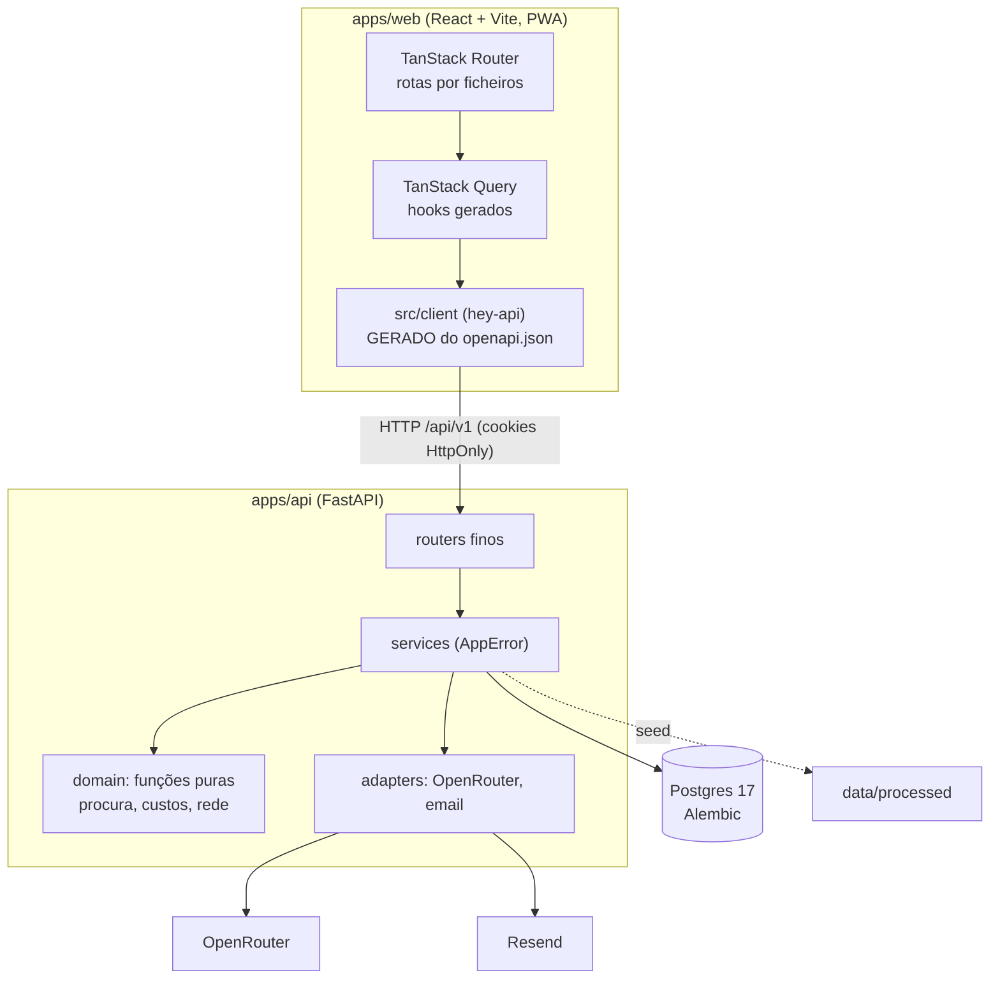

# Arquitetura

Um monorepo com duas aplicações, uma base de dados e três serviços externos. O web fala só com a API; só a API toca em dados e serviços.



## Stack e repositório

| Camada | Escolha | Porquê |
| --- | --- | --- |
| API | Python 3.12, FastAPI, SQLAlchemy 2 assíncrono, Pydantic v2, uv | Tipagem total e contrato OpenAPI automático |
| Otimização | OR-Tools: CP-SAT para pontos e modos, VRP para rotas | Resolve o problema real, com limite de tempo e sementes fixas |
| Base de dados | PostgreSQL 17, migrações Alembic | Escala, integridade e consultas simples |
| Web | React, Vite, TanStack Router e Query, Tailwind v4, shadcn/ui | SPA rápida; a API é a única fonte de dados |
| Mapa | MapLibre com estilos CARTO por omissão | Sem chave |
| i18n | Paraglide, pt-PT e inglês, prefixo de língua no URL | Mensagens tipadas, compiladas |
| PWA | vite-plugin-pwa (autoUpdate); a API nunca fica em cache | Instalável, boa em telemóvel |
| IA | OpenRouter com saída estruturada | Um fornecedor, vários modelos ([IA](ia.md)) |
| PDF | WeasyPrint com as fontes da marca | Relatório RAP |
| Deploy | Docker Compose no Coolify | Um push, um deploy ([Deploy](deploy.md)) |

```
apps/api/src/novelo/
  core/        config, base de dados, erros tipados, segurança, limites de pedidos, limites de convidados (guest.py)
  features/    auth · users · textile · network · datasets · municipal · planning · lots · reports · ai_admin · copilot · health · dev (só em desenvolvimento)
  domain/      procura, custos, geografia, rede: só funções puras
  adapters/    OpenRouter e email (Resend ou log); o OSRM ainda não tem adaptador
  ai/          prompts versionados, verificador de números, catálogo de modelos, avaliações (triagem, copiloto)
apps/web/src/
  routes/      rotas por ficheiros (_app/* exige sessão)
  features/    ecrãs por funcionalidade
  components/  ui (shadcn), data-table, page, states, sticky-actions, layout
  client/      GERADO
  lib/         formatação, erros, i18n, tema, vocabulário
```

## API

Todas as rotas vivem sob `/api/v1`. Os routers não têm prefixo; aplica-se no `main.py`. As rotas de dados são autenticadas; são públicas só `health`, `ready`, as rotas de entrada (`auth/*`, `quick-join/info`) e o passaporte do lote (`/api/v1/public/lots/{code}` e o seu QR), para o QR abrir sem sessão. Em desenvolvimento há ainda `/api/v1/dev/emails` (fora do OpenAPI) e `/api/docs`; em produção não.

| Grupo | Exemplos |
| --- | --- |
| `auth` | `login`, `register`, `refresh`, `logout`, `logout-all`, `me`, `verify-email`, `resend-verification`, `forgot-password`, `reset-password`, `change-password`, `magic-link` e `magic-link/verify`, `quick-join` (`info`, entrada, `qr`, `guests`), Google (`login`, `callback`), `config` |
| `users` | listar e alterar papel (`admin`, `operator`, `guest`) e estado (só administradores) |
| `textile` | `baseline`, `flows`, `waste`, `overview` |
| `network` | `circuits`, `fleet`, `localities`, `containers` |
| `datasets` | `quality`, resolver e reabrir alertas |
| `municipal` | rede **municipal** de contentores (indiferenciado, orgânico, seletivo; não é têxtil; base geográfica do modelo): `overview`, `parishes`, `sites`, `containers`, `producers`, `textile-candidates`, `gap-ranking`, `density-benchmark`, `export`, GeoJSON (ver [Rede municipal](#rede-municipal-municipal)) |
| `planning` | `parameters`, `zones`, `scenarios` (criar, listar, ler, renomear, apagar, `flows`, `sensitivity`), `compare-robustness`, `benchmarks`, `pilot` |
| `whatif` | criar, aplicar e listar perguntas "E se...?" |
| `lots`, `triage`, `market`, `brands` | `/lots` (abrir, listar, ler, itens, estado), `/triage` (análise de uma peça), `/market` e reservas, `/brands`; público: `/public/lots/{code}` e `/qr` |
| `reports` | `rap` (gera o PDF), listar, `{id}/pdf` |
| `ai` | `settings`, `models`, `usage`, `credits`, `test`, `eval/triage` (só administradores) |
| `copilot` | `stream`, `chat`, `threads`, `history`, `actions`, `artifacts`, `attachments`, `mentions`, `memory`, `settings`, `data` (ver [Copiloto](copiloto.md#endpoints-operationid)) |
| `health` | `health` (processo) e `ready` (base de dados) |

### `GET /api/v1/textile/overview` (`get_overview`)

Um só pedido de leitura para a página inicial; só dados reais da BD ou constantes com fonte e `verified` (`features/textile/references.py`, espelho de `docs/pesquisa/registo-de-afirmacoes.md`). Autenticado como o resto de `textile`.

| Campo | Conteúdo |
| --- | --- |
| `gap` | `potential_t` (estimativa: têxtil por desviar, população × 1,235 kg/hab/mês × 12 = 43 051 t × 5,4% ≈ 2 324,8 t), `collected_t`, `missing_t`, `capture_pct`, `destinations{reuse_t,recycle_t,reject_t}`, `kg_per_inhab_year/month` observados e do potencial, `population`, `parishes_count`, `is_estimate` |
| `references` | `key`, `label`, `kg_per_inhab_year`, `year`, `scope`, `source_label`, `source_url`, `verified`, `evidence`, `is_estimate`. Guimarães hoje e têxtil por desviar (14,82 kg/hab/ano = 43 051 t de RSU × 5,4% da APA ÷ 156 830; dados da Vitrus e da APA, estimativa; a leitura de 0,7 kg/hab/mês do plano municipal, se aparecer, é «leitura alternativa, não usada pela Vitrus»), França 2024 (4,27), UE-27 2020 (4,4), Catalunha 2024 (2,7), Alemanha 2022 (`verified=false`). O web só mostra em público as `verified` |
| `timeline` | `date`, `key`, `status` (`done`/`upcoming`), `days_remaining` (relógio do servidor em UTC, `null` se já passou), `who_pays`, fonte e `verified`: obrigação municipal (1 jan 2025), transposição (17 jun 2027), regimes de RAP (17 abr 2028) |
| `parishes` | por freguesia (ordenadas por população): `code`, `name`, `population`, `tipau`, `potential_t` (estimativa), `circuits_count`, `localities_count`, `containers_count` (ativos; 0 até 20 out), `area_km2` (BD ou calculada do contorno), `centroid{lat,lon}`, `share_of_population_pct` |
| `scenario_frontier`, `pareto_ids` | cenários guardados (até 200) com `tonnes_year`, `eur_per_tonne`, `annual_cost_eur`, `capex_eur`, `modes`, `status` (`feasible`/`infeasible`), `objective`, `is_pareto` (não dominado em menos €/t e mais toneladas, só viáveis) |
| `data_sources` | `key`, `name`, `provider`, `kind`, período, `methods` (`weighed`/`percentage`) e `rows` importadas |
| `highlights` | 4 a 6 manchetes (`key`, `value`, `unit`, `text_key` i18n, `context`, `source_label`, `verified`, `is_estimate`): maior entidade, reutilização, equivalente francês em toneladas, têxtil no indiferenciado (caracterização da Vitrus, não os 5,4% do plano, por verificar), razão e concentração das freguesias |

O relógio injeta-se com `Depends(get_today)` (`dependency_overrides` nos testes); as contas puras estão em `domain/overview.py`.

Erros no formato `{code, message, details}` com um `ErrorCode` tipado, publicado no OpenAPI; `apps/web/src/lib/errors.ts` traduz cada código de forma exaustiva.

### Rede municipal (`/municipal`)

Os contentores **municipais** (profundidade, superfície, orgânico, verdes; 20 de outubro de 2026) vivem em tabelas próprias e **nunca** se misturam com `containers` (têxteis; vazia, porque não há contentores de têxteis). São a base geográfica: onde o têxtil se perde e onde a viatura já passa; servem de camada de locais de paragem, produtores B2B e geometria oficial; o contrato de dados está em [Análise dos contentores municipais](../dados/analise-contentores-municipais.md). Código em `features/municipal/` (`router` fino; `service`/`analytics`/`exports` sem FastAPI; `importer` do seed; `http` com ETag; `domain/municipal.py` com as regras puras).

| operationId | Rota | O que devolve |
| --- | --- | --- |
| `get_municipal_overview` | `GET /municipal/overview` | KPIs: contentores, locais, densidade, cobertura 200/300/500 m (estimativa, de área), qualidade |
| `list_municipal_parishes` / `get_municipal_parish` | `/municipal/parishes`, `/municipal/parishes/{dicofre}` | 48 freguesias; ordenação (`sort`, `order`) e filtros (`q`, `min_population`, `max_containers_per_1000_hab`, `max_cover_pct_300m`, `has_candidates`) |
| `list_municipal_sites` | `/municipal/sites` | Locais; filtros `kind`, `stream`, `parish`, `producer_type`, `site_class`, `textile_candidate`, `coord_suspect`, `coord_precision`, `q` (sem acentos), `bbox`; cursor + `limit` (máx. 500) |
| `get_municipal_sites_geojson` | `/municipal/sites/geojson` | GeoJSON leve por `bbox`/`zoom`, agrupado no servidor por grelha abaixo do zoom 16 (`cluster=false` desliga); gzip |
| `get_municipal_site` | `/municipal/sites/{site_id}` | Local com contentores, relações orgânico-rua, vizinhos a `radius_m` (por omissão 200 m) e freguesia |
| `list_municipal_containers` | `/municipal/containers` | Tabela completa (inclui os 29 pendentes), cursor por `container_uid`, mesmos filtros + `located`, `parish_match`, `brand` |
| `list_municipal_producers` | `/municipal/producers` | Resumo por tipo (contentores, estabelecimentos distintos, freguesias com mais, hipótese de interesse para têxteis) e locais de produtores |
| `get_textile_candidate_sites` | `/municipal/textile-candidates` | Candidatos do ETL com chaves de justificação e ordem explícita (`rank_rule`); o `rank` é sempre o global |
| `get_municipal_gap_ranking` | `/municipal/gap-ranking` | Lacuna por freguesia: **estimativa**, com a regra e os parâmetros (têxtil por desviar, 1,235 kg/hab/mês igual em todas) |
| `get_municipal_density_benchmark` | `/municipal/density-benchmark` | Densidade do concelho, distribuição (mín., p25, mediana, p75, máx.) entre freguesias e a referência francesa (por verificar) |
| `export_municipal_sites` | `/municipal/export?format=csv\|xlsx\|geojson&scope=sites\|containers` | Streaming (CSV e GeoJSON por lotes; XLSX construído em memória e enviado em blocos), mesmos filtros |
| `get_caop_parishes_geojson` | `/municipal/parishes/caop.geojson` | 48 contornos CAOP 2019 com métricas para coroplético |

- **Permissões:** tudo exige sessão; `operator` (e `guest`, quando existir) lê. Os **nomes de estabelecimentos** (`producer_name(s)`) só saem a `admin` com `show_names=true`; qualquer outro papel que o peça recebe 403 `forbidden`, e sem o parâmetro vêm `null`. A pesquisa `q` só procura nos nomes quando eles são visíveis (senão seria um oráculo). O copiloto nunca os mostra, nem a admins.
- **Cache:** `ETag` fraco (`SHA-256 do pacote` + instante da importação + rota, query e papel), `Cache-Control: private` (5 min; 1 h no GeoJSON das freguesias), `If-None-Match` devolve 304 sem consultar a base de dados além da versão. O GeoJSON vai comprimido (gzip) com `Vary: Accept-Encoding`.
- **Contorno CAOP na base de dados** (`municipal_parish_stats.geometry`, JSONB, 147 KB no total) e não servido do ficheiro: o API em produção pode não ter `data/processed` ao lado do código, a geometria fica versionada com as métricas (mesma importação, mesma `source_id`, mesmo ETag) e o resultado já agregado com as métricas é uma só leitura de 48 linhas.
- **Importação:** `seed` chama `features/municipal/importer.py` quando a fonte `vitrus_municipal_containers_2026_10` e os ficheiros existem. É idempotente (upsert por `container_uid`, `site_id`, `dicofre`), apaga o que saiu do ficheiro e importa os 25 alertas `municipal_*` para `data_alerts` (ecrã Qualidade dos dados) sem tocar no estado já decidido. A versão dos dados é o SHA-256 do pacote em `data_sources`.

### Desempenho da API

- **O otimizador nunca corre no event loop.** `planning.run_scenario` lê as zonas, os pressupostos e a base têxtil, e entrega a `compute()` (CP-SAT e VRP, funções síncronas e puras sobre modelos Pydantic, sem sessão nem ORM) numa thread com `asyncio.to_thread`; grava o cenário depois, já de volta ao loop. Como o cenário, o "E se...?", o cenário de referência (benchmark) e as ações e ferramentas do Copiloto passam todos por `run_scenario`, é este o único ponto. Sensibilidade, robustez e piloto já usavam `to_thread`; a fronteira de Pareto do Copiloto também, e passou a ocupar uma vaga de `solver_slots` como as rotas (429 tipado se estiver tudo ocupado). Os limitadores (`SolverGuard`, `SOLVER_MAX_CONCURRENCY`), os limites de tempo e as sementes fixas não mudaram. Prova: `tests/api/test_solver_offload.py` (um solver falso a dormir 1 s não atrasa o loop nem `/health`).
- **Listas sem colunas pesadas.** `GET /reports` faz `defer(pdf, summary)` (o PDF só sai em `/reports/{id}/pdf`). `GET /planning/scenarios` e a fronteira da home (`/textile/overview`) usam as colunas de KPIs e fazem `defer(result, params, constraints)`; a home lê os modos da coluna `scenarios.modes` (derivada de `result.modes`, preenchida ao criar e pela migração `0012` nos cenários antigos). `GET /lots` conta peças e soma pesos em SQL (um só `LEFT JOIN` agregado) em vez de carregar as peças, e `GET /brands` carrega só três colunas. O índice `ix_scenarios_created_at` serve a ordenação. Os filtros de alertas e de utilizadores não pedem índice: os alertas são filtrados no cliente e a tabela `users` é pequena.
- **Cache HTTP partilhada (`core/http_cache.py`).** `ETag` fraco = versão dos dados + caminho + query (+ variante do utilizador quando o conteúdo depende dela, como no municipal), `Cache-Control: private`, `Vary: Cookie, Accept-Encoding`, `If-None-Match` devolve 304 sem fazer o trabalho caro e o gzip dos JSON grandes fica em cache de processo. A versão sai de uma consulta barata (`features/datasets/versioning.py`): `reference_data_version` junta hash e instante de importação de cada `data_sources` (circuitos, frota, contentores, base têxtil, municipal) e `planning_data_version` acrescenta a versão dos pressupostos ativos. Aplicação: dados importados (`textile/baseline|flows|waste`, `network/circuits|fleet|localities|containers|coverage`) com `max-age=300`; dados que dependem dos pressupostos editáveis (`planning/zones`, com a geometria, e `planning/parameters`) com `max-age=0, must-revalidate`, para a edição de um administrador se ver logo e o 304 poupar na mesma as 10 consultas e os 57 KB. Nunca se aplica a dados por utilizador ou que mudam a cada ação (cenários, alertas, lotes, relatórios, home). O municipal usa a mesma utilidade (`municipal/http.py`).
- **Observabilidade.** O registo de cada pedido (`novelo.request`) é JSON com `method`, `route` (o modelo, por exemplo `/api/v1/planning/scenarios/{scenario_id}`, nunca o URL com ids), `status`, `duration_ms` e `request_id`: dá para agregar p50/p95 por rota. Com `LOG_LEVEL=debug` acrescenta `queries`, o número de consultas SQL do pedido, para apanhar N+1 ao ler o log.
- **Testes de desempenho.** `tests/querycount.py` (`capture_sql`) regista o SQL de um bloco; `test_list_performance.py` verifica que as listas não leem `pdf`/`result`, que o número de consultas dos endpoints principais não cresce com as linhas e que a migração `0012` preenche `modes`; `test_http_cache.py` cobre ETag estável, 304, invalidação ao editar pressupostos ou importar dados e que nada é `public`.

## Contrato OpenAPI e cliente gerado

1. O FastAPI define o contrato; o `operationId` é o nome da função Python (`list_zones`, `create_scenario`).
2. `just gen` exporta `openapi.json` (`scripts/export_openapi.py`) e corre o hey-api (`apps/web/openapi-ts.config.ts`): cliente fetch, SDK, esquemas Zod e hooks do React Query.
3. O web usa `xxxOptions()` e `xxxMutation()` de `@/client/@tanstack/react-query.gen`. Nunca há `fetch` à mão, nem rotas ou tipos escritos à mão.
4. O `authFetch` renova a sessão em silêncio quando o token de acesso expira.
5. `just check-contract` regenera tudo e falha se `openapi.json` ou `src/client` mudarem. O cliente gerado é versionado de propósito.

## Base de dados

Postgres com migrações Alembic (`apps/api/alembic`). Tabelas por domínio:

| Domínio | Tabelas |
| --- | --- |
| Contas | `users` (com o consentimento RGPD dos convidados), `refresh_tokens`, `password_reset_tokens`, `email_verification_tokens`, `login_tokens` (magic link e entrada por QR); tokens guardados como hash |
| Têxtil | `textile_entities`, `textile_flows`, `waste_shares` |
| Rede | `parishes`, `localities`, `vehicles`, `circuits`, `circuit_days`, `circuit_localities`, `shift_assignments`, `fleet_capacity`, `containers` |
| Dados | `data_sources`, `data_alerts` |
| Rede municipal | `municipal_containers`, `municipal_sites`, `municipal_parish_stats` (com o contorno CAOP), `municipal_links`, `municipal_meta` |
| Planeamento | `parameter_sets`, `scenarios`, `whatif_runs` |
| IA | `ai_settings` (uma linha), `ai_usage` |
| Copiloto | `copilot_threads`, `copilot_messages`, `copilot_actions`, `copilot_artifacts`, `copilot_attachments`, `copilot_memory_entries`, `copilot_memory_pending`, `copilot_user_settings`, `copilot_feedback` |
| Operação | `lots`, `lot_items`, `lot_events`, `lot_reservations`, `reports` |

`data/processed` é importado no arranque da API de forma idempotente (`just seed` também o faz). Os ficheiros de origem ficam registados com impressão digital. Há oito migrações (`0001` a `0008`: esquema inicial, alertas e contentores, definições e uso de IA, copiloto, rede municipal, magic link e entrada por QR, ordem das localidades, convites, auditoria, impersonação e aprovação de contas).

## Autenticação

Três formas de entrar: **magic link** por email (a principal; 15 minutos, uso único, cria uma sessão longa), password (argon2id) e Google OAuth. JWT em cookies HttpOnly com rotação do token de renovação; "manter sessão iniciada" alonga a validade (`REFRESH_TOKEN_EXPIRE_DAYS` contra `SESSION_TOKEN_HOURS`). **Entrada por QR** (`/join?c=<código>`): nome, email e consentimento criam um utilizador com o papel `guest`; um email que já tem conta recebe um magic link em vez de uma sessão. O `guest` é um operador sem gestão de utilizadores, sem administração de IA, sem apagar dados e sem ações de risco alto, com limites de IA e de otimizador por hora (`core/guest.py`). Confirmação de email e recuperar password usam tokens de uso único guardados como hash; os emails (confirmar email, recuperar password, ligação de acesso, boas-vindas de convidado) saem pelo Resend (ou pelo log em dev). Templates em `features/auth/emails.py` (textos pt-PT/en) e `email_layout.py` (tabelas, CSS inline, dark mode, botão VML para Outlook, versão texto). Google OAuth. Limites de pedidos nas rotas sensíveis (em memória, por processo; ver «Segurança: modelo de ameaças»). O primeiro administrador é criado no arranque a partir de `ADMIN_EMAIL` e `ADMIN_PASSWORD`.

### Administração de utilizadores (convites, aprovação, eliminação, impersonação, auditoria)

Só `admin` (operador e convidado recebem 403; o Turnstile não se aplica às rotas de admin nem a `POST /auth/invitations/accept`, onde o token de uso único é o segredo). Tudo o que muda contas fica em `audit_log` (ator real, conta efetiva, ação, alvo, IP, user-agent, detalhes JSON sem segredos: `features/audit`, chaves com `token`, `password`, `secret`, `hash`, `cookie`... são removidas), consultável em `GET /users/audit`.

- **Convites** (`features/users/invitations.py`): `secrets.token_urlsafe(32)` enviado só por email; na base fica o SHA-256 (`invitations.token_hash`). Aceitar consome o convite com `UPDATE ... WHERE accepted_at IS NULL ... RETURNING` (uso único atómico) e cria a conta com email verificado, `joined_via=invited` e sessão longa; qualquer falha (inexistente, usado, revogado, expirado, convidante sem papel admin) responde o mesmo `invalid_token`. Validade `INVITATION_EXPIRE_DAYS` (7); um só convite pendente por email (índice parcial único); email já registado → 409 `email_taken`; `role=admin` exige `confirm_admin`. Limites: por admin (`INVITATIONS_PER_HOUR`), por email e por convite reenviado; reenviar gera token novo e invalida o anterior.
- **Aprovação de contas**: quem se regista por password ou Google fica `approval_status=pending`; convites, QR (guest), contas criadas por admin e contas anteriores são `approved`. A guarda está em `get_current_user` (`core/deps.py`): pendente → 403 `account_pending`, recusado → 403 `account_rejected` em TODAS as rotas protegidas; só `/auth/me`, `/auth/approval-status`, logout, config e reenviar verificação usam o utilizador sem guarda. Aprovar/recusar são auditados, aprovar com `role=admin` exige `confirm_admin`, ninguém se aprova a si próprio. Os admins recebem um email por pedido novo, no máximo um a cada 10 minutos (em memória, por processo; o contador no menu vem de `GET /users/summary` e `pending_approvals` em `/auth/me`).
- **Eliminar** (`DELETE /users/{id}` com `confirm_email` igual ao do alvo): bloqueia a própria conta, o último admin ativo (linhas dos outros admins bloqueadas com `FOR UPDATE`) e quem está a ser impersonado. Apaga a pessoa de verdade: as FK de `users` fazem CASCADE em sessões, tokens e em tudo o que é do copiloto (conversas, memória, anexos, artefactos, ações) e SET NULL nos registos operacionais que sobrevivem (`created_by`/`updated_by`/`resolved_by` de cenários, relatórios, lotes e eventos, alertas, parâmetros, utilização de IA). Apaga também os convites do email e a auditoria deixa de ter o email do alvo e o IP/dispositivo da pessoa; fica o facto (quem eliminou, quando, papel).
- **Impersonação** (`features/users/impersonation.py`): admin→não-admin (admin→admin proibido), motivo ≥ 10 caracteres, sem aninhamento. O cookie `access_token` passa a ser um JWT com `imp` (admin real) e `sid`, 30 min fixos (`IMPERSONATION_MINUTES`), sem refresh; o token só vale enquanto a linha em `impersonation_sessions` estiver ativa (parar, logout, expirar, desativar ou promover o alvo, ou o admin perder o papel terminam-na). O cookie de renovação do admin não se toca: renovar a sessão devolve o admin. `POST /auth/impersonation/stop` devolve a sessão ao admin. Bloqueado no servidor (403 `impersonation_blocked`): alterar password e perfil, terminar todas as sessões, reenviar verificação, ligar Google, exportar conversas e dados do copiloto, apagar dados e memória, ações críticas do copiloto; gerir utilizadores e convites falha por o alvo não ser admin. Escritas feitas durante a impersonação ficam em `audit_log` (`impersonation.write`, método e caminho) com o admin real como ator.

### Segurança contra bots

Camadas, da mais barata à mais cara: (1) limites de pedidos por IP e por email (`core/ratelimit.py`); (2) corpo máximo de 16 KB em `POST /auth/*`, verificação de `Origin` nas escritas e cabeçalhos de segurança (`core/hardening.py`); (3) honeypot `website` (campo invisível) em registo e entrada por QR, rejeitado sem pistas; (4) **Cloudflare Turnstile**, a guarda `captcha(action)` de `core/captcha.py` com o adapter `adapters/turnstile.py` (injetado por `Depends`, falso nos testes). Protege só onde faz sentido de segurança, sem fricção desnecessária: `register`, `login`, `forgot-password` (envia email), `magic-link` e `quick-join` (token no cabeçalho `X-Turnstile-Token`; ações `register`, `login`, `forgot_password`, `magic_link`, `quick_join`); tabela completa em [Ambiente](ambiente.md#onde-há-captcha-e-porquê). Não protege, por desenho: `reset-password`, `invitations/accept` e `magic-link/verify` e `verify-email` (exigem um token secreto de uso único e já têm limite), `resend-verification` (exige sessão iniciada; mantém limite e bloqueio em impersonação), `refresh` e `logout` (cookie), `google/login` (só redireciona; o Google faz o seu próprio desafio) e as rotas autenticadas (a sessão é a barreira). O passaporte público do lote só tem GET. Se a Cloudflare falhar, só as rotas públicas respondem 503 `captcha_unavailable`; o resto da API continua. Variáveis em [Ambiente](ambiente.md#cloudflare-turnstile).

### Segurança: sem scripts inline

A CSP (`apps/web/security-headers.conf`) só permite `script-src 'self'` e o Turnstile; **não há `unsafe-inline` em scripts e não deve passar a haver**. Regra: nenhum `<script>` executável sem `src`, nenhum handler `on*=` e nenhum `javascript:` no HTML, nem em `index.html` nem nas páginas pré-renderizadas. A lógica de arranque vive em ficheiros externos `self` (`public/theme-init.js`: tema antes da primeira pintura e o instante `__splashT0` que o `BootSplash` usa para continuar a fase do spinner; se não existir, a fase é 0). O JSON-LD (`type="application/ld+json"`) não executa e é permitido. `style` inline é aceite pela CSP (`style-src 'unsafe-inline'`). O `scripts/prerender.mjs` corre `auditHtml` (`scripts/seo-core.mjs`, testado em `src/lib/seo.test.ts`) sobre o `index.html` e cada página pública e **falha o build** se encontrar uma violação ou um splash no `#root` público. Também mantém o email de contacto fora do HTML pré-renderizado (o JSON-LD escreve `@` como `\u0040`), para a Cloudflare não injetar o `email-decode.min.js` (opção Scrape Shield, Email Address Obfuscation, pode ficar desligada).

### Páginas públicas sem carregamento

Landing, entrada, registo, privacidade e termos nunca mostram splash nem esqueleto: o `#root` pré-renderizado não leva `.boot-splash` (só a app autenticada, em `index.html`, o leva), a landing pré-carrega o seu pacote com `modulepreload` e o `Suspense` da landing não tem fallback. Quem não tem sessão não paga a ida à API: `lib/session-hint.ts` guarda a pista `novelo_session=1` (cookie legível, sem segredos, posto/removido pelo `authFetch` consoante as respostas de `/auth/*` e pelo botão Google); sem pista, `/` e `_auth` mostram a página já. A pista nunca concede acesso: com pista faz-se a verificação normal (`/auth/me`), as rotas `_app` verificam sempre, e a API continua a ser a barreira.

### Segurança: modelo de ameaças e o que mudou

Ameaças consideradas, por ordem de risco para um serviço público com convidados anónimos: (1) contornar limites forjando o IP; (2) abusar de rotas que custam dinheiro (IA) ou CPU (otimizador, PDF) com contas descartáveis; (3) tomada de conta (força bruta, pré-sequestro, reutilização de tokens); (4) pedidos entre sites com os cookies da vítima (CSRF); (5) fuga de segredos por logs, erros e emails; (6) escrita em dados partilhados por convidados; (7) injeção em ficheiros exportados. Fora de âmbito: DDoS volumétrico (Cloudflare), comprometimento do VPS.

| Achado | Controlo |
| --- | --- |
| IP forjável | `client_ip` conta `X-Forwarded-For` a partir da direita (`TRUSTED_PROXY_HOPS`), valida com `ipaddress`, aceita `CF-Connecting-IP` só se o salto externo for da Cloudflare; o uvicorn só confia em `FORWARDED_ALLOW_IPS` (loopback). O mesmo IP vai para limites, Turnstile, auditoria e emails (nos emails só um IP válido; o dispositivo sem caracteres de controlo e cortado) |
| Limiter sem fim | Chaves vazias apagadas, teto de chaves por limiter, um processo em produção; tetos de dinheiro na base de dados |
| Argon2 a bloquear o loop | `hash_password_async`/`verify_password_async` em thread, no máximo 4 em simultâneo; limiter de falhas por conta (hash do email) além do IP; `_DUMMY_HASH` mantém o tempo igual para contas inexistentes |
| Abuso de convidados | Teto global de entradas por hora e de gasto de IA dos convidados em 24 h (na base de dados); convidados nascem com email não verificado; `NotGuest` em lotes, alertas, renomear cenários, partilha do copiloto; teto de anexos por utilizador (100 e 50 MB) |
| Rotas caras | `solver_guard`/`pdf_guard` (`core/guest.py`): limite por utilizador e por minuto, concorrência global sem fila (429 «o servidor está ocupado»); o orçamento mensal global de IA (`LLM_MONTHLY_BUDGET_USD`, 30 em produção) pára as chamadas antes de saírem |
| Emails nos logs | `LogSender` só em desenvolvimento; em produção sem chave, 503 e nada de corpo/links nos logs |
| Pré-sequestro | Ligar Google ou usar um magic link numa conta com `email_verified=false` apaga a password e revoga todas as sessões (`claim_unverified_account`). `verify-email` **não** apaga a password: o dono legítimo de uma conta que acabou de criar perderia o acesso logo a seguir ao registo |
| CSRF | `HardeningMiddleware` recusa (403 `forbidden`) POST/PUT/PATCH/DELETE com `Origin` (ou `Referer`) que não seja de `CORS_ORIGINS`/`APP_URL`; sem nenhum dos dois passa (só browsers fazem CSRF e enviam sempre `Origin`). Cookies `SameSite=Lax`, e em HTTPS com prefixo `__Host-` (`Path=/`, `Secure`, sem `Domain`); o refresh passa a viajar em todos os pedidos da API em HTTPS |
| Cabeçalhos duplicados | A API só acrescenta nosniff/frame/referrer em desenvolvimento; em produção são do nginx. Respostas de `/auth` levam sempre `Cache-Control: no-store` |
| Tokens | Refresh, reset de password e verificação de email consomem-se com `UPDATE ... WHERE ... RETURNING` (duas tentativas em simultâneo não passam as duas); reutilização de um refresh já rodado revoga todas as sessões |
| Erros do fornecedor | `UpstreamError` com mensagem fixa; o detalhe do OpenRouter/Resend só vai para o log |
| CSV injection | Células de texto que começam por `=`, `+`, `-`, `@`, tab ou CR levam o prefixo `'` (CSV e XLSX do mapa municipal). Os exports do simulador são gerados no browser |
| Impersonação | `/copilot/*` responde 403 `impersonation_blocked` (o admin não lê conversas privadas); escritas continuam auditadas |
| Password inicial | `seed_admin` recusa uma `ADMIN_PASSWORD` fraca (mesma regra do registo) e regista o erro |
| Passaporte público | Limite por IP (60/min) |

Decisões e riscos residuais. O registo com email existente continua a responder `email_taken` (409): uma resposta neutra tem de devolver uma sessão falsa e partiria o ecrã de espera de aprovação; mitigado pelo Turnstile, pelo limite do registo por IP e pela aprovação manual. O QR distingue email novo de existente (ver [Ambiente](ambiente.md#magic-link-e-entrada-por-qr)). O tempo do magic link para contas inexistentes é igualado com um passo equivalente (hash, escrita e commit), não é idêntico ao milissegundo. Os limiters são por processo. Um access token (15 min) já emitido continua válido depois de a sessão ser revogada, até expirar. O bloqueio por conta no login permite a um atacante bloquear a conta de alguém durante 15 minutos (o magic link e o Google continuam a funcionar).

## Web

- **Rotas** em `src/routes/`; dados nos `loader` com `queryClient.ensureQueryData`; estado partilhável no URL com `validateSearch`.
- **Estados obrigatórios** em todo o ecrã de dados: a carregar (skeleton), vazio, erro, sucesso (`components/states.tsx`).
- **DataTable** (`components/data-table/`): a mesma tabela em todo o produto, num só cartão. Ecrãs largos: tabela com cabeçalho e rodapé fixos (só as linhas rolam), colunas fixáveis à esquerda/direita (a principal fica fixa por omissão), arrastar para reordenar (ou `↑ ↓` no painel), redimensionar (arrastar ou setas), menu em cada cabeçalho (ordenar, fixar, mover, ocultar, filtrar), ordenação múltipla com Shift, densidade compacta/confortável, linhas selecionáveis (Shift para intervalo, "selecionar as N filtradas"), linhas expansíveis, ações por linha, ações em massa e totais no rodapé. Telemóvel: pesquisa e um botão "Filtros" que abre uma folha inferior com ordenar, filtros, colunas, vistas e exportar; a lista de cartões mantém o desenho.
  - **Filtros**: por faceta (com contagens que respeitam os outros filtros, incluir/excluir), intervalo numérico, intervalo de datas e texto com operadores; chips removíveis e editáveis, "Limpar tudo". Pesquisa e filtros, ordem e página vivem na URL (`?t.<id>=`), por isso partilham-se; colunas, ordem, larguras, densidade, linhas por página e **vistas guardadas** (pesquisa + filtros + ordem + colunas, com nome) ficam no navegador (`novelo.table.<id>`).
  - **Exportar** o que está filtrado e ordenado, tudo ou a seleção, só colunas visíveis ou todas: CSV (UTF-8 com BOM, `;` e vírgula decimal para o Excel pt-PT, ou `,` com ponto), XLSX (escrito por nós, sem dependências, carregado só ao exportar; números e datas verdadeiros), JSON e copiar para a área de transferência. Valores formatados (pt-PT) ou crus. Texto que começa por `= + - @` leva apóstrofo (injeção de fórmulas).
  - **Teclado**: `/` foca a pesquisa; `↑ ↓ Home End PgUp PgDn` movem entre linhas, `Espaço` seleciona (`Shift+↑↓` alarga), `Enter` expande ou abre, `Esc` limpa a seleção (ou a pesquisa), `Ctrl/⌘+A` seleciona as filtradas.
  - **Estados**: `loading` (linhas de esqueleto com a altura das reais), `refreshing` (barra fina), `error` + `onRetry`, vazio e vazio-por-filtro com ação; rodapé "1–25 de 1 234 · filtrado de 40", linhas por página (10, 25, 50, 100 ou rolagem contínua em blocos).
  - **API** (retrocompatível): `Column<T>` com `id`, `header`, `cell`, `value`, `exportValue`, `type` (`text|number|date|datetime`), `filter` (`true`/`{format}` por valores, `'range'`, `'date'`, `'text'`, `false`), `sortable`, `searchable`, `hideable`, `defaultHidden`, `pinned`, `width`, `resizable`, `aggregate` (`sum|avg|min|max|count`) com `format`, e `primary`/`badge`/`full`/`desktopOnly` para o cartão. `DataTable`: `id`, `rows`, `getRowId`, `title`, `controls`, `pageSize`, `initialSort`, `loading`, `refreshing`, `error`, `onRetry`, `rowActions`, `bulkActions`, `selectable`, `views`, `renderExpanded`, `actions`, `exportName`, `urlSync`. Toda a coluna com `value` ganha filtro do tipo certo, ordenação, pesquisa e exportação sem mais código.
  - Ficheiros: `use-table-state.ts` (estado), `table-logic.ts` (filtros, ordem, URL; funções puras testadas), `export.ts` e `xlsx.ts` (exportação), `toolbar.tsx`, `filters.tsx`, `columns-panel.tsx`, `column-header.tsx`, `views-menu.tsx`, `export-menu.tsx`, `mobile-list.tsx`.
- **Sala de decisão** (`/`, `features/home/`): a home de quem tem sessão, em `lazy` (a landing nunca descarrega a app). O `loader` só espera por `getOverview` (faixa, controlo de orçamento, próximos passos e confiança saem dele) e lança já `getCaopParishesGeojson` (contornos CAOP com área e contentores municipais por freguesia); tudo o resto carrega por blocos (`AsyncBoundary` com esqueleto e erro próprios, `WhenNear` só monta o que está perto do ecrã): próximos passos (um pedido por linha, por papel), evidência (baseline, fluxos com o gráfico `echarts` em `lazy` só ao abrir «Fluxos», composição). Estado na URL: `layer`, `parish`, `budget`, `tab`.
  - **Mapa em meio-tom** (`map-model.ts`, `decision-map.tsx`): sem biblioteca de mapas e sem `echarts`. `buildMapModel` projeta os contornos, simplifica-os (Douglas-Peucker) e preenche cada freguesia com uma grelha de pontos a 45º (≈ 2 600 pontos, ≈ 25 ms, uma vez); cada freguesia é um só `<path>` de círculos cujo raio mede a camada (`layerValues`, área ∝ valor, densidades por km²). Setas navegam entre vizinhas (`neighbourInDirection`), Enter abre o detalhe (painel na coluna em ecrã largo, folha inferior arrastável `components/detail-sheet.tsx` em telemóvel). Não há captura por freguesia: o «potencial por captar» é o potencial × (1 − captura média do concelho) e a legenda di-lo.
  - **Controlo de orçamento** (`budget.ts`, `budget-control.tsx`): curva custo anual × toneladas dos cenários guardados e viáveis (`budgetCurve`, sem dominados), interpolação linear (`estimateAt`), sem extrapolar. A alça é não controlada e os números atualizam-se por `requestAnimationFrame`; só ao largar atualiza o URL e o mapa marca as freguesias servidas no cenário guardado mais próximo (`allocations` de `getScenario`). Sem P10–P90 por orçamento: só existe por cenário (comparar robustez).
  - **O fio** (`fio-model.ts`, `fio.tsx`): SVG próprio com alturas proporcionais às toneladas, desenhado uma vez ao entrar (`clip-path`), com descrição e tabela alternativa (`DataTable`). **Confiança** (`derive.ts#trustItems`): medido / estimativa / em falta.
- **Separadores** (`components/page-tabs.tsx` sobre `ui/tabs.tsx`): linha inferior animada (ou pastilha, na variante segmentada), contagens, ponto de atenção ou triângulo de erro com texto para leitores de ecrã, rolagem com setas quando não cabem, teclado (setas, Home, End) e o separador ativo na URL (`validateSearch`). Os separadores já visitados ficam montados e escondidos, por isso a pesquisa, os filtros e a rolagem de cada um mantêm-se.
- **Layout** com `Page` e `Section`, `PageHeader`, `StatStrip`, `StickyActions` (barra de ações fixa em telemóvel) e `OfflineBanner`. Em telemóvel há uma barra de separadores em baixo (`nav_tabbar`) e menu «Mais»; as margens respeitam o entalhe e a barra do sistema (`env(safe-area-inset-*)`).
- **Marca e imagem:** ícones, partilha (OG) por página e idioma, banners e os fundos dither da landing e do login são gerados por `just brand` (`scripts/brand/`); SEO, pré-render e cabeçalhos em [Landing: direção](../marca/landing-direcao.md#7-seo-técnico-e-de-conteúdo).
- **PWA:** instalável (`vite-plugin-pwa`, ícones e capturas geridos por `just brand`), com diálogo de instalação para iOS; a API nunca fica em cache.
- **Páginas de erro** (`features/errors/`, `route-error.tsx`), todas com o mesmo desenho: não encontrado (com sugestões de secções), sem permissão, erro do servidor (com referência para suporte), sem ligação, em manutenção (quando o nginx devolve 503 durante um redeploy, com nova tentativa automática), sessão expirada e nova versão disponível.
- **Primeira entrada:** introdução guiada (`features/onboarding/`): boas-vindas com os números reais de Guimarães e percurso com spotlight sobre os elementos verdadeiros (curta para convidado, completa para operador, mais as pessoas para administrador; folha inferior em telemóvel). O estado é por conta no servidor (`PUT /auth/me/onboarding`, campos em `users`), com `localStorage` como cache; repete-se em «Ver introdução» no menu da conta. O checklist «Primeiros passos» (cenário, Copiloto, mapa) marca-se sozinho; o texto de privacidade público está em `/privacy`.
- **Telemóvel primeiro:** áreas de toque de pelo menos 40 px, campos a 16 px (sem zoom no iOS), margens de segurança, diálogos que abrem como folha inferior.
- **Tema, língua e tipografia:** claro e escuro, pt-PT e inglês; Inter no texto e Newsreader nos títulos; tokens da marca em [Guia de marca](../marca/guia-de-marca.md).

## Boas práticas

**Python.** Feature-based (`router`, `service`, `models`, `schemas`); services sem FastAPI levantam `AppError`; `domain/` só com funções puras, testadas com valores calculados à mão; I/O externo só em `adapters/`; `mypy --strict` e Ruff limpos; rotas que chamam OR-Tools nunca bloqueiam o event loop (o serviço usa `asyncio.to_thread` sobre uma função pura) e têm limite de tempo (`SOLVER_TIME_LIMIT_S`); nunca editar uma migração já aplicada.

**TypeScript.** `strict` e `noUncheckedIndexedAccess`, Biome, sem `any`; componentes sem lógica de negócio; números em pt-PT com unidade (`lib/format.ts`); acessibilidade AA e uso total por teclado.

## Qualidade

`just check` corre localmente e é a barreira antes de cada push.

| Área | Ferramentas |
| --- | --- |
| Python | Ruff (lint e formato), mypy strict, pytest (536 testes a 20/10/2026) |
| TypeScript | Biome, `tsc --noEmit`, Vitest (157 testes) |
| Contrato | `just check-contract`: `just gen` e `git diff --exit-code` em `openapi.json` e `src/client` |
| Marca | `just check-brand` (alinhamento do logótipo em píxeis) |
| Ponta a ponta | Playwright, 162 testes em 25 ficheiros (`pnpm exec playwright test` em `apps/web`), contra a stack de `just dev`; não fazem parte do `just check` |
| Imagens | `just build` constrói as duas imagens de produção |

Por agora não há integração contínua remota. O fluxo é: `just check` verde, commit em Conventional Commits e push direto para `main`, que o Coolify publica.

## Copiloto

O copiloto (`features/copilot/`) é a feature mais complexa da API: conversa em streaming (SSE) com 46 ferramentas tipadas que chamam os mesmos services da app, threads persistentes por utilizador, memória de longo prazo, artefactos (gráficos, tabelas, mapas), ações com confirmação e auditoria, anexos, menções e histórico unificado. Desenho, contrato de eventos, segurança e operação em [Copiloto](copiloto.md); gestão de modelos, custos e orçamento em [IA](ia.md). O nginx do web tem locations próprias para o stream (sem buffering) e para os anexos (até 55 MB).
