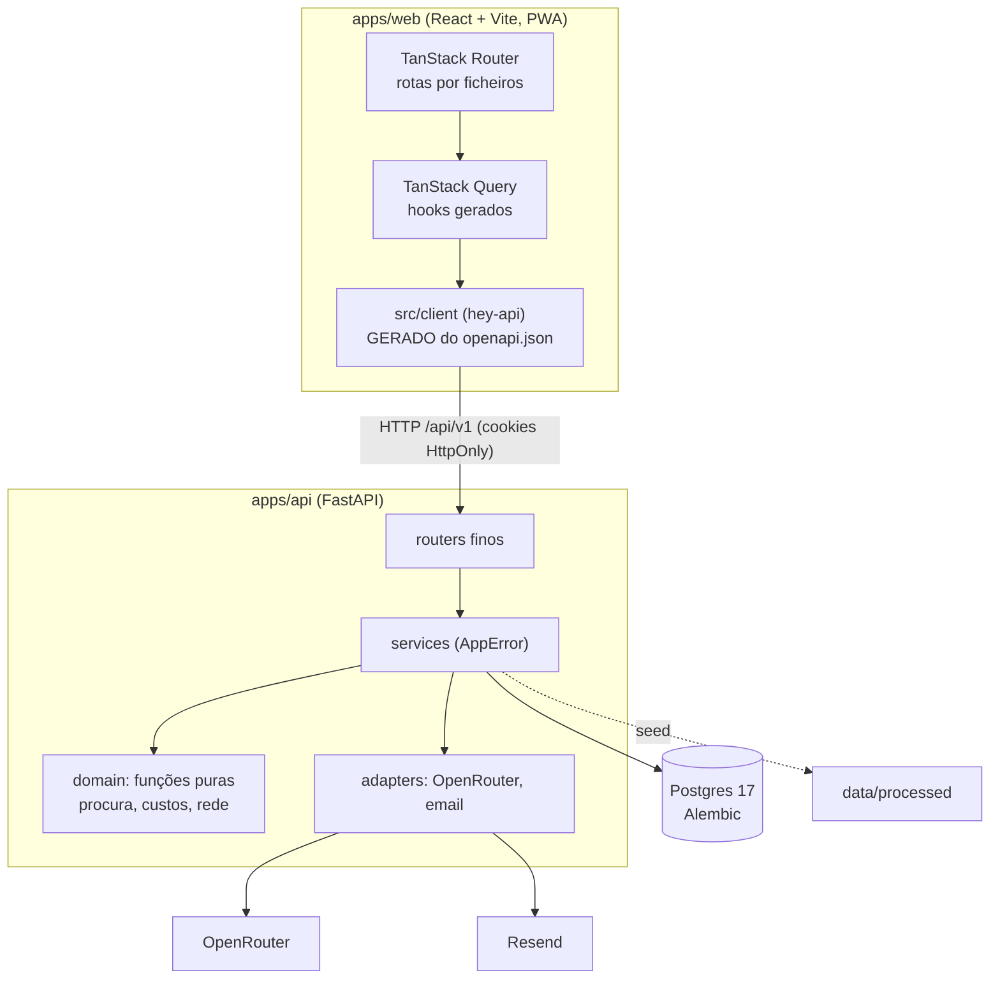

# Arquitetura

Um monorepo com duas aplicações, uma base de dados e três serviços externos. O web fala só com a API; só a API toca em dados e serviços.



## Stack e repositório

| Camada | Escolha | Porquê |
| --- | --- | --- |
| API | Python 3.12, FastAPI, SQLAlchemy 2 assíncrono, Pydantic v2, uv | Tipagem total e contrato OpenAPI automático |
| Otimização | OR-Tools: CP-SAT para pontos e modos, VRP para rotas | Resolve o problema real, com limite de tempo e sementes fixas |
| Base de dados | PostgreSQL 17, migrações Alembic | Escala, integridade e consultas simples |
| Web | React, Vite, TanStack Router e Query, Tailwind v4, shadcn/ui | SPA rápida; a API é a única fonte de dados |
| Mapa | MapLibre com estilos CARTO por omissão | Sem chave |
| i18n | Paraglide, pt-PT e inglês, prefixo de língua no URL | Mensagens tipadas, compiladas |
| PWA | vite-plugin-pwa (autoUpdate); a API nunca fica em cache | Instalável, boa em telemóvel |
| IA | OpenRouter com saída estruturada | Um fornecedor, vários modelos ([IA](ia.md)) |
| PDF | WeasyPrint com as fontes da marca | Relatório RAP |
| Deploy | Docker Compose no Coolify | Um push, um deploy ([Deploy](deploy.md)) |

```
apps/api/src/novelo/
  core/        config, base de dados, erros tipados, segurança, limites de pedidos
  features/    auth · users · textile · network · datasets · planning · lots · reports · ai_admin · copilot · health
  domain/      procura, custos, geografia, rede: só funções puras
  adapters/    OpenRouter e email (Resend ou log)
  ai/          prompts versionados, verificador de números, catálogo de modelos, avaliações (triagem, copiloto)
apps/web/src/
  routes/      rotas por ficheiros (_app/* exige sessão)
  features/    ecrãs por funcionalidade
  components/  ui (shadcn), data-table, page, states, sticky-actions, layout
  client/      GERADO
  lib/         formatação, erros, i18n, tema, vocabulário
```

## API

Todas as rotas vivem sob `/api/v1`. Os routers não têm prefixo; aplica-se no `main.py`. As rotas de dados são autenticadas; o passaporte do lote (`/api/v1/public/lots/{code}`) é público para o QR abrir sem sessão.

| Grupo | Exemplos |
| --- | --- |
| `auth` | `login`, `register`, `refresh`, `logout`, `me`, `verify-email`, `forgot-password`, `reset-password`, `change-password`, Google, `config` |
| `users` | listar e alterar papel e estado (só administradores) |
| `textile` | `baseline`, `flows`, `waste`, `overview` |
| `network` | `circuits`, `fleet`, `localities`, `containers` |
| `datasets` | `quality`, resolver e reabrir alertas |
| `municipal` | rede **municipal** de contentores (outras frações, não é têxtil): `overview`, `parishes`, `sites`, `containers`, `producers`, `textile-candidates`, `gap-ranking`, `density-benchmark`, `export`, GeoJSON (ver [Rede municipal](#rede-municipal-municipal)) |
| `planning` | `parameters`, `zones`, `scenarios` (criar, listar, ler, renomear, apagar, fluxos) |
| `whatif` | criar, aplicar e listar perguntas "E se...?" |
| `lots` | lotes, itens, estado, `triage`, `market` e reservas, `brands` |
| `reports` | `rap` (gera o PDF), listar, `{id}/pdf` |

### `GET /api/v1/textile/overview` (`get_overview`)

Um só pedido de leitura para a página inicial; só dados reais da BD ou constantes com fonte e `verified` (`features/textile/references.py`, espelho de `docs/pesquisa/registo-de-afirmacoes.md`). Autenticado como o resto de `textile`.

| Campo | Conteúdo |
| --- | --- |
| `gap` | `potential_t` (estimativa: população × 0,7 kg/hab/mês × 12), `collected_t`, `missing_t`, `capture_pct`, `destinations{reuse_t,recycle_t,reject_t}`, `kg_per_inhab_year/month` observados e do potencial, `population`, `parishes_count`, `is_estimate` |
| `references` | `key`, `label`, `kg_per_inhab_year`, `year`, `scope`, `source_label`, `source_url`, `verified`, `evidence`, `is_estimate`. Guimarães hoje e potencial do plano (este `verified=false`, fonte por localizar), França 2024 (4,27), UE-27 2020 (4,4), Catalunha 2024 (2,7), Alemanha 2022 (`verified=false`). O web só mostra em público as `verified` |
| `timeline` | `date`, `key`, `status` (`done`/`upcoming`), `days_remaining` (relógio do servidor em UTC, `null` se já passou), `who_pays`, fonte e `verified`: obrigação municipal (1 jan 2025), transposição (17 jun 2027), regimes de RAP (17 abr 2028) |
| `parishes` | por freguesia (ordenadas por população): `code`, `name`, `population`, `tipau`, `potential_t` (estimativa), `circuits_count`, `localities_count`, `containers_count` (ativos; 0 até 20 out), `area_km2` (BD ou calculada do contorno), `centroid{lat,lon}`, `share_of_population_pct` |
| `scenario_frontier`, `pareto_ids` | cenários guardados (até 200) com `tonnes_year`, `eur_per_tonne`, `annual_cost_eur`, `capex_eur`, `modes`, `status` (`feasible`/`infeasible`), `objective`, `is_pareto` (não dominado em menos €/t e mais toneladas, só viáveis) |
| `data_sources` | `key`, `name`, `provider`, `kind`, período, `methods` (`weighed`/`percentage`) e `rows` importadas |
| `highlights` | 4 a 6 manchetes (`key`, `value`, `unit`, `text_key` i18n, `context`, `source_label`, `verified`, `is_estimate`): maior entidade, reutilização, equivalente francês em toneladas, têxtil no indiferenciado (caracterização da Vitrus, não os 5,4% do plano, por verificar), razão e concentração das freguesias |

O relógio injeta-se com `Depends(get_today)` (`dependency_overrides` nos testes); as contas puras estão em `domain/overview.py`.

Erros no formato `{code, message, details}` com um `ErrorCode` tipado, publicado no OpenAPI; `apps/web/src/lib/errors.ts` traduz cada código de forma exaustiva.

### Rede municipal (`/municipal`)

Os contentores **municipais** (profundidade, superfície, orgânico, verdes; 20 de outubro de 2026) vivem em tabelas próprias e **nunca** se misturam com `containers` (têxteis). Servem de camada de lugares possíveis, produtores B2B e geometria oficial; o contrato de dados está em [Análise dos contentores municipais](../dados/analise-contentores-municipais.md). Código em `features/municipal/` (`router` fino; `service`/`analytics`/`exports` sem FastAPI; `importer` do seed; `http` com ETag; `domain/municipal.py` com as regras puras).

| operationId | Rota | O que devolve |
| --- | --- | --- |
| `get_municipal_overview` | `GET /municipal/overview` | KPIs: contentores, locais, densidade, cobertura 200/300/500 m (estimativa, de área), qualidade |
| `list_municipal_parishes` / `get_municipal_parish` | `/municipal/parishes`, `/municipal/parishes/{dicofre}` | 48 freguesias; ordenação (`sort`, `order`) e filtros (`q`, `min_population`, `max_containers_per_1000_hab`, `max_cover_pct_300m`, `has_candidates`) |
| `list_municipal_sites` | `/municipal/sites` | Locais; filtros `kind`, `stream`, `parish`, `producer_type`, `site_class`, `textile_candidate`, `coord_suspect`, `coord_precision`, `q` (sem acentos), `bbox`; cursor + `limit` (máx. 500) |
| `get_municipal_sites_geojson` | `/municipal/sites/geojson` | GeoJSON leve por `bbox`/`zoom`, agrupado no servidor por grelha abaixo do zoom 16 (`cluster=false` desliga); gzip |
| `get_municipal_site` | `/municipal/sites/{site_id}` | Local com contentores, relações orgânico-rua, vizinhos a `radius_m` (por omissão 200 m) e freguesia |
| `list_municipal_containers` | `/municipal/containers` | Tabela completa (inclui os 29 pendentes), cursor por `container_uid`, mesmos filtros + `located`, `parish_match`, `brand` |
| `list_municipal_producers` | `/municipal/producers` | Resumo por tipo (contentores, estabelecimentos distintos, freguesias com mais, hipótese de interesse para têxteis) e locais de produtores |
| `get_textile_candidate_sites` | `/municipal/textile-candidates` | Candidatos do ETL com chaves de justificação e ordem explícita (`rank_rule`); o `rank` é sempre o global |
| `get_municipal_gap_ranking` | `/municipal/gap-ranking` | Lacuna por freguesia: **estimativa**, com a regra e os parâmetros (0,7 kg/hab/mês, captura 22,9%) |
| `get_municipal_density_benchmark` | `/municipal/density-benchmark` | Densidade do concelho, distribuição (mín., p25, mediana, p75, máx.) entre freguesias e a referência francesa (por verificar) |
| `export_municipal_sites` | `/municipal/export?format=csv\|xlsx\|geojson&scope=sites\|containers` | Streaming (CSV e GeoJSON por lotes; XLSX construído em memória e enviado em blocos), mesmos filtros |
| `get_caop_parishes_geojson` | `/municipal/parishes/caop.geojson` | 48 contornos CAOP 2019 com métricas para coroplético |

- **Permissões:** tudo exige sessão; `operator` (e `guest`, quando existir) lê. Os **nomes de estabelecimentos** (`producer_name(s)`) só saem a `admin` com `show_names=true`; qualquer outro papel que o peça recebe 403 `forbidden`, e sem o parâmetro vêm `null`. A pesquisa `q` só procura nos nomes quando eles são visíveis (senão seria um oráculo). O copiloto nunca os mostra, nem a admins.
- **Cache:** `ETag` fraco (`SHA-256 do pacote` + instante da importação + rota, query e papel), `Cache-Control: private` (5 min; 1 h no GeoJSON das freguesias), `If-None-Match` devolve 304 sem consultar a base de dados além da versão. O GeoJSON vai comprimido (gzip) com `Vary: Accept-Encoding`.
- **Contorno CAOP na base de dados** (`municipal_parish_stats.geometry`, JSONB, 147 KB no total) e não servido do ficheiro: o API em produção pode não ter `data/processed` ao lado do código, a geometria fica versionada com as métricas (mesma importação, mesma `source_id`, mesmo ETag) e o resultado já agregado com as métricas é uma só leitura de 48 linhas.
- **Importação:** `seed` chama `features/municipal/importer.py` quando a fonte `vitrus_municipal_containers_2026_10` e os ficheiros existem. É idempotente (upsert por `container_uid`, `site_id`, `dicofre`), apaga o que saiu do ficheiro e importa os 25 alertas `municipal_*` para `data_alerts` (ecrã Qualidade dos dados) sem tocar no estado já decidido. A versão dos dados é o SHA-256 do pacote em `data_sources`.

## Contrato OpenAPI e cliente gerado

1. O FastAPI define o contrato; o `operationId` é o nome da função Python (`list_zones`, `create_scenario`).
2. `just gen` exporta `openapi.json` (`scripts/export_openapi.py`) e corre o hey-api (`apps/web/openapi-ts.config.ts`): cliente fetch, SDK, esquemas Zod e hooks do React Query.
3. O web usa `xxxOptions()` e `xxxMutation()` de `@/client/@tanstack/react-query.gen`. Nunca há `fetch` à mão, nem rotas ou tipos escritos à mão.
4. O `authFetch` renova a sessão em silêncio quando o token de acesso expira.
5. `just check-contract` regenera tudo e falha se `openapi.json` ou `src/client` mudarem. O cliente gerado é versionado de propósito.

## Base de dados

Postgres com migrações Alembic (`apps/api/alembic`). Tabelas por domínio:

| Domínio | Tabelas |
| --- | --- |
| Contas | `users`, `refresh_tokens`, `password_reset_tokens`, `email_verification_tokens` (tokens guardados como hash) |
| Têxtil | `textile_entities`, `textile_flows`, `waste_shares` |
| Rede | `parishes`, `localities`, `vehicles`, `circuits`, `circuit_days`, `circuit_localities`, `shift_assignments`, `fleet_capacity`, `containers` |
| Dados | `data_sources`, `data_alerts` |
| Rede municipal | `municipal_containers`, `municipal_sites`, `municipal_parish_stats` (com o contorno CAOP), `municipal_links`, `municipal_meta` |
| Planeamento | `parameter_sets`, `scenarios`, `whatif_runs` |
| Operação | `lots`, `lot_items`, `lot_events`, `lot_reservations`, `reports` |

`data/processed` é importado no arranque da API de forma idempotente (`just seed` também o faz). Os ficheiros de origem ficam registados com impressão digital.

## Autenticação

Palavras-passe com argon2; JWT em cookies HttpOnly com rotação do token de renovação; "manter sessão iniciada" alonga a validade (`REFRESH_TOKEN_EXPIRE_DAYS` contra `SESSION_TOKEN_HOURS`). Confirmação de email e recuperar password usam tokens de uso único guardados como hash; os emails (confirmar email, recuperar password, ligação de acesso, boas-vindas de convidado) saem pelo Resend (ou pelo log em dev). Templates em `features/auth/emails.py` (textos pt-PT/en) e `email_layout.py` (tabelas, CSS inline, dark mode, botão VML para Outlook, versão texto). Google OAuth. Limites de pedidos nas rotas sensíveis. O primeiro administrador é criado no arranque a partir de `ADMIN_EMAIL` e `ADMIN_PASSWORD`.

## Web

- **Rotas** em `src/routes/`; dados nos `loader` com `queryClient.ensureQueryData`; estado partilhável no URL com `validateSearch`.
- **Estados obrigatórios** em todo o ecrã de dados: a carregar (skeleton), vazio, erro, sucesso (`components/states.tsx`).
- **DataTable** (`components/data-table/`): a mesma tabela em todo o produto, num só cartão. Ecrãs largos: tabela com cabeçalho e rodapé fixos (só as linhas rolam), colunas fixáveis à esquerda/direita (a principal fica fixa por omissão), arrastar para reordenar (ou `↑ ↓` no painel), redimensionar (arrastar ou setas), menu em cada cabeçalho (ordenar, fixar, mover, ocultar, filtrar), ordenação múltipla com Shift, densidade compacta/confortável, linhas selecionáveis (Shift para intervalo, "selecionar as N filtradas"), linhas expansíveis, ações por linha, ações em massa e totais no rodapé. Telemóvel: pesquisa e um botão "Filtros" que abre uma folha inferior com ordenar, filtros, colunas, vistas e exportar; a lista de cartões mantém o desenho.
  - **Filtros**: por faceta (com contagens que respeitam os outros filtros, incluir/excluir), intervalo numérico, intervalo de datas e texto com operadores; chips removíveis e editáveis, "Limpar tudo". Pesquisa e filtros, ordem e página vivem na URL (`?t.<id>=`), por isso partilham-se; colunas, ordem, larguras, densidade, linhas por página e **vistas guardadas** (pesquisa + filtros + ordem + colunas, com nome) ficam no navegador (`novelo.table.<id>`).
  - **Exportar** o que está filtrado e ordenado, tudo ou a seleção, só colunas visíveis ou todas: CSV (UTF-8 com BOM, `;` e vírgula decimal para o Excel pt-PT, ou `,` com ponto), XLSX (escrito por nós, sem dependências, carregado só ao exportar; números e datas verdadeiros), JSON e copiar para a área de transferência. Valores formatados (pt-PT) ou crus. Texto que começa por `= + - @` leva apóstrofo (injeção de fórmulas).
  - **Teclado**: `/` foca a pesquisa; `↑ ↓ Home End PgUp PgDn` movem entre linhas, `Espaço` seleciona (`Shift+↑↓` alarga), `Enter` expande ou abre, `Esc` limpa a seleção (ou a pesquisa), `Ctrl/⌘+A` seleciona as filtradas.
  - **Estados**: `loading` (linhas de esqueleto com a altura das reais), `refreshing` (barra fina), `error` + `onRetry`, vazio e vazio-por-filtro com ação; rodapé "1–25 de 1 234 · filtrado de 40", linhas por página (10, 25, 50, 100 ou rolagem contínua em blocos).
  - **API** (retrocompatível): `Column<T>` com `id`, `header`, `cell`, `value`, `exportValue`, `type` (`text|number|date|datetime`), `filter` (`true`/`{format}` por valores, `'range'`, `'date'`, `'text'`, `false`), `sortable`, `searchable`, `hideable`, `defaultHidden`, `pinned`, `width`, `resizable`, `aggregate` (`sum|avg|min|max|count`) com `format`, e `primary`/`badge`/`full`/`desktopOnly` para o cartão. `DataTable`: `id`, `rows`, `getRowId`, `title`, `controls`, `pageSize`, `initialSort`, `loading`, `refreshing`, `error`, `onRetry`, `rowActions`, `bulkActions`, `selectable`, `views`, `renderExpanded`, `actions`, `exportName`, `urlSync`. Toda a coluna com `value` ganha filtro do tipo certo, ordenação, pesquisa e exportação sem mais código.
  - Ficheiros: `use-table-state.ts` (estado), `table-logic.ts` (filtros, ordem, URL; funções puras testadas), `export.ts` e `xlsx.ts` (exportação), `toolbar.tsx`, `filters.tsx`, `columns-panel.tsx`, `column-header.tsx`, `views-menu.tsx`, `export-menu.tsx`, `mobile-list.tsx`.
- **Separadores** (`components/page-tabs.tsx` sobre `ui/tabs.tsx`): linha inferior animada (ou pastilha, na variante segmentada), contagens, ponto de atenção ou triângulo de erro com texto para leitores de ecrã, rolagem com setas quando não cabem, teclado (setas, Home, End) e o separador ativo na URL (`validateSearch`). Os separadores já visitados ficam montados e escondidos, por isso a pesquisa, os filtros e a rolagem de cada um mantêm-se.
- **Layout** com `Page` e `Section`, `PageHeader`, `StatStrip`, `StickyActions` (barra de ações fixa em telemóvel) e `OfflineBanner`.
- **Telemóvel primeiro:** áreas de toque de pelo menos 40 px, campos a 16 px (sem zoom no iOS), margens de segurança, diálogos que abrem como folha inferior.
- **Tema, língua e tipografia:** claro e escuro, pt-PT e inglês; Inter no texto e Newsreader nos títulos; tokens da marca em [Guia de marca](../marca/guia-de-marca.md).

## Boas práticas

**Python.** Feature-based (`router`, `service`, `models`, `schemas`); services sem FastAPI levantam `AppError`; `domain/` só com funções puras, testadas com valores calculados à mão; I/O externo só em `adapters/`; `mypy --strict` e Ruff limpos; rotas que chamam OR-Tools são `def` com limite de tempo (`SOLVER_TIME_LIMIT_S`); nunca editar uma migração já aplicada.

**TypeScript.** `strict` e `noUncheckedIndexedAccess`, Biome, sem `any`; componentes sem lógica de negócio; números em pt-PT com unidade (`lib/format.ts`); acessibilidade AA e uso total por teclado.

## Qualidade

`just check` corre localmente e é a barreira antes de cada push.

| Área | Ferramentas |
| --- | --- |
| Python | Ruff (lint e formato), mypy strict, pytest (76 testes) |
| TypeScript | Biome, `tsc --noEmit`, Vitest |
| Contrato | `just gen` e `git diff --exit-code` em `openapi.json` e `src/client` |
| Ponta a ponta | Playwright (`pnpm exec playwright test` em `apps/web`) contra a stack de `just dev` |
| Imagens | `just build` constrói as duas imagens de produção |

Por agora não há integração contínua remota. O fluxo é: `just check` verde, commit em Conventional Commits e push direto para `main`, que o Coolify publica.

## Copiloto

O copiloto (`features/copilot/`) é a feature mais complexa da API: conversa em streaming (SSE) com 42 ferramentas tipadas que chamam os mesmos services da app, threads persistentes por utilizador, memória de longo prazo, artefactos (gráficos, tabelas, mapas), ações com confirmação e auditoria, anexos, menções e histórico unificado. Desenho, contrato de eventos, segurança e operação em [Copiloto](copiloto.md); gestão de modelos, custos e orçamento em [IA](ia.md). O nginx do web tem locations próprias para o stream (sem buffering) e para os anexos (até 55 MB).
