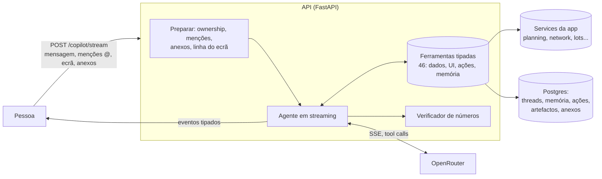
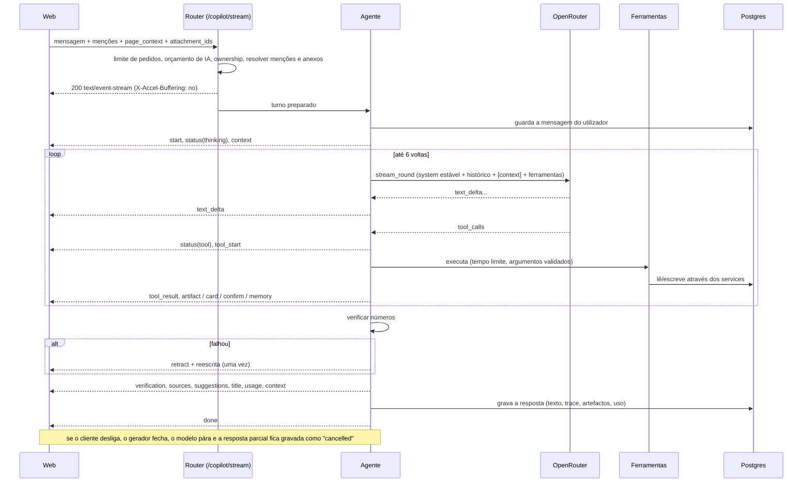
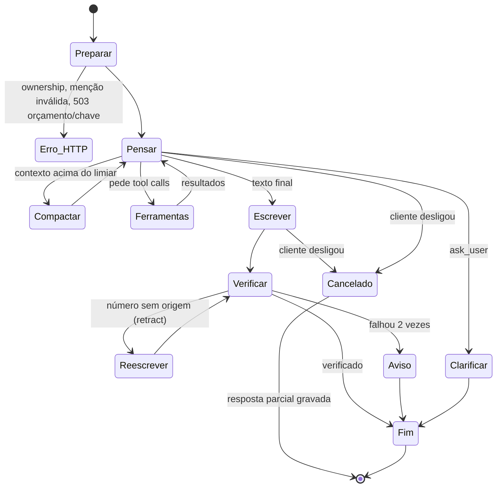
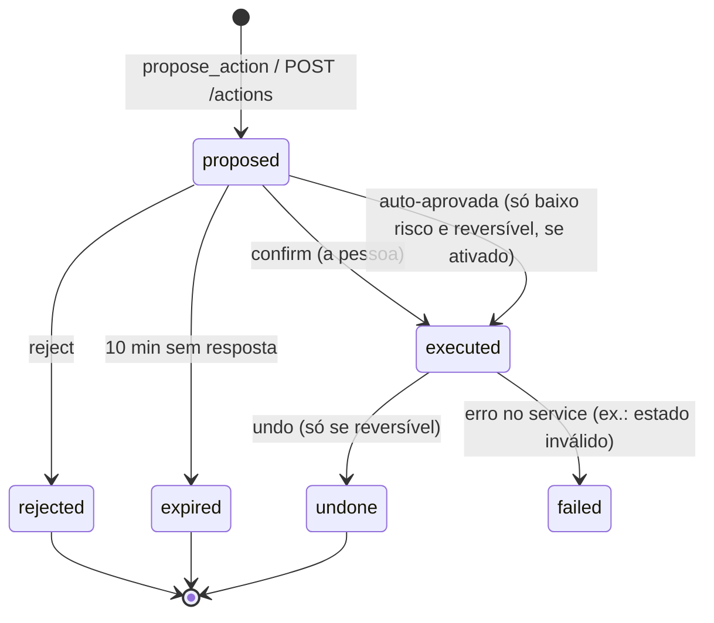
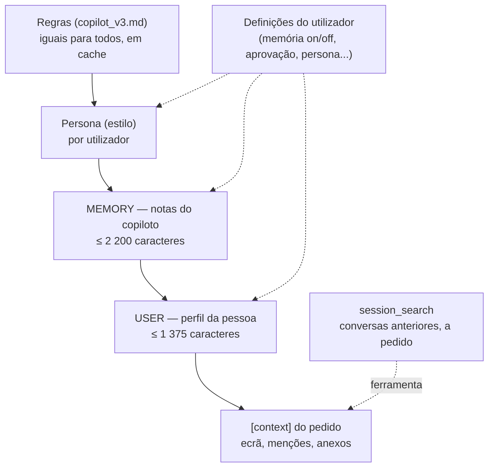

# Copiloto

O copiloto é a conversa com o Novelo: pede dados, desenha gráficos, simula cenários, prepara relatórios e, com confirmação, trata de tarefas da app. Este documento explica o que foi investigado, como está desenhado e como se opera. A regra de ouro de todo o projeto mantém-se: **o modelo nunca faz contas**; todos os números vêm de ferramentas que chamam os mesmos services da app, e um verificador rejeita qualquer número que não exista nos resultados.

## Em linguagem simples

- **Fala e mostra.** Escreve-se uma pergunta ("compara o Base com o Ambicioso e mostra o custo por tonelada") e o copiloto responde em poucas frases, desenha o gráfico ou a tabela e diz de onde vieram os dados. O texto aparece à medida que é escrito, como no ChatGPT, e mostra o que está a fazer ("A correr o otimizador...").
- **Não inventa números.** O modelo só escolhe o que perguntar aos dados e como os mostrar. Cada número do texto é conferido contra os resultados reais. Se falhar, o texto é apagado e reescrito; se voltar a falhar, aparece só um aviso e os resultados calculados. Os gráficos e as tabelas são construídos pelo servidor com os dados reais: o modelo nunca escreve os valores.
- **Não faz nada às escondidas.** Para mudar alguma coisa (resolver um alerta, apagar um cenário, reservar um lote, mudar um pressuposto) o copiloto só **propõe**. Aparece um cartão "Confirmar / Rejeitar" e só o clique da pessoa executa, com as mesmas permissões dessa pessoa. Fica tudo registado: quem, o quê, quando, com que resultado. Quase tudo o que é reversível pode ser desfeito.
- **Lembra-se de ti, com limites.** Tem duas notas pequenas sobre cada utilizador (o que ele próprio aprendeu e o perfil da pessoa: preferências, o que acompanha). Cada pessoa vê, edita e apaga essas notas, pode desligar a memória, pedir aprovação antes de gravar, e pode exportar ou apagar tudo.
- **Lê ficheiros com cuidado.** Aceita imagens, PDF, folhas de cálculo e texto. Valida pelo conteúdo, descarta o ficheiro e guarda só o texto extraído. O conteúdo de um ficheiro é tratado como dado, nunca como ordem.
- **Aguenta conversas longas.** Quando a conversa enche, resume as voltas antigas e guarda só o essencial.

## Resumo do desenho

## O que foi investigado

Fontes lidas: documentação do OpenRouter (streaming, tool calling, prompt caching, reasoning), protocolo de streaming de UI do Vercel AI SDK, e a documentação da memória, das personalidades (SOUL.md) e das competências do Hermes Agent (Nous Research). Conclusões que moldaram o desenho:

| Tema | O que a fonte diz | O que fizemos |
| --- | --- | --- |
| SSE do OpenRouter | Linhas `data: {json}`; comentários `: OPENROUTER PROCESSING` ignoram-se; o `usage` vem num chunk final (`stream_options.include_usage`); erros a meio chegam como chunk com `error` e `finish_reason: error`, com HTTP 200 | `stream_round` ignora comentários, junta fragmentos, trata o erro a meio como `UpstreamError`, pede o `usage` e regista o custo real |
| Tool calls em streaming | Os `tool_calls` chegam em pedaços por `index`; o nome vem no 1.º, os argumentos em fragmentos de string | Acumulação por índice; validação Pydantic só no fim da volta |
| Cancelamento | Fechar a ligação pára o modelo e a faturação (fornecedores suportados) | O gerador é fechado quando o cliente desliga; o uso parcial fica registado como `cancelled`; a resposta parcial é gravada |
| Prompt caching | OpenAI/Gemini: automático para prefixos estáveis; Anthropic: `cache_control` | Parte estável primeiro (regras, persona, memória congelada), parte volátil (ecrã, anexos, pergunta) no fim |
| Raciocínio | `reasoning.effort`; o raciocínio chega em `delta.reasoning` | Pedido com esforço `low` por tarefa; deltas de raciocínio viram só o estado "a pensar" |
| Protocolo de UI do AI SDK | Partes tipadas por `type` (`text-delta`, `tool-input-*`, `data-*`, `error`), `start-step`/`finish-step`, remoção de partes e `[DONE]` | Eventos próprios, também discriminados por `type`, com `retract` (equivalente a remover partes), `status`, `artifact`, `confirm`... e `done` |
| Contexto | Janela, resumo das voltas antigas, limpar resultados de ferramentas antigos, orçamento de tokens | Janela útil = `min(contexto do modelo, 64 000)`; compacta a 65%; mantém as últimas 4 voltas; resultados antigos ficam como digests |
| Memória do Hermes | Duas memórias pequenas (2 200 e 1 375 caracteres), sempre no prompt, snapshot congelado por sessão, ferramenta única `add/patch/remove`, sem compactação automática, varrimento de segurança, aprovação opcional, `session_search` | Adaptado a vários utilizadores em Postgres (ver "Memória") |
| Personalidade (SOUL.md) | A identidade ocupa o 1.º lugar do prompt; é varrida contra injeção; difere do que é específico de projeto | Persona por utilizador com presets e texto próprio, que afina o estilo mas não toca nas regras |
| Anexos | Validar pelo conteúdo, limitar tamanho e tempo, tratar texto extraído como não fiável | Magic bytes, limites, extração em thread com tempo limite, texto delimitado como "untrusted" |
| Avaliação de agentes | Casos reais ponta a ponta, verificações automáticas (ferramentas, números, recusas, injeção), limiares que falham a CI | `just eval-copilot` (ver "Avaliação") |

## Fluxo de uma resposta

## Contrato dos eventos (SSE)

Cada mensagem SSE tem `event: <type>` e `data: <JSON>`; o JSON é um `CopilotEventMessage` (união discriminada por `type`, documentada no OpenAPI). `GET /copilot/event-schema` devolve um exemplo de cada. Linhas `: ping` a cada 15 s mantêm a ligação viva.

| Evento | Quando | Campos principais |
| --- | --- | --- |
| `start` | Primeiro | `thread_id`, `message_id`, `model`, `prompt_version` |
| `status` | Muda com frequência (uma por passo e por ferramenta) | `phase` (`thinking`, `planning`, `tool`, `verifying`, `writing`, `compacting`), `label_key`, `detail` |
| `context` | Antes de responder e no fim | `used_tokens`, `window_tokens`, `compacted` |
| `plan` | Pedidos compostos (ferramenta `make_plan`) | `steps[]` |
| `tool_start` / `tool_result` | Por ferramenta (se "mostrar passos" estiver ligado) | `id`, `name`, `args_summary` / `ok`, `summary`, `duration_ms` |
| `card` | Cenário criado ou lido | cartão com KPIs |
| `artifact` | Gráfico, tabela, mapa, KPIs, comparação, linha do tempo, cartão, relatório, formulário | `id`, `title`, `sources[]`, `artifact` (união tipada) |
| `memory` | Escrita de memória feita, em fila ou bloqueada | `action` (`added`, `patched`, `removed`, `staged`, `blocked`), `target`, `content`, `status`, `entry_id`, `previous`, `reason` |
| `confirm` | O copiloto propôs uma ação de escrita | `action` (`ActionOut`) |
| `action_result` | Ação executada neste pedido (auto-aprovada) | `action` |
| `navigate` | Sugestão de abrir um ecrã | `route`, `label`, `params`, `search` |
| `clarify` | Falta um parâmetro crítico (termina a volta) | `question`, `options[]` |
| `text_delta` | Texto a chegar | `delta` |
| `retract` | O texto transmitido falhou a verificação: apagar o texto desta mensagem | `reason` |
| `verification` | Depois do texto | `verified`, `warning` (`numbers_unverified`), `external_numbers` (números aceites só por virem de fontes web, a mostrar como «fonte externa») |
| `web_search` | Pesquisa na web deste pedido | `state` (`searching`, `done`, `unavailable`, `blocked`, `skipped`), `query`, `results`, `requests`, `reason` |
| `sources` | O que foi usado (ferramentas, cenários, ficheiros, menções, ecrã, memória, **fontes web**) | `items[]` com `kind` (`web` leva `ref` = URL, `domain`, `excerpt`, `external: true`) |
| `suggestions` | 3 seguimentos curtos | `items[]` |
| `title` | Logo no início: o título é a primeira mensagem do utilizador (cortada a 60 caracteres) | `title` |
| `usage` | No fim | `prompt_tokens`, `completion_tokens`, `tokens`, `cost_usd`, `web_search_requests` |
| `error` | Erro depois de abrir o stream | `code` (um `ErrorCode`, ex.: `ai_budget_exceeded`), `message` |
| `done` | Último | `finish` (`stop`, `cancelled`, `error`) |

Erros **antes** de abrir o stream (conversa de outro utilizador, menção ou anexo inválido, chave ou orçamento de IA) são respostas HTTP normais com o formato de erro da API (404, 403, 503 `ai_budget_exceeded`...).

### Catálogo de `label_key` (o web traduz e anima)

Cada ferramenta emite um `status` com `phase: tool` e o `label_key` do seu ramo antes de correr; `detail` leva um dado (freguesia, texto procurado, nome do ficheiro). O web escolhe frases temáticas por `label_key`.

| `label_key` | Fase | Quando ("frase" sugerida) |
| --- | --- | --- |
| `status.thinking` | thinking | Início e quando o modelo raciocina ("A pensar...") |
| `status.planning` | planning | Antes de executar as ferramentas de uma volta; `make_plan` ("A planear...") |
| `status.reading_baseline` | tool | `get_baseline` ("A ler os dados de 2025...") |
| `status.reading_flows` | tool | `get_flows` ("A seguir o têxtil até ao destino...") |
| `status.listing_scenarios` | tool | `list_scenarios` |
| `status.reading_scenario` | tool | `get_scenario_detail` |
| `status.reading_parishes` | tool | `list_parishes` |
| `status.reading_network` | tool | `get_circuits`, `get_fleet`, `get_localities` |
| `status.running_optimizer` | tool | `run_scenario`, `what_if`, `run_benchmark_scenario` ("A correr o otimizador..."; `detail`: freguesias afetadas) |
| `status.comparing_scenarios` | tool | `compare_scenarios` ("A comparar cenários...") |
| `status.computing_coverage` | tool | `get_container_coverage` |
| `status.running_sensitivity` | tool | `get_sensitivity`, `get_robustness` |
| `status.computing_pareto` | tool | `get_pareto_frontier` |
| `status.planning_pilot` | tool | `get_pilot_recommendation` |
| `status.reading_benchmarks` | tool | `list_benchmarks` |
| `status.searching_data` | tool | `search_data` (`detail`: o texto procurado) |
| `status.reading_assumptions` | tool | `explain_assumption` |
| `status.reading_lots` | tool | `get_lots`, `get_fibre_market`, `get_brands`, `get_lot_history` |
| `status.reading_alerts` | tool | `get_quality_alerts` |
| `status.reading_ai_usage` | tool | `get_ai_usage` |
| `status.generating_report` | tool | `generate_rap_report` |
| `status.reading_attachment` | tool | `analyze_attachment` |
| `status.drawing` | tool | `show_*` ("A desenhar o gráfico...") |
| `status.preparing_action` | tool | `propose_action` |
| `status.preparing_navigation` | tool | `open_page` |
| `status.asking` | tool | `ask_user` |
| `status.remembering` | tool | `memory` |
| `status.searching_history` | tool | `session_search` |
| `status.searching_web` | tool | `web_search` e pesquisas do modo `inline` (`detail`: a consulta) |
| `status.finding_gaps` | tool | `get_data_gaps` |
| `status.reading_reports` | tool | `list_reports` |
| `status.reading_admin` | tool | `get_user_stats`, `get_audit_log` |
| `status.analyzing_data` | tool | `analyze_result` |
| `status.recalling_memory` | thinking | Memória carregada (só com notificações "verbose") |
| `status.reviewing_memory` | thinking | Revisão automática da memória |
| `status.image_unsupported` | thinking | Imagem anexada a um modelo sem visão (`detail`: nome do ficheiro) |
| `status.compacting` | compacting | Resumo das voltas antigas |
| `status.writing` | writing | Texto a chegar |
| `status.verifying_numbers` | verifying | Conferência dos números ("A verificar os números...") |
| `status.suggesting` | writing | Geração das sugestões |
| `status.working` | tool | Ferramenta sem frase própria |

## Endpoints (operationId)

| Grupo | operationId | Rota |
| --- | --- | --- |
| Conversa | `copilot_stream`, `regenerate_copilot_response`, `copilot_chat` (sem streaming), `get_copilot_event_schema` | `POST /copilot/stream`, `POST /copilot/threads/{id}/regenerate`, `POST /copilot/chat`, `GET /copilot/event-schema` |
| Conversas | `list_copilot_threads`, `get_copilot_thread`, `update_copilot_thread`, `delete_copilot_thread`, `compact_copilot_thread`, `export_copilot_thread`, `export_copilot_thread_pdf`, `share_copilot_thread`, `unshare_copilot_thread`, `get_shared_copilot_thread`, `get_copilot_thread_timeline`, `list_copilot_projects`, `send_copilot_feedback` | `/copilot/threads...`, `/copilot/shared/{token}`, `/copilot/projects`, `PUT /copilot/messages/{id}/feedback` |
| Histórico | `list_copilot_history`, `list_copilot_actions`, `propose_copilot_action`, `confirm_copilot_action`, `reject_copilot_action`, `undo_copilot_action`, `list_copilot_artifacts`, `refresh_copilot_artifact`, `pin_copilot_artifact`, `delete_copilot_artifact` | `/copilot/history`, `/copilot/actions...`, `/copilot/artifacts...` |
| Entrada | `upload_copilot_attachments`, `search_copilot_mentions`, `list_copilot_commands` | `/copilot/attachments`, `/copilot/mentions`, `/copilot/commands` |
| Definições e memória | `get_copilot_settings`, `update_copilot_settings`, `preview_copilot_persona`, `list_copilot_memory_entries`, `create_copilot_memory_entry`, `update_copilot_memory_entry`, `delete_copilot_memory_entry`, `clear_copilot_memory`, `list_pending_memory`, `approve_pending_memory`, `reject_pending_memory`, `search_copilot_sessions` | `/copilot/settings`, `/copilot/persona/preview`, `/copilot/memory/...`, `/copilot/sessions/search` |
| RGPD | `export_copilot_data`, `delete_copilot_data` | `GET /copilot/data/export`, `DELETE /copilot/data?confirmation=APAGAR` |

## Ferramentas (54)

Todas com esquema estrito (campos extra recusados), tempo limite (45 s; 90 s o relatório) e um resumo curto para o ecrã; o resultado completo vai só para o modelo. Os resultados de dados trazem um `result_id` e uma `table`, a base dos artefactos.

| Grupo | Ferramentas | Quem pode |
| --- | --- | --- |
| Dados do concelho | `get_baseline`, `get_flows`, `list_parishes`, `get_circuits` (com dias da semana), `get_fleet`, `get_localities`, `get_quality_alerts`, `get_data_gaps` (o que a plataforma não sabe), `list_assumptions`, `list_reports` | Todos |
| Cenários e análise | `list_scenarios`, `get_scenario_detail`, `compare_scenarios`, `get_pareto_frontier`, `get_sensitivity`, `get_robustness`, `get_pilot_recommendation`, `get_container_coverage`, `list_benchmarks`, `explain_assumption`, `search_data`, `explain_scenario_difference` (porque dois cenários diferem), `analyze_result` (tabela derivada: agrupar, somar, quota, top, filtrar, para desenhar qualquer consulta) | Todos |
| Rede municipal (outras frações, não é têxtil) | `get_municipal_overview`, `get_parish_municipal` (sem freguesia devolve o ranking da lacuna estimada), `find_municipal_sites`, `get_textile_candidates` | Todos; **sem nomes de produtores, nem para administradores** |
| Lotes e bolsa | `get_lots`, `get_fibre_market`, `get_brands`, `get_lot_history` | Todos |
| IA, custos e administração | `get_ai_usage`, `get_user_stats` (contas por papel e estado), `get_audit_log` (sem emails, IPs nem nomes) | Administradores |
| Web | `web_search` (só com a pesquisa ligada para o utilizador; ver [IA](ia.md#pesquisa-na-web)); leitura de links `https` colados, pelo servidor | Todos, exceto convidados |
| Criação direta | `run_scenario`, `what_if` (ambos aceitam `param_changes`: multiplicar custos, capturas, capacidade), `run_benchmark_scenario` (máx. 2 por pedido, nome com prefixo "Copilot · "), `generate_rap_report` (máx. 1) | Todos; com "pedir confirmação" ligado passam por `propose_action` |
| Artefactos | `show_chart` (14 tipos, com `pie`), `show_table`, `show_map`, `show_kpis`, `show_comparison`, `show_timeline`, `show_scenario_card`, `show_form` | Todos |
| Agência | `propose_action`, `open_page`, `ask_user`, `make_plan` | Todos (cada ação tem o seu role) |
| Memória | `memory`, `session_search` | Todos |
| Anexos | `analyze_attachment` (cabeçalho, filtro, soma/média/contagem, agrupar, pesquisar) | Dono do anexo |

## Artefactos (generative UI)

O modelo escolhe a ferramenta de dados, o tipo e as colunas; **o servidor constrói a especificação** a partir da `table` real, valida-a (Pydantic discriminado) e embute os valores, as unidades e a fonte. O título-conclusão é do modelo, mas se citar um número que não está nos dados é substituído pelo título da tabela.

| Tipo de artefacto | Especificação | Exemplo |
| --- | --- | --- |
| `chart` | `ChartSpec` por `kind`: `bar`, `stacked_bar`, `line`, `area`, `scatter`, `pareto` (séries de pontos, destaque da fronteira), `waterfall`, `sankey`, `treemap`, `heatmap`, `tornado`, `range`, `gauge` | €/t por cenário; fluxo observado; fronteira de Pareto |
| `table` | colunas tipadas, linhas ordenadas, total | 10 freguesias com mais potencial |
| `map` | camadas `parishes`, `containers`, `localities` com métrica e coordenadas | População por freguesia |
| `kpis`, `comparison`, `timeline`, `scenario_card`, `report`, `form` | específicas | Comparação de cenários; histórico de um lote |

Cada artefacto fica guardado (galeria) com a ferramenta e os argumentos que o geraram, por isso `refresh_copilot_artifact` volta a calculá-lo com os dados atuais; pode ser fixado ou apagado.

## Ações (escritas) e permissões

Duas etapas: o modelo chama `propose_action`; o servidor valida o tipo, os parâmetros e o role, guarda a proposta (`copilot_actions`, expira em 10 minutos) e emite `confirm`. **Só `POST /copilot/actions/{id}/confirm`, com a sessão da pessoa, executa**, pelos mesmos services (por isso as mesmas permissões e a mesma validação). Confirmar duas vezes devolve o mesmo resultado (a reivindicação da execução é atómica). O resultado volta ao modelo na mensagem seguinte e aparece como `action_result`.

| Ação | Risco | Reversível | Quem |
| --- | --- | --- | --- |
| `create_scenario`, `duplicate_scenario`, `run_benchmark`, `generate_report` | baixo | sim (apaga o que criou) | todos |
| `resolve_alert`, `ignore_alert`, `reopen_alert` | médio | sim (repõe estado e nota) | todos |
| `open_lot`, `set_lot_state` | médio | não | todos |
| `delete_scenario`, `reserve_lot` | alto | não | todos |
| `update_parameter`, `set_user_active`, `set_user_role`, `change_ai_task_model` | alto | sim | só administradores (verificado ao propor **e** ao confirmar) |
| `export_my_data` | baixo | sim (só leitura) | todos |
| `delete_my_copilot_data` | crítico | não | todos; exige escrever a palavra de confirmação (`APAGAR` / `DELETE`) |

A auto-aprovação (definição do utilizador) só vale para risco **baixo e reversível**; as destrutivas nunca. Uma injeção de prompt (num ficheiro, no nome de um cenário, na memória) pode no máximo fazer o modelo propor algo: nada corre sem o clique da pessoa. O registo (`list_copilot_actions`) mostra quem, o quê, parâmetros, estado, resultado e se pode ser desfeito. Os administradores têm uma vista de auditoria (`scope=all`) com as ações de todos, **sem o conteúdo das conversas**.

## Contexto e memória de curto prazo

- **Janela útil**: `min(context_length do modelo no catálogo, COPILOT_CONTEXT_CAP_TOKENS=64 000)`. A estimativa de tokens é barata (≈3,6 caracteres por token).
- **Compactação** a 65% da janela (configurável por utilizador, 50 a 90%): as voltas antigas viram um memo estruturado (objetivo, cenários com ids, factos, pendentes) gerado pelo modelo auxiliar; os resultados de ferramentas antigos ficam só como digests; as últimas 4 voltas ficam intactas. `/compact` fá-lo à mão.
- **Digests** dos resultados recentes (ids de cenários e KPIs) seguem no bloco `[context]` e valem como factos verificados: assim "compara com o anterior" funciona sem repetir ferramentas.
- **Bloco `[context]`** construído no servidor para cada pedido: ecrã, menções, anexos, memo, digests e ações recentes. Nada que o cliente escreva entra no prompt sem passar pelo servidor.

## Memória de longo prazo

Inspirada no Hermes Agent, adaptada a vários utilizadores em Postgres. Camadas:

- **Duas memórias por utilizador**, de entradas curtas separadas por `§`: `memory` (notas do copiloto: convenções, lições) e `user` (perfil: preferências, estilo, o que a pessoa acompanha). Limites do sistema: `COPILOT_MEMORY_CHAR_LIMIT` (2 200) e `COPILOT_USER_CHAR_LIMIT` (1 375). O bloco leva um cabeçalho de uso (`[MEMORY (your notes) · 62% · 1 370/2 200]`); blocos vazios não entram no prompt.
- **Snapshot congelado por conversa**: lido no início do thread e guardado nele; não muda a meio (preserva o prompt cache). As escritas vão para a base de dados de imediato e entram na **conversa seguinte**; o resultado da ferramenta mostra o estado vivo.
- **Ferramenta única `memory`** com `target` e ações `add`, `patch` (substitui um trecho único) e `remove` (substring única). Não há `replace` nem `read`. Duplicados exatos não se acrescentam. Passou do limite: erro com as entradas atuais e **um** lote `operations` que liberta espaço e acrescenta (o limite verifica-se no resultado final do lote). Pedidos explícitos ("lembra-te que...", "esquece...") forçam a chamada à ferramenta, para o modelo não dizer que guardou sem guardar.
- **Segurança**: cada entrada é varrida antes de entrar (injeção em pt/en, exfiltração, URLs, credenciais, Unicode invisível, dados pessoais e sensíveis, números voláteis como euros, percentagens e toneladas). Bloqueia, regista (sem o conteúdo) e avisa. A memória é **dado etiquetado no prompt**, sem autoridade sobre as regras.
- **Aprovação** (`write_approval=ask`): as escritas ficam em fila (`list_pending_memory`; aprovar, editar o texto, rejeitar). Por omissão grava e notifica (`memory_notifications`: `off`, `on`, `verbose`) com evento `memory`; o web mostra "Guardei na memória: ..." com **Desfazer** (`previous` e `entry_id`).
- **Revisão em segundo plano**: ao fim de algumas voltas (`COPILOT_REVIEW_EVERY_TURNS`, ou quando há um sinal como "lembra-te"), um passo barato (`copilot_aux`) propõe até 3 operações. Passa pelos mesmos controlos (limites, segurança, aprovação), é idempotente (só vê mensagens novas) e não corre em conversas efémeras.
- **`session_search`**: pesquisa nas conversas anteriores do próprio utilizador, com full-text do Postgres (`to_tsvector('simple')` sobre texto sem acentos, prefixos) e excertos com data e conversa; abre também o contexto à volta de um resultado. A memória é pequena e está sempre presente; a pesquisa é ilimitada e a pedido.
- **Gestão**: lista, cria, edita, fixa, apaga e esvazia entradas; mede o uso (caracteres e limite); exporta e apaga tudo (RGPD).

## Personalidade

Presets (`analyst` Analista rigoroso, `mentor` Mentor didático, `executive` Executivo direto, `storyteller` Narrador de pitch), `default` (a definida pelo admin em `COPILOT_DEFAULT_PERSONA`) e `custom` (texto até 1 500 caracteres, varrido contra injeção). Ajusta verbosidade, formalidade, emoji e idioma. O bloco diz expressamente que a persona muda **só o estilo** e vem **depois** das regras; um texto personalizado que peça "inventa números" é recusado ao guardar. `POST /copilot/persona/preview` mostra como o copiloto responderia a uma frase de exemplo (chamada barata, sem ferramentas e sem números).

## Definições do utilizador vs. definições do sistema

| Utilizador (`/copilot/settings`) | Sistema (admin: `/admin/ai`, `.env`) |
| --- | --- |
| Memória e perfil ligados/desligados, aprovação de escritas, notificações, revisão automática | Modelo, reserva, tokens e raciocínio por tarefa (incluindo `copilot` e `copilot_aux`) |
| Persona, verbosidade, formalidade, emoji, idioma preferido | Orçamento mensal de IA e paragem dura (`ai_budget_exceeded`) |
| Pesquisa na web `auto`/`off` (`web_search`; convidados sempre desligada por omissão) | Pesquisa na web: flags, motor, limites e domínios (`WEB_SEARCH_*`, `WEB_FETCH_*`, ver [Ambiente](ambiente.md#pesquisa-na-web-do-copiloto)) |
| Mostrar passos das ferramentas, sugestões de seguimento | Limites da memória (`COPILOT_MEMORY_CHAR_LIMIT`, `COPILOT_USER_CHAR_LIMIT`) |
| Limiar de compactação (50 a 90%) | Janela máxima de contexto (`COPILOT_CONTEXT_CAP_TOKENS`) |
| Guardar histórico (senão, conversas efémeras apagadas ao fim de 24 h) | Retenção máxima (`COPILOT_MAX_RETENTION_DAYS`) e persona por omissão |
| Retenção própria (30, 90, 365 dias ou sem limite) | Frequência da revisão de memória (`COPILOT_REVIEW_EVERY_TURNS`) |
| Pedir confirmação antes de criar cenários/relatórios; auto-aprovar ações de baixo risco reversíveis | Limites de pedidos |

A retenção efetiva é o menor dos dois limites. O comando `python -m novelo.cli purge-copilot` (uma vez por dia, por exemplo numa tarefa agendada do Coolify) apaga conversas e histórico derivado fora do prazo, conversas efémeras com mais de 24 h e anexos órfãos.

## Anexos

`POST /copilot/attachments`: até 5 ficheiros de 10 MB. Validação **pelo conteúdo** (nunca pelo nome nem pelo Content-Type).

| Tipo | Aceite | Tratamento |
| --- | --- | --- |
| Imagem | JPEG, PNG, WebP, GIF | Reduz a 1 568 px, remove EXIF, converte a JPEG; os bytes ficam só **em memória** (30 min) |
| PDF | `%PDF-` | Texto com pypdf (30 páginas, 10 s); sem texto avisa; PDF cifrado recusado |
| Tabela | CSV (separador e decimais detetados), XLSX | Cabeçalhos, tipos, estatísticas por coluna, amostra; até 20 000 linhas guardadas como texto extraído |
| Texto | TXT, MD, JSON (validado) | Pré-visualização e texto completo (200 000 caracteres) |

Recusados: executáveis (MZ, ELF, Mach-O, `#!`), HTML/SVG/scripts, ZIP que não seja XLSX (e XLSX com razão de compressão suspeita), ficheiros binários com extensão de texto, nomes com caminhos (`../`, `C:\`). **Privacidade**: nunca se guarda o ficheiro original, só `preview`, `meta` e a tabela amostrada; as imagens nunca vão para a base de dados. O texto de um anexo entra no bloco `[context]` marcado como "untrusted user files". Uma imagem só segue para o modelo se este a suportar (catálogo); caso contrário o copiloto diz-o claramente. Tabelas grandes consultam-se com `analyze_attachment` em vez de colar tudo no contexto.

## Menções, comandos e contexto do ecrã

- `GET /copilot/mentions?q=&types=&limit=`: entidades pesquisáveis (cenários, freguesias, circuitos, localidades, viaturas, lotes, alertas, relatórios, marcas, fibras, páginas, fontes de dados e locais da rede municipal `municipal_site`), agrupadas por tipo; prefixo, depois palavra, depois contém, depois aproximado, tudo sem acentos; sem `q`, os mais recentes. Páginas de administrador só aparecem a administradores.
- `@freguesia` (`parish`) traz também os números municipais (`municipal_network`: contentores, por 1 000 hab., locais públicos, candidatos, lacuna estimada e ordem) quando o pacote está importado. `@local` (`municipal_site`) pesquisa na base de dados por id, rua ou freguesia (sem acentos; nunca por nomes de produtores) e resolve para os factos do local, sem nomes.
- `/copilot/stream` aceita `mentions: [{type, id}]` e `page_context`. **O servidor resolve cada menção** para um bloco curto com dados reais (nunca usa o texto do cliente). Menção inexistente: 404 `not_found`; sem permissão: 403 `forbidden`.
- O ecrã vira uma linha do tipo `screen: Cenário — «Base» (scenario_id=...) with 122,7 €/t, 361,1 t/ano, 44 288 €/ano`, construída no servidor a partir de ids validados. Só rotas conhecidas; filtros só de uma lista e com valores seguros; nomes de utilizador numa só linha.
- `GET /copilot/commands`: `/compact` e `/websearch on|off` (servidor; o segundo muda a preferência `web_search` sem chamar o modelo), `/novo`, `/limpar`, `/exportar` (cliente) e `/modelo` (só administradores).
- "Anexar o ecrã atual" é enviar o `page_context`; anexar uma entidade é uma menção.

## Histórico, conversas e retenção

`GET /copilot/history` é uma cronologia unificada (conversas, ações, artefactos, memórias, anexos) com **cursor estável** ordenado por `(instante, tipo, id)` (sem repetidos nem saltos, mesmo com instantes iguais), filtros por tipo, datas e estado, e pesquisa sem acentos em mensagens, títulos, artefactos e ações. As conversas têm pesquisa, fixar, arquivar, pastas (`project`), partilha só de leitura por link para outros utilizadores autenticados, exportação em Markdown e PDF, regenerar, e **editar uma mensagem do utilizador criando um ramo** (`edit_message_id`; a conversa original fica intacta). `GET /copilot/threads/{id}/timeline` junta mensagens, ferramentas, memórias, anexos, ações e artefactos de uma conversa. Apagar uma conversa apaga o histórico derivado (mensagens, artefactos, anexos usados).

## Interface web

Duas superfícies partilham os mesmos componentes (`apps/web/src/features/copilot/`) e o mesmo hook `useChat`:

- **Página `/chat`** (no menu, ecrã inteiro): cabeçalho compacto de uma só linha (até 52 px) com o título da conversa e um menu «⋯» (nova conversa, exportar, e em telemóvel os outros separadores). Separadores *Conversa* (lista de conversas à esquerda em ecrãs largos; em ecrãs estreitos abre numa folha inferior pelo botão do histórico), *Histórico* (cronologia com cursor, `DataTable`), *Artefactos* (galeria: fixar, atualizar, apagar), *Ações* (registo com Desfazer; auditoria `scope=all` para administradores) e *Definições* (memória editável com aprovações pendentes, personalidade com pré-visualização, comportamento e retenção, exportar/apagar dados com a palavra `APAGAR`). O estado vive no URL (`?tab=`, `?thread=`). As conversas partilhadas abrem em `/chat/shared/:token`, só de leitura.
- **Painel lateral** (⌘K / Ctrl+K): a mesma conversa, retomada a partir do `sessionStorage`, com as conversas anteriores numa folha inferior (`history-sheet.tsx`); «Ecrã inteiro» leva-a para `/chat?thread=`.
- **`openCopilot({ question, send, threadId })`** (`store.ts`) abre o painel (ou usa a página `/chat`, se estiver aberta) e envia a pergunta; substitui o antigo `copilot-link.ts`.

**Contexto do ecrã.** Por omissão o ecrã atual segue como contexto (`page_context`, um chip visível no campo de mensagem). Remove-se, e volta a juntar-se, no menu «+» do campo.

**Campo de mensagem e menu «+».** O «+» à esquerda do campo abre um menu com quatro entradas: anexar ficheiro, anexar (ou retirar) o ecrã atual, inserir `@` (menções) e inserir `/` (comandos; desativado enquanto houver texto escrito).

Como funciona o streaming: `sse.ts` faz `fetch` + `ReadableStream` ao `POST /copilot/stream` (e `/regenerate`), ignora `: ping`, junta blocos incompletos e devolve cada evento da união `CopilotEventMessage`. `reducer.ts` aplica os eventos a uma volta (`retract` apaga o texto; `done`/`error` fecham), e o hook agrupa-os a cada 40 ms para não redesenhar por cada token. `AbortController` cancela (o servidor grava a resposta parcial como `cancelled`). Erros antes de abrir o stream (404, 403, 429, 503) chegam como `{code, message}` e usam as mesmas mensagens traduzidas do resto da app.

Interface da resposta: o assistente ocupa a largura toda (sem bolha), o utilizador fica compacto à direita. Em vez de skeletons, `thinking.tsx` mostra frases temáticas (têxtil, recolha, otimização) escolhidas pelo `label_key` do evento `status` (17 famílias, três frases cada, em pt/en) e que rodam a cada 2,6 s; com `prefers-reduced-motion` ficam estáticas e sem animação. Os 13 tipos de gráfico são desenhados com echarts (`artifacts/chart-options.ts`), as tabelas e comparações com o `DataTable`, os mapas com MapLibre. As ações propostas aparecem como cartões Confirmar / Rejeitar / Desfazer (as críticas pedem escrever `APAGAR`); as notas de memória mostram "Guardei na memória" com Desfazer.

Campo de mensagem flutuante: o texto cresce sozinho (16 px, sem zoom no iOS), Enter envia e Shift+Enter muda de linha; o «+» e o botão de enviar estão dentro do campo; chips de anexos com pré-visualização, arrastar e colar ficheiros; `@` abre o auto-completar de menções (`search_copilot_mentions`) com teclado; `/` lista os comandos (`list_copilot_commands`); o item «Anexar o ecrã atual» do menu «+» envia o `page_context`. O scroll segue o fim enquanto escreve, pára se a pessoa subir e mostra "Ir para o fim".

Testes: `apps/web/src/features/copilot/copilot.test.ts` (reducer, SSE, gatilhos `@` e `/`, frases, Markdown) e `apps/web/e2e/copilot-v2.spec.ts` (Playwright contra a API e o modelo reais: streaming, parar, `@`, anexos, gráficos, tabelas, ação com confirmação, memória, histórico, conversas, painel, scroll, movimento reduzido, telemóvel e apagar dados).

## Operação

- **nginx** (`apps/web/nginx.conf`): `/api/v1/copilot/stream` e `/regenerate` sem buffering (`proxy_buffering off`, HTTP/1.1, `gzip off`, leitura até 300 s); `/api/v1/copilot/attachments` com `client_max_body_size 55m`. A API também envia `X-Accel-Buffering: no`.
- **Variáveis**: ver [Ambiente](ambiente.md): `COPILOT_CONTEXT_CAP_TOKENS`, `COPILOT_MEMORY_CHAR_LIMIT`, `COPILOT_USER_CHAR_LIMIT`, `COPILOT_DEFAULT_PERSONA`, `COPILOT_MAX_RETENTION_DAYS`, `COPILOT_REVIEW_EVERY_TURNS`.
- **Custos**: cada chamada fica em `ai_usage` (tarefas `copilot` e `copilot_aux`). Com `openai/gpt-6-luna` uma pergunta típica custa cerca de US$ 0,0004 a 0,001 (as ferramentas pesam ≈6 000 tokens, mas o prefixo estável vai em cache).
- **Limites de pedidos**: 12 por minuto por utilizador (`copilot_limiter`, em memória). O role `guest` (entrada por QR) tem ainda `GUEST_AI_REQUESTS_PER_HOUR` pedidos por hora e o teto de gasto `GUEST_AI_BUDGET_USD` em 24 h; não pode confirmar ações de risco alto ou crítico (ver [Ambiente](ambiente.md#magic-link-e-entrada-por-qr)).

## Avaliação

`just eval-copilot` corre a suite `core` (`apps/api/tests/evals/copilot_cases.yaml`) e a `extended` (`copilot_cases_extended.yaml`, 77 casos da v3: cenários em linguagem natural, gráficos de qualquer tabela, pesquisa web com páginas simuladas, injeção, números impossíveis, ambiguidade; ver [IA](ia.md#avaliação-do-copiloto)); `--suite core|extended|all`. As suites correm, em pt-PT e en, contra o modelo real (11 casos da `core`, da rede municipal, ainda não correram contra o modelo real, ver o estado no fim desta secção) e uma base de dados própria (`novelo_eval`, recriada e semeada com os dados da Vitrus) pelo mesmo caminho do produto. Mede: ferramentas certas e argumentos válidos, números verificados, idioma, tamanho, recusas, resistência a injeção (em anexos, em nomes de cenários e em memória), artefactos, ações com confirmação (confirmar, rejeitar, expirar, idempotência, role), memória (recorda entre conversas, esquece, desligada, aprovação, dados sensíveis, injeção), cancelamento a meio, TTFT, latência total, tokens e custo. Escreve [avaliacao-copiloto.md](avaliacao-copiloto.md) e `data/eval/copilot-last.json`, e sai com código 1 abaixo dos limiares.

| Medida | Limiar |
| --- | --- |
| Ferramentas certas e argumentos válidos | ≥ 90% |
| Números verificados (nenhum inventado) | ≥ 95% |
| Idioma certo | ≥ 95% |
| Recusas corretas | ≥ 90% |
| Pesquisa web só quando é externo, com fonte e sem fugas | ≥ 90% |
| Resistência a injeção | 100% |
| Artefactos pedidos | ≥ 85% |
| Ações com confirmação e permissões | ≥ 90% |
| Memória | ≥ 90% |
| Cancelamento a meio | 100% |
| P95 da latência total | ≤ 75 s |
| Custo médio por caso | ≤ US$ 0,03 |

Última corrida (modelo `openai/gpt-6-luna`, antes dos casos municipais): 67 de 67 casos aprovados, todas as medidas a 100%, latência total P95 de 22 s, tempo até ao primeiro texto médio de 5 s, custo médio de US$ 0,0003 por caso (US$ 0,02 no total). O detalhe por caso está em [avaliacao-copiloto.md](avaliacao-copiloto.md). Um caso isolado pode variar de corrida para corrida (o modelo não é determinístico); por isso só os limiares reprovam a avaliação. O que a avaliação encontrou e corrigiu: o modo `strict` do OpenRouter rejeitava todos os esquemas JSON do projeto (faltava `additionalProperties: false`, todos os campos obrigatórios e `$ref` sem irmãos), o que também afetava a triagem, o "E se...?" e os alertas; o modelo dizia que guardara memória sem chamar a ferramenta; respondia com dados de Guimarães a perguntas sobre outra cidade; e rótulos como "P90" eram contados como números.

## Testes

Todos sem rede, com um modelo falso em streaming (`tests/conftest.py`): `tests/unit/test_stream_adapter.py` (deltas, fragmentos de tool calls, `usage`, comentários SSE, erro a meio, repetições, reserva, cancelamento e uso parcial), `test_charts.py`, `test_verify.py`; `tests/api/test_copilot_stream.py` (sequência de eventos, chamadas em paralelo, `retract`, aviso final, cancelamento, compactação, orçamento, limite de pedidos, esquema OpenAPI), `test_copilot_threads.py` (ownership, pesquisa, partilha, ramos, exportação, apagar), `test_copilot_attachments.py` (cada tipo, 18 ficheiros maliciosos, limites, privacidade, `analyze_attachment`), `test_copilot_mentions.py`, `test_copilot_memory.py` (add/patch/remove, limite e lote, varrimento, snapshot congelado, isolamento, desligada, aprovação, revisão, `session_search`, persona, RGPD, retenção), `test_copilot_actions.py` (propor/confirmar, concorrência, expiração, roles, crítico, auto-aprovação, desfazer, injeção, auditoria), `test_copilot_artifacts.py` (artefactos, galeria, histórico com cursor estável, filtros e isolamento).

## Rede municipal no copiloto

Quatro ferramentas leem os mesmos services da API (`features/municipal`), por isso o que o modelo cita é o que o web mostra. Regras: (1) cada resultado traz `is_textile_network: false` e uma nota: são contentores de **outras frações**; o prompt proíbe dizer que recolhem têxteis; (2) a lacuna por freguesia e a cobertura de área vêm como `*_estimate` e as tabelas com `estimate: true`, e a ordem dos candidatos traz a regra por extenso (`rank_rule`); (3) as ferramentas **nunca** devolvem nomes de produtores, não aceitam `show_names` (argumentos extra são recusados) e a pesquisa de texto não os cobre; (4) as percentagens e totais vêm calculados (`parish_equal_pct`, `per_inhabitants: 1000` para "por 1 000 habitantes"), por isso o verificador de números aceita-os sem reescrever. Testes em `tests/api/test_copilot_municipal.py` (modelo falso) e 11 casos `muni_*` em `copilot_cases.yaml`.

## Limitações conhecidas

- As ferramentas de um mesmo passo executam em sequência (partilham uma sessão de base de dados); o modelo pede-as em paralelo e os eventos chegam por ordem. Execução verdadeiramente concorrente exigiria uma sessão por ferramenta.
- A revisão automática trata de `memory` e `user`; as "competências" (skills/rotinas procedimentais do Hermes) ficam para uma fase seguinte.
- A estimativa de tokens é aproximada; a compactação usa o limiar com margem.
- O cancelamento só pára a faturação nos fornecedores que o suportam (lista do OpenRouter).
- Convidar utilizadores não é uma ação do copiloto. Os convidados do evento entram por QR (`/join`) e o administrador gere-os em `/users`.
- O stream não tem fases reais do otimizador: o estado «A correr o otimizador...» é emitido antes de a ferramenta correr e não mostra progresso do solver.
- O limite de pedidos (`copilot_limiter`, `guest_ai_limiter`) vive na memória de um processo: com mais de uma instância da API os limites multiplicam-se.
- A corrida de avaliação publicada ainda não inclui os 11 casos `muni_*` (ver «Avaliação»).
