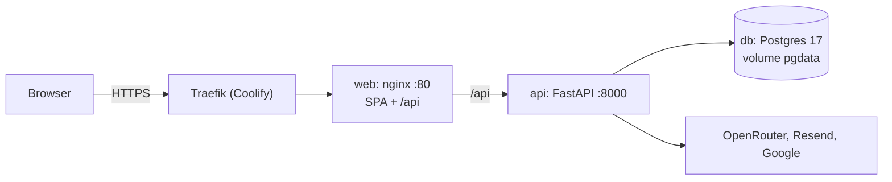

# Deploy no Coolify

Cada `git push` para `main` é construído e posto no ar pelo Coolify a partir de `docker-compose.yml`, em **https://novelo.helder.si**. Um só domínio: o nginx do contentor `web` serve a SPA e encaminha `/api` para a API, por isso não há CORS nem URLs da API no bundle. Por agora não há integração contínua remota; `just check` corre localmente antes de cada push.

## Como fica na VPS

Nenhuma porta é publicada pelo compose: o Traefik do Coolify é a única entrada, com HTTPS automático. A base de dados só é visível dentro da rede do compose.

## Preparar o Coolify (uma vez)

1. **DNS:** registo A de `novelo.helder.si` para o IP da VPS.
2. **Projeto:** no Coolify, criar o recurso "Docker Compose" a partir do repositório (GitHub App), branch `main`, ficheiro `docker-compose.yml`.
3. **Domínio:** atribuir `https://novelo.helder.si` ao serviço `web` (o compose declara `SERVICE_FQDN_WEB_80`).
4. **Variáveis:** preencher as do quadro abaixo no recurso (Environment Variables).
5. **Deploy automático por push:** ligado; o Coolify constrói as duas imagens e arranca.

## O que o compose faz

`docker-compose.yml` tem três serviços:

| Serviço | Imagem | Notas |
| --- | --- | --- |
| `web` | `apps/web/Dockerfile`: build do Vite e nginx 1.27 | Healthcheck em `/health`; limite de 8 MB por pedido (fotos da triagem) |
| `api` | `apps/api/Dockerfile`: Python 3.12 slim, utilizador sem privilégios, Pango para o PDF | `entrypoint.sh` corre `alembic upgrade head`, o seed idempotente de `data/processed` e o `uvicorn` |
| `db` | `postgres:17-alpine`, volume `pgdata` | Healthcheck com `pg_isready` |

O Coolify gera `SERVICE_PASSWORD_POSTGRES` e `SERVICE_PASSWORD_64_SECRETKEY`. As imagens podem testar-se localmente com `just build`.

## Variáveis

Os nomes vivem em `.env.example` (versionado); os valores só no Coolify. Descrição completa em [Ambiente](ambiente.md).

| Variável | Origem | Notas |
| --- | --- | --- |
| `DOMAIN` | Coolify | `novelo.helder.si`; define `APP_URL` e `CORS_ORIGINS` |
| `SERVICE_PASSWORD_POSTGRES`, `SERVICE_PASSWORD_64_SECRETKEY` | Gerados pelo Coolify | Password da base de dados e chave de sessão |
| `ADMIN_EMAIL`, `ADMIN_PASSWORD` | **Segredo** | Administrador inicial, criado no arranque |
| `ALLOW_REGISTRATION` | Opcional | `false` para só entrarem contas existentes |
| `GOOGLE_CLIENT_ID`, `GOOGLE_CLIENT_SECRET` | **Segredo** | Redirecionamento: `https://novelo.helder.si/api/v1/auth/google/callback` |
| `RESEND_API_KEY`, `EMAIL_FROM` | **Segredo** | O domínio do `EMAIL_FROM` tem de estar verificado no Resend |
| `OPENROUTER_API_KEY`, `LLM_MODEL_TEXT`, `LLM_MODEL_VISION` | **Segredo** e opções | Sem chave, a IA responde 503 |
| `SOLVER_TIME_LIMIT_S`, `LOG_LEVEL` | Opcional | |

## Operação

- **Estado:** `GET /api/v1/health` (processo) e `GET /api/v1/ready` (base de dados).
- **Logs:** no Coolify, por serviço. Sem `RESEND_API_KEY`, os emails aparecem no log da API.
- **Rollback:** `git revert` do commit em `main` e novo push. Antes da apresentação, marcar a versão da demo com uma tag (`v1.0-demo`).
- **Backups:** o único estado é o volume `pgdata`. Agendar um `pg_dump` diário no Coolify e copiá-lo para fora da VPS. Tudo o resto reconstrói-se a partir do repositório.
- **Novos dados:** os ficheiros de `data/processed` são importados no arranque; basta fazer push e o deploy importa-os (por exemplo, as localizações dos contentores de 20 de outubro de 2026).

## Diagnóstico rápido

| Sintoma | Verificar |
| --- | --- |
| Deploy não arranca | Variáveis em falta no recurso; logs do `api` (migração ou seed) |
| `502` em `/api` | Healthcheck do `api`; `DATABASE_URL` |
| Google devolve erro de redirecionamento | URI de retorno igual à de produção na consola Google |
| Emails não chegam | `RESEND_API_KEY` e domínio do `EMAIL_FROM` verificado |
| IA responde 503 | `OPENROUTER_API_KEY` |
| PDF do relatório falha | Bibliotecas Pango na imagem da API |

**Fontes:** [Coolify, Docker Compose](https://coolify.io/docs/services/configuration/docker-compose) · [Hey API, TanStack Query](https://heyapi.dev/openapi-ts/plugins/tanstack-query)
