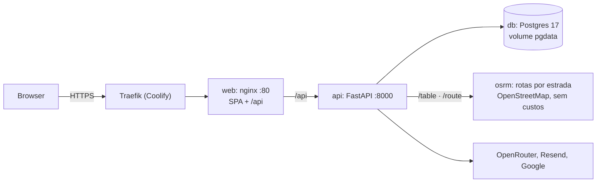

# Deploy no Coolify

Cada `git push` para `main` é construído e posto no ar pelo Coolify a partir de `docker-compose.yml`, em **https://novelo.helder.si** (uma VPS com o Coolify). Um só domínio: o nginx do contentor `web` serve a SPA e encaminha `/api` para a API, por isso não há CORS nem URLs da API no bundle. Por agora não há integração contínua remota; `just check` corre localmente antes de cada push.

## Como fica na VPS

Nenhuma porta é publicada pelo compose: o Traefik do Coolify é a única entrada, com HTTPS automático. A base de dados só é visível dentro da rede do compose.

## Preparar o Coolify (uma vez)

1. **DNS:** registo A de `novelo.helder.si` para o IP da VPS.
2. **Projeto:** no Coolify, criar o recurso "Docker Compose" a partir do repositório (GitHub App), branch `main`, ficheiro `docker-compose.yml`.
3. **Domínio:** atribuir `https://novelo.helder.si` ao serviço `web` (o compose declara `SERVICE_FQDN_WEB_80`).
4. **Variáveis:** preencher as do quadro abaixo no recurso (Environment Variables).
5. **Deploy automático por push:** ligado; o Coolify constrói as duas imagens e arranca.

## O que o compose faz

`docker-compose.yml` tem quatro serviços:

| Serviço | Imagem | Notas |
| --- | --- | --- |
| `web` | `apps/web/Dockerfile`: build do Vite e nginx | Healthcheck em `/health`; limite de 8 MB por pedido (fotos da triagem), 55 MB nos anexos do copiloto; stream do copiloto sem buffering e com leitura até 300 s; devolve 503 JSON `service_unavailable` quando a API reinicia |
| `api` | `apps/api/Dockerfile`: Python 3.12 slim, utilizador sem privilégios, Pango para o PDF | `entrypoint.sh` corre `alembic upgrade head`, o seed idempotente de `data/processed` (que vai dentro da imagem) e o `uvicorn` com 2 processos por omissão (`WEB_CONCURRENCY`) |
| `db` | `postgres:17-alpine`, volume `pgdata` | Healthcheck com `pg_isready` |
| `osrm` | `apps/osrm/Dockerfile`: descarrega o OpenStreetMap de Portugal (Geofabrik), recorta Guimarães e prepara o grafo no build | ~340 MB, ~60 MB de RAM (`mem_limit` 384 MB). O build precisa de rede para o Geofabrik e leva uns minutos na primeira vez. A API não depende dele: se parar, estima os km em linha reta. Ver [Rotas por estrada](rotas-reais.md) |

O Coolify gera `SERVICE_PASSWORD_POSTGRES` e `SERVICE_PASSWORD_64_SECRETKEY`. As imagens podem testar-se localmente com `just build`.

## Variáveis

Os nomes vivem em `.env.example` (versionado); os valores só no Coolify. Descrição completa em [Ambiente](ambiente.md). **O compose só repassa à API as variáveis do quadro**; as outras (por exemplo `MAGIC_LINK_EXPIRE_MINUTES`, `GUEST_*`, `COPILOT_*`, `EMAIL_TRANSPORT`) ficam nos valores por omissão do `config.py` até serem acrescentadas a `api.environment`.

| Variável | Origem | Notas |
| --- | --- | --- |
| `DOMAIN` | Coolify | `novelo.helder.si`; define `APP_URL` e `CORS_ORIGINS` |
| `SERVICE_PASSWORD_POSTGRES`, `SERVICE_PASSWORD_64_SECRETKEY` | Gerados pelo Coolify | Password da base de dados e `SECRET_KEY` (a API recusa arrancar em produção com uma chave de dev ou com menos de 32 caracteres) |
| `ADMIN_EMAIL`, `ADMIN_PASSWORD` | **Segredo** | Administrador inicial, criado no arranque |
| `ALLOW_REGISTRATION` | Opcional | `false` para só entrarem contas existentes |
| `QUICK_JOIN_ENABLED`, `QUICK_JOIN_CODE` | **Segredo** (o código) | A entrada por QR do evento só fica ativa em produção com `QUICK_JOIN_CODE` definido; mudar o código fecha os QR antigos |
| `GOOGLE_CLIENT_ID`, `GOOGLE_CLIENT_SECRET` | **Segredo** | Redirecionamento: `https://novelo.helder.si/api/v1/auth/google/callback` |
| `RESEND_API_KEY`, `EMAIL_FROM`, `EMAIL_SUPPORT`, `EMAIL_REPLY_TO` | **Segredo** (a chave) | O domínio do `EMAIL_FROM` tem de estar verificado no Resend. Sem chave não há magic link por email |
| `RESEND_WEBHOOK_SECRET`, `RESEND_READ_API_KEY`, `EMAIL_NOT_FOUND_PER_HOUR` | **Segredo** (os dois primeiros) | Entrega verificada dos emails; ver [Emails](emails.md). Sem eles só se sabe que o Resend aceitou o email |
| `OPENROUTER_API_KEY`, `OPENROUTER_BASE_URL`, `LLM_MODEL_TEXT`, `LLM_MODEL_VISION` | **Segredo** e opções | Sem chave, a IA responde 503. Depois do primeiro arranque os modelos mudam em `/admin/ai` |
| `SOLVER_TIME_LIMIT_S`, `LOG_LEVEL` | Opcional | |

Em produção `/api/docs` e `/api/openapi.json` ficam desligados; o contrato consulta-se no `openapi.json` do repositório.

## Deploy manual

O caminho normal é o push para `main`. Se o webhook não disparar ou for preciso repetir um deploy sem novo commit, faz-se **Redeploy** do recurso no painel do Coolify, ou, com acesso à VPS, pelo `artisan` do próprio Coolify. Este último é um procedimento operacional da equipa que **não está automatizado nem versionado** neste repositório; os comandos e os acessos ficam fora do Git, tal como os segredos.

## Operação

- **Estado:** `GET /api/v1/health` (processo) e `GET /api/v1/ready` (base de dados e se a IA está ligada).
- **Primeiro arranque:** a migração cria as tabelas e o seed importa os dados da Vitrus, o pacote municipal (tabelas `municipal_*`) e o administrador. Na primeira entrada, o administrador abre `/users`, separador «Cartaz do QR», para imprimir o QR do evento.
- **Logs:** no Coolify, por serviço; os da API são JSON com `request_id`. Sem `RESEND_API_KEY`, os emails aparecem no log da API.
- **Retenção do copiloto:** `python -m novelo.cli purge-copilot` apaga o que passou do prazo; pode agendar-se uma vez por dia no Coolify (ver [Copiloto](copiloto.md#definições-do-utilizador-vs-definições-do-sistema)).
- **Rollback:** `git revert` do commit em `main` e novo push. Antes da apresentação, marcar a versão da demo com uma tag (`v1.0-demo`).
- **Backups:** o único estado é o volume `pgdata`. Agendar um `pg_dump` diário no Coolify e copiá-lo para fora da VPS. Tudo o resto reconstrói-se a partir do repositório.
- **Cenários de referência:** com `SEED_REFERENCE_SCENARIOS=true` (por omissão no `docker-compose.yml`), cada arranque verifica em segundo plano os 6 cenários de referência e recalcula os desatualizados (um processo de cada vez, por tranca do Postgres; 20 a 40 s cada por locais). Depois de um deploy que mude o modelo, sobe `REFERENCE_MODEL_VERSION` em `features/planning/reference.py` (ver [Arquitetura](arquitetura.md#cenários-de-referência)).
- **Registo aberto:** para um evento, um administrador liga-o com `PATCH /api/v1/admin/settings` (`open_registration`, opcionalmente `approve_pending` para aprovar já os pendentes); fica na base de dados, não é uma variável de ambiente.
- **Novos dados:** `data/processed` vai dentro da imagem da API e é importado no arranque; basta correr `just etl`, fazer commit e push (por exemplo, quando chegarem os custos ou uma caracterização do lixo). A pasta `data/raw` não vai para a imagem.

## Diagnóstico rápido

| Sintoma | Verificar |
| --- | --- |
| Deploy não arranca | Variáveis em falta no recurso; logs do `api` (migração ou seed) |
| `502` em `/api` | Healthcheck do `api`; `DATABASE_URL` |
| Google devolve erro de redirecionamento | URI de retorno igual à de produção na consola Google |
| Emails não chegam | `RESEND_API_KEY` e domínio do `EMAIL_FROM` verificado; sem chave o magic link está desligado. Ver o *runbook* em [Emails](emails.md#runbook-um-utilizador-diz-que-não-recebeu-o-email) |
| `/join` diz que o acesso está fechado | `QUICK_JOIN_CODE` por definir em produção |
| O copiloto "fica pendurado" ou chega de uma vez | Algo entre o browser e a API está a fazer buffering do stream (ver as locations do `nginx.conf`) |
| IA responde 503 | `OPENROUTER_API_KEY` |
| PDF do relatório falha | Bibliotecas Pango na imagem da API |

**Fontes:** [Coolify, Docker Compose](https://coolify.io/docs/services/configuration/docker-compose) · [Hey API, TanStack Query](https://heyapi.dev/openapi-ts/plugins/tanstack-query)
