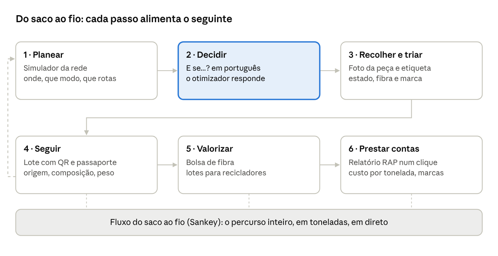

# Funcionalidades

Seis funcionalidades que nos distinguem, uma história: **do saco ao fio**. Planear a rede, decidir em linguagem natural, seguir cada saco até à indústria e entregar à câmara o dossiê de 2028. Cada uma usa a anterior, e as cinco primeiras cabem numa demo de dois minutos. A seguir vêm o copiloto conversacional, o agente semanal (ainda por fazer) e os ecrãs de base.

A linha tracejada à esquerda é o agente semanal de operações (secção 7, por fazer): o que os lotes mostram no terreno volta a calibrar o plano.

## 1. "E se...?" sobre o otimizador

O decisor pergunta em português e recebe um cenário novo, calculado pelo otimizador, com a diferença explicada em números. A IA conduz o modelo matemático; nunca faz contas.

> **Pergunta:** "E se tirarmos os contentores de rua de Serzedelo e passarmos a recolha a pedido?"
>
> **Novelo:** "Entendi: em Serzedelo, retirar contentores de rua e usar recolha a pedido. Resultado: investimento −X €, custo anual −Y €, toneladas captadas −Z t, €/t passa de A para B. Fonte: cenário B2, gerado às 14:32."

**Como funciona, passo a passo:**

1. O modelo (via OpenRouter, ver [IA](ia.md)) recebe a pergunta, o cenário atual e as listas fechadas de freguesias, modos e parâmetros.
2. Devolve **só** uma alteração estruturada, `ScenarioDelta`, validada por Pydantic. Exemplo: `{"zones": ["Serzedelo"], "remove_modes": ["street"], "add_modes": ["on_demand"]}`.
3. O ecrã mostra "Entendi: ..." antes de correr, para o decisor confirmar ou corrigir.
4. O OR-Tools corre o cenário novo e devolve os KPIs em JSON.
5. O modelo escreve a explicação a partir desse JSON.
6. **Verificação automática:** todos os números da resposta têm de existir no JSON. Se algum não existir, a resposta é rejeitada e gerada de novo; à segunda falha, mostra-se só a tabela.

**Regras:**

- Pergunta ambígua ("e se pouparmos?") → o Novelo pergunta de volta em vez de adivinhar.
- Freguesia ou modo fora das listas → recusa explícita, com sugestões próximas.
- Cada resposta guarda pergunta, alteração, cenário e versão do prompt: tudo auditável.
- Um conjunto de perguntas de teste com alteração esperada protege cada mudança de prompt (`tests/api/test_whatif.py`).

## 2. Lote com passaporte e bolsa de fibra

Cada peça triada entra num lote; cada lote tem um QR e uma página pública; os lotes juntam-se por fibra numa bolsa que os recicladores do Vale do Ave consultam. A recolha deixa de acabar no camião e passa a acabar na fábrica.

**O lote**

| Campo | Origem |
| --- | --- |
| Código e QR | Gerado ao abrir o lote no ponto de recolha |
| Freguesia e ponto | Ponto onde a peça foi entregue |
| Composição (ex.: 100% algodão) | Lida da etiqueta na triagem |
| Estado (reutilizável, reciclável, rejeito) | Triagem por foto, confirmável pelo operador |
| Peso | Estimado por tipo de peça no MVP; balança no ponto no piloto |
| Histórico | Recolhido, triado, reservado, entregue, com data |

**O passaporte.** Ler o QR abre a página pública do lote: origem, composição, peso e histórico. Os campos seguem o que o Plano de Guimarães descreve para a primeira fase do Passaporte Digital do Produto dos têxteis (composição, reciclabilidade, rastreabilidade), prevista até 2027, para o Novelo encaixar quando a regra chegar.

**A bolsa de fibra.** Uma vista agregada para quem recicla: "algodão 100%, reciclável, 320 kg em 4 lotes, Azurém e Creixomil". O reciclador registado manifesta interesse e o lote fica reservado. Sem preços nem pagamentos no MVP: o valor está em tornar visível material que hoje vai para aterro.

**Porque importa:** o plano municipal aponta a falta de têxtil limpo e homogéneo como uma das razões para não haver mercado de matérias-primas secundárias. Lotes por fibra são exatamente isso.

## 3. Relatório RAP num clique

Um botão gera o PDF que a câmara vai precisar para negociar com as entidades gestoras da responsabilidade alargada do produtor, que cada Estado-Membro tem de criar até 17 de abril de 2028. Responde a "quem paga isto?" com números do próprio concelho.

| Secção do relatório | Conteúdo |
| --- | --- |
| Resumo | Toneladas captáveis, custo anual e €/t do cenário escolhido |
| Custo por tipo de território | €/t em áreas predominantemente urbanas, medianamente urbanas e predominantemente rurais (tipologia TIPAU do INE) |
| Material recolhido | Toneladas por fibra e por destino (reutilização, reciclagem, rejeito), a partir dos lotes |
| Cenários | Os cenários comparados, com investimento e custo de operação |
| Evidência por marca | As marcas mais encontradas e a sua composição (ver feature 5) |
| Método e fontes | Fórmulas, pressupostos e fontes de cada número, com a etiqueta "estimativa" onde se aplica |

Gerado a partir de um modelo HTML com a identidade Novelo e convertido para PDF no servidor (WeasyPrint). O ecrã "Relatório RAP" guarda o histórico e descarrega cada PDF. Cada relatório fica guardado com data e versão dos parâmetros, para se poder reproduzir.

## 4. Fluxo do saco ao fio

Um diagrama de fluxo (Sankey) com quatro colunas: **freguesia → modo de recolha → resultado da triagem → destino**. A espessura de cada fio é a quantidade em toneladas.

- Mostra num relance onde se perde valor: um modo com muito rejeito, uma freguesia que capta pouco.
- Liga-se a um cenário (fluxo previsto) ou aos lotes reais (fluxo observado), e os dois comparam-se lado a lado.
- **Na demo:** cada peça triada em palco engrossa um fio em direto. É o momento em que o júri vê o sistema inteiro a funcionar.

## 5. Quem polui, paga: evidência por marca

Na triagem, a foto da etiqueta dá também a marca, quando está visível. O Novelo agrega **quilos por marca e por composição** ao longo do tempo.

- A nova diretiva permite que os Estados-Membros cobrem taxas de RAP mais altas a quem vende moda rápida (ecomodulação). Com isto, o município passa a ter dados próprios para essa discussão, em vez de médias europeias.
- Só se guardam marca, composição e peso. As fotografias são apagadas depois de processadas e nunca há dados de quem entregou a peça.
- No relatório RAP, esta evidência aparece agregada e com o tamanho da amostra, para não tirar conclusões de poucos lotes.

## 6. Copiloto conversacional

Uma conversa em streaming (`/chat`, ou o painel em qualquer ecrã com `⌘K` / `Ctrl+K`) que sabe o que o decisor está a ver. Pede-se em português ("compara o Base com o Ambicioso e mostra o €/t") e o copiloto responde em poucas frases, com o gráfico ou a tabela e a fonte dos dados.

- **46 ferramentas tipadas** chamam os mesmos services da app: cenários, "E se...?", sensibilidade, piloto, rede, lotes, bolsa, marcas, alertas, rede municipal e custos de IA.
- **Nunca faz contas:** gráficos e tabelas são construídos pelo servidor; o verificador retira e reescreve um texto com números sem origem.
- **Ações com confirmação:** o copiloto só propõe (criar ou apagar um cenário, resolver um alerta, abrir ou reservar um lote, mudar um pressuposto); só o clique executa, com as permissões da pessoa. Fica auditado e, quando reversível, pode ser desfeito.
- **Memória, anexos e menções:** duas notas pequenas por utilizador, editáveis e exportáveis; imagens, PDF, folhas de cálculo e texto como contexto; `@freguesia`, `@cenário`, `@local` e o ecrã atual.
- **Conversas:** histórico, pastas, partilha só de leitura por ligação, exportação em Markdown e PDF, ramos ao editar uma mensagem.

Desenho, contrato dos eventos, segurança e avaliação em [Copiloto](copiloto.md).

## 7. Agente semanal de operações (se houver tempo)

Um agente que corre todas as segundas-feiras e fecha o ciclo entre o plano e o terreno:

1. Lê os lotes da semana e compara toneladas reais com as previstas por ponto.
2. Recalibra as taxas de captura por modo (ver [Dados e modelo](dados-e-modelo.md)).
3. Volta a correr o otimizador e propõe alterações com a poupança esperada ("mover o ponto da Junta X para o supermercado Y: +0,4 t/mês").
4. Escreve um resumo para a Vitrus. **Nada é aplicado sem aprovação humana.**

No hackathon mostra-se uma execução, com dados simulados de uma semana. No pitch entra como o próximo passo natural. **Não iniciado.**

## Ecrãs de base

Tudo o que as funcionalidades acima precisam para funcionar com dados reais.

| Ecrã | Rota | O que faz |
| --- | --- | --- |
| Sala de decisão (Ponto de partida) | `/` | A página que se abre todos os dias, para responder em 10 segundos: onde estamos, quanto falta e o que dá o orçamento. Faixa de situação (301,3 t recolhidas, % do potencial, t por captar e dias até 17 abr 2028, cada um com selo «medido» ou «estimativa»), **mapa de Guimarães em meio-tom** (48 freguesias, camadas potencial por captar, população, contentores municipais «não são de têxteis», circuitos e lacunas de dados; detalhe, simular, perguntar ao Copiloto e mapa completo por freguesia), **controlo de orçamento ao vivo** (interpola a recolha entre os cenários guardados, sem solver nem IA; abre o simulador com o orçamento), «O fio» (potencial → recolhido → destino, com o fio solto), próximos passos por papel com contadores, perguntas sugeridas ao Copiloto, barra de confiança dos dados (medido / estimativa / em falta) e a evidência (manchetes, fontes, entidades, fluxos, composição, freguesias) por baixo da dobra. URL partilhável: `?layer=&parish=&budget=&tab=` |
| Simulador | `/simulator` | Formulário de orçamento (60 000 € por ano por omissão), meta e restrições; corre o otimizador e mostra os passos. **Rede: «Locais reais» (por omissão) escolhe locais concretos da rede municipal** (raio a pé de 200, 300 ou 500 m; tipo de ponto em local existente ou contentor de rua); «Por freguesia» mantém o modelo por zonas |
| Cenários | `/scenarios`, `/scenarios/:id`, `/scenarios/compare` | Lista, resumo, rede, incerteza (tornado e Monte Carlo; só por freguesia), "E se...?", robustez e comparação lado a lado; cenários de referência por *benchmark*. Os cenários por locais reais mostram os locais abertos (rua, freguesia, têxtil e população servida, viatura), o raio de cobertura no mapa e as rotas pelos locais |
| Validação | `/validation` | O que se consegue testar do modelo com os dados de hoje: triangulação do potencial por habitante e validação cruzada espacial; o que ainda não se testa |
| Pressupostos | `/assumptions` | Cada parâmetro com valor, unidade e origem; edição só por administradores |
| Piloto | `/pilot` | Escolhe 2 a 4 freguesias de maior aprendizagem e o piso de sinal em toneladas |
| Cobertura | `/coverage` | Cobertura a pé dos contentores **de têxteis**; em espera até chegarem as localizações |
| Mapa | `/map` | Freguesias, localidades e camadas municipais (locais, contornos CAOP, produtores) |
| Rede municipal | `/municipal` | Contentores de **outras frações** (não são de têxteis) em seis separadores: visão geral, freguesias, locais, candidatos a têxteis, lacunas (estimativa) e qualidade; exportação CSV, XLSX e GeoJSON. Nomes de produtores só para administradores |
| Circuitos e localidades | `/circuits`, `/localities` | Os circuitos e as 82 localidades da Vitrus, por tipologia e por frequência |
| Frota e turnos | `/fleet` | Calendário da semana tipo (semana, dia, por viatura, por circuito) com conflitos reais, mapa das localidades por circuito, visão geral com carga por turno, viaturas e tipologias; exportação `.ics` e CSV. É planeamento de semana tipo, sem datas nem horas reais |
| Qualidade dos dados | `/data-quality` | Alertas (12 da Vitrus e 25 municipais) resolúveis, com sugestão de IA, e fontes com impressão digital |
| Triagem, lotes, bolsa, marcas | `/triage`, `/lots`, `/market`, `/brands` | Funcionalidades 2 e 5 |
| Relatório RAP | `/reports` | Funcionalidade 3 |
| Copiloto | `/chat` | Funcionalidade 6 |
| Utilizadores | `/users` | Contas, convidados do evento (entrada por QR) e cartaz do QR para imprimir. Só administradores |
| IA | `/admin/ai` | Modelo e limites por tarefa, orçamento, custos e avaliação da triagem. Só administradores |
| Conta | `/account` | Perfil, língua, tema, sessões, password |
| Entrada | `/login`, `/join`, `/magic-link`, `/verify-email`, `/privacy` | Magic link (principal), password, Google, entrada de evento por QR, confirmação de email e texto de privacidade |
| Passaporte | `/passport/:código` | Público, sem sessão: o que o QR do lote abre |

**Transversal:** pt-PT e inglês, tema claro e escuro, PWA instalável com barra de separadores em telemóvel, páginas de erro, visita guiada na primeira entrada, `DataTable` em todas as tabelas (ver [Arquitetura](arquitetura.md#web)).

## Estado de implementação

| Funcionalidade | Estado |
| --- | --- |
| Simulador, cenários e comparação, pressupostos com origem, incerteza, robustez e piloto | Feito |
| "E se...?" com verificador de números | Feito (precisa de `OPENROUTER_API_KEY`) |
| Triagem por foto, lotes, QR, passaporte público, bolsa de fibra | Feito; exatidão da triagem por medir |
| Evidência por marca, relatório RAP em PDF com custo por TIPAU | Feito |
| Mapa da rede, circuitos, localidades, qualidade dos dados | Feito |
| Frota: calendário da semana tipo com conflitos reais, mapa, visão geral, `.ics`/CSV | Feito (semana tipo, sem datas nem horas reais) |
| Tabelas e separadores de nível profissional (`DataTable`, `PageTabs`) | Feito; paginação em blocos, sem virtualização de linhas |
| Rede municipal (outras frações, não é têxtil): API, ecrã de seis separadores, camadas do mapa, alertas `municipal_*`, exportação e ferramentas do copiloto | Feito |
| Copiloto conversacional (SSE tipado, threads, memória, anexos, menções, artefactos, ações com confirmação, página `/chat`, avaliação) | Feito; estado «a correr o otimizador» sem progresso real |
| Entrada por magic link, entrada por QR (`guest`), Google, emails transacionais | Feito |
| Páginas de erro, PWA e interface de telemóvel, marca gerada por `just brand` | Feito |
| Camada e cobertura dos contentores de **têxteis** | Falta: a lista de contentores de têxteis continua por receber |
| Agente semanal de operações | Não iniciado (fica para depois) |

## O que fica de fora, de propósito

- **Sensores nos contentores:** custam por unidade e o desafio pede o menor investimento.
- **Blockchain no passaporte:** um registo com histórico na base de dados chega para rastrear lotes; não acrescenta nada que o júri valorize.
- **App do cidadão completa:** a recolha a pedido pode começar com um formulário simples; a app vem depois do piloto.

## Ordem de corte

Se o tempo apertar, corta-se por esta ordem: agente semanal (7), copiloto conversacional (6), evidência por marca (5), animação do Sankey (fica estático), bolsa de fibra (fica só o passaporte do lote). **Nunca se cortam:** a comparação de cenários, o "E se...?" e o relatório RAP.

**Fontes:** [Plano de Ação Integrado para a Circularidade Têxtil de Guimarães](https://urbact.eu/sites/default/files/2026-01/Guimaraes_IAP_PT.pdf) (passaporte digital, mercado de matérias-primas secundárias) · [Diretiva 2025/1892, VdA](https://www.vda.pt/pt/publicacoes/insights/diretiva-20251892-que-altera-a-diretiva-quadro-dos-residuos-diretiva-200898ce/28063/) (prazo da RAP) · [EU Parliament mandates EPR for textiles, AMI](https://www.ami.international/insights/eu-parliament-mandates-extended-producer-responsibility-epr-for-textiles) (taxas mais altas para moda rápida)
