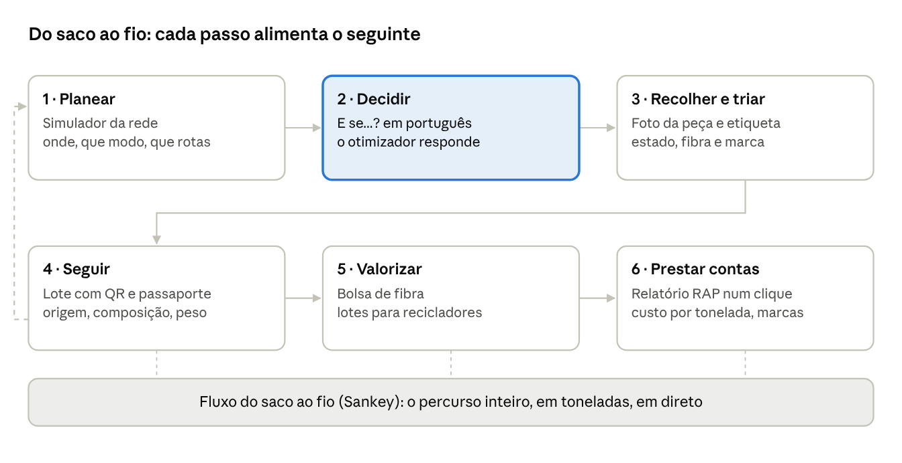

# Funcionalidades

Seis funcionalidades que nos distinguem, uma história: **do saco ao fio**. Planear a rede, decidir em linguagem natural, seguir cada saco até à indústria e entregar à câmara o dossiê de 2028. Cada uma usa a anterior, e as cinco primeiras cabem numa demo de dois minutos. A seguir vêm o copiloto conversacional (6), o agente semanal (7) e os ecrãs de base.

A resposta ao feedback da Vitrus (apresentação de nov 2026) acrescentou uma segunda frente, **a rede no terreno e o cidadão** (secções 8–13): do saco ativado em casa ao lote pesado na viatura, ao aviso da escola e ao crédito em pontos. O âmbito foi decidido e documentado no [mapa wayfinder](https://github.com/helderpgoncalves/novelo/issues/30); as decisões difíceis de reverter estão nos [ADR](adr/README.md) e os termos no [glossário](../../GLOSSARY.md).

A linha tracejada à esquerda é o agente semanal de operações (secção 7, por fazer): o que os lotes mostram no terreno volta a calibrar o plano.

## 1. "E se...?" sobre o otimizador

O decisor pergunta em português e recebe um cenário novo, calculado pelo otimizador, com a diferença explicada em números. A IA conduz o modelo matemático; nunca faz contas.

> **Pergunta:** "E se em Serzedelo deixarmos a paragem em local existente e passarmos a recolha a pedido?"
>
> **Novelo:** "Entendi: em Serzedelo, retirar o ponto em local existente e usar recolha a pedido. Resultado: investimento −X €, custo anual −Y €, toneladas captadas −Z t, €/t passa de A para B. Fonte: cenário B2, gerado às 14:32."

**Como funciona, passo a passo:**

1. O modelo (via OpenRouter, ver [IA](ia.md)) recebe a pergunta, o cenário atual e as listas fechadas de freguesias, modos e parâmetros.
2. Devolve **só** uma alteração estruturada, `ScenarioDelta`, validada por Pydantic. Exemplo: `{"zones": ["Serzedelo"], "remove_modes": ["existing"], "add_modes": ["on_demand"]}`. Os modos por omissão são `existing` e `on_demand`; `street` (contentor de rua) só entra se o utilizador o pedir como referência, porque a Vitrus não quer contentores de têxtil (21 out 2026).
3. O ecrã mostra "Entendi: ..." antes de correr, para o decisor confirmar ou corrigir.
4. O OR-Tools corre o cenário novo e devolve os KPIs em JSON.
5. O modelo escreve a explicação a partir desse JSON.
6. **Verificação automática:** todos os números da resposta têm de existir no JSON. Se algum não existir, a resposta é rejeitada e gerada de novo; à segunda falha, mostra-se só a tabela.

**Regras:**

- Pergunta ambígua ("e se pouparmos?") → o Novelo pergunta de volta em vez de adivinhar.
- Freguesia ou modo fora das listas → recusa explícita, com sugestões próximas.
- Cada resposta guarda pergunta, alteração, cenário e versão do prompt: tudo auditável.
- Um conjunto de perguntas de teste com alteração esperada protege cada mudança de prompt (`tests/api/test_whatif.py`).

## 2. Lote com passaporte e bolsa de fibra

Cada saco recolhido vira um lote; cada lote tem um QR e uma página pública; os lotes juntam-se por fibra numa bolsa que os recicladores do Vale do Ave consultam. A recolha deixa de acabar no camião e passa a acabar na fábrica.

**O lote** — nasce na paragem (`POST /lots/stops`), acumula unidades com QR e pesos medidos e fecha quando a viatura parte (`POST /lots/{código}/departure`):

| Campo | Origem |
| --- | --- |
| Código e QR | Um QR por unidade física (`lot_units`): o do saco da plataforma (`source: bag`), ou etiqueta impressa na viatura com UUID (`source: label`) quando não há; o QR imprime-se via `GET /lots/{código}/units/{id}/qr` |
| Paragem (freguesia, local) | Onde o lote nasce — à porta (ronda ou pedido) ou num local; ancorado ao abrir (`locality_id` + freguesia deduzida ou explícita) |
| Peso | **Medido na viatura, por unidade** (`weight_g` em cada saco; pratos ≤ 15 kg somados); lotes antigos caem na estimativa por tipo de peça e dizem-no (`weight_source: measured` / `estimated`) |
| Estado fino, tipologia, estação, cor, género, tamanho | Triagem a jusante: a IA propõe (foto), o operador confirma (padrão-ouro); cada atributo carrega proveniência e confiança («confirmado» / «IA») |
| Composição (ex.: 100% algodão) | Lida da etiqueta na triagem |
| Histórico | Aberto na paragem, partiu («Partir»), peças triadas, reservado, entregue, com data |

**Um lote de recolha por paragem.** O lote de recolha nasce na viatura, um por paragem (na recolha a pedido, um por saco), pesado e etiquetado no momento: «Cheguei» abre, os sacos entram com o QR próprio e o peso da balança, e «Partir» fecha a paragem (exige todas as unidades pesadas; depois as unidades congelam, e a triagem acrescenta peças sem tocar no peso medido). O lote de **escoamento** é que se fecha por categoria para exportar roupa reutilizável — chave (estado fino, tipologia, estação, género), com a linhagem preservada até às paragens; cor e tamanho ficam como atributos filtráveis. É a resposta ao pedido da Vitrus de categorizar as triagens (cor, estação, …) para exportar lotes; os níveis de qualidade e a sazonalidade vêm do que a Retex (Maia) faz (branch `research/retex-maia`; a Retex é candidata a operador de triagem).

**O passaporte.** Ler o QR abre a página pública do lote: origem, composição, peso e histórico. Os campos seguem o que o plano municipal de Guimarães (contexto público, F74) descreve para a primeira fase do Passaporte Digital do Produto dos têxteis (composição, reciclabilidade, rastreabilidade), prevista até 2027, para o Novelo encaixar quando a regra chegar.

**A bolsa de fibra (prioridade baixa).** A Vitrus diz que reciclar custa muito mais que a fibra virgem (21 out 2026): o valor está na reutilização, e a bolsa desce na prioridade. Uma vista agregada para quem recicla: "algodão 100%, reciclável, 320 kg em 4 lotes, Azurém e Creixomil". O reciclador registado manifesta interesse e o lote fica reservado. Sem preços nem pagamentos no MVP: o valor está em tornar visível material que hoje vai para aterro.

**Porque importa:** o plano municipal aponta a falta de têxtil limpo e homogéneo como uma das razões para não haver mercado de matérias-primas secundárias. Lotes por fibra são exatamente isso.

## 3. Relatório RAP num clique

Um botão gera o PDF que a câmara vai precisar para negociar com as entidades gestoras da responsabilidade alargada do produtor, que cada Estado-Membro tem de criar até 17 de abril de 2028. Responde a "quem paga isto?" com números do próprio concelho.

| Secção do relatório | Conteúdo |
| --- | --- |
| Resumo | Toneladas captáveis, custo anual e €/t do cenário escolhido |
| Custo por tipo de território | €/t em áreas predominantemente urbanas, medianamente urbanas e predominantemente rurais (tipologia TIPAU do INE) |
| Material recolhido | Toneladas por fibra e por destino (reutilização, reciclagem, rejeito), a partir dos lotes |
| Cenários | Os cenários comparados, com investimento e custo de operação |
| Evidência por marca | As marcas mais encontradas e a sua composição (ver feature 5) |
| Método e fontes | Fórmulas, pressupostos e fontes de cada número, com a etiqueta "estimativa" onde se aplica |

Gerado a partir de um modelo HTML com a identidade Novelo e convertido para PDF no servidor (WeasyPrint). O ecrã "Relatório RAP" guarda o histórico e descarrega cada PDF. Cada relatório fica guardado com data e versão dos parâmetros, para se poder reproduzir.

## 4. Fluxo do saco ao fio

Um diagrama de fluxo (Sankey) com quatro colunas: **freguesia → modo de recolha → resultado da triagem → destino**. A espessura de cada fio é a quantidade em toneladas.

- Mostra num relance onde se perde valor: um modo com muito rejeito, uma freguesia que capta pouco.
- Liga-se a um cenário (fluxo previsto) ou aos lotes reais (fluxo observado), e os dois comparam-se lado a lado.
- **Na demo:** cada peça triada em palco engrossa um fio em direto. É o momento em que o júri vê o sistema inteiro a funcionar.

## 5. Quem polui, paga: evidência por marca

Na triagem, a foto da etiqueta dá também a marca, quando está visível. O Novelo agrega **quilos por marca e por composição** ao longo do tempo.

- A nova diretiva permite que os Estados-Membros cobrem taxas de RAP mais altas a quem vende moda rápida (ecomodulação). Com isto, o município passa a ter dados próprios para essa discussão, em vez de médias europeias.
- A evidência guarda marca, composição e peso. A triagem não guarda fotografias (só em memória durante o pedido) e nunca há dados de quem entregou a peça. Desde 23 out 2026 o operador pode, peça a peça, guardar uma **miniatura opcional** (JPEG até 640 px, sem metadados, sem pessoas, confirmada pelo operador), apagada ao fim de 90 dias ou quando quiser. Ver [Privacidade das fotografias](privacidade-fotografias.md).
- No relatório RAP, esta evidência aparece agregada e com o tamanho da amostra, para não tirar conclusões de poucos lotes.

## 6. Copiloto conversacional

Uma conversa em streaming (`/chat`, ou o painel em qualquer ecrã com `⌘K` / `Ctrl+K`) que sabe o que o decisor está a ver. Pede-se em português ("compara o Base com o Ambicioso e mostra o €/t") e o copiloto responde em poucas frases, com o gráfico ou a tabela e a fonte dos dados.

- **52 ferramentas tipadas** (mais a pesquisa web, se ligada) chamam os mesmos services da app: cenários, "E se...?", sensibilidade, piloto, rede, lotes, bolsa, marcas, alertas, rede municipal e custos de IA.
- **Nunca faz contas:** gráficos e tabelas são construídos pelo servidor; o verificador retira e reescreve um texto com números sem origem.
- **Ações com confirmação:** o copiloto só propõe (criar ou apagar um cenário, resolver um alerta, abrir ou reservar um lote, mudar um pressuposto); só o clique executa, com as permissões da pessoa. Fica auditado e, quando reversível, pode ser desfeito.
- **Memória, anexos e menções:** duas notas pequenas por utilizador, editáveis e exportáveis; imagens, PDF, folhas de cálculo e texto como contexto; `@freguesia`, `@cenário`, `@local` e o ecrã atual.
- **Conversas:** histórico, pastas, partilha só de leitura por ligação, exportação em Markdown e PDF, ramos ao editar uma mensagem.

Desenho, contrato dos eventos, segurança e avaliação em [Copiloto](copiloto.md).

## 7. Agente semanal de operações (se houver tempo)

Um agente que escreve o resumo semanal para a Vitrus: lê os lotes e os pesos da semana, compara com o previsto por paragem e propõe recálculos de cenário com a poupança esperada ("o local X já só dá 2 kg/semana: baixar para mensal poupa Y €"). A calibração em si é a da secção 13 — o agente propõe e **nada é aplicado sem aprovação humana**. No pitch entra como o próximo passo natural. **Não iniciado.**

## 8. Superfície do cidadão (`/cidadao`)

O PWA que existe evolui; **sem app nativa** (é na viatura que o Android + Chrome é exigido, para o Bluetooth da balança e da impressora). Conta por magic link de email (ou telefone, sem password); só `pt-PT` no MVP; sem conta, só o que já é público. RGPD no [ADR](adr/rgpd-conta-de-doador.md) (13 anos, consentimentos em duas camadas, apagamento).

- **Os meus sacos**: ativar/desativar, apelido privado; saldo só leitura; histórico ligado ao passaporte; crédito por **saco ativado**, nunca por kg ([ADR](adr/identidade-e-credito-do-doador.md)).
- **Dois portadores**: saco da plataforma com QR único, ou mão a mão com o QR de conta (locais públicos sem sacos = lote sem doador).
- **«Onde e quando entrego»**: página pública com a agenda real de cada local (dado introduzido, não saída do otimizador).
- **«Vai no saco?»** continua público e sem sessão.
- Protótipo (branch `prototype/fluxo-cidadao`): base «Carteira» (separadores Início/Sacos/Saldo/Histórico), onboarding passo a passo na primeira sessão e herói público «onde e quando entrego». Privacidade no [ADR do RGPD](adr/rgpd-conta-de-doador.md).

## 9. Recolha a pedido

A ronda mantém-se **universal** (o saco no dia da freguesia é sempre recolhido); o pedido é opcional e vale **certeza**: data e aviso. Só com conta, gratuito, auto-aceite por regras; corte às **48 h**; 1–5 sacos; 1 pedido ativo por morada; expira à 3.ª ausência; morada retida 12 meses. Fora da ronda é exceção despachada pela Vitrus, não produto. Para o modelo, o pedido é **sinal de procura** e calibra os sacos por ronda (secção 13).

## 10. Pontos e parcerias

- Ganho **flat por saco recolhido (100, estimativa)** + **bónus de conformidade (+50)** a quem declarou o conteúdo e a triagem confirmou; teto mensal por conta; valores configuráveis, sempre «estimativa».
- **Catálogo MVP**: donativos a IPSS (1 000 pontos ≈ 5 €, a única âncora em €), prémios **cedidos por parceiros locais** e acumulado ambiental verificado.
- **Economia**: os parceiros pagam os prémios; a Vitrus paga os donativos **com teto indexado ao custo evitado** (105,64 €/t). Nunca dinheiro nem vouchers de moda ([ADR](adr/economia-dos-pontos.md)).
- **Resgate por código pseudónimo**: zero partilha de dados com parceiros ([ADR](adr/resgate-por-codigo-pseudonimo.md)); 12 meses por ganho, FIFO; campanhas sazonais da Vitrus.
- **Benefícios municipais** em fases (2: perímetro Vitrus; 3: equipamentos da câmara e freguesias; 4: bonificação tarifária por regulamento, com parecer ERSAR — precedente Ovar 780/2024); donativo a IPSS = **mecenato** (EBF art. 62.º, DL 167/2026); regulamento de pontos com abuso de critérios objetivos; minuta de contrato de patrocínio (10 cláusulas). Detalhe legal no branch `research/enquadramento-legal-incentivos`.
- **Gestor de parcerias** na app de gestão (as freguesias propõem); acumular desde o dia 1, trocar no passo seguinte do PWA.

## 11. Contas de local: assistidas e produtor B2B (`/local`)

Um só papel (`local`); a conta pertence ao **local**, é criada pela equipa (sem auto-registo) e a natureza do sítio decide a home.

- **Locais assistidos (escolas no MVP)**: leitura — lotes por paragem com o peso medido, relatório em kg medidos por destino (sem CO₂ nem doadores); certificado público **opt-in**; e uma única escrita: o **aviso «sacos prontos»**, que garante paragem.
- **Produtor B2B (17 lares + 9 de hotelaria)**: leitura em espelho do assistido; pedido de recolha com a mecânica do cidadão, exceto o volume (teto de 20 sacos, estimativa; acima = recolha especial) e a morada institucional fixa; sem pontos nem crédito.
- Protótipo «Duas portas» (branch `prototype/fluxo-local`): o aviso como herói; rondas e certificado atrás de portões grandes, em folhas inferiores.
- **Na API e no contrato (17 nov 2026)**: convite com papel `local` traz `locality_id` + `local_kind` (`assistido`/`b2b`) e ao aceitar nasce `local_accounts` (conta ligada ao local; certificado opt-in por conta). O aviso vive em `stop_notices`: **um só ativo por local** (índice parcial único; anular não apaga, avisar outra vez cria linha nova), com `bag_count` opcional — sinal de procura para o otimizador (#61), nunca contabilidade (o peso verdadeiro é o da balança). Leitura do próprio local em `/local/account`, `/local/lots`, `/local/report` (kg por destino: o peso vem da balança, os destinos da triagem — só lotes triados contam no desvio); a equipa vê tudo em `/locals`; o certificado público em `GET /public/locals/{id}/certificate` só existe com opt-in (404 `certificate_not_public`), sem doadores e sem CO₂. No web, `/local` «Duas portas» (telemóvel primeiro, pt-PT) e `/certificado/{id}` público; mudar o papel de uma conta existente para `local` é bloqueado no UI (a conta de local nasce do convite, com local).

## 12. Ecrã da viatura: pesar, etiquetar, offline

O lote de recolha nasce aqui (secção 2). **«O scan manda»**: câmara primeiro; etiqueta impressa só quando o saco não tem QR; pratos calculados pela app (≤ 15 kg por pesagem); correção direta por saco (o prato pesado anula-se); total sempre visível; «Cheguei» e «Partir» os únicos gestos deliberados (sem GPS no MVP). Offline com fila «à espera de sincronização» (IndexedDB + Background Sync).

- **Hardware** (branch `research/hardware-viatura`): Zebra ZQ511 (etiquetas, BLE) + KERN IXC 10K-3M (balança 15 kg, BLE, IP65) ≈ 1 300–1 600 € s/IVA por viatura (**estimativa**); alternativa de demonstração ~200–350 €.
- **Exige Android + Chrome** (Web Bluetooth e Background Sync não existem no Safari/iOS).

## 13. Política de paragem e calibração

- **Política de paragem** ([ADR](adr/politica-de-paragem.md)): o aviso garante paragem; sem aviso, a frequência de cada local é escolhida pelo otimizador na **escada discreta** (semanal a trimestral); a porta não encolhe (ronda universal — o pedido calibra os sacos por ronda, não corta quilómetros); a agenda pública acompanha o degrau; nenhuma visita publicada é saltada; corte único de 48 h. O `collection_plan` passa a mostrar a frequência por local.
- **Calibração** ([ADR](adr/captura-anual-e-derivada.md) e [Dados e modelo](dados-e-modelo.md#calibração)): o observado (pesos por paragem, pedidos) calibra quatro métricas operacionais — **taxa de geração** (kg/dia por local), kg por saco, sacos por ronda por freguesia, pedidos por semana — com janela de 12 semanas (mediana) e pseudo-contagem (o observado domina a partir da 4.ª visita pesada; rótulos «estimativa·n» / «observado·n»). A captura anual é **derivada** (taxa × frequência), nunca auto-calibrada pelo piloto; a atualização é manual, ao recalcular, e o cenário fotografa a calibração que usou. Painel «Calibração» na app de gestão; os pedidos chegam primeiro (sinal de arranque) e **nunca multiplicam quilos**.

## Ecrãs de base

Tudo o que as funcionalidades acima precisam para funcionar com dados reais.

| Ecrã | Rota | O que faz |
| --- | --- | --- |
| Sala de decisão (Ponto de partida) | `/` | A página que se abre todos os dias, para responder em 10 segundos: onde estamos, quanto falta e o que dá o orçamento. Faixa de situação (301,3 t recolhidas, % do potencial, t por captar e dias até 17 abr 2028, cada um com selo «medido» ou «estimativa»), **mapa de Guimarães em meio-tom** (48 freguesias, camadas potencial por captar, população, contentores municipais «não são de têxteis», circuitos e lacunas de dados; detalhe, simular, perguntar ao Copiloto e mapa completo por freguesia), **controlo de orçamento ao vivo** (interpola a recolha entre os cenários guardados, sem solver nem IA; abre o simulador com o orçamento), «O fio» (potencial → recolhido → destino, com o fio solto), próximos passos por papel com contadores, perguntas sugeridas ao Copiloto, barra de confiança dos dados (medido / estimativa / em falta) e a evidência (manchetes, fontes, entidades, fluxos, composição, freguesias) por baixo da dobra. URL partilhável: `?layer=&parish=&budget=&tab=` |
| Simulador | `/simulator` | Formulário de orçamento (60 000 € por ano por omissão), meta e restrições; corre o otimizador e mostra os passos. **Rede: «Locais reais» (por omissão) escolhe locais concretos da rede municipal** (raio a pé de 200, 300 ou 500 m; paragem em local existente, sem contentor novo, por omissão; contentor de rua só como referência). Candidatos na API (`site_candidates`): locais públicos e **pontos assistidos** (escolas), os dois por omissão. «Por freguesia» mantém o modelo por zonas. Em ambos, toda a recolha é feita por uma **viatura nova de têxtil, de caixa fechada e sem compactação**, a partir do estaleiro de Polvoreira (a Vitrus confirmou a 22 out 2026 que o saco não pode ir na compactadora do porta a porta): saco fechado à porta numa ronda por freguesia a cada 2 semanas e paragens nos locais. As rotas têm os km e o traçado **medidos pela estrada** (OSRM próprio sobre o OpenStreetMap; [Rotas por estrada](rotas-reais.md)): cada rota traz `source` (`road` ou `estimate`) e o resultado `routing` (`road`, `mixed` ou `estimate`); só se o OSRM não responde ou um par não tem caminho a rota é estimativa (linha reta × desvio 1,3), e a volta porta a porta dentro de cada freguesia é sempre estimativa por fórmula. O resultado traz o plano da viatura (`collection_plan`: freguesia, canal, dia, viatura, frequência, kg por ronda, km e horas por ano), as viaturas necessárias e os dias de viatura por semana, o investimento na viatura (42 500 €, pressuposto com fonte), o **tratamento evitado** (105,64 €/t, Vitrus) e o **custo líquido para o município** (custo anual − tratamento evitado), sempre estimativa |
| Cenários | `/scenarios`, `/scenarios/:id`, `/scenarios/compare` | Lista, resumo, rede, incerteza (tornado e Monte Carlo; só por freguesia), "E se...?", robustez e comparação lado a lado; cenários de referência por *benchmark*. **Cenários de referência da aplicação** (`GET /planning/scenarios/reference`): 5 por locais reais (20 000 a 150 000 €/ano) e 1 por freguesia a 60 000 €/ano (`reference_key=parish:60000`, `onboarding=true`) com o plano de recolha pronto para o ecrã inicial; recalculados no arranque quando o modelo (`REFERENCE_MODEL_VERSION = 5`, viatura dedicada) ou os pressupostos mudam. Os cenários por locais reais mostram os locais abertos (rua, freguesia, têxtil e população servida, viatura), o raio de cobertura no mapa e as rotas pelos locais, desenhadas pelas estradas e com a origem dos km («por estrada» ou estimativa) e a duração de condução do OSRM, só informativa (as horas de viatura usam 30 km/h de recolha, pressuposto). Os KPIs de cada cenário trazem a viatura dedicada (viaturas, dias por semana, investimento), o tratamento evitado e o custo líquido (também na comparação), o **têxtil reutilizável** (toneladas × quota de reutilização de 2025, 59,4%, com intervalo de 50,0% a 72,9%) e o **€ por tonelada reutilizável**, sempre estimativa. Separador **Cobertura** (`GET /planning/scenarios/{id}/coverage`): a matriz do art. 22.º-C, n.º 9, alínea b) da Diretiva (UE) 2025/1892, por freguesia e por TIPAU, com a população servida fora das freguesias urbanas contra as urbanas ([Dados e modelo](dados-e-modelo.md#10-matriz-de-cobertura-diretiva-20251892)) |
| Validação | `/validation` | O que se consegue testar do modelo com os dados de hoje: triangulação do potencial por habitante e validação cruzada espacial; o que ainda não se testa |
| Pressupostos | `/assumptions` | Cada parâmetro com valor, unidade e origem; edição só por administradores |
| Piloto | `/pilot` | Escolhe 2 a 4 freguesias de maior aprendizagem e o piso de sinal em toneladas |
| Cobertura | `/coverage` | Cobertura a pé dos pontos de têxteis. A Vitrus não tem contentores de têxtil (21 out 2026); o ecrã não inventa cobertura |
| Mapa | `/map` | Freguesias, localidades e camadas municipais (locais, contornos CAOP, produtores) |
| Rede municipal | `/municipal` | Contentores de **outras frações** (não são de têxteis) em seis separadores: visão geral, freguesias, locais, candidatos a têxteis, lacunas (estimativa) e qualidade; exportação CSV, XLSX e GeoJSON. Nomes de produtores só para administradores |
| Circuitos e localidades | `/circuits`, `/localities` | Os circuitos e as 82 localidades da Vitrus, por tipologia e por frequência |
| Frota e turnos | `/fleet` | Calendário da semana tipo (semana, dia, por viatura, por circuito) com conflitos reais, mapa das localidades por circuito, visão geral com carga por turno, viaturas e tipologias; exportação `.ics` e CSV. É planeamento de semana tipo, sem datas nem horas reais |
| Qualidade dos dados | `/data-quality` | Alertas (12 dos circuitos da Vitrus, 2 da atribuição das localidades à freguesia e 25 municipais) resolúveis, com sugestão de IA, e fontes com impressão digital |
| Triagem, lotes, bolsa, marcas | `/triage`, `/lots`, `/market`, `/brands` | Funcionalidades 2 e 5 |
| Relatório RAP | `/reports` | Funcionalidade 3 |
| Copiloto | `/chat` | Funcionalidade 6 |
| Utilizadores | `/users` | Contas, convidados do evento (entrada por QR) e cartaz do QR para imprimir. **Registo aberto** (`open_registration`, `GET/PATCH /admin/settings`): quem se regista ou entra com a conta por aprovar fica logo aprovado (para o júri), com auditoria; opção de aprovar já os pendentes; nunca contas ou emails recusados. Cartão no topo de `/users` com confirmação ao ligar; o registo e a entrada dizem «Entras logo, sem esperar aprovação» quando está aberto. Só administradores |
| IA | `/admin/ai` | Modelo e limites por tarefa, orçamento, custos e avaliação da triagem. Só administradores |
| Conta | `/account` | Perfil, língua, tema, sessões, password |
| Entrada | `/login`, `/join`, `/magic-link`, `/verify-email`, `/privacy` | Magic link (principal), password, Google, entrada de evento por QR, confirmação de email e texto de privacidade |
| Passaporte | `/passport/:código` | Público, sem sessão: o que o QR do lote abre |
| Cidadão | `/cidadao` | Secções 8–10: os meus sacos, saldo, histórico, «onde e quando entrego», pedir recolha (planeado) |
| Local | `/local` | Secção 11: conta do local assistido ou produtor B2B — aviso «sacos prontos» (única escrita), rondas com peso medido, certificado público opt-in; ecrã próprio fora da app de equipa, telemóvel primeiro |

**Transversal:** pt-PT e inglês, tema claro e escuro, PWA instalável com barra de separadores em telemóvel, páginas de erro, apresentação de seis passos na primeira entrada (o impacto com os números da API), `DataTable` em todas as tabelas (ver [Arquitetura](arquitetura.md#web)).

## Estado de implementação

| Funcionalidade | Estado |
| --- | --- |
| Simulador, cenários e comparação, pressupostos com origem, incerteza, robustez e piloto | Feito |
| "E se...?" com verificador de números | Feito (precisa de `OPENROUTER_API_KEY`) |
| Triagem por foto, lotes, QR, passaporte público, bolsa de fibra | Feito; lote nascido na paragem (um por paragem, ancorado ao local, peso medido por saco com QR por unidade) na API e no contrato; ecrã da viatura e exatidão da triagem por fazer |
| Evidência por marca, relatório RAP em PDF com custo por TIPAU | Feito |
| Mapa da rede, circuitos, localidades, qualidade dos dados | Feito |
| Frota: calendário da semana tipo com conflitos reais, mapa, visão geral, `.ics`/CSV | Feito (semana tipo, sem datas nem horas reais) |
| Tabelas e separadores de nível profissional (`DataTable`, `PageTabs`) | Feito; paginação em blocos, sem virtualização de linhas |
| Rede municipal (indiferenciado, orgânico, seletivo; base geográfica do modelo): API, ecrã de seis separadores, camadas do mapa, alertas `municipal_*`, exportação e ferramentas do copiloto | Feito |
| Rede sem contentores ancorada nos dados reais (API): viatura dedicada ao têxtil (saco à porta em rondas por freguesia e paragens nos locais, plano em `collection_plan`), pontos assistidos (escolas), canal B2B de lares e hotelaria (`GET /municipal/b2b-channel`, toneladas «a medir no piloto»), procura pela capacidade dos contentores, tratamento evitado a 105,64 €/t e custo líquido | Feito na API, no contrato e nos ecrãs do cenário (KPIs, plano, comparação, cobertura) |
| Têxtil reutilizável nos KPIs e matriz de cobertura por freguesia e TIPAU (`GET /planning/scenarios/{id}/coverage`); localidades dos circuitos na freguesia CAOP 2019 (79 de 82) | Feito na API e no contrato (22 out 2026); separador Cobertura do cenário no web |
| Copiloto conversacional (SSE tipado, threads, memória, anexos, menções, artefactos, ações com confirmação, página `/chat`, avaliação) | Feito; estado «a correr o otimizador» sem progresso real |
| Entrada por magic link, entrada por QR (`guest`), Google, emails transacionais | Feito |
| Páginas de erro, PWA e interface de telemóvel, marca gerada por `just brand` | Feito |
| Camada e cobertura dos contentores de **têxteis** | Não se aplica: não há contentores de têxteis (Vitrus, 21 out 2026) |
| Conta de local: papel `local` criado por convite (com local e natureza do sítio), `/local` «Duas portas» (aviso, rondas, certificado opt-in) e página pública `/certificado` | Feito na API, no contrato e no web; pedido de recolha B2B e o consumo do aviso pelo otimizador por fazer |
| Agente semanal de operações | Não iniciado (fica para depois) |
| Resposta ao feedback da Vitrus (nov 2026): âmbito decidido e documentado — ADR, glossário (`GLOSSARY.md`), secções 8–13 e backlog | Feito (documentação; mapa wayfinder #30) |
| Ecrã da viatura, conta de local, superfície do cidadão, recolha a pedido, pontos, política de paragem, calibração (secções 8–13) | Por fazer; protótipos nos branches `prototype/fluxo-cidadao` (#48), `prototype/fluxo-local` (#51) e `prototype/paragem-viatura` (#50) |

## O que fica de fora, de propósito

- **Sensores nos contentores:** custam por unidade e o desafio pede o menor investimento.
- **Blockchain no passaporte:** um registo com histórico na base de dados chega para rastrear lotes; não acrescenta nada que o júri valorize.
- **App nativa (iOS/Android):** a superfície do cidadão é o PWA; só a viatura exige Android + Chrome (balança e impressora por Bluetooth).
- **Resgate em dinheiro ou vouchers de moda:** pontos não são dinheiro nem conversíveis; o valor sai em donativos e prémios locais ([ADR](adr/economia-dos-pontos.md)).
- **Contas a menores de 13 anos:** idade mínima 13 (Lei 58/2019); sem verificação parental no MVP.
- **Contentores de têxtil:** não existem e a Vitrus não os quer — a rede é de saco fechado, porta a porta e em locais.

## Ordem de corte

Se o tempo apertar, corta-se por esta ordem na frente nova: **calibração** (13; precisa de dados de piloto na mesma) → **pontos e parcerias** (10; dependem de parceiros) → **recolha a pedido** (9) → **contas de local** (11) → **ecrã da viatura** (12; depende de hardware) → **superfície do cidadão** (8; é a raiz da frente, sai em último). Depois, o rabo antigo: agente semanal (7), copiloto conversacional (6), evidência por marca (5), animação do Sankey (fica estático), bolsa de fibra (fica só o passaporte do lote). **Nunca se cortam:** a comparação de cenários, o "E se...?" e o relatório RAP.

**Fontes:** [Plano de Ação Integrado para a Circularidade Têxtil de Guimarães](https://urbact.eu/sites/default/files/2026-01/Guimaraes_IAP_PT.pdf) (passaporte digital, mercado de matérias-primas secundárias; documento do Município/URBACT, não usado pela Vitrus; números do modelo vêm da Vitrus e da APA) · [Diretiva 2025/1892, VdA](https://www.vda.pt/pt/publicacoes/insights/diretiva-20251892-que-altera-a-diretiva-quadro-dos-residuos-diretiva-200898ce/28063/) (prazo da RAP) · [EU Parliament mandates EPR for textiles, AMI](https://www.ami.international/insights/eu-parliament-mandates-extended-producer-responsibility-epr-for-textiles) (taxas mais altas para moda rápida)
