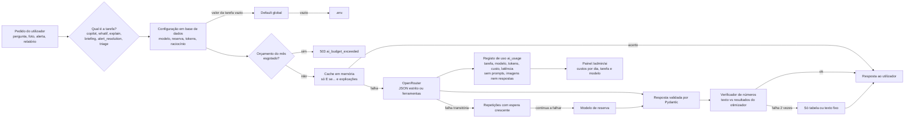

# IA no Novelo

A IA traduz e explica; **nunca faz contas**. Todos os números vêm do otimizador ou da base de dados, e um verificador rejeita qualquer número que não exista nos resultados de origem.

## Em linguagem simples

Pense na IA do Novelo como um **assistente que lê e escreve, mas não calcula**.

- Quando alguém pergunta "e se Serzedelo passar a recolha a pedido?", o assistente só percebe a pergunta e diz ao programa o que mudar. Quem faz as contas é o otimizador, o mesmo programa que calcula os cenários. O assistente não tem calculadora.
- Quando o assistente escreve uma frase com números ("capta 301,3 toneladas"), o programa confere cada número contra os resultados reais. Se aparecer um número que não está nos resultados, a frase é deitada fora e escrita outra vez; à segunda falha, mostra-se só a tabela.
- Cada funcionalidade (copiloto, "E se...?", explicações, briefing do relatório, alertas de dados, triagem por foto) pode usar um **modelo diferente**. Um administrador escolhe-o no painel `/admin/ai`, vê quanto custa cada tipo de operação e define um **orçamento mensal**. Quando o orçamento acaba, a IA pára; o resto do Novelo continua a funcionar.
- Nada do que as pessoas escrevem ou fotografam fica guardado na IA: o registo de uso guarda só quanto custou, quanto demorou e qual foi o modelo.
- A IA nunca altera dados: propõe, e uma pessoa confirma. Só cria cenários novos, marcados "Copilot".

## Fluxo de um pedido

## Fornecedor e modelos

Todos os modelos passam pelo **OpenRouter** (API compatível com OpenAI), através de `apps/api/src/novelo/adapters/openrouter.py`.

| Tarefa | Funcionalidade | Exige | Prompt |
| --- | --- | --- | --- |
| `copilot` | Conversa com ferramentas (`POST /copilot/chat`) | tools + structured outputs | `copilot_v1.md` |
| `whatif` | "E se...?": percebe a pergunta (`ScenarioDelta`) | structured outputs | `whatif_v1.md` |
| `explain` | Explicação do resultado do "E se...?" | structured outputs | `explain_v1.md` |
| `briefing` | Parágrafo executivo do relatório RAP | structured outputs | `briefing_v1.md` |
| `alert_resolution` | Proposta de resolução de alertas de qualidade | structured outputs | `alert_resolution_v1.md` |
| `triage` | Triagem por foto (visão) | imagem + structured outputs | `triage_v1.md` |

**Modelo recomendado: `openai/gpt-6-luna`.** US$ 0,10 por milhão de tokens de entrada, US$ 0,50 por milhão de saída, contexto de 1,05 M, texto e imagem. É o valor por omissão de todas as tarefas, incluindo a visão. `typesafe/jev-router` existe no catálogo mas tem preço dinâmico e escolhe o modelo por baixo; não é default e só serve para ser avaliado (`just eval-triage --models ...`).

Custo estimado por operação com `gpt-6-luna` (estimativa a partir de tokens típicos; o painel substitui-a pela média real medida em `ai_usage` assim que há histórico):

| Operação | Tokens típicos (entrada / saída) | Custo estimado |
| --- | --- | --- |
| Peça triada (duas fotos reduzidas) | 2 200 / 250 | cerca de US$ 0,00035 |
| Pergunta ao copiloto (várias chamadas) | 5 000 / 600 | cerca de US$ 0,0008 |
| Briefing do relatório | 1 200 / 250 | cerca de US$ 0,00025 |

### Configuração por tarefa

A configuração vive na tabela `ai_settings` (uma linha) e **a base de dados manda**: o `.env` só dá o valor inicial. Cada tarefa tem os seus campos (`model`, `fallback_model`, `max_output_tokens`, `reasoning_effort`); um campo vazio herda o **default global**, e o global vazio herda o `.env`. Há um default de texto e outro de visão: a triagem nunca herda o modelo de texto.

`GET /ai/settings` devolve, por tarefa, o valor **efetivo** e a **origem** de cada campo: `database` (definido na tarefa), `global_default` (default global na base de dados), `env` (`.env`) ou `code` (limite por omissão da tarefa).

Só administradores alteram. `PUT /ai/settings` valida cada modelo escolhido contra o catálogo do OpenRouter: tem de existir e suportar o que as tarefas que o usam exigem (imagem para a triagem, ferramentas para o copiloto, structured outputs para todas). Um modelo global de texto também é validado contra as tarefas que o herdam.

### Como trocar o modelo no painel (`/admin/ai`)

1. Abrir a tarefa que se quer mudar (por exemplo, "Triagem por foto").
2. Escolher o modelo na lista. A lista mostra só modelos compatíveis com a tarefa, ordenáveis por custo, com o custo estimado (ou medido) **por operação** dessa tarefa e a marca "recomendado".
3. Opcional: modelo de reserva, limite de tokens de saída e esforço de raciocínio. Deixar vazio herda o global.
4. "Testar modelo" faz uma chamada mínima e mostra latência e custo reais (conta para o orçamento).
5. Guardar. A alteração vale logo no pedido seguinte, sem deploy.

Para comparar modelos com dados reais antes de trocar: `just eval-triage --models a,b,c` (ver abaixo).

## Orçamento e custos

- `ai_usage` regista **cada chamada**: tarefa, modelo, tokens, custo real (`usage.cost` devolvido pelo OpenRouter; se faltar, calcula-se pelo preço do catálogo), latência, sucesso ou erro, utilizador e `request_id`.
- **Privacidade:** nunca se guardam prompts, imagens nem respostas; no máximo um hash SHA-256 da entrada.
- **Orçamento mensal** em US$ (`monthly_budget_usd`, mês civil UTC): aviso a 80% e **paragem dura** a 100%. A partir daí, as funcionalidades de IA respondem **503 com `code: ai_budget_exceeded`**. O relatório RAP continua a sair com o briefing determinístico.
- `GET /ai/usage` devolve totais, série por dia e agrupamentos por tarefa e por modelo, com o custo do mês contra o orçamento. `GET /ai/credits` mostra o saldo e o limite da chave no OpenRouter e falha com graça (`available: false`).

## Desempenho e custo

- **Saída estruturada estrita** (`json_schema` com `strict`) e temperatura 0; uma repetição se não validar.
- **`max_tokens` por tarefa** (copiloto 900, "E se..." 400, explicação 300, briefing 400, alertas 500, triagem 500), com `reasoning: low` por omissão.
- **Timeouts curtos** (30 s por chamada, 90 s por conversa) e **repetições limitadas** com espera exponencial em timeouts, 429 e 5xx. Se o modelo principal continuar a falhar, tenta-se uma vez o **modelo de reserva** da tarefa.
- **Fotos reduzidas** antes de seguirem para o modelo: lado maior até 1024 px, JPEG com qualidade 80, sem EXIF (também retira a localização e o modelo da câmara).
- **Cache em memória** (1 h) das respostas idênticas do "E se...?" e das explicações: a chave é o hash do input determinístico.
- **Semáforo** de concorrência (`LLM_MAX_CONCURRENCY`) para não saturar o fornecedor.
- **Prompts estáveis no início** (prompt de sistema primeiro, dados variáveis depois), para beneficiar do prompt caching do fornecedor. Cabeçalhos `HTTP-Referer` e `X-Title` enviados.
- **Catálogo** do OpenRouter com cache de 1 h, `ETag` e stale-while-error: se o fornecedor não responder, serve-se a cópia anterior (`stale: true`).

## Copiloto

O copiloto tem documento próprio: [Copiloto](copiloto.md) (streaming SSE com eventos tipados, 42 ferramentas, artefactos, ações com confirmação, memória e persona por utilizador, anexos, menções, histórico, avaliação). Aqui ficam só as regras de IA que o atravessam:

- Os números do texto passam sempre pelo verificador (`unsupported_rounded`, com tolerância de arredondamento e sem contar rótulos como "P90" nem marcadores de listas). Se o texto já foi transmitido e falha, o servidor emite `retract` e reescreve uma vez; à segunda falha, só aviso e resultados.
- Os gráficos e as tabelas são construídos pelo servidor a partir dos resultados das ferramentas; o modelo nunca escreve os valores.
- Tarefas de IA do copiloto: `copilot` (conversa) e `copilot_aux` (título, sugestões, resumo de compactação, revisão de memória e pré-visualização de persona), ambas configuráveis em `/admin/ai`.
- **Saída estruturada estrita**: o adaptador converte cada esquema Pydantic para o formato que o modo `strict` aceita (objetos fechados, todos os campos obrigatórios, sem irmãos de `$ref`); o Pydantic continua a validar a resposta com o modelo original. Sem isto, o fornecedor devolve 400 "Provider returned error".

## Outras funcionalidades

- **Alertas de qualidade:** `POST /datasets/alerts/{id}/suggest` (`suggest_alert_resolution`). O modelo propõe ação, justificação e campos a corrigir; só se aceitam valores escritos no próprio alerta e números que existam nele. **Não aplica nada**: quem confirma usa `PATCH /datasets/alerts/{id}` com o estado e a nota sugeridos. Se a proposta inventar valores, devolve-se uma regra determinística (`source: fallback`).
- **Briefing do relatório RAP:** um parágrafo em pt-PT ou en no resumo do PDF, com números verificados. Sem IA, sem chave ou sem orçamento, usa um texto determinístico; o relatório nunca falha por causa da IA.
- **"E se...?":** o modelo devolve `ScenarioDelta` com listas fechadas; o ecrã mostra "Entendi: ..." para confirmar; o otimizador corre; o modelo explica; o verificador valida (2.ª falha, só tabela). Pergunta ambígua ou fora das listas: recusa com sugestões.
- **Triagem por foto:** as fotos são reduzidas, enviadas, processadas e descartadas (**não se guardam**). Ficam só tipo, estado, composição, marca e peso estimado, depois de o operador os confirmar ou corrigir. O peso vem de uma tabela de pesos médios por tipo (pressuposto, "estimativa").

## O verificador de números

`ai/verify.py` recolhe todos os números do texto (aceita vírgula ou ponto decimal e separador de milhares) e compara-os com os dos factos. Duas variantes: `unsupported_numbers` (igualdade exata, usada nas explicações) e `unsupported_rounded` (aceita arredondamento: um número com *d* casas decimais é válido se algum facto, arredondado a *d* casas, der o mesmo valor; usada no copiloto, nos alertas e no briefing). Ignora identificadores (UUID, datas ISO, chaves `id`). Os números que o utilizador escreveu na pergunta também são válidos. Números de mensagens anteriores do assistente **não** contam: se são precisos, o modelo volta a chamar a ferramenta.

## Avaliação da triagem

`just eval-triage` lê `data/eval/triage/` (fotos e `truth.csv` com `file, label_file, garment_type, condition, brand, composition`), corre o modelo de visão e escreve [avaliacao-triagem.md](avaliacao-triagem.md) (exatidão por campo, matrizes de confusão, custo e latência por peça) e `data/eval/triage-last.json`, que o painel mostra (`GET /ai/eval/triage`). Com `--models a,b,c` compara vários modelos numa tabela de exatidão, custo e latência. Sem imagens, escreve o modelo vazio com as instruções.

## Testes

Nenhum teste chama a API real. `tests/unit/test_stream_adapter.py` (streaming), `tests/unit/test_ai_client.py` (tool calling, limite de 6 voltas, repetições, reserva, orçamento, custo, cache, logs sem segredos), `test_catalog.py` (cache, ETag, stale-while-error), `test_images.py`, `test_verify.py`, `test_briefing.py`, `test_eval_triage.py`; `tests/api/test_copilot.py`, `test_ai_admin.py`, `test_alert_suggest.py`, `test_whatif.py`, `test_lots.py` e `test_reports.py` cobrem as rotas com um adaptador falso injetado por `Depends`.

Com chave real (manual): `curl` autenticado a `POST /api/v1/copilot/chat` e, no painel, "Testar modelo". Sem `OPENROUTER_API_KEY` a API arranca e as funcionalidades de IA respondem 503.
