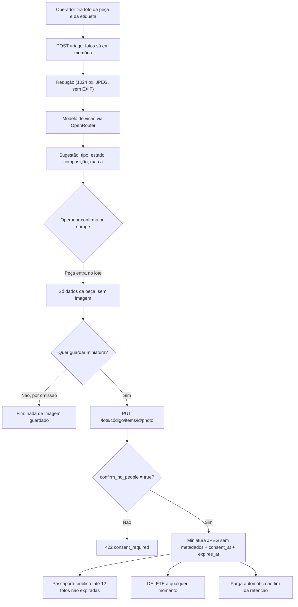

# Privacidade das fotografias

> **Aviso.** Isto é uma avaliação técnica interna, escrita pela equipa de engenharia a partir do código. **Não é aconselhamento jurídico.** A base jurídica, a avaliação de impacto e os textos de informação têm de ser validados pelo encarregado de proteção de dados da entidade responsável (Vitrus ou município). O que aqui se afirma sobre o comportamento do Novelo foi lido no código e na migração; o que depende da entidade vem marcado como decisão em aberto.

**Estado a 23 out 2026.** Até esta data o Novelo dizia que as fotografias nunca eram guardadas. Isso **deixou de ser verdade para uma parte do fluxo**: o operador pode agora guardar, por peça, uma miniatura opcional. A triagem em si continua a não guardar nada.

Fonte do comportamento: `apps/api/src/novelo/features/lots/{photos,photo_store,router,schemas,models,service}.py`, migração `apps/api/alembic/versions/0018_lot_item_photos.py`, `core/config.py` e `docker-compose.yml`.

## Finalidade

A miniatura serve para **reconhecer a peça** no lote e no passaporte público (por exemplo, mostrar ao reciclador de que peça se trata). Não serve para identificar pessoas, vigiar entregas nem treinar modelos. Cada peça pode ter uma só miniatura; guardá-la é sempre uma escolha do operador, nunca um efeito automático da triagem.

## Minimização: o que se guarda e o que não

| Guarda-se | Não se guarda |
| --- | --- |
| Uma miniatura JPEG por peça: lado maior ≤ 640 px, tamanho ≤ 150 KB (`LOT_PHOTO_MAX_BYTES`, por omissão 153 600 bytes) | A fotografia original |
| Largura, altura, tamanho em bytes, tipo (`image/jpeg`) | EXIF, GPS, modelo da câmara, perfil de cor ICC, miniaturas embebidas |
| Crédito de licença, opcional, até 240 caracteres (texto simples, sem HTML), para fotos de terceiros | Nome, contacto ou qualquer dado de quem entregou a peça |
| `consent_at`: o momento em que o operador confirmou que não há pessoas | A foto da etiqueta (só vai à triagem, em memória) |
| `created_by_id`: o utilizador que a guardou (passa a nulo se a conta for eliminada) | Bytes da imagem na auditoria ou nos registos de uso de IA |
| `expires_at`: fim da retenção | |

Como a miniatura é construída (`photos.py`): aplica-se a orientação EXIF primeiro, depois cria-se uma imagem nova só com os pixels (a transparência assenta em fundo branco), reduz-se e grava-se em JPEG progressivo, baixando a qualidade em passos até caber no limite. Se não couber, o pedido é recusado com 400. Recusam-se também ficheiros de entrada com mais de 5 MB ou mais de 40 milhões de píxeis, e formatos que não sejam JPEG, PNG ou WebP.

A tabela `lot_item_photos` é **separada** de `lot_items`: nenhuma listagem de peças lê os bytes. Apaga-se em cascata com a peça.

## Fluxo

Pontos a reter:

- A triagem (`POST /triage`) não escreve nada na base de dados. As fotos existem em memória durante o pedido, são reduzidas e seguem para o modelo de visão. Os dados da peça só entram no lote depois de o operador os confirmar.
- Guardar a miniatura é um **segundo pedido, separado**, feito pelo operador, peça a peça. O ficheiro enviado nesse pedido é novamente processado no servidor; o servidor não reutiliza o que foi à triagem.

## Base jurídica (proposta)

**Proposta técnica, a validar.** O enquadramento que a equipa considera mais adequado é o **interesse legítimo**, artigo 6.º, n.º 1, alínea f), do RGPD, com salvaguardas:

- **Interesse:** dar rastreabilidade visual a lotes de têxteis usados que seguem para reutilização e reciclagem, e permitir ao reciclador confirmar a peça.
- **Necessidade:** uma miniatura pequena chega; não se guarda a original nem metadados.
- **Equilíbrio:** a foto é de uma peça, não de uma pessoa; há confirmação expressa de que não mostra pessoas, rostos, documentos nem informação pessoal; é opcional; expira; apaga-se quando se quiser.
- **Escolha explícita do operador:** o servidor só guarda se `confirm_no_people=true`. Não é um consentimento do titular no sentido do artigo 6.º, n.º 1, alínea a): é a **declaração do operador** de que a foto não contém dados pessoais. `consent_at` regista quando o fez, como prova dessa declaração.

Se a entidade preferir outra base, ou concluir que o interesse legítimo não se aplica, a alternativa mais simples é desligar o recurso (não pedir miniaturas) e manter só a triagem.

## Titulares possíveis e riscos

A foto deve mostrar uma peça de roupa. Em teoria, não há titulares. Na prática, o risco é fotografar **por engano**:

| Titular possível | Como poderia acontecer | Gravidade |
| --- | --- | --- |
| Pessoa que entrega a peça | Aparece no fundo ou refletida | Média, se identificável |
| Operador ou terceiro | Rosto, mão com anel, tatuagem | Média |
| Informação pessoal na peça | Nome bordado, etiqueta com nome, documento num bolso | Baixa a média |
| O próprio operador | Fica ligado a cada foto por `created_by_id` e pela auditoria | Baixa |

**Mitigações** (todas no código, exceto a indicada):

1. **Confirmação obrigatória** no servidor: sem `confirm_no_people=true`, resposta 422 `consent_required`; não é possível contornar pela interface.
2. **Aviso no ecrã** junto da opção de guardar. O texto vive em `apps/web/messages/`; o seu conteúdo final tem de ser validado pela entidade (ver decisões abaixo).
3. **Sem metadados:** nem GPS nem EXIF nem ICC, por construção da imagem.
4. **Resolução baixa:** lado maior ≤ 640 px e ≤ 150 KB torna difícil o reconhecimento facial fiável, mas **não o impede**; por isso a confirmação e o apagamento são essenciais.
5. **Apagar e expirar:** a qualquer momento ou ao fim de 90 dias.
6. **Sem deteção automática de rostos.** O Novelo **não** analisa a imagem à procura de pessoas. Isto é uma limitação, não uma salvaguarda.

## Retenção

| Regra | Valor | Fonte |
| --- | --- | --- |
| Duração | `LOT_PHOTO_RETENTION_DAYS`: 90 dias por omissão, entre 1 e 365 | `core/config.py`, `docker-compose.yml` |
| Contagem | A partir do momento em que a foto é guardada ou substituída (`expires_at = agora + retenção`) | `photo_store.save_photo` |
| Expirada | Deixa de ser servida logo que `expires_at` passa (404), mesmo antes de ser apagada | `photo_etag`, `read_photo` |
| Purga automática | 30 s depois do arranque da API e de 24 em 24 h; apaga só miniaturas, nunca a peça nem o lote | `purge_loop`, `purge_expired_photos` |
| Apagar a pedido | `DELETE` em qualquer estado do lote; imediato; sem foto não faz nada | `delete_photo` |
| Lote `delivered` | Bloqueia guardar e substituir (409); apagar continua permitido; a foto expira como as outras | `save_photo` |
| Substituir | Apaga a anterior e cria outra com novo `id`, nova validade e novo `consent_at` | `save_photo` |
| Eliminar a conta do operador | A foto fica (`created_by_id` passa a nulo); é a peça e o prazo que mandam | migração `0018` |

A retenção em **cópias de segurança** não está definida: ver [Deploy](deploy.md#operação) (pg_dump diário a copiar para fora da VPS). Uma miniatura apagada pode continuar numa cópia até esta ser rodada. Decisão em aberto.

## Direitos dos titulares e como se exercem

| Direito | Como se exerce hoje |
| --- | --- |
| Apagamento (art. 17.º RGPD) | O operador apaga a miniatura com `DELETE /lots/{código}/items/{id}/photo`. Um titular que se reconheça numa foto pede à entidade responsável, que pede ao operador ou a um administrador que a apague. Fica `lot.photo.delete` na auditoria |
| Oposição (art. 21.º) | Mesmo caminho: apagar a miniatura. Se o interesse legítimo for a base, a oposição tem de poder ser atendida |
| Acesso (art. 15.º) | Um titular sem conta não tem acesso direto. A entidade pesquisa pelo lote e pela peça, e mostra a miniatura. **Não há ferramenta de pesquisa por pessoa**, porque não se guarda nada que identifique pessoas |

**Cache pública.** As rotas públicas respondem com `Cache-Control: public, max-age=3600` e `ETag`. Uma foto apagada pode continuar visível, até 1 hora, em caches (browser, Cloudflare ou outros). Por isso, ao atender um pedido de apagamento urgente, convém avisar que o desaparecimento completo pode demorar até 1 hora. As rotas autenticadas usam `private, no-cache`.

**Canal e prazos.** Quem recebe e responde aos pedidos, em que prazo e por que canal é decisão da entidade (ver lista no fim). O Novelo não tem hoje um formulário de pedidos de titulares.

## Subcontratante e transferências

Durante a **triagem** (não na miniatura guardada), as fotos reduzidas (lado maior ≤ 1024 px, JPEG qualidade 80, sem EXIF) são enviadas, via OpenRouter, ao modelo de visão configurado (`LLM_MODEL_VISION`). Participam o OpenRouter e o fornecedor do modelo. Ver [IA](ia.md):

- A API não guarda imagens, prompts nem respostas no registo de uso de IA: só tarefa, modelo, tokens, custo e latência (e no máximo um hash).
- O código **não** usa routing regional nem `provider.zdr`/`data_collection` (ver [IA](ia.md#privacidade-região-e-rgpd)). A variável `OPENROUTER_ZDR_ENFORCED` só **declara** que a conta OpenRouter força ZDR; o Novelo não o verifica. Não há, neste repositório, prova de que a conta o force. Não se deve afirmar que o fornecedor do modelo não retém a foto.
- A retenção e o treino por parte do OpenRouter e do fornecedor do modelo dependem dos termos de cada um e da configuração da conta. Não foram verificados nesta avaliação.

**Transferências.** O OpenRouter e o fornecedor do modelo podem estar fora da UE/EEE. O endpoint regional da UE não é usado por omissão. Se houver transferência, a entidade tem de ter acordo de tratamento de dados (art. 28.º) e mecanismo de transferência válido (capítulo V do RGPD). **Decisão em aberto.** A localização da VPS e da base de dados também não está documentada aqui.

A miniatura guardada **não** sai da nossa base de dados, exceto quando o passaporte público é aberto.

## Segurança

| Medida | Detalhe | Fonte |
| --- | --- | --- |
| Quem guarda ou apaga | Só utilizadores autenticados que não sejam convidados (`NotGuestDep`) | `router.py` |
| Quem vê (autenticado) | Qualquer sessão válida, com `Cache-Control: private, no-cache` e `Vary: Cookie` | `router.py` |
| Quem vê (público) | Qualquer pessoa com o código do lote (o do QR): até 12 miniaturas não expiradas no passaporte | `service.py`, `router.py` |
| Limites de pedidos | 30 pedidos/min por IP para guardar e apagar; 60/min por IP no passaporte e nas fotos públicas | `core/ratelimit.py` |
| ETag | Forte, derivado do `id` da foto; muda sempre que a foto é substituída; 304 sem ler os bytes | `photo_store.etag_of` |
| Sem listagens com bytes | `has_photo`, `photo_url` e `photo_credit` nas listagens; os bytes só em rotas próprias; coluna lida só por consulta explícita | `schemas.py`, `models.py` |
| Auditoria | `lot.photo.save`, `lot.photo.delete`, `lot.photo.purge`, com lote, tamanho e contagem; **nunca bytes** | `photo_store.py` |
| Validação | Tipo real pelos primeiros bytes (não pelo nome), limite de 5 MB e de píxeis, crédito sem HTML | `photos.py`, `photo_store.py` |

Limitações conhecidas: quem tiver o código do lote vê as miniaturas sem sessão; o limite de pedidos é em memória, por processo; o `credit` é texto livre mostrado no passaporte público.

## Avaliação de impacto (DPIA): triagem de necessidade

**Resultado esperado: avaliação de impacto não obrigatória no estado atual.** Esta é a nossa leitura técnica, a confirmar pelo encarregado de proteção de dados.

Justificação:

- O tratamento não visa pessoas: o objeto é uma peça de têxtil.
- Não há categorias especiais de dados nem decisões automatizadas sobre pessoas. A sugestão do modelo é sempre confirmada pelo operador.
- Não há controlo sistemático de zonas públicas, nem perfis, nem cruzamento de bases.
- Escala pequena: um piloto com poucos operadores; a retenção é curta (90 dias) e o conteúdo é minimizado.
- Riscos residuais (pessoas fotografadas por engano) estão mitigados por confirmação, apagamento e expiração.

**Rever quando** mudar a escala ou o âmbito: mais operadores ou entidades, miniaturas de zonas de recolha ou de contentores (onde há pessoas), retenção maior, uso das fotos para treinar modelos, análise automática de imagens, ou publicação em mais canais. Rever também se o fornecedor de IA mudar.

## O que a entidade responsável tem de decidir ou validar

Não assumimos nada sobre a organização interna da Vitrus ou do município.

1. Quem é o **responsável pelo tratamento** (Vitrus, município ou ambos) e quem é o encarregado de proteção de dados.
2. Se o **interesse legítimo** é a base adequada, e se o teste de ponderação documentado está aceitável.
3. A **retenção**: manter os 90 dias ou ajustar `LOT_PHOTO_RETENTION_DAYS` (1 a 365).
4. O **texto do aviso** no ecrã e a informação aos titulares (política de privacidade, `/privacy`).
5. O **canal** e o prazo para pedidos de apagamento, oposição e acesso.
6. O acordo com o **OpenRouter** e o fornecedor do modelo (ZDR efetivo, localização, treino) e as transferências para fora da UE/EEE.
7. A retenção em **cópias de segurança** e a localização da VPS.
8. Se se mantém o **crédito de licença** público e se as fotos de demonstração (Wikimedia Commons) são identificadas como tal.
9. Se a miniatura deve estar disponível no **passaporte público** ou só a utilizadores autenticados.
10. Se a DPIA é de facto dispensada.

## Documentos relacionados

- [IA](ia.md): triagem, OpenRouter, ZDR e o que se regista.
- [Ambiente](ambiente.md#fotografias-dos-lotes): variáveis `LOT_PHOTO_*`.
- [Arquitetura](arquitetura.md): tabelas e rotas dos lotes.
- [Funcionalidades](features.md): a evidência por marca e o que se guarda.
- [Registo de afirmações](../pesquisa/registo-de-afirmacoes.md): afirmações D5 e D6.
