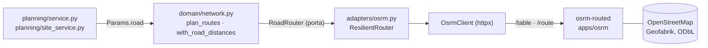

# Rotas por estrada

Os quilómetros e o traçado das rotas dos cenários vêm de um **OSRM próprio** sobre o OpenStreetMap de Guimarães e arredores. É grátis (sem chaves, quotas nem APIs pagas), corre no mesmo compose e, se parar, a API continua a funcionar e volta à estimativa em linha reta. Cada rota diz de onde vêm os seus números.

## O que mudou

| | Antes | Agora |
| --- | --- | --- |
| Distância entre paragens | linha reta (haversine) × `detour_factor` (1,3) | estrada real, nos dois sentidos (ruas de sentido único contam) |
| Escolha da rede por freguesias | ida e volta ao estaleiro em linha reta × desvio | ida e volta ao estaleiro **por estrada**, na mesma matriz do VRP |
| Traçado no mapa | linhas retas entre paragens | polilinha pelas estradas, simplificada a 3 m |
| Tempo de condução | km ÷ 30 km/h | também a duração do OSRM (`duration_min`), só informativa |
| Se o OSRM falha | — | estimativa, marcada `source = estimate` |

As **horas de viatura** (e por isso o número de viaturas) continuam a vir de `km ÷ vehicle_speed_kmh + paragens × minutos`. A duração do OSRM é sem paragens, sem trânsito e com velocidades de carro; usá-la para dimensionar a frota seria otimista. Fica visível na rota para comparação.

## Arquitetura

- **`domain/routing.py`** (puro): a porta `RoadRouter` (`matrix`, `geometry`, `fingerprint`), `RoadMatrix`, e `resolve`, que completa a matriz com a estimativa onde a estrada não deu caminho e marca cada par como exato ou não. Sem I/O.
- **`domain/network.py`**: `plan_routes` pede a matriz ao router, resolve o VRP sobre ela e pede o traçado de cada rota; `with_road_distances` põe em cada freguesia a ida e volta ao estaleiro por estrada (uma só chamada), para o CP-SAT escolher a rede com os km reais.
- **`adapters/osrm.py`**: `OsrmClient` fala HTTP e levanta `OsrmError`; `ResilientRouter` é o que o domínio usa. Nunca levanta: devolve `None` e o domínio estima.
- **Injeção**: `run_scenario` (e a ferramenta de Pareto do copiloto) passam `get_road_router()` a `compute`/`compute_sites`, que o põem em `network.Params.road`. Os testes não definem `OSRM_URL`: sem router, tudo é estimativa e determinístico; quem quer um falso passa-o por `road=`.

### Como falha

| Situação | Comportamento |
| --- | --- |
| `OSRM_URL` vazio | Sem router: estimativa em todo o lado (testes, `just api` sem OSRM) |
| OSRM em baixo, lento ou com erro | Aviso no log (um por episódio), o router fica em pausa `OSRM_COOLDOWN_S` (30 s) para os pedidos seguintes não esperarem pelo timeout, e a rota é estimativa |
| Um ponto a mais de `OSRM_MAX_SNAP_M` (500 m) de uma estrada, ou um par sem caminho | Só os pares afetados caem na estimativa; a rota fica `estimate` |
| Traçado indisponível com os km por estrada | Os km ficam por estrada (`source = road`) e o mapa desenha linhas retas (`road_path = false`) |
| Falha a meio de um cálculo por locais | O resultado (estimado) **não** entra na cache em memória, para não ser servido como se fosse por estrada |

A cache em memória dos cenários por locais inclui na chave a **versão do mapa** (`fingerprint`: distância e duração de uma rota-sonda fixa, que mudam quando os dados ou o perfil mudam). Dados novos do OpenStreetMap invalidam-na sozinhos.

## No contrato

`RouteOut` ganha `source` (`road` ou `estimate`), `road_path` e `duration_min` (nulo na estimativa). `ScenarioResult.routing` resume as rotas: `road`, `mixed` ou `estimate`. Cenários guardados antes disto carregam com `estimate`/`false`/`null`.

`routing` fala só das **rotas** (`routes`). A volta dentro de uma freguesia no porta a porta (a fórmula de Beardwood-Halton-Hammersley, secção 9 de [Dados e modelo](dados-e-modelo.md)) é uma estimativa por área e não tem estrada: continua a levar `detour_factor`. Na sensibilidade (tornado e Monte Carlo), `detour_factor` é uma alavanca que escala os km das rotas já medidos, em proporção ao valor do cenário; não volta a consultar o OSRM.

## O serviço OSRM (`apps/osrm`)

Uma imagem autocontida, construída em três estágios:

1. **Recorte**: descarrega `portugal-latest.osm.pbf` do Geofabrik (licença ODbL) e recorta com `osmium` a caixa `-8.60,41.26,-8.00,41.66` (Guimarães com ~10 km de margem, para as estradas na fronteira se ligarem). O nome do ficheiro datado fica em `/data/SNAPSHOT`.
2. **Grafo**: `osrm-extract`, `osrm-partition` e `osrm-customize` (algoritmo MLD) com o perfil `novelo-van`.
3. **Servidor**: `osrm-routed --algorithm mld --max-table-size 500 --max-viaroute-size 500`.

O perfil `novelo-van` é o `car.lua` oficial com a altura, largura, comprimento e peso de uma furgoneta/camião ligeiro (2,8 m, 2,1 m, 6,0 m, 3 500 kg), para respeitar `maxheight`, `maxwidth` e `maxweight` das vias. **Estas dimensões são um pressuposto**: a Vitrus ainda não indicou a viatura. O build falha se o `car.lua` mudar e o `sed` deixar de aplicar.

Medidas (imagem de 23 out 2026, dados `portugal-261020`): imagem de ~340 MB, ~60 MB de RAM em repouso, resposta de `/route` em menos de 1 ms. Em produção o serviço tem `mem_limit: 384m` e 1 CPU.

### Variáveis

| Variável | Por omissão | Para quê |
| --- | --- | --- |
| `OSRM_URL` | vazio (dev em Docker e produção: `http://osrm:5000`) | Vazio = sem OSRM, estimativa |
| `OSRM_TIMEOUT_S` | 8 | Timeout de cada pedido |
| `OSRM_MAX_LOCATIONS` | 400 | Pontos por pedido `/table`; acima disto divide em blocos (tem de ser ≤ `--max-table-size` do servidor) |
| `OSRM_MAX_SNAP_M` | 500 | Um ponto mais longe de uma estrada é tratado como sem caminho |
| `OSRM_CACHE_SIZE` | 256 | Matrizes e traçados em cache (LRU) |
| `OSRM_COOLDOWN_S` | 30 | Pausa depois de uma falha |
| `OSRM_HOST_PORT` | 5190 | Só dev: porta do OSRM no host |

## Comandos

| Comando | O que faz |
| --- | --- |
| `just osrm-up` | Sobe só o OSRM (:5190). A primeira vez descarrega ~300 MB e prepara o grafo (uns minutos) |
| `just osrm-refresh` | Volta a descarregar o OpenStreetMap e reconstrói o grafo (estradas novas) |
| `just osrm-calibrate` | Compara a estrada com `detour_factor` e `vehicle_speed_kmh` |
| `just osrm-test` | Testes de integração contra o OSRM a sério (`tests/api/test_osrm_live.py`); fora do `just check`, que não depende do OSRM |
| `just api` | Aponta por omissão para `http://localhost:5190` |

`just dev` constrói e arranca o OSRM com o resto da stack.

## Calibração (23 out 2026, dados `portugal-261020`)

Estaleiro de Polvoreira até ao centróide de cada freguesia e até 300 locais municipais candidatos, nos dois sentidos:

| | Desvio da estrada (estrada ÷ linha reta) | Velocidade média de condução |
| --- | --- | --- |
| 48 freguesias (96 trajetos) | mediana **1,48** (p10 1,31, p90 2,09), média 1,78 | mediana **41,4 km/h** (p10 35,4, p90 51,7) |
| 300 locais candidatos (600 trajetos) | mediana **1,37** (p10 1,28, p90 1,82), média 1,48 | mediana **39,2 km/h** (p10 35,0, p90 44,7) |
| Pressuposto atual | 1,3 | 30 km/h |

Nenhum ponto ficou sem caminho. Leitura:

- O desvio de 1,3 é **otimista**: a estrada real é, em mediana, 37% a 48% mais longa que a linha reta, e as freguesias rurais mais afastadas sobem muito (p90 de 2,1). Com o OSRM ligado isto deixa de importar para as rotas e para a escolha da rede, mas **a estimativa de fallback, o porta a porta dentro da freguesia e a sensibilidade continuam a usar 1,3**. Subir o pressuposto para ~1,4 a 1,5 é uma decisão do modelo (mexe nos valores de referência e nos testes calculados à mão) e fica por tomar.
- Os 30 km/h são a velocidade **em recolha** (inclui manobras e paragens curtas), não a de condução (~40 km/h no OSRM). Não são comparáveis diretamente e por isso as horas não passam a usar a duração do OSRM.
- O OSRM dá velocidades de carro sem trânsito. Os km são fiáveis; os minutos são um limite inferior.

## Limitações

- Perfil de furgoneta, não de camião com restrições reais da Vitrus (viaturas e dimensões por confirmar). Ruas estreitas do centro histórico podem ser menos viáveis do que o grafo diz.
- Sem trânsito nem horários (zonas pedonais por horas, cargas e descargas).
- O recorte cobre Guimarães e ~10 km à volta. Pontos fora da caixa não têm caminho e caem na estimativa.
- Os cenários de referência semeados no arranque esperam até ~1 minuto (12 tentativas de 5 s) que o OSRM responda. Se ele não aparecer, ficam `estimate` (a API regista um aviso) e são refeitos por estrada, uma só vez, no arranque seguinte da API em que o OSRM responda (`reference.py`). Um cenário criado por um utilizador (ou pelo [seed de demonstração](seed-demo.md)) enquanto o OSRM está parado fica `estimate` e não é refeito sozinho: cria-se de novo.
- O traçado é simplificado a 3 m (Douglas-Peucker) para não engordar cada cenário guardado.

## Atribuição

Dados © colaboradores do OpenStreetMap, licença ODbL. Recorte e distribuição por Geofabrik. Motor: [Project OSRM](https://project-osrm.org) (BSD-2).
