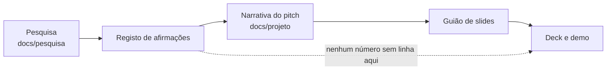

# Dossier de pesquisa

Tudo o que o Novelo afirma em público (slides, demo, relatório) assenta aqui. Esta pasta existe para que ninguém tenha de adivinhar de onde vem um número no dia 26 de outubro.

Consultas feitas a **19 de outubro de 2026**. Onde a fonte primária não foi lida, diz-se.

## Como usar para construir o pitch

1. **Procura o tema** no índice abaixo e lê o resumo no topo de cada ficheiro.
2. **Antes de pôr um número num slide**, confirma que está no [registo de afirmações](registo-de-afirmacoes.md) com o estado certo. Sem linha no registo, o número não vai para o slide.
3. **Respeita o estado.** Facto verificado diz-se com firmeza. Estimativa e pressuposto dizem-se com a palavra "estimativa" ou "pressuposto" na frase e no ecrã.
4. **Atualiza o registo** quando verificares algo em fonte primária ou quando a Vitrus enviar dados novos.

## Índice

| Ficheiro | Para quê |
| --- | --- |
| [Enquadramento regulatório](enquadramento-regulatorio.md) | O que a Diretiva (UE) 2025/1892 e o RGGR obrigam, prazos, quem paga, o que Portugal ainda não tem |
| [Benchmarks internacionais](benchmarks-internacionais.md) | França, Catalunha, UE, Países Baixos: kg por habitante, densidade de pontos, € por tonelada |
| [Tecnologia de triagem](tecnologia-de-triagem.md) | O que a foto e a etiqueta conseguem, o que a espetroscopia consegue, limites honestos |
| [Indústria e mercado](industria-e-mercado.md) | Vale do Ave, recicladores, economia social, mercado de segunda mão, quem contactar |
| [Registo de afirmações](registo-de-afirmacoes.md) | Cada afirmação do pitch com valor, fonte, data e estado |
| [Fontes](fontes.md) | Bibliografia numerada com ligações |

Documentos de estratégia que usam esta pesquisa:

- [Estratégia para ganhar](../projeto/estrategia-para-ganhar.md)
- [Mentores](../projeto/mentores.md)
- [Cenários e contingências](../projeto/cenarios-e-contingencias.md)
- [Narrativa do pitch](../projeto/narrativa-do-pitch.md)
- [Guião de slides](../projeto/pitch-slides.md)

## Os estados de cada afirmação

| Estado | Significa | Como se diz |
| --- | --- | --- |
| **Dado Vitrus** | Vem dos ficheiros recebidos da Vitrus | Com firmeza, citando "dados da Vitrus" |
| **Verificado (primária)** | Lido na fonte oficial (EUR-Lex, APA, relatório do operador) | Com firmeza, com a fonte no rodapé |
| **Verificado (secundária)** | Confirmado em imprensa ou análise jurídica fiável, sem ler a fonte oficial | Com firmeza moderada; preferir a primária antes de pôr em slide |
| **Por verificar** | Encontrado mas contraditório, indireto ou sem fonte primária | Não usar em slide; só em conversa, com ressalva |
| **Pressuposto nosso** | Valor que escolhemos e está visível no ecrã "Pressupostos" | "Assumimos...", nunca como facto |
| **Cálculo nosso** | Conta feita por nós sobre números verificados | "Calculámos...", com a conta à vista |

## Principais descobertas desta ronda

1. **Não existe ainda entidade gestora de têxteis em Portugal.** A APA confirma, em dezembro de 2025, que "ainda não se encontra aprovado o fluxo de resíduos em sistemas de RAP". Hoje o município paga sozinho, e a diretiva só obriga os regimes a existir a 17 de abril de 2028.
2. **A diretiva exige que os custos dos produtores sejam "economicamente eficientes" e transparentes** (artigo 22.º-A, n.º 12). Quem demonstrar o custo eficiente por tonelada tem argumentos para o reclamar. É exatamente o que o Novelo calcula.
3. **A rede tem de cobrir o território todo, não só onde compensa** (artigo 11.º e considerando 36). O otimizador tem de minimizar custo **sujeito a cobertura**, e o modo "a pedido" é a resposta às zonas dispersas.
4. **O gargalo da indústria é a qualidade, não a capacidade.** A Sasia recicla cerca de 2 000 t por mês, quase tudo pré-consumo; o têxtil que Guimarães ainda deita ao lixo (≈ 2 324,8 t por ano, 43 051 t de RSU × 5,4%, estimativa) é cerca de 10% disso. O que falta são lotes limpos e por composição. A Vitrus acrescenta (21 out 2026) que reciclar custa mais que a fibra virgem: o valor está na reutilização.
5. **O setor da recolha está sob pressão.** Sintra está a retirar centenas de contentores de roupa usada e os recicladores falam em saturação de mercado. Um município não pode simplesmente "pôr contentores", e a Vitrus não os quer: o têxtil de contentor vem contaminado (21 out 2026).
6. **Guimarães está a 1,9 kg/hab/ano**; a França recolhe 4,27, a UE em média 4,4 e a Catalunha 2,7. Há margem, mas a meta tem de ser dita como referência, não como promessa.
7. **A Fibrenamics está em Guimarães e tem projetos de fios de fibras recicladas (Lusitano) e de valorização de resíduos (Green), mas a informação pública não diz se aceita têxtil pós-consumo**; a investigação da UMinho aponta não tecidos e isolamento para misturas. Ver [Indústria e mercado](industria-e-mercado.md#fibrenamics-e-a-investigação-da-uminho).
8. **O "Prof. Paulo Afonso" do Departamento de Produção e Sistemas é, muito provavelmente, um investigador de custos, avaliação de investimentos e logística (grupo SLOTS)**, não só de otimização matemática: o que lhe mostrarmos deve ser a estrutura de custos e a incerteza. Identificação por confirmar.
9. **Os critérios de avaliação do Hack4Guimarães estão confirmados nos pesos** (inovação 25%, viabilidade 25%, impacto 30%, apresentação e continuidade 20%, [F61]); falta o detalhe de cada um, no separador Rules da plataforma TAIKAI [F62]. Ver [Critérios de avaliação](../projeto/criterios-de-avaliacao.md). **Não foi possível confirmar** o plano municipal que dá os 5,4% e os "4 de 27 operadores", nem os custos por tonelada da Vitrus. Estão marcados como por verificar e levam perguntas na [estratégia](../projeto/estrategia-para-ganhar.md).
