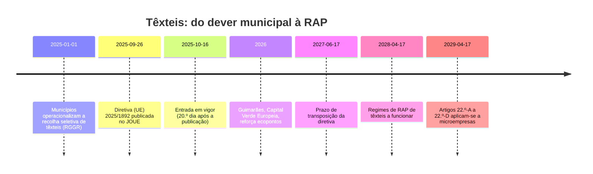

# Enquadramento regulatório

**Resumo.** A Diretiva (UE) 2025/1892 cria a responsabilidade alargada do produtor (RAP) para têxteis, vestuário e calçado: os produtores passam a pagar recolha, triagem e reciclagem, com regimes obrigatórios até **17 de abril de 2028**. Em Portugal, os municípios são obrigados a recolher têxteis seletivamente desde **1 de janeiro de 2025**, mas ainda não há entidade gestora nem regime de RAP aprovado. Entre uma data e a outra, **o município paga sozinho**, e quem consegue provar o custo eficiente por tonelada fica com melhores argumentos.

Consultado a 19 de outubro de 2026. Fontes numeradas em [Fontes](fontes.md).

> **Nota de rigor.** O texto da diretiva foi lido a partir do EUR-Lex em português [F1], por extração automática, e as perguntas frequentes da APA [F2] foram lidas página a página. Antes de citar a redação exata de um artigo num slide, confirma-a no EUR-Lex.

## Linha do tempo

| Data | O que acontece | Fonte | Estado |
| --- | --- | --- | --- |
| 1 jan 2025 | Municípios operacionalizam a recolha seletiva de têxteis, nos termos do RGGR (DL 102-D/2020) | APA [F2], imprensa [F4] [F5] | Verificado (primária) |
| 26 set 2025 | Publicação da diretiva no Jornal Oficial (datada de 10 set 2025) | APA [F2], EUR-Lex [F1] | Verificado (primária) |
| 16 out 2025 | Entrada em vigor, no vigésimo dia após a publicação | EUR-Lex art. 3.º [F1], Comissão Europeia [F8] | Verificado (primária) |
| 17 jun 2027 | Prazo de transposição | EUR-Lex art. 2.º [F1], APA [F2] | Verificado (primária) |
| 17 abr 2028 | Prazo para os regimes de RAP | EUR-Lex art. 22.º-A [F1], APA [F2] | Verificado (primária) |
| 17 abr 2029 | Obrigações de RAP aplicam-se às microempresas | Cuatrecasas [F3] | Verificado (secundária) |

## O que a diretiva obriga

### Os produtores pagam, e quanto

- **Quem:** os produtores que disponibilizam pela primeira vez no mercado produtos do anexo IV-C (vestuário e acessórios, roupa de cama, mesa e casa, cortinados, chapéus, calçado, entre outros). Fabricantes, importadores e distribuidores, incluindo plataformas de venda online de países terceiros [F1] [F2].
- **O quê:** artigo 22.º-A, n.º 8. Os custos cobertos incluem recolha, transporte, triagem, preparação para reutilização, reciclagem e eliminação, mais os estudos de composição dos resíduos urbanos indiferenciados e a informação aos utilizadores [F1].
- **Indiferenciado:** artigo 22.º-A, n.º 9. Os Estados-Membros **podem** (não têm de) fazer os produtores pagar também os têxteis que acabam no lixo indiferenciado [F1]. É um ponto em aberto em Portugal e um argumento para as câmaras.
- **Limite de eficiência:** artigo 22.º-A, n.º 12. Os custos não podem exceder o necessário para uma prestação **economicamente eficiente** e devem ser determinados **de forma transparente** [F1].
- **Modulação:** as contribuições devem ser moduladas por critérios de conceção ecológica (durabilidade, reparabilidade, reciclabilidade, conteúdo reciclado), segundo os considerandos 39 e 40 e a leitura da APA [F1] [F2]. As receitas de reutilização e de matérias-primas secundárias entram no cálculo [F3].
- **Quem gere:** os produtores podem delegar numa organização competente em matéria de responsabilidade do produtor (OCRP), que precisa de autorização [F1] [F3].

### A rede de recolha

- **Cobertura:** artigo 11.º, n.º 1 (novo parágrafo). Os Estados-Membros asseguram infraestruturas e "uma cobertura material e territorial suficiente dos pontos de recolha seletiva" [F1].
- **Todo o território:** considerando 36. A rede deve abranger todo o território, não apenas as zonas onde a recolha é rentável [F1], o que a APA repete [F2].
- **Cooperação:** os produtores organizam a rede com municípios, operadores de gestão e reutilização e entidades da economia social [F2].

### Triagem e destino

- **Artigo 22.º-D, n.º 5:** a triagem dá prioridade à reutilização e à triagem local; o que não serve para reutilização vai para remanufatura e reciclagem [F1].
- **Artigo 22.º-D, n.º 2 e 3:** os têxteis recolhidos seletivamente são resíduos desde a recolha, exceto os usados entregues diretamente e avaliados como aptos para reutilização, por um profissional, no ponto de recolha [F1].
- **Considerando 48:** a reutilização deve ser o principal objetivo da triagem [F1].

### Economia social

- **Artigo 22.º-C, n.º 11:** as entidades da economia social podem manter e explorar os seus próprios pontos de recolha seletiva, com tratamento igual ou preferencial na localização, e não são obrigadas a entregar o que recolhem à organização do regime [F1].
- **Artigo 22.º-C, n.º 12 e 13:** reportam o peso recolhido pelo menos uma vez por ano; os Estados-Membros podem isentá-las quando o encargo for desproporcionado [F1].
- **Artigo 22.º-C, n.º 8, c):** a recolha gratuita dos resíduos gerados por estas entidades deve ser assegurada [F1].

### Metas

- **Não há metas quantitativas de recolha ou reutilização de têxteis no texto lido.** O considerando 59 pede à Comissão que avalie a viabilidade de as fixar [F1].
- A Indústria & Ambiente [F9] refere metas "face à média anual de 2021 a 2023", mas isso corresponde às metas de **resíduos alimentares** (artigo 9.º-A, n.º 4: menos 10% no fabrico e menos 30% per capita no retalho e nas casas). Não confundir nos slides.
- A diretiva exige **estudos regulares da composição do indiferenciado**, pelo menos ao nível NUTS 2 (considerando 36) [F1]. A "caracterização do lixo indiferenciado" que a Vitrus enviou é exatamente este tipo de dado.

## O que acontece em Portugal

| Ponto | Estado | Fonte |
| --- | --- | --- |
| Obrigação municipal de recolha seletiva desde 1 jan 2025 | Em vigor | APA [F2] |
| Entidade gestora de têxteis licenciada | **Não existe** | APA [F2] |
| Regime de RAP de têxteis | **Não aprovado**: aplica-se o regime geral do RGGR | APA [F2] |
| Financiamento aos municípios | Candidaturas por avisos dos programas operacionais regionais; projeto-piloto de retorno e reciclagem da APED com 450 000 € do Fundo Ambiental | APA [F2] |
| Reação dos municípios | A ANMP pediu medidas legislativas transitórias; a ZERO alertou que, sem entidade gestora, os municípios assumem sozinhos a responsabilidade e o custo | Observador [F6], Smart Cities [F5] |
| Licenciamento futuro | Entidades gestoras licenciadas pela APA e DGAE, até 10 anos; após a transposição, os produtores podem apresentar candidatura com caderno de encargos | APA [F2] |
| Estado da reciclagem | "Ainda é escassa em Portugal", por complexidade da separação de fibras e falta de infraestruturas | APA [F2] |

**Leitura para o pitch.** Até abril de 2028 não há ninguém a quem faturar. Depois, quem paga passa a ser o produtor, mas só até ao custo "eficiente e transparente". Um município que chegue a 2028 com um custo por tonelada medido, desagregado por tipo de território, negoceia em posição de força. É para isso que serve o relatório RAP do Novelo.

## Ecodesign e passaporte digital

O Regulamento de Ecodesign para Produtos Sustentáveis (ESPR) prevê passaporte digital e requisitos de conceção para têxteis. As fontes encontradas são sobretudo blogues de consultoras e discordam nas datas (ato delegado de têxteis entre o início e o fim de 2027; obrigações entre meados de 2028 e inícios de 2029) [F20]. A proibição de destruir vestuário e calçado não vendido de grandes empresas terá começado a 19 de julho de 2026, segundo as mesmas fontes. **Por verificar** no Jornal Oficial e no sítio da Comissão. Para o pitch, a ligação segura é conceptual: o passaporte do lote do Novelo vai no mesmo sentido, mas não promete conformidade com o passaporte do produto.

## O que fica por verificar

| Questão | Onde procurar |
| --- | --- |
| Redação exata dos artigos 22.º-A a 22.º-D | [EUR-Lex, versão portuguesa](https://eur-lex.europa.eu/legal-content/PT/TXT/HTML/?uri=OJ:L_202501892) |
| Se já há projeto de decreto-lei de RAP de têxteis em Portugal | Diário da República e [APA](https://apambiente.pt) (têxteis, RAP) |
| Quem será o candidato a entidade gestora (Sociedade Ponto Verde, Novo Verde, Valorsul e outras) | Notícias e APA; perguntar ao mentor da Vitrus |
| Atos delegados de modulação e de passaporte digital | Comissão Europeia, página do ESPR |
