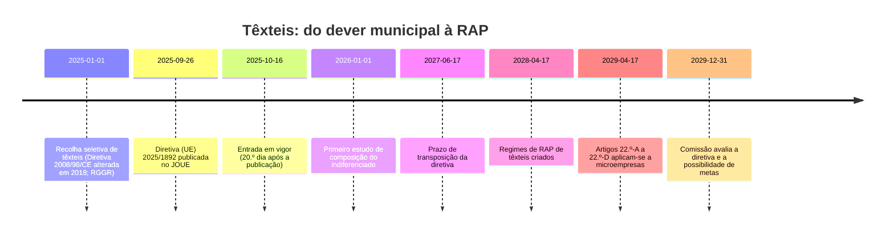

# Enquadramento regulatório

**Resumo.** A Diretiva (UE) 2025/1892 cria a responsabilidade alargada do produtor (RAP) para têxteis, vestuário e calçado. Cada Estado-Membro tem de **criar** o regime até **17 de abril de 2028** (art. 22.º-A, n.º 14). Os produtores passam a cobrir o custo eficiente da recolha, do transporte, da triagem e do tratamento, mas **só dos produtos que põem no mercado pela primeira vez depois da lei nacional de transposição, ou o mais tardar depois de 17 de abril de 2028** (art. 22.º-A, n.º 11). O têxtil que já está nas casas continua sem produtor que pague durante anos. Em Portugal, os municípios recolhem têxteis à parte desde **1 de janeiro de 2025** (RGGR), sem entidade gestora nem regime de RAP aprovado. Hoje **o município paga sozinho**; com o regime a funcionar, paga uma parte que vai diminuindo, à medida que as peças antigas saem de circulação. A lei põe as autoridades locais entre os intervenientes que determinam o custo eficiente (art. 22.º-A, n.º 7 e 12): quem o medir chega à mesa com argumentos.

Diretiva lida integralmente a 22 de outubro de 2026, a partir do Jornal Oficial, via Serviço das Publicações (Cellar) [F1]. Outras consultas a 19 de outubro de 2026. Fontes numeradas em [Fontes](fontes.md).

> **Nota de rigor.** Texto lido: versão portuguesa oficial do Jornal Oficial (JO L, 2025/1892, 26.9.2025), considerandos, artigos 1.º a 4.º e anexo, confirmada pela versão inglesa nos números citados abaixo. As citações entre aspas são do texto oficial. A leitura do art. 22.º-A, n.º 11 (quem paga o que já está no mercado) é nossa e **está por confirmar com a APA ou com um jurista** antes de a dizer em público.

## Linha do tempo

| Data | O que acontece | Fonte | Estado |
| --- | --- | --- | --- |
| 1 jan 2025 | Os Estados-Membros estabelecem a recolha seletiva de têxteis (Diretiva 2008/98/CE, art. 11.º, n.º 1, introduzido pela Diretiva (UE) 2018/851). Em Portugal, a obrigação é dos municípios (RGGR, DL 102-D/2020, art. 36.º) | [F81], [F69], APA [F2] | Verificado (primária) |
| 26 set 2025 | Publicação da diretiva no Jornal Oficial (datada de 10 set 2025) | [F1], APA [F2] | Verificado (primária) |
| 16 out 2025 | Entrada em vigor, no vigésimo dia após a publicação | art. 3.º [F1], Comissão Europeia [F8] | Verificado (primária) |
| 1 jan 2026 | Primeiro estudo da composição do indiferenciado; depois, de cinco em cinco anos | art. 22.º-D, n.º 6 [F1] | Verificado (primária) |
| 17 jun 2027 | Prazo de transposição | art. 2.º, n.º 1 [F1], APA [F2] | Verificado (primária) |
| 17 abr 2028 | Prazo para os regimes de RAP estarem criados; data-limite a partir da qual os produtos novos ficam cobertos | art. 22.º-A, n.º 11 e 14 [F1] | Verificado (primária) |
| 17 abr 2029 | Os artigos 22.º-A a 22.º-D aplicam-se a empresas com menos de 10 empregados e volume de negócios e balanço anual até 2 milhões de euros | art. 41.º, parágrafo aditado pelo art. 1.º, ponto 12 [F1] | Verificado (primária) |
| 31 dez 2029 | A Comissão avalia a diretiva, incluindo metas de têxteis e a triagem prévia do indiferenciado | art. 41.º-A [F1] | Verificado (primária) |

A 22 de outubro de 2026 faltam 238 dias para a transposição e 543 para 17 de abril de 2028 (cálculo nosso).

## O que a diretiva obriga

### Quem paga, o quê e a partir de quando

- **Quem é produtor (art. 3.º, ponto 4-B):** quem fornece pela primeira vez no território produtos do anexo IV-C sob marca própria (fabricante, importador ou distribuidor) e quem os vende à distância, diretamente a utilizadores finais, estando estabelecido noutro Estado-Membro ou num país terceiro. As **plataformas em linha não são produtores**: têm de obter do produtor o número de registo e uma autocertificação antes de o deixar vender (art. 22.º-A, n.º 13); os prestadores de serviços de execução também verificam essa informação (n.º 15 e 16) [F1].
- **Que produtos (anexo IV-C):** vestuário (NC 61 e 62), cobertores e mantas, roupa de cama, mesa e casa, cortinados, artigos de interiores, artigos têxteis usados (6309), chapéus, vestuário de couro e calçado. Ficam fora, entre outros, malas, tapetes e colchões [F1].
- **O que cobrem (art. 22.º-A, n.º 8):** a) recolha, transporte, triagem, preparação para reutilização, reciclagem, outras valorizações e eliminação, incluindo os resíduos das operações da economia social que fazem parte do sistema (subalínea iv); b) o estudo da composição do indiferenciado; c) informação e campanhas; d) "Recolha de dados e apresentação de relatórios"; e) apoio à investigação e desenvolvimento [F1].
- **Custo líquido:** as contribuições têm em conta "as receitas [...] provenientes da reutilização, da preparação para reutilização ou do valor das matérias-primas secundárias" (art. 22.º-C, n.º 5, b)) [F1].
- **A partir de quando (art. 22.º-A, n.º 10 e 11):** os produtores cobrem esses custos para os produtos depositados nos pontos de recolha que "tenham sido disponibilizados no mercado pela primeira vez: a) Após a data em que esse Estado-Membro decrete a entrada em vigor das disposições" de transposição, "ou b) O mais tardar após 17 de abril de 2028". Só nos países que já tinham RAP de têxteis a 16 de outubro de 2025 a data é essa (n.º 10); não é o caso de Portugal (B11). O considerando 31 explica: as obrigações "não se apliquem retroativamente" [F1].
- **Consequência para Guimarães (leitura nossa, por confirmar com a APA ou um jurista):** à letra, conta a data em que a peça foi posta à venda, não a data em que é recolhida. As peças compradas antes da transposição continuam sem produtor que pague durante anos. O município paga uma parte que diminui à medida que essas peças saem de circulação. O texto não diz como cada regime nacional trata esse resto, nem dá a idade das peças recolhidas: **não há número** para isto e não o inventamos.
- **Indiferenciado (art. 22.º-A, n.º 9):** os Estados-Membros "podem decidir" que os produtores cubram, "parcial ou totalmente", os custos de recolha e gestão (n.º 8, alínea a)) dos têxteis que acabam no lixo indiferenciado. É opcional e decide-se na transposição. É um ponto em aberto em Portugal e um argumento para as câmaras [F1].
- **Custo eficiente, determinado com o município (art. 22.º-A, n.º 7 e 12):** os custos "não podem exceder os custos necessários à prestação economicamente eficiente dos serviços" e "devem ser determinados de forma transparente entre os intervenientes relevantes em conformidade com o n.º 7". O n.º 7 nomeia, entre outros, "Os operadores públicos ou privados de resíduos" (alínea c)) e "As autoridades locais" (alínea d)) [F1]. A câmara e a Vitrus estão na mesa onde se fixa o custo.
- **Modulação (art. 22.º-C, n.º 5 a 7):** as contribuições baseiam-se "no peso e, quando adequado, na quantidade dos produtos" e são moduladas pelos requisitos de conceção ecológica do Regulamento (UE) 2024/1781 (n.º 5, a)). Os Estados-Membros podem modular também contra a moda rápida, pela longevidade e pela vida útil para além do primeiro utilizador (n.º 6, opcional). Durabilidade, reparabilidade e reciclabilidade como critérios vêm do considerando 39, não do artigo [F1].
- **Quem gere (art. 22.º-C, n.º 1 e 2):** os produtores **têm de** incumbir uma organização competente em matéria de responsabilidade do produtor (OCRP), autorizada por uma autoridade competente, de cumprir as obrigações em seu nome. Não é opcional [F1]. Em Portugal, chama-se entidade gestora (APA [F2]).

### A rede de recolha

- **Todo o território (art. 22.º-C, n.º 9, b)):** o sistema de recolha "Abranja todo o território do Estado-Membro tendo em conta a dimensão e a densidade da população, o volume previsto [...], a acessibilidade e a proximidade dos utilizadores finais, sem estar limitado a zonas onde a recolha e subsequente gestão desses produtos seja rendível" [F1]. O considerando 36 diz o mesmo; a obrigação vinculativa está no artigo.
- **Trajetória (art. 22.º-C, n.º 9, c)):** o sistema "Mantenha um aumento sustentado e tecnicamente viável da recolha seletiva e uma diminuição correspondente" de têxteis no indiferenciado [F1].
- **Frequência (art. 22.º-C, n.º 8, b)):** recolha gratuita nos pontos do sistema, "com uma frequência adaptada à área abrangida e ao volume" [F1]. O texto não fixa pontos por habitante, distância máxima nem frequência mínima.
- **Cooperação (art. 22.º-C, n.º 9, a)):** os pontos de recolha são criados pela OCRP e por operadores em seu nome, "em cooperação com" entidades da economia social, retalhistas, "autoridades públicas ou terceiros que procedam à recolha, em nome dessas autoridades" (é o caso da Vitrus) [F1].
- **A OCRP não pode recusar o município (art. 22.º-C, n.º 10):** as OCRP "não sejam autorizadas a recusar a participação de autoridades públicas locais, entidades da economia social ou de outros operadores de reutilização no sistema de recolha seletiva" [F1].
- **Cobertura do Estado (art. 11.º, n.º 1, novo parágrafo):** os Estados-Membros asseguram infraestruturas e "uma cobertura material e territorial suficiente dos pontos de recolha seletiva" [F1].

### Triagem, destino e estatuto de resíduo

- **Artigo 22.º-D, n.º 5:** a triagem visa a reutilização, "dando prioridade à triagem local e, se adequado, à reutilização local"; o que não serve para reutilização vai para remanufatura e reciclagem [F1].
- **Artigo 22.º-D, n.º 2 e 3:** os têxteis recolhidos seletivamente são resíduos desde a recolha. A exceção são os usados entregues diretamente e "avaliados a nível profissional como aptos para reutilização no ponto de recolha pelo operador responsável pela reutilização ou pelas entidades da economia social" [F1]. Um operador de resíduos, como a Vitrus, não está nesta lista: o que recolhe é resíduo desde a recolha.
- **Considerando 48:** a reutilização deve ser o principal objetivo da triagem [F1].
- **Registo por fardo (art. 22.º-D, n.º 8 e 9):** as transferências de usados aptos para reutilização levam, por fardo, "o tipo de vestuário, o tamanho, a cor, o sexo, a composição dos materiais" e "o nome e o endereço da empresa responsável pela derradeira triagem ou preparação para reutilização" [F1].
- **Não incinerar nem aterrar o recolhido:** não está na 2025/1892. Vem de 2018: a Diretiva 2008/98/CE, art. 10.º, n.º 4, diz que os resíduos recolhidos seletivamente para preparação para reutilização e reciclagem "não são incinerados" [F81]; a Diretiva 1999/31/CE, art. 5.º, n.º 3, alínea f), proíbe aceitá-los em aterro [F82]. Ambas excetuam os resíduos de operações de tratamento posteriores (por exemplo, o rejeito da triagem).

### Economia social

- **Artigo 22.º-C, n.º 11:** as entidades da economia social podem manter e explorar os seus próprios pontos de recolha seletiva, com tratamento igual ou preferencial na localização, e não são obrigadas a entregar o que recolhem à OCRP [F1].
- **Artigo 22.º-C, n.º 12 e 13:** reportam o peso recolhido pelo menos uma vez por ano, dividido em apto para reutilização, preparação para reutilização e reciclagem, e outras operações; os Estados-Membros podem isentá-las quando o encargo for desproporcionado [F1].
- **Artigo 22.º-C, n.º 8, c):** a OCRP assegura a recolha gratuita dos resíduos gerados por estas entidades "a partir dos referidos produtos [...] recolhidos através dos pontos de recolha que fazem parte do sistema" da OCRP. Não é todo e qualquer resíduo destas entidades [F1].

### Reporte

- **OCRP (art. 22.º-C, n.º 18 e 20):** publica "Pelo menos uma vez por ano" e entrega anualmente à autoridade: produtos colocados no mercado, peso recolhido (não vendidos à parte), taxas de reutilização, preparação para reutilização e reciclagem (fibra a fibra à parte), outras valorizações e eliminação, e exportações [F1].
- **Estado-Membro (art. 37.º, n.º 3):** reporta estes dados à Agência Europeia do Ambiente todos os anos [F1].
- O texto não cria uma obrigação de reporte direta para o município; essa vem do direito nacional (RGGR).

### Metas e estudos

- **Não há metas quantitativas de recolha ou reutilização de têxteis.** O art. 41.º-A manda a Comissão avaliar, "Até 31 de dezembro de 2029", entre outros: a) se a RAP cobre os custos, incluindo uma contribuição dos operadores de reutilização comercial; b) "A possibilidade de fixar metas de prevenção, recolha, preparação para reutilização e reciclagem"; c) "A possibilidade de introduzir a triagem prévia de resíduos urbanos indiferenciados" [F1]. O considerando 59 fundamenta este artigo.
- A Indústria & Ambiente [F9] refere metas "face à média anual de 2021 a 2023", mas isso corresponde às metas de **resíduos alimentares** (artigo 9.º-A, n.º 4: menos 10% no fabrico e menos 30% per capita no retalho e nas casas). Não confundir nos slides.
- **Estudo de composição (art. 22.º-D, n.º 6):** "Até 1 de janeiro de 2026 e, posteriormente, de cinco em cinco anos", os Estados-Membros estudam a composição do indiferenciado para saber a percentagem de têxteis. Com base nisso, as autoridades podem exigir à OCRP "medidas corretivas para ampliar a respetiva rede de pontos de recolha". Os resultados são públicos. O nível "pelo menos NUTS 2" está só no considerando 36. O custo do estudo é dos produtores (art. 22.º-A, n.º 8, b)) [F1].
- O 5,4% que o Novelo usa é uma média nacional da APA, não uma caracterização do lixo de Guimarães ([Dados e modelo](../engenharia/dados-e-modelo.md)). Um estudo deste tipo, feito pelo Estado e com valor para o Norte, substituiria esse número. **Perguntar à APA** se o estudo de 1 de janeiro de 2026 foi feito e se o 5,4% vem dele.

## O que o Novelo mostra para cada artigo

| Artigo | O que pede | O que o Novelo mostra |
| --- | --- | --- |
| 22.º-A, n.º 8 e 12 | Custos cobertos; custo "economicamente eficiente", determinado com as autoridades locais | €/t por cenário e por tipo de território (estimativa) e o relatório RAP em PDF com o método e as fontes |
| 22.º-C, n.º 9, b) | Cobertura de todo o território por população, densidade, volume previsto, acessibilidade e proximidade | Matriz de cobertura no separador **Cobertura** de cada cenário (`GET /planning/scenarios/{id}/coverage`, 22 out 2026): por freguesia, população, densidade, volume previsto, proximidade (área a ≤ 300 m de um local municipal), acessibilidade (dias de porta a porta com viatura) e canal de recolha; por tipo de território (TIPAU), população servida, toneladas e €/t. No cenário por freguesia de 60 000 €/ano (estimativa): predominantemente urbanas (APU), 36 freguesias, 135 460 hab., 76,0% servida, 344,3 t, 39 182 €, 113,8 €/t; mediamente urbanas (AMU), 11, 20 671 hab., 69,1%, 50,7 t, 8 284 €, 163,6 €/t; predominantemente rural (APR), 1, 699 hab., 59,9%, 1,6 t, 373 €, 240,0 €/t. Fora das urbanas serve 68,8% da população, contra 76,0% nas urbanas, a um €/t mais alto: a rede não fica só onde a tonelada sai mais barata ([Dados e modelo](../engenharia/dados-e-modelo.md#10-matriz-de-cobertura-diretiva-20251892)) |
| 22.º-C, n.º 9, c) | Aumento sustentado da recolha seletiva e diminuição correspondente no indiferenciado | Linha de base: 2 324,8 t/ano de têxtil no indiferenciado (estimativa: 43 051 t de RSU da Vitrus × 5,4% da APA) e as toneladas que cada cenário tira daí |
| 22.º-D, n.º 9 | Registo por fardo: tipo, tamanho, cor, sexo, composição, quem triou | Passaporte do lote com QR: composição, peso, destino e histórico. Vai no sentido do registo; ainda não tem tipo de vestuário, tamanho, cor, sexo nem o endereço do triador |
| 22.º-C, n.º 12 e 18 | Peso recolhido, dividido em reutilização, reciclagem e outras operações | Divisão das 301,3 t de 2025: 59,4% reutilização, 26,5% reciclagem, 14,1% rejeito (dados da Vitrus). Por cenário, as toneladas reutilizáveis com intervalo (estimativa; no de 60 000 €/ano, 235,6 t, de 198,3 a 288,9 t) |

O detalhe de cada funcionalidade está em [Funcionalidades](../engenharia/features.md).

## O que acontece em Portugal

| Ponto | Estado | Fonte |
| --- | --- | --- |
| Obrigação municipal de recolha seletiva desde 1 jan 2025 | Em vigor | RGGR, art. 36.º [F69]; APA [F2] |
| Entidade gestora de têxteis licenciada | **Não existe** | APA [F2] |
| Regime de RAP de têxteis | **Não aprovado**: aplica-se o regime geral do RGGR | APA [F2] |
| Financiamento aos municípios | Candidaturas por avisos dos programas operacionais regionais; projeto-piloto de retorno e reciclagem da APED com 450 000 € do Fundo Ambiental | APA [F2] |
| Reação dos municípios | A ANMP pediu medidas legislativas transitórias; a ZERO alertou que, sem entidade gestora, os municípios assumem sozinhos a responsabilidade e o custo | Observador [F6], Smart Cities [F5] |
| Licenciamento futuro | Entidades gestoras licenciadas pela APA e DGAE, até 10 anos; após a transposição, os produtores podem apresentar candidatura com caderno de encargos | APA [F2] |
| Estado da reciclagem | "Ainda é escassa em Portugal", por complexidade da separação de fibras e falta de infraestruturas | APA [F2] |

**Leitura para o pitch.** Até haver regime, não há ninguém a quem faturar. Depois, os produtores pagam o custo eficiente das peças que põem no mercado a partir da lei nacional (o mais tardar a partir de 17 de abril de 2028); as peças antigas continuam a pesar no município durante anos. O custo eficiente é determinado "entre os intervenientes relevantes", e as autoridades locais estão nessa lista. Um município que chegue a essa mesa com um custo por tonelada medido, desagregado por tipo de território, negoceia em posição de força. É para isso que serve o relatório RAP do Novelo.

## Ecodesign e passaporte digital

O Regulamento de Ecodesign para Produtos Sustentáveis (ESPR) prevê passaporte digital e requisitos de conceção para têxteis. As fontes encontradas são sobretudo blogues de consultoras e discordam nas datas (ato delegado de têxteis entre o início e o fim de 2027; obrigações entre meados de 2028 e inícios de 2029) [F20]. A proibição de destruir vestuário e calçado não vendido de grandes empresas terá começado a 19 de julho de 2026, segundo as mesmas fontes. **Por verificar** no Jornal Oficial e no sítio da Comissão. Para o pitch, a ligação segura é conceptual: o passaporte do lote do Novelo vai no mesmo sentido, mas não promete conformidade com o passaporte do produto.

## O que fica por verificar

| Questão | Onde procurar |
| --- | --- |
| Quem paga a recolha das peças postas à venda antes da transposição (art. 22.º-A, n.º 11) | APA; jurista |
| Se a derrogação dos 80% do art. 8.º-A, n.º 4 vale para a RAP têxtil | APA; jurista |
| Se Portugal fez o estudo de composição de 1 jan 2026 e se o 5,4% vem dele | APA |
| Posição do Governo sobre o art. 22.º-A, n.º 9 (indiferenciado) na transposição | APA, ANMP |
| Se já há projeto de decreto-lei de RAP de têxteis em Portugal | Diário da República e [APA](https://apambiente.pt) (têxteis, RAP) |
| Quem será o candidato a entidade gestora (Sociedade Ponto Verde, Novo Verde, Valorsul e outras) | Notícias e APA; perguntar ao mentor da Vitrus |
| Atos delegados de modulação e de passaporte digital | Comissão Europeia, página do ESPR |
