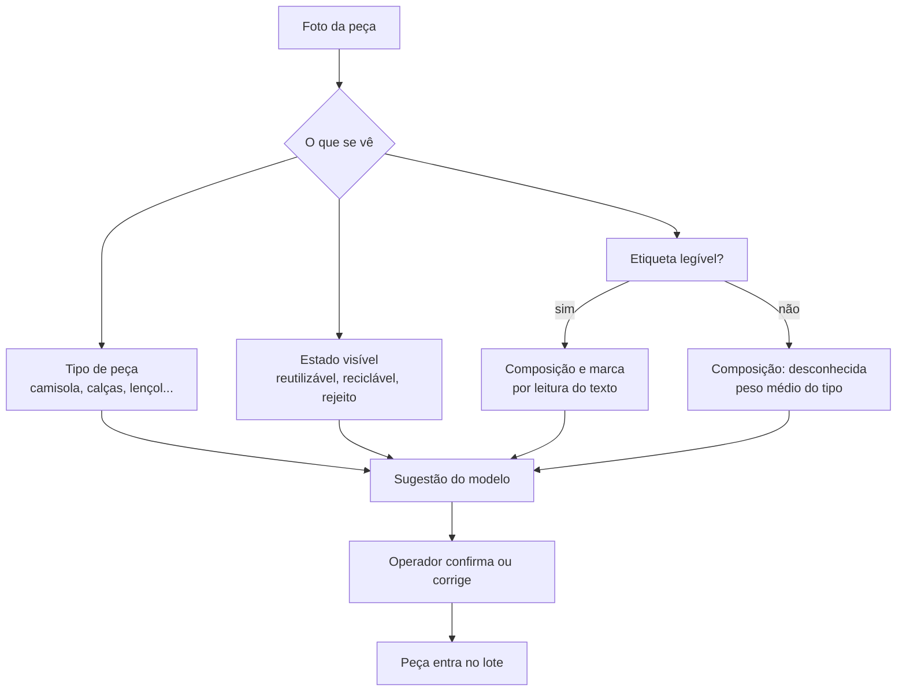

# Tecnologia de triagem

**Resumo.** A triagem industrial por espetroscopia de infravermelho próximo (NIR) atinge mais de 95% de exatidão em ensaios, mas **as misturas e a sujidade degradam-na**, e uma fotografia comum **não vê a fibra**. O que uma foto consegue é reconhecer o tipo de peça, o estado e, com sorte, ler a etiqueta. Por isso o Novelo faz da foto uma **primeira triagem assistida**, com confirmação do operador, e mede a sua exatidão em vez de a prometer.

Consultado a 19 de outubro de 2026. Fontes em [Fontes](fontes.md).

## O que a investigação e a indústria mostram

| Tecnologia | O que faz | Números encontrados | Limites | Fonte |
| --- | --- | --- | --- | --- |
| **NIR + redes neuronais** | Identifica a fibra pela absorção de luz | Mais de 95% de exatidão num conjunto externo de 526 amostras, menos de 2 s por amostra | Ensaio académico, não linha industrial em produção | Kohan [F31] |
| **NIR, seis fibras puras** | Classificação por fibra | 89% a 98% por classe | Fibras puras, não misturas | MDPI Textiles [F33] |
| **NIR em misturas** | Estima teor de algodão em poliéster/algodão | Um tecido 80% algodão e 20% poliéster foi classificado na classe vizinha; um estudo de 2026 mediu erros de 1,2 a 1,6% com instrumentos portáteis, melhor com equipamento de bancada | Abaixo de 35% de algodão a estimativa degrada; a humidade e a sujidade pioram a exatidão (de 83,1% para 78,9% num ensaio) | MDPI Recycling [F32], Montanuniversität Leoben [F34] |
| **Fibersort (Valvan)** | Linha NIR industrial | 45 frações por composição e cor; ritmo de cerca de 1 peça por segundo na versão semiautomática | Sem custos publicados | Fibre2Fashion, Kohan [F31] |
| **SIPTex** | Linha com NIR da TOMRA | Uma das duas linhas comerciais mais conhecidas | Sem números independentes | MDPI Recycling [F32] |
| **Refiberd** | Imagem hiperespectral e aprendizagem automática | Promete tratar até 70% dos resíduos têxteis | Sem exatidão independente | Fibre2Fashion |

**Custos de capital e de operação:** não foram encontrados valores fiáveis para nenhuma destas linhas. A BCG estima investimentos adicionais de 8 a 11 mil milhões de euros e custos operacionais de 5 a 6,5 mil milhões por ano na Europa até 2035 para a cadeia toda, mas não por equipamento. Por verificar.

**Conclusão honesta:** uma linha NIR industrial é uma decisão de investimento da Vitrus, da Resinorte ou da futura entidade gestora, não de um município pequeno. O Novelo não compete com ela. **Alimenta-a** com lotes já pré-separados por composição declarada, tipo de peça e estado.

## O que uma foto e uma etiqueta conseguem

| Campo | Fiabilidade esperada | Porquê |
| --- | --- | --- |
| Tipo de peça | Alta | Visual, bem coberto por modelos de visão |
| Estado (reutilizar, reciclar, rejeitar) | Média, depende do operador | Manchas, buracos e desgaste são visíveis; cheiro e humidade não |
| Marca | Média | Só se a etiqueta ou o logótipo estiver visível |
| Composição | Só quando a etiqueta é legível | A foto não mede a fibra; o consumidor costuma cortar a etiqueta [F37] |
| Peso | Pressuposto (peso médio por tipo) | No piloto passa a vir de uma balança |

**Mitigação:** o modelo devolve confiança e "desconhecido" quando não tem certeza; abaixo de um limiar a peça segue para triagem manual. O operador confirma sempre antes de a peça entrar no lote, e as correções ficam registadas.

## O que prometemos e o que não

| Afirmação | Pode dizer-se? |
| --- | --- |
| "A IA faz uma primeira triagem, o operador confirma" | Sim |
| "Lemos a composição da etiqueta quando é legível" | Sim, quando medido |
| "Acertamos X% no tipo de peça e Y% na marca, num teste de N peças" | **Só depois de medir** (ver avaliação abaixo) |
| "A IA identifica a fibra pela foto" | **Não** |
| "Substitui a linha de triagem industrial" | **Não** |
| "Não guardamos fotografias nem dados de quem entrega" | Sim, é o comportamento atual: as fotos são apagadas depois de processadas |

## A avaliação que vamos fazer

Em construção: um conjunto de 30 a 50 peças fotografadas (próprias e, se possível, da Humana ou da Vitrus), com a verdade de terreno escrita à mão (tipo, estado, marca, composição da etiqueta). Corre-se o modelo e publica-se:

- matriz de confusão por tipo de peça e por estado;
- exatidão por campo (tipo, estado, marca, composição);
- custo e latência por peça no OpenRouter.

O resultado fica em `docs/engenharia/avaliacao-triagem.md` e, se for bom, entra no pitch como "medimos". Se for mau, entra como "primeira triagem com confirmação humana, e é por isso que o operador fica no circuito".

## O que falta verificar

| Questão | Onde procurar |
| --- | --- |
| Custo de uma linha NIR (capex e opex por tonelada) | Pedir orçamento ou relatório a Valvan, Tomra, ou ao CITEVE |
| Exatidão de modelos de visão em etiquetas de composição | Medir nós (avaliação acima) |
| Tamanho de lote mínimo que os recicladores aceitam | Perguntar à Sasia, Recutex, Wippytex |
