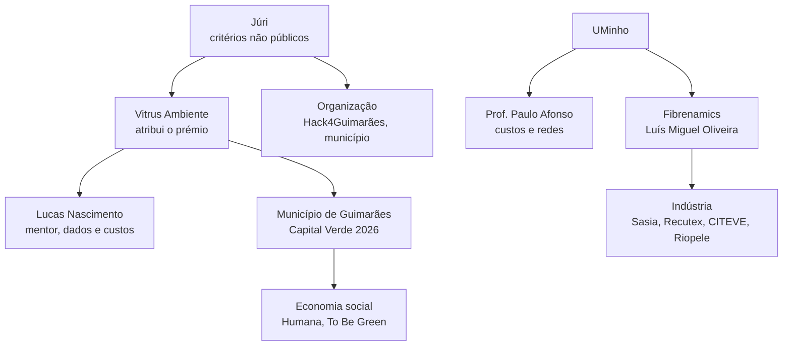

# Estratégia para ganhar

Documento mestre para o Hack4Guimarães 2035 (Desafio 5, TexVitrus). Escrito a 19 de outubro de 2026; pitch a 26 e vencedores a 28.

| Ligações | |
| --- | --- |
| Pessoas | [Mentores](mentores.md): perfis, abordagem e perguntas por ordem de impacto |
| Imprevistos | [Cenários e contingências](cenarios-e-contingencias.md): pitch, dados, mentoria, concorrência, 48 perguntas do júri, pós-hackathon |
| História | [Narrativa do pitch](narrativa-do-pitch.md) e [Guião de slides](pitch-slides.md) |
| Provas | [Dossier de pesquisa](../pesquisa/README.md) e [Registo de afirmações](../pesquisa/registo-de-afirmacoes.md) |

## Resumo executivo

**O que a Vitrus perguntou.** Como criar uma recolha seletiva de têxteis pós-consumo que garanta material reutilizável e reciclável, com o menor investimento e o menor custo de operação.

**O que respondemos.** Não um contentor melhor, mas **a camada de decisão** que diz, com números, onde investir, que modo de recolha usar em cada zona e quanto custa cada tonelada; que entrega ao lote um passaporte para o reciclador; e que dá ao município o dossiê de custo eficiente para reclamar aos produtores quando a responsabilidade alargada começar, a **17 de abril de 2028**.

**Porque pode ganhar.**

1. **Dados reais em todo o lado:** 301,3 t, destino de cada tonelada, 40 circuitos, 29 viaturas, população do INE.
2. **Honestidade sobre a incerteza:** os custos unitários ainda são pressupostos; mostramos o intervalo e o que mais pesa (em integração).
3. **IA com disciplina:** conduz o otimizador e **nunca faz contas**; um verificador rejeita números inventados.
4. **Tese regulatória sólida:** hoje o município paga sozinho; a diretiva só admite custos "economicamente eficientes" e exige cobertura do território todo.
5. **Cadeia completa, do saco ao fio:** recolha, triagem, lote com passaporte, bolsa de fibra, relatório RAP.
6. **Pedido concreto:** piloto de 3 meses em duas freguesias com KPIs e piso de sinal (em integração).

**O que ainda nos falta** (por ordem): custos unitários da Vitrus; fonte do plano municipal (5,4%, 0,7 kg/hab/mês, "4 de 27"); critérios do júri; contentores (chegam a 20); uma frase de um reciclador; exatidão medida da triagem.

**A única regra que não se pode violar:** nenhum número vai para o palco sem estar no [registo](../pesquisa/registo-de-afirmacoes.md) com o seu estado.

## O desafio, lido com atenção

> Como criar um serviço de recolha seletiva de têxteis pós-consumo que garanta material reutilizável e reciclável, com o menor investimento e o menor custo de operação?
> *Por onde começar: recolha mais próxima do cidadão, triagem logo à partida com reconhecimento por imagem, ou ligação à indústria têxtil do Vale do Ave para reciclar fibra.*
> *Dados disponíveis: localização dos contentores atuais e caracterização do lixo indiferenciado, com a fração têxtil, na medida em que exista.*

| Parte da pergunta | O que significa | Como respondemos |
| --- | --- | --- |
| "serviço de recolha seletiva" | Um serviço, não um equipamento | Rede de modos combináveis (rua, pontos existentes, a pedido) |
| "garanta material reutilizável e reciclável" | Qualidade à entrada | Triagem assistida e lotes por composição e estado |
| "menor investimento" | CAPEX | Pontos onde a densidade o justifica; a pedido sem km novos |
| "menor custo de operação" | OPEX | Otimizador de rotas sobre circuitos e viaturas atuais |
| "menor" (as duas coisas) | Comparar | Simulador com orçamento, cenários e €/t |
| "dados disponíveis" | Usá-los | Todos usados; contentores quando chegarem; caracterização do indiferenciado **por verificar** |

**Os três caminhos sugeridos são a mesma cadeia**, não alternativas:

| Caminho | Risco de o fazer sozinho | O que o Novelo faz |
| --- | --- | --- |
| Recolha mais próxima do cidadão | Mais contentores, mais custo e problemas de gestão (Sintra, Humana) | Otimiza onde, quanto e em que modo; mede a lacuna de cobertura |
| Triagem com imagem | A foto não vê a fibra; exatidão por medir | Triagem assistida com confirmação do operador e avaliação medida |
| Ligação à indústria do Vale do Ave | Recicladores precisam de lotes homogéneos, não de sacos | Lote com passaporte e bolsa de fibra; destino de baixo valor com a Fibrenamics (a validar) |

## Mapa de decisores e influenciadores

| Quem | O que quer (hipótese) | O que lhe damos | Estado |
| --- | --- | --- | --- |
| **Vitrus** (prémio) | Uma resposta operacional e defensável com os seus dados | Cenários em €/t, qualidade dos dados, piloto | A construir confiança |
| **Município** | Cumprir a obrigação desde 2025 e preparar 2028 sem pagar sozinho | Relatório RAP e custo eficiente | A explorar |
| **Júri** | Problema real, dados, impacto, viabilidade, demo, clareza (**hipóteses**) | Ver abaixo | Critérios por confirmar |
| **Lucas Nascimento** | Otimização de recursos e reporte de projetos | Dados em €/t e KPIs | Contactar hoje |
| **Luís Miguel Oliveira** | Impacto mensurável, clareza, ciência aplicada às fibras | Passaporte do lote e protocolo de medição | Contactar 20 e 21 |
| **Prof. Paulo Afonso** | Custos, investimento, redes, rigor | Modelo e incerteza | Contactar 21 |
| **Indústria** | Lotes homogéneos e rastreáveis | Passaporte e bolsa de fibra | Procurar uma frase |
| **Economia social** | Manter os seus pontos e a reutilização | Modo adicional da rede | A explorar |

## O que o júri vai valorizar (hipóteses)

> **Os critérios do Hack4Guimarães 2035 não são públicos.** Não os encontrámos na [página da organização](https://www.fpguimaraes.pt/events/hack4guimaraes-2035/) [F59], no regulamento nem na imprensa [F21] [F22]. Perguntar à organização e ao Lucas **hoje**. O que segue são hipóteses a partir de guias de hackathons e do tipo de desafio.

| Hipótese de critério | Porque é plausível | Como a cobrimos | Evidência a mostrar |
| --- | --- | --- | --- |
| **Problema real e bem compreendido** | O desafio é de uma empresa que atribui o prémio | Números reais da Vitrus e do INE; regulação 2025 e 2028 | Slide do problema com fontes |
| **Uso dos dados disponíveis** | O enunciado lista os dados | Todos usados; contentores quando chegarem | Qualidade dos dados |
| **Impacto em investimento e custo** | É a pergunta | €/t, investimento e custo anual por cenário | Comparação A/B |
| **Viabilidade** | "Pode continuar depois do hackathon?" [F38] | Piloto de 3 meses; custos como pressuposto visível | Recomendador de piloto (em integração) |
| **Demo a funcionar** | Padrão dos júris | Demo ao vivo com plano B em vídeo | Demo ensaiada 3 vezes |
| **Inovação com sentido (IA)** | Vantagem da equipa | A IA conduz o otimizador | "E se...?" ao vivo |
| **Clareza do pitch** | Sempre | Uma ideia, um número-âncora | Narrativa |
| **Sustentabilidade e impacto ambiental** | A área é Sustentabilidade | Toneladas desviadas do aterro, hierarquia reutilização > reciclagem | Sankey |

## Tese e diferenciadores

**Tese em uma frase:** *Sabemos dizer à Vitrus quanto custa cada tonelada de têxtil tirada do aterro, e como baixar esse custo.*

| Diferenciador | Porque conta | Estado a 19 out |
| --- | --- | --- |
| **Dados reais da Vitrus em todo o lado** | Ninguém mais os tem | Feito |
| **Otimizador com três modos combináveis** | Responde a "menor investimento e menor custo" | Feito |
| **A IA não faz contas; verificador de números** | Confiança de quem decide | Feito |
| **Relatório RAP em PDF** com custo por tipo de território | Fala a linguagem de 2028 | Feito |
| **Lote com QR, passaporte público e bolsa de fibra** | Liga recolha à indústria | Feito |
| **Interface profissional, mobile-first, pt/en, PWA** | Demo credível em qualquer ecrã | Feito |
| **Cobertura de contentores e lacuna face à referência francesa** | Um número que o júri nunca viu | Em integração (contentores a 20 out) |
| **Sensibilidade e robustez** (tornado, P10/P50/P90) | Transforma a falta de custos em argumento | Em integração |
| **Cenário de referência francês** | Meta externa; mostra a distância (meta 669,7 t, teto do modelo 562,6 t) | Em integração |
| **Recomendador de piloto** (Gondar e a União de Arosa e Castelões; piso de sinal 1,71 t) | O pedido final | Em integração |
| **Copiloto de IA com ferramentas** | Conduz o simulador em conversa | Em integração |
| **Painel de IA** (modelo por funcionalidade, custos e orçamento via OpenRouter; `openai/gpt-6-luna` por defeito) | Controlo de custo e troca de modelo | Em integração |
| **Triagem com avaliação medida** | "Medimos", não "prometemos" | Em integração |
| **Resolvedor de alertas e briefing do RAP** | Automação com humano no circuito | Em integração |

**Regra de corte:** só entra no pitch o que estiver integrado, testado (E2E) e ensaiado **a 25 de outubro**. O que não estiver fica em "próximos passos".

## Arquitetura da prova

Cada afirmação do pitch tem de ter **evidência a abrir** e **fonte**. Se a linha não existir, não se diz.

| Afirmação (slide) | Evidência ao vivo | Fonte | Estado |
| --- | --- | --- | --- |
| "Recolhemos 301,3 t em 2025, 0,16 kg/hab/mês" (2) | Ponto de partida | Dados da Vitrus; INE | Dado Vitrus + cálculo |
| "59,4% reutilização, 26,5% reciclagem, 14,1% rejeito" (5) | Sankey | Dados da Vitrus | Dado Vitrus (duas entidades estimadas) |
| "72% dos têxteis vão para o indiferenciado na Europa" (2) | Slide com fonte | AEA [F7] | Primária |
| "Desde 2025 o município é obrigado; os produtores só em abril de 2028" (2) | Slide de 2028 | APA, EUR-Lex [F1] [F2] | Primária |
| "O custo tem de ser economicamente eficiente" (7) | Relatório RAP | EUR-Lex art. 22.º-A n.º 12 | Primária |
| "A rede tem de cobrir o território todo" (3, 7) | Cobertura | EUR-Lex art. 11.º | Primária |
| "A França recolhe 4,27 kg/hab; nós 1,92" (3) | Cenário francês | Imprensa citando a Refashion [F10] | **Por verificar** na fonte primária |
| "A meta francesa seria 669,7 t; o teto do modelo é 562,6 t" (3) | Cenários de referência | Cálculo nosso | Cálculo (depende da França) |
| "Os pressupostos que mais pesam são estes" (4) | Tornado | Modelo | Estimativa |
| "A Sasia recicla cerca de 2 000 t/mês, quase tudo pré-consumo" (6) | Slide da indústria | Jornal de Negócios [F53] | Secundária |
| "Os lotes por composição são o que falta" (6) | Passaporte e bolsa de fibra | Plano municipal (por verificar); recicladores | Hipótese |
| "A ciência da UMinho aponta não tecidos e isolamento para misturas" (6) | Só em conversa | [F49] a [F52] | Primária (investigação, via pesquisa) |
| "O piloto de 2 freguesias mede X" (8) | Piloto | Modelo | Estimativa |

Os números **por verificar** ([A8, A10, A11, C5, C6, C12, C20, C23](../pesquisa/registo-de-afirmacoes.md)) **não vão a slide**.

## Calendário dia a dia, 19 a 28 de outubro

**H** = Hélder, **F** = Flávio. Propostas; ajustar entre os dois. O produto novo está a ser integrado hoje.

| Dia | Foco | Hélder | Flávio | Checkpoint (go/no-go) |
| --- | --- | --- | --- | --- |
| **Seg 19** | Arranque | Confirmar inscrição; mensagem ao Lucas com 5 pedidos; pedir critérios do júri | Integração dos novos ecrãs; `just check` verde; chave OpenRouter e saldo verificados | **Go** se: inscrição confirmada, mensagem enviada, API e web a arrancar |
| **Ter 20** | Dados novos | Receber contentores e custos; mensagem ao Luís Miguel; contactos à indústria | Importar contentores, mapa e cobertura | **Go** se: contentores no mapa ou plano B definido |
| **Qua 21** | Modelo e mentores | 10 min com o Prof. Paulo Afonso; fixar cenários A, B e francês | Sensibilidade, robustez e piloto no web | **Go** se: três cenários calculados e a frase-âncora preenchida |
| **Qui 22** | Prova | Medir a triagem (30 a 50 peças); resposta de um reciclador; narrativa final | Copiloto e resolvedor de alertas; painel de IA | **No-go** de cada funcionalidade nova sem E2E verde: sai da demo |
| **Sex 23** | Fechar produto | Slides em rascunho; registo de afirmações | Polimento; E2E completo; imagens de produção; deploy de ensaio | **Código congelado à noite** |
| **Sáb 24** | Deck | Deck v1; vídeo de 60 s | Plano B (relatório pré-gerado, stack local, dump da base); verificar Coolify | Deck e vídeo prontos |
| **Dom 25** | Ensaio | 3 ensaios cronometrados com as 48 perguntas | Ensaio técnico (rede, projetor, QR no telemóvel de um jurado) | **Go/no-go final**: o que não foi ensaiado sai |
| **Seg 26** | **Pitch** | Apresenta | Opera a demo | — |
| **Qua 28** | Resultados | Preparar a resposta para [cada resultado](cenarios-e-contingencias.md#f-cenários-pós-hackathon) | — | — |

**Ordem de corte** (do primeiro a sair ao último): resolvedor de alertas na demo → painel de IA na demo → copiloto no palco → triagem medida (fica como "estamos a medir") → cenário francês → piloto recomendado → sensibilidade. **Nunca se corta:** comparação de cenários, "E se...?", relatório RAP, dados reais. Ver [Features](../engenharia/features.md#ordem-de-corte).

## Checklist de pitch

- [ ] Inscrição confirmada, critérios do júri e duração perguntados
- [ ] Cenários A, B e francês calculados; frase-âncora com X e Y preenchidos
- [ ] Registo de afirmações impresso, com "slide" preenchido e nada "por verificar" em slide
- [ ] Cinco perguntas "E se..." de reserva testadas, com respostas em cache
- [ ] Triagem medida (matriz de confusão) **ou** frase "estamos a medir"
- [ ] Pelo menos uma frase de um reciclador **ou** o slide diz "em conversa"
- [ ] Custos da Vitrus **ou** o intervalo e o tornado à vista
- [ ] E2E completo verde; `just check` verde; imagens de produção compiladas
- [ ] Vídeo de 60 s, relatório RAP pré-gerado e deck em PDF, em dois dispositivos
- [ ] Saldo e orçamento de IA verificados; modelo de reserva configurado
- [ ] Três ensaios cronometrados; respostas às 48 perguntas lidas
- [ ] Kit físico (adaptadores, carregadores, powerbank)
- [ ] Verificação 15 minutos antes: API, login, cenário B, PDF, QR, Wi-Fi

## Riscos priorizados

| # | Risco | Gravidade | Probabilidade | Resposta | Dono |
| --- | --- | --- | --- | --- | --- |
| 1 | Os custos unitários da Vitrus não chegam | Alta | Alta | Intervalo e tornado; dizer "estimativa"; pedir hoje | H |
| 2 | O júri pergunta pelos 5,4% e "4 de 27" | Alta | Média | Pedir o documento ao Lucas; até lá não vão a slide | H |
| 3 | Prometer demasiado ("a IA substitui a triagem", metas na diretiva) | Alta | Média | Lista "o que nunca dizer"; revisão do registo | HF |
| 4 | Funcionalidade nova quebra na demo | Média | Média | Regra de corte; cenários pré-calculados | HF |
| 5 | IA indisponível (saldo, chave, latência) | Média | Média | Orçamento e modelo de reserva; vídeo; sem IA o resto funciona | F |
| 6 | Contentores chegam com formato inesperado ou tarde | Média | Média | Importador tolerante; plano B "a chegar" | F |
| 7 | Falha de rede ou portátil | Média | Baixa | Stack local, vídeo, segundo portátil | F |
| 8 | O modelo ignora a operação real | Alta | Baixa | Rotas atuais no modelo; falar com o Lucas sobre restrições | H |
| 9 | Meta francesa mal interpretada | Baixa | Média | Dizer "referência", mostrar a distância e o potencial como teto | H |
| 10 | Datas da regulação mal ditas | Média | Baixa | Só as marcadas "Primária" | H |
| 11 | Cansaço no dia 26 | Média | Média | Congelar código a 23; ensaios a 25; dormir | HF |
| 12 | Identificação errada de um mentor | Baixa | Baixa | Confirmar logo na primeira mensagem | H |

## Métricas de sucesso

| Métrica | Alvo |
| --- | --- |
| Pitch dentro do tempo | ≤ 5:00 em 3 ensaios |
| Demo | ≤ 2 minutos, sem erro, com o QR lido pelo telemóvel de um jurado |
| Números em slide | 100% no registo, 0 "por verificar" |
| Qualidade de código | `just check` verde; E2E completo verde |
| Respostas às perguntas | 48 respondidas em ≤ 20 s |
| Evidência externa | ≥ 1 frase de um reciclador; ≥ 1 validação de um mentor; custos recebidos (ou intervalo) |
| Resultado | Ganhar; senão, convite para piloto ou feedback escrito |

## O que dizer e o que nunca dizer

**Dizer**

- "Sabemos dizer quanto custa cada tonelada e como baixar esse custo."
- "A IA conduz o otimizador; nunca faz contas."
- "O município paga hoje; em 2028 deixa de pagar sozinho, mas só custos eficientes. Alguém tem de os provar."
- "Os custos unitários ainda são pressupostos; aqui está o que mais pesa."
- "Pedimos duas freguesias, três meses."

**Nunca dizer**

- Um número que não esteja no [registo](../pesquisa/registo-de-afirmacoes.md).
- Que a IA "identifica a fibra" ou "substitui a triagem".
- Que a diretiva fixa metas de recolha de têxteis.
- "Validado pela Fibrenamics/Universidade/Vitrus" antes de ouvir e escrever o que disseram.
- Que a meta francesa é uma promessa.
- Que uma funcionalidade "em integração" está pronta sem a ter ensaiado.

## Contactos e perguntas

As perguntas completas, por ordem de impacto, para o **Lucas Nascimento**, o **Luís Miguel Oliveira** e o **Prof. Paulo Afonso** estão em [Mentores](mentores.md). Contactos à indústria e à economia social:

| Contacto | Mensagem curta | Prova que queremos |
| --- | --- | --- |
| **Sasia** (Miguel Silva, administrador) | "Estamos a desenhar lotes de têxtil pós-consumo por composição para o Vale do Ave. A que critérios de composição, cor e limpeza compram, e a que preço?" | Uma frase com critérios e preço |
| **Recutex** | Mesma pergunta | Se trabalham com pós-consumo |
| **CITEVE** | "Pode comentar o passaporte do lote e a classificação por fibra? Há ligação ao RegioGreenTex?" | Validação técnica e rede |
| **Fibrenamics** | Ver [Mentores](mentores.md#luís-miguel-oliveira-fibrenamics) | Critérios do lote; destino de baixo valor |
| **Humana** ou outra entidade de economia social | "Como articulam novos pontos municipais com os vossos? Têm dados de triagem?" | Parceria e dados reais |
| **Wippytex** | "Como trabalham com 30 municípios e o que pedem às câmaras?" | Boas práticas |
| **Município / Let's Go Circular** | "Pode partilhar o plano de ação de circularidade têxtil?" | A fonte dos 5,4% |

Mais contexto em [Indústria e mercado](../pesquisa/industria-e-mercado.md).
