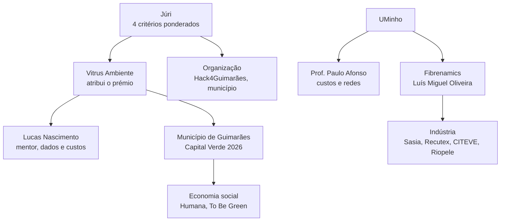
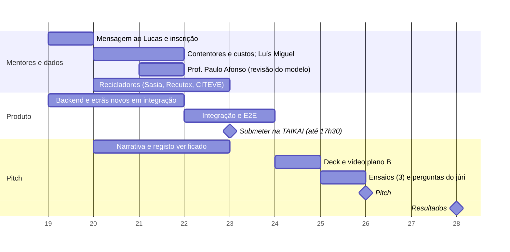

# Estratégia para ganhar

Documento mestre para o Hack4Guimarães 2035 (Desafio 5, TexVitrus). Escrito a 19 de outubro de 2026; **submissão a 23 às 17h30 (fecho rígido)**, pitch a 26 a partir das 14h30 e vencedores a 28.

| Ligações | |
| --- | --- |
| Pessoas | [Mentores](mentores.md): perfis, abordagem e perguntas por ordem de impacto |
| Imprevistos | [Cenários e contingências](cenarios-e-contingencias.md): pitch, dados, mentoria, concorrência, 48 perguntas do júri mais 12 por critério, pós-hackathon |
| História | [Narrativa do pitch](narrativa-do-pitch.md) e [Guião de slides](pitch-slides.md) |
| Critérios | [Critérios de avaliação](criterios-de-avaliacao.md): pesos, matriz e o que falta ler nas Regras |
| Provas | [Dossier de pesquisa](../pesquisa/README.md) e [Registo de afirmações](../pesquisa/registo-de-afirmacoes.md) |

## Resumo executivo

**O que a Vitrus perguntou.** Como criar uma recolha seletiva de têxteis pós-consumo que garanta material reutilizável e reciclável, com o menor investimento e o menor custo de operação.

**O que respondemos.** Não um contentor melhor, mas **a camada de decisão** que diz, com números, onde investir, que modo de recolha usar em cada zona e quanto custa cada tonelada; que entrega ao lote um passaporte para o reciclador; e que dá ao município o dossiê de custo eficiente para levar à mesa com produtores e entidade gestora quando a responsabilidade alargada começar (o regime tem de existir até **17 de abril de 2028** e cobre as peças postas à venda a partir da lei nacional).

**Porque pode ganhar.**

1. **Dados reais em todo o lado:** 301,3 t, destino de cada tonelada, 40 circuitos, 29 viaturas, população do INE.
2. **Honestidade sobre a incerteza:** os custos unitários ainda são pressupostos; mostramos o intervalo e o que mais pesa (feito: tornado e Monte Carlo).
3. **IA com disciplina:** conduz o otimizador e **nunca faz contas**; um verificador rejeita números inventados.
4. **Tese regulatória sólida:** hoje o município paga sozinho; a diretiva só admite custos "economicamente eficientes", determinados com as autoridades locais (art. 22.º-A, n.º 7 e 12), e exige cobertura do território todo por população, densidade, volume previsto e proximidade, sem se limitar às zonas rendíveis (art. 22.º-C, n.º 9, b)). O separador Cobertura de cada cenário mostra-o: no de 60 000 €/ano, 60,2% da população servida fora das freguesias urbanas, contra 73,9% nas urbanas (estimativa).
5. **Cadeia completa, do saco ao fio:** recolha, triagem, lote com passaporte, bolsa de fibra, relatório RAP.
6. **Pedido concreto:** piloto de 3 meses em duas freguesias com KPIs e piso de sinal (feito).

**O que ainda nos falta** (por ordem): custos por hora e por km das viaturas (pedidos ao departamento financeiro a 21 de outubro, ainda por chegar a 22); o texto das Regras (os quatro critérios e pesos já são conhecidos, falta o detalhe de cada um); uma frase de um reciclador; exatidão medida da triagem. Resolvido a 21 de outubro: não há contentores de têxteis (a Vitrus não os quer). Resolvido a 22 de outubro: a procura passa ao indiferenciado do concelho todo × 5,86% (APA) ≈ 3 003 t por ano ainda no lixo (estimativa); o saco não pode ir no compactador e não há viaturas livres, por isso a rede usa uma viatura de têxtil nova; o tratamento evitado vale 105,64 €/t; o depósito é em Polvoreira.

**A única regra que não se pode violar:** nenhum número vai para o palco sem estar no [registo](../pesquisa/registo-de-afirmacoes.md) com o seu estado.

## O desafio, lido com atenção

> Como criar um serviço de recolha seletiva de têxteis pós-consumo que garanta material reutilizável e reciclável, com o menor investimento e o menor custo de operação?
> *Por onde começar: recolha mais próxima do cidadão, triagem logo à partida com reconhecimento por imagem, ou ligação à indústria têxtil do Vale do Ave para reciclar fibra.*
> *Dados disponíveis: localização dos contentores atuais e caracterização do lixo indiferenciado, com a fração têxtil, na medida em que exista.*

| Parte da pergunta | O que significa | Como respondemos |
| --- | --- | --- |
| "serviço de recolha seletiva" | Um serviço, não um equipamento | Uma viatura de têxtil nova, sem compactação: saco fechado à porta num dia fixo por freguesia e paragens nos locais municipais e nas escolas, sem contentor novo |
| "garanta material reutilizável e reciclável" | Qualidade à entrada | Triagem assistida e lotes por composição e estado; toneladas reutilizáveis em cada cenário, porque a qualidade depende de quem recolhe (em 2025, 72,9% de reutilização na Ultriplo, 9,2% no têxtil recolhido pela Vitrus; A19) |
| "menor investimento" | CAPEX | Sem contentores de têxtil: uma só viatura nova (o "meio novo de recolha" que a Vitrus indicou) e locais existentes, sem contentor novo |
| "menor custo de operação" | OPEX | Otimizador de rotas para a viatura de têxtil, a partir do depósito de Polvoreira; o tratamento evitado (105,64 €/t, Vitrus; A25) paga parte da operação |
| "menor" (as duas coisas) | Comparar | Simulador com orçamento, cenários e €/t |
| "dados disponíveis" | Usá-los | Todos usados; não há contentores de têxteis (Vitrus, 21 out); caracterização: 5,86% da APA (2025) indicado pela Vitrus (22 out) |

**Os três caminhos sugeridos são a mesma cadeia**, não alternativas:

| Caminho | Risco de o fazer sozinho | O que o Novelo faz |
| --- | --- | --- |
| Recolha mais próxima do cidadão | Mais contentores, mais custo e problemas de gestão (Sintra, Humana) | Otimiza onde, quanto e em que modo; mede a lacuna de cobertura |
| Triagem com imagem | A foto não vê a fibra; exatidão por medir | Triagem assistida com confirmação do operador e avaliação medida |
| Ligação à indústria do Vale do Ave | Recicladores precisam de lotes homogéneos, não de sacos | Lote com passaporte e bolsa de fibra; destino de baixo valor com a Fibrenamics (a validar) |

## Mapa de decisores e influenciadores

| Quem | O que quer (hipótese) | O que lhe damos | Estado |
| --- | --- | --- | --- |
| **Vitrus** (prémio) | Uma resposta operacional e defensável com os seus dados | Cenários em €/t, qualidade dos dados, piloto | A construir confiança |
| **Município** | Cumprir a obrigação desde 2025 e preparar 2028 sem pagar sozinho | Relatório RAP e custo eficiente | A explorar |
| **Júri** | Inovação 25%, viabilidade 25%, impacto 30%, apresentação e continuidade 20% (detalhe de cada um por ler nas Regras) | [Como somos avaliados](#como-somos-avaliados) | Pesos confirmados; Regras por ler |
| **Lucas Nascimento** | Otimização de recursos e reporte de projetos | Dados em €/t e KPIs | Contactar hoje |
| **Luís Miguel Oliveira** | Impacto mensurável, clareza, ciência aplicada às fibras | Passaporte do lote e protocolo de medição | Contactar 20 e 21 |
| **Prof. Paulo Afonso** | Custos, investimento, redes, rigor | Modelo e incerteza | Contactar 21 |
| **Indústria** | Lotes homogéneos e rastreáveis | Passaporte e bolsa de fibra | Procurar uma frase |
| **Economia social** | Manter os seus pontos e a reutilização | Modo adicional da rede | A explorar |

## Como somos avaliados

Os projetos são avaliados por **quatro critérios ponderados**. Fonte: página oficial do Hack4Guimarães 2035, FAQ "Como são avaliados os projetos?", consultada a 19 de outubro de 2026 [F61] (registo [E4](../pesquisa/registo-de-afirmacoes.md)).

| Critério | Peso | Valor de +1 ponto na nossa nota (0 a 10) |
| --- | --- | --- |
| Inovação e originalidade | **25%** | +0,25 |
| Viabilidade técnica | **25%** | +0,25 |
| Impacto e relevância | **30%** | +0,30 |
| Apresentação e potencial de continuidade | **20%** | +0,20 |
| **Total** | **100%** | |

> **O que ainda não sabemos.** O detalhe de cada critério está no separador **Rules** da página do evento na plataforma TAIKAI, que **ainda não temos** (E6). A coluna "o que o júri provavelmente procura" é, por isso, **hipótese**: vem de guias de hackathons [F38] e do tipo de desafio, não do texto oficial. Quando lermos as Regras, cola-se o texto em [Critérios de avaliação](criterios-de-avaliacao.md#colar-aqui-o-texto-das-regras) e esta matriz revê-se no mesmo dia. Os nomes do júri, o formato do pitch e das perguntas e a duração continuam desconhecidos (E5, E7).

### O que a organização escreve, e o que isso muda

Palavras oficiais da FAQ [F61] e do enunciado do desafio [F62]. São um resumo, não os critérios detalhados.

| Critério | Palavras oficiais | O que muda para nós |
| --- | --- | --- |
| Inovação e originalidade | "a inovação da solução" | Provar a novidade com a ligação saco, lote e fio, não com tecnologia |
| Viabilidade técnica | "a solidez técnica **do que foi construído**"; "demonstrar que a ideia funciona na prática" | Conta o que está construído e a funcionar, não o que está em integração: sem E2E verde, não se mostra |
| Impacto e relevância | "o impacto **no território**" | Dados locais: freguesias, 40 circuitos, 29 viaturas, população do INE; o piloto em duas freguesias |
| Apresentação e potencial de continuidade | "a clareza com que a equipa o apresenta"; "um protótipo funcional com potencial de continuidade, **não um produto acabado**"; "pode evoluir depois do hackathon" | Dizer que é um protótipo e mostrar o caminho: piloto, roadmap, replicabilidade |

### As regras do jogo

| Facto | Valor | Registo |
| --- | --- | --- |
| **Submissão** | Até **23 de outubro às 17h30**; depois, os projetos ficam fechados e não se cria nem edita nada | E8 |
| Pitches | 26 de outubro a partir das 14h30, presenciais; presença obrigatória | E2, E9 |
| Júri | Designado pela organização, especialistas nas áreas temáticas, **sem votação pública**, decisões finais; avalia a 26 e 27 | E7 |
| Prémios | 7 500 €, 4 500 € e 3 000 € na classificação geral; 1 000 € para o melhor de cada desafio; acumulam. Neste desafio, a Vitrus atribui o prémio | E3, E13, E14 |
| IA e código de terceiros | Permitidos e encorajados, **desde que identificados** | E11 |
| Originalidade | Trabalho substancial feito durante o hackathon; a organização pode verificar o histórico dos repositórios. O nosso primeiro commit é de 19 de outubro | E12 |

**Implicações.** 1) Competimos na classificação geral com os outros quatro desafios, perante especialistas de várias áreas: a clareza (não o jargão de VRP) pesa. 2) O que se submete a 23 às 17h30 é o que fica; a produção faz deploy a cada push em `main`, por isso depois de submeter só entram correções. 3) Identificar na submissão e no README as ferramentas de IA, APIs e bibliotecas usadas (Claude Code, GLM/Z.ai, OpenRouter e o modelo configurado, OR-Tools, OSRM). 4) Nunca reescrever o histórico do Git.

### Matriz: critério, prova e ação

A leitura "o que o júri procura" é **hipótese** até lermos as Regras. Os restantes campos são factos do projeto. Os slides são os do [guião](pitch-slides.md); os passos da demo, os do [roteiro](narrativa-do-pitch.md#roteiro-da-demo).

| Critério | O que o júri provavelmente procura (**hipótese**) | Evidência Novelo | Onde se mostra | Risco | Ação para subir a nota |
| --- | --- | --- | --- | --- | --- |
| **Inovação e originalidade** (25%) | Uma ideia que não seja a solução óbvia (a app do cidadão, mais contentores); IA com sentido; uma ligação nova entre peças | A IA conduz o otimizador e um verificador rejeita números fora do resultado; a cadeia do saco ao fio numa só ferramenta: decisão da rede, lote com passaporte e QR, bolsa de fibra, relatório RAP ([funcionalidades](../engenharia/features.md)) | Slides 5 e 6; demo: "E se...?" (passo 6) e lote com QR (passo 8) | "Isto já existe?": cada peça existe isolada, e a nossa pesquisa de concorrência não é exaustiva | Dizer a novidade como **ligação**, não como tecnologia; mostrar o verificador a recusar um número; ter uma frase de comparação. **Não investir mais engenharia aqui** |
| **Viabilidade técnica** (25%) | Funciona a sério; usa dados reais; os pressupostos estão à vista; sabe-se o que acontece quando falha | Em produção ([novelo.helder.si](https://novelo.helder.si)); dados da Vitrus (301,3 t, 40 circuitos, 29 viaturas) e do INE; pressupostos visíveis; domínio testado com valores calculados à mão; 12 alertas de qualidade dos dados | Slide 5; demo: ponto de partida (passo 1) e sensibilidade (passo 5); plano B | Custos unitários ainda são pressupostos; sensibilidade, piloto e copiloto já na app (a ensaiar com o guião); exatidão da triagem por medir | E2E verde em tudo o que entra; mostrar intervalo e tornado; "estamos a medir" com protocolo; cenários pré-calculados |
| **Impacto e relevância** (30%) | Problema real e grande; quem beneficia; resposta à pergunta ("menor investimento e menor custo de operação") | 301,3 t = 0,16 kg/hab/mês (dados Vitrus, INE); ≈ 3 003 t/ano ainda no lixo (51 250,6 t de indiferenciado do concelho × 5,86%, Vitrus e APA) e captura de 9,1% (cálculo, estimativa); 105,64 €/t de tratamento evitado (Vitrus); destino 59,4% / 26,5% / 14,1%; obrigação desde 1 jan 2025 e RAP criada até 17 abr 2028 (cobre as peças novas, B17); **cenário de 60 000 €/ano: 445,8 t/ano a 102,8 €/t, e 47 093 € de tratamento evitado que pagam a operação (estimativa, H3, H10)** | Slides 1 a 3 e 7; demo: cenário A contra B (passo 3) e relatório RAP (passo 10) | Custos das viaturas da Vitrus por chegar; 5,86% é média nacional da APA, não caracterização local; sem medição no terreno | Fechar A e B e a frase-âncora a 22 out; dizer **quem paga em 2028**; mostrar o intervalo; propor o piloto com KPIs |
| **Apresentação e potencial de continuidade** (20%) | História clara, tempo cumprido, demo sem falhas; um plano para depois do hackathon, parceiros, replicação, sustentabilidade | Narrativa em sete passos; demo mínima de cinco passos; plano B; pedido do piloto (duas freguesias, 3 meses, KPIs, piso de sinal de 1,71 t, estimativa); repositório público, propriedade dos autores [F59] | Slides 1 e 8; slide de apoio 9 ("critério → prova"); QR lido no telemóvel de um jurado | Deck por fazer; duração e formato por confirmar; nenhum parceiro confirmou o piloto; modelo de sustentabilidade é hipótese | Três ensaios a 25 out; mensagem à Vitrus e à Fibrenamics com o pedido; roadmap pós-26 out com datas; replicação dita com prova (dados abertos) |

### Autoavaliação honesta

**Estimativa nossa, subjetiva e sem avaliador externo.** Serve para decidir onde gastar horas, não para prever o resultado. Nota ponderada = soma de peso × nota.

| Critério | Peso | Nota hoje (0 a 10) | Contributo | Porquê | Alvo a 25 out | Contributo alvo |
| --- | --- | --- | --- | --- | --- | --- |
| Inovação e originalidade | 25% | **7** | 1,75 | A cadeia ligada e o verificador distinguem-nos; mas as peças existem isoladas e não temos prova externa de novidade | 7 | 1,75 |
| Viabilidade técnica | 25% | **6** | 1,50 | Produto no ar com dados reais; mas custos são pressupostos, a triagem não tem exatidão medida e há 162 testes ponta a ponta que ainda têm de ser ensaiados com o guião da demo | 8 | 2,00 |
| Impacto e relevância | 30% | **6** | 1,80 | Problema e prazos com fonte primária; frase-âncora preenchida a 22 out (445,8 t a 102,8 €/t, estimativa), mas faltam os custos das viaturas da Vitrus e o potencial do plano municipal está por verificar | 8 | 2,40 |
| Apresentação e continuidade | 20% | **5** | 1,00 | Narrativa e guião escritos; mas o deck não existe, a demo não foi ensaiada, o formato é desconhecido e nenhum parceiro confirmou o piloto | 8 | 1,60 |
| **Nota ponderada** | 100% | | **6,05** | | | **7,75** |

**Onde está o ganho.** Impacto +2 pontos vale +0,60. Apresentação e continuidade +3 pontos vale +0,60. Viabilidade +2 pontos vale +0,50. Inovação +0 pontos. Total: +1,70.

**As três maiores lacunas** (por ganho ponderado):

1. **Impacto com número-âncora ainda estimado:** 445,8 t a 102,8 €/t (preenchido a 22 out), mas sem custos reais das viaturas da Vitrus. É o critério que mais pesa.
2. **Continuidade sem parceiro confirmado e sem deck ensaiado:** o piloto é o nosso pedido, mas ninguém da Vitrus, da Fibrenamics ou da UMinho o confirmou.
3. **Viabilidade apoiada em funcionalidades por integrar:** sensibilidade, piloto recomendado e triagem medida só contam se tiverem E2E verde a 25 de outubro.

### Prioridades de esforço, pelos pesos

Impacto (30%) e viabilidade (25%) somam 55% da nota. A inovação vale 25%, a mesma que a viabilidade, mas é onde já estamos mais fortes e onde cada hora rende menos. **Não gastar tempo em funcionalidades vistosas sem prova de impacto.**

| Ordem | Critério | O que fazer primeiro |
| --- | --- | --- |
| 1 | Impacto e relevância (30%) | Cenários A, B e francês fechados; frase-âncora com 445,8 t e 102,8 €/t; custo por tonelada com intervalo; "quem paga em 2028" no relatório RAP |
| 2 | Apresentação e continuidade (20%) | Maior margem (de 5 para 8) e custo baixo: deck, vídeo, três ensaios, pedido do piloto por escrito |
| 3 | Viabilidade técnica (25%) | E2E verde; sensibilidade à vista; protocolo de medição da triagem; plano B testado |
| 4 | Inovação e originalidade (25%) | Manter. Só polir o que já aparece na demo ("E se...?", QR) |

### Regras de corte em função dos pesos

1. **Teste de entrada.** Cada funcionalidade, slide ou frase tem de nomear o critério que sobe e a prova que se abre. Sem as duas coisas, sai.
2. **Desempate pelo peso.** Se há conflito de horas de engenharia: impacto, depois viabilidade, depois inovação. As horas de ensaio não se cortam (são a nota de apresentação).
3. **Sem vistoso sem prova.** O copiloto, o painel de IA e o resolvedor de alertas só vão ao palco se acabarem numa grandeza de impacto (€/t, toneladas, cobertura) ou de viabilidade (erro evitado, número verificado).
4. **Sem E2E verde a 25 de outubro, não se mostra** (regra de corte já existente, agora justificada pelo critério de viabilidade).

| Critério | O que conta (entra) | O que não conta (sai) |
| --- | --- | --- |
| **Viabilidade técnica** | E2E verde; dados reais; custos como **pressupostos explícitos**; sensibilidade (intervalo e tornado); cenários pré-calculados; plano B | Funcionalidade sem E2E; número sem fonte; "funciona na minha máquina" |
| **Impacto e relevância** | €/t; toneladas desviadas; cobertura do território; **quem paga em 2028**; piloto de 3 meses com KPIs (toneladas, €/t, taxa de rejeito) | Métricas de utilização do ecrã; números "por verificar"; adjetivos |
| **Apresentação e potencial de continuidade** | Storyline de sete passos; demo ensaiada três vezes; plano B; **plano pós-hackathon** (piloto, roadmap); replicabilidade a outros municípios; modelo de sustentabilidade (hipótese dita como tal); parceiros Vitrus, Fibrenamics e UMinho **só como "em conversa" depois de falar** | Slides densos; improviso na demo; parceiros nomeados sem os ter ouvido |
| **Inovação e originalidade** | A ligação do saco ao fio; a IA que conduz e não calcula; o verificador | Tecnologia pela tecnologia (blockchain, sensores, robôs de triagem) |

### Ordem de corte, por valor ponderado

Do primeiro a sair ao último. Mantém a [ordem de corte](#calendário-dia-a-dia-19-a-28-de-outubro) abaixo, agora com o critério que cada peça serve.

| Sai por ordem | Funcionalidade | Critério que serve | Porque nesta posição |
| --- | --- | --- | --- |
| 1.º | Resolvedor de alertas na demo | Viabilidade (qualidade dos dados) | Já temos os 12 alertas à vista sem IA |
| 2.º | Painel de IA na demo | Viabilidade | Não muda nenhum número de impacto |
| 3.º | Copiloto no palco | Inovação | Vistoso; o "E se...?" simples já prova a IA |
| 4.º | Triagem medida | Viabilidade | Fica como "estamos a medir" |
| 5.º | Cenário francês | Impacto | Referência, não promessa |
| 6.º | Piloto recomendado | Impacto e continuidade | É o pedido final |
| 7.º | Sensibilidade | Viabilidade e impacto | Transforma a falta de custos em argumento |

**Nunca se corta:** comparação de cenários (impacto), "E se...?" (inovação), relatório RAP (impacto), dados reais (viabilidade).

## Tese e diferenciadores

**Tese em uma frase:** *Sabemos dizer à Vitrus quanto custa cada tonelada de têxtil tirada do aterro, e como baixar esse custo.*

| Diferenciador | Porque conta | Estado a 19 out |
| --- | --- | --- |
| **Dados reais da Vitrus em todo o lado** | Ninguém mais os tem | Feito |
| **Otimizador com três modos combináveis** | Responde a "menor investimento e menor custo" | Feito |
| **A IA não faz contas; verificador de números** | Confiança de quem decide | Feito |
| **Relatório RAP em PDF** com custo por tipo de território | Fala a linguagem de 2028 | Feito |
| **Lote com QR, passaporte público e bolsa de fibra** | Liga recolha à indústria | Feito |
| **Interface profissional, mobile-first, pt/en, PWA** | Demo credível em qualquer ecrã | Feito |
| **Cobertura de contentores e lacuna face à referência francesa** | Um número que o júri nunca viu | Deixou de se aplicar: não há contentores de têxteis (21 out); fica a rede por locais reais |
| **Sensibilidade e robustez** (tornado, P10/P50/P90) | Transforma a falta de custos em argumento | Em integração |
| **Cenário de referência francês** | Meta externa; mostra o caminho (meta 669,7 t, alcançável sem contentores entre 100 000 e 150 000 €/ano; teto do modelo sem contentores 772,1 t, estimativa) | Em integração |
| **Recomendador de piloto** (Aldão e a União de Arosa e Castelões; piso de sinal 1,71 t, previsão 2,43 t) | O pedido final | Em integração |
| **Copiloto de IA com ferramentas** | Conduz o simulador em conversa | Em integração |
| **Painel de IA** (modelo por funcionalidade, custos e orçamento via OpenRouter; `openai/gpt-6-luna` por defeito) | Controlo de custo e troca de modelo | Em integração |
| **Triagem com avaliação medida** | "Medimos", não "prometemos" | Em integração |
| **Resolvedor de alertas e briefing do RAP** | Automação com humano no circuito | Em integração |

**Regra de corte:** só entra no pitch o que estiver integrado, testado (E2E) e ensaiado **a 25 de outubro**. O que não estiver fica em "próximos passos".

## Arquitetura da prova

Cada afirmação do pitch tem de ter **evidência a abrir** e **fonte**. Se a linha não existir, não se diz.

| Afirmação (slide) | Evidência ao vivo | Fonte | Estado |
| --- | --- | --- | --- |
| "Recolhemos 301,3 t em 2025, 0,16 kg/hab/mês" (2) | Ponto de partida | Dados da Vitrus; INE | Dado Vitrus + cálculo |
| "59,4% reutilização, 26,5% reciclagem, 14,1% rejeito" (5) | Sankey | Dados da Vitrus | Dado Vitrus (duas entidades estimadas) |
| "72% dos têxteis vão para o indiferenciado na Europa" (2) | Slide com fonte | AEA [F7] | Primária |
| "Desde 2025 o município é obrigado e paga; a RAP tem de existir até abril de 2028 e cobre as peças postas à venda a partir daí" (2) | Slide de 2028 | APA, EUR-Lex art. 22.º-A n.º 11 e 14 [F1] [F2] (B17) | Primária; leitura do n.º 11 a confirmar com a APA |
| "O custo tem de ser economicamente eficiente e é determinado com as autoridades locais" (7) | Relatório RAP | EUR-Lex art. 22.º-A n.º 7 e 12 | Primária |
| "A rede tem de cobrir o território todo, não só as zonas rendíveis" (3, 7) | Cobertura | EUR-Lex art. 22.º-C n.º 9, b) | Primária |
| "A França recolhe 4,27 kg/hab; nós 1,92" (3) | Cenário francês | Imprensa citando a Refashion [F10] | **Por verificar** na fonte primária |
| "A meta francesa seria 669,7 t; sem contentores, o modelo chega lá entre 100 000 e 150 000 €/ano, e o teto é 772,1 t" (3) | Cenários de referência | Cálculo nosso (H6) | Cálculo (depende da França) |
| "A qualidade depende de quem recolhe: 72,9% de reutilização na Ultriplo, 9,2% no têxtil recolhido pela Vitrus" (6) | Sankey e KPI de toneladas reutilizáveis | Dados da Vitrus (A19) | Dado Vitrus (Vitrus e Nova Etapa por percentagem de relatório) |
| "Fora das freguesias urbanas o cenário serve 60,2% da população, contra 73,9%" (7) | Separador Cobertura do cenário | Cálculo nosso (H4); art. 22.º-C n.º 9, b) | Cálculo (estimativa) |
| ~~"Numa tarde de dia útil, cerca de 15 das 29 viaturas não têm circuito"~~ | — | A20 | **Falso** (Vitrus, 22 out): erro na folha de turnos. Não dizer |
| "Cada tonelada que sai do lixo poupa 105,64 € de tratamento" | Impacto | Vitrus (A25) | Dado Vitrus |
| "Os pressupostos que mais pesam são estes" (4) | Tornado | Modelo | Estimativa |
| "A Sasia recicla cerca de 2 000 t/mês, quase tudo pré-consumo" (6) | Slide da indústria | Jornal de Negócios [F53] | Secundária |
| "Os lotes por composição são o que falta" (6) | Passaporte e bolsa de fibra | Plano municipal (por verificar); recicladores | Hipótese |
| "A ciência da UMinho aponta não tecidos e isolamento para misturas" (6) | Só em conversa | [F49] a [F52] | Primária (investigação, via pesquisa) |
| "O piloto de 2 freguesias mede X" (8) | Piloto | Modelo | Estimativa |

Os números **por verificar** ([A8, A10, A11, C5, C6, C12, C20, C23](../pesquisa/registo-de-afirmacoes.md)) **não vão a slide**.

## Calendário dia a dia, 19 a 28 de outubro

**H** = Hélder, **F** = Flávio. Propostas; ajustar entre os dois. O produto novo está a ser integrado hoje.

| Dia | Foco | Hélder | Flávio | Checkpoint (go/no-go) |
| --- | --- | --- | --- | --- |
| **Seg 19** | Arranque | Confirmar inscrição; mensagem ao Lucas com 5 pedidos; obter o texto das Regras (separador Rules na TAIKAI) | Integração dos novos ecrãs; `just check` verde; chave OpenRouter e saldo verificados | **Go** se: inscrição confirmada, mensagem enviada, API e web a arrancar |
| **Ter 20** | Dados novos | Receber contentores e custos; mensagem ao Luís Miguel; contactos à indústria | Importar contentores, mapa e cobertura | **Go** se: contentores no mapa ou plano B definido |
| **Qua 21** | Modelo e mentores | 10 min com o Prof. Paulo Afonso; fixar cenários A, B e francês | Sensibilidade, robustez e piloto no web | **Go** se: três cenários calculados e a frase-âncora preenchida |
| **Qui 22** | Prova | Medir a triagem (30 a 50 peças); resposta de um reciclador; narrativa final; rascunho da submissão na plataforma | Copiloto e resolvedor de alertas; painel de IA | **No-go** de cada funcionalidade nova sem E2E verde: sai da demo |
| **Sex 23** | Fechar produto e **submeter** | Texto da submissão, ferramentas de IA identificadas, registo de afirmações; slides em rascunho | Polimento; E2E completo; imagens de produção; deploy de ensaio; etiqueta Git da versão submetida | **Código congelado às 15h00; submetido até às 16h30** (fecho às 17h30). Depois, só correções |
| **Sáb 24** | Deck | Deck v1; vídeo de 60 s | Plano B (relatório pré-gerado, stack local, dump da base); verificar Coolify | Deck e vídeo prontos |
| **Dom 25** | Ensaio | 3 ensaios cronometrados com as 48 perguntas e as 12 por critério | Ensaio técnico (rede, projetor, QR no telemóvel de um jurado) | **Go/no-go final**: o que não foi ensaiado sai |
| **Seg 26** | **Pitch** | Apresenta | Opera a demo | — |
| **Qua 28** | Resultados | Preparar a resposta para [cada resultado](cenarios-e-contingencias.md#f-cenários-pós-hackathon) | — | — |

**Ordem de corte** (do primeiro a sair ao último): resolvedor de alertas na demo → painel de IA na demo → copiloto no palco → triagem medida (fica como "estamos a medir") → cenário francês → piloto recomendado → sensibilidade. **Nunca se corta:** comparação de cenários, "E se...?", relatório RAP, dados reais. Ver [Features](../engenharia/features.md#ordem-de-corte).

## Checklist de pitch

- [ ] **Submetido na TAIKAI até 23 de outubro às 17h30**, com as ferramentas de IA identificadas e uma etiqueta Git da versão submetida
- [ ] Inscrição confirmada; texto das Regras colado em [Critérios de avaliação](criterios-de-avaliacao.md#colar-aqui-o-texto-das-regras); duração e formato do pitch e das perguntas confirmados
- [ ] Cada critério tem uma frase e uma prova na demo (ver o [slide de apoio](pitch-slides.md#9-slide-de-apoio-checklist-critério-e-prova))
- [x] Cenários A, B e francês calculados; frase-âncora preenchida (445,8 t a 102,8 €/t, 22 out)
- [ ] Registo de afirmações impresso, com "slide" preenchido e nada "por verificar" em slide
- [ ] Cinco perguntas "E se..." de reserva testadas, com respostas em cache
- [ ] Triagem medida (matriz de confusão) **ou** frase "estamos a medir"
- [ ] Pelo menos uma frase de um reciclador **ou** o slide diz "em conversa"
- [ ] Custos da Vitrus **ou** o intervalo e o tornado à vista
- [ ] E2E completo verde; `just check` verde; imagens de produção compiladas
- [ ] Vídeo de 60 s, relatório RAP pré-gerado e deck em PDF, em dois dispositivos
- [ ] Saldo e orçamento de IA verificados; modelo de reserva configurado
- [ ] Três ensaios cronometrados; respostas às 48 perguntas e às 12 por critério lidas
- [ ] Kit físico (adaptadores, carregadores, powerbank)
- [ ] Verificação 15 minutos antes: API, login, cenário B, PDF, QR, Wi-Fi

## Riscos priorizados

| # | Risco | Gravidade | Probabilidade | Resposta | Dono |
| --- | --- | --- | --- | --- | --- |
| 1 | Os custos unitários da Vitrus não chegam | Alta | Alta | Intervalo e tornado; dizer "estimativa"; pedir hoje | H |
| 2 | O júri pergunta pelos 5,86% e "4 de 27" | Alta | Média | 5,86%: média nacional da APA (2025) indicada pela Vitrus, aplicada ao indiferenciado do concelho todo (≈ 51 250,6 t). "4 de 27" vem só do plano municipal (contexto público, não usado pela Vitrus): sem confirmação não vai a slide | H |
| 3 | Prometer demasiado ("a IA substitui a triagem", metas na diretiva) | Alta | Média | Lista "o que nunca dizer"; revisão do registo | HF |
| 4 | Funcionalidade nova quebra na demo | Média | Média | Regra de corte; cenários pré-calculados | HF |
| 5 | IA indisponível (saldo, chave, latência) | Média | Média | Orçamento e modelo de reserva; vídeo; sem IA o resto funciona | F |
| 6 | Contentores chegam com formato inesperado ou tarde | Média | Média | Importador tolerante; plano B "a chegar" | F |
| 7 | Falha de rede ou portátil | Média | Baixa | Stack local, vídeo, segundo portátil | F |
| 8 | O modelo ignora a operação real | Alta | Baixa | Rotas atuais no modelo; falar com o Lucas sobre restrições | H |
| 9 | Meta francesa mal interpretada | Baixa | Média | Dizer "referência", mostrar a distância e o potencial como teto | H |
| 10 | Datas da regulação mal ditas | Média | Baixa | Só as marcadas "Primária" | H |
| 11 | Cansaço no dia 26 | Média | Média | Congelar código e submeter a 23; ensaios a 25; dormir | HF |
| 12 | Identificação errada de um mentor | Baixa | Baixa | Confirmar logo na primeira mensagem | H |
| 13 | As Regras mudam a interpretação dos critérios | Média | Média | Protocolo de uma hora em [Cenários](cenarios-e-contingencias.md#a4-critérios-e-regras); matriz revista no mesmo dia | HF |
| 14 | Perder a submissão de 23 às 17h30 (plataforma, ficheiro em falta, hora) ou submeter uma versão que depois muda | Alta | Baixa | Rascunho a 22; congelar às 15h00 e submeter até às 16h30; etiqueta Git; sem push em `main` depois, exceto correções; contactar a organização pela plataforma se falhar | HF |
| 15 | Não identificar as ferramentas de IA usadas | Média | Média | Lista no texto da submissão e no README, a 23 | H |

## Métricas de sucesso

| Métrica | Alvo |
| --- | --- |
| Pitch dentro do tempo | ≤ 5:00 em 3 ensaios, com a [repartição pelos critérios](narrativa-do-pitch.md#repartição-do-tempo-pelos-quatro-critérios) |
| Demo | ≤ 2 minutos, sem erro, com o QR lido pelo telemóvel de um jurado |
| Números em slide | 100% no registo, 0 "por verificar" |
| Qualidade de código | `just check` verde; E2E completo verde |
| Respostas às perguntas | 48 mais as 12 por critério ([E.5](cenarios-e-contingencias.md#e5-perguntas-por-critério-de-avaliação)) respondidas em ≤ 20 s |
| Nota ponderada (autoavaliação, estimativa) | De 6,05 para ≥ 7,75 a 25 de outubro, com as ações da [matriz](#matriz-critério-prova-e-ação) |
| Evidência externa | ≥ 1 frase de um reciclador; ≥ 1 validação de um mentor; custos recebidos (ou intervalo) |
| Resultado | Ganhar; senão, convite para piloto ou feedback escrito |

## O que dizer e o que nunca dizer

**Dizer**

- "Sabemos dizer quanto custa cada tonelada e como baixar esse custo."
- "A IA conduz o otimizador; nunca faz contas."
- "O município paga hoje. Com a RAP, os produtores pagam o custo eficiente das peças novas, e a lei põe a câmara na mesa onde se fixa esse custo. Alguém tem de o provar."
- "Os custos unitários ainda são pressupostos; aqui está o que mais pesa."
- "Pedimos duas freguesias, três meses."

**Nunca dizer**

- Um número que não esteja no [registo](../pesquisa/registo-de-afirmacoes.md).
- Que a IA "identifica a fibra" ou "substitui a triagem".
- Que a diretiva fixa metas de recolha de têxteis.
- Que em 2028 os produtores passam a pagar toda a recolha (só as peças postas à venda depois da lei nacional).
- "Validado pela Fibrenamics/Universidade/Vitrus" antes de ouvir e escrever o que disseram.
- Que a meta francesa é uma promessa.
- Que uma funcionalidade "em integração" está pronta sem a ter ensaiado.

## Contactos e perguntas

As perguntas completas, por ordem de impacto, para o **Lucas Nascimento**, o **Luís Miguel Oliveira** e o **Prof. Paulo Afonso** estão em [Mentores](mentores.md). Contactos à indústria e à economia social:

| Contacto | Mensagem curta | Prova que queremos |
| --- | --- | --- |
| **Sasia** (Miguel Silva, administrador) | "Estamos a desenhar lotes de têxtil pós-consumo por composição para o Vale do Ave. A que critérios de composição, cor e limpeza compram, e a que preço?" | Uma frase com critérios e preço |
| **Recutex** | Mesma pergunta | Se trabalham com pós-consumo |
| **CITEVE** | "Pode comentar o passaporte do lote e a classificação por fibra? Há ligação ao RegioGreenTex?" | Validação técnica e rede |
| **Fibrenamics** | Ver [Mentores](mentores.md#luís-miguel-oliveira-fibrenamics) | Critérios do lote; destino de baixo valor |
| **Humana** ou outra entidade de economia social | "Como articulam novos pontos municipais com os vossos? Têm dados de triagem?" | Parceria e dados reais |
| **Wippytex** | "Como trabalham com 30 municípios e o que pedem às câmaras?" | Boas práticas |
| **Município / Let's Go Circular** | "Há uma caracterização do lixo de Guimarães mais recente que a média da APA?" | Procura por zona em vez de 5,86% igual em todas |

Mais contexto em [Indústria e mercado](../pesquisa/industria-e-mercado.md).
