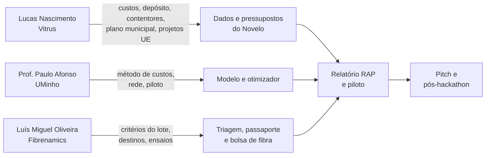

# Mentores

Três pessoas podem desbloquear o que mais falta ao Novelo: **dados e custos reais** (Lucas Nascimento, Vitrus), **validação científica do que fazemos com o lote** (Luís Miguel Oliveira, Fibrenamics) e **validação do modelo de custos e de rede** (Prof. Paulo Afonso, UMinho). Este documento diz quem são, o que podem dar, como abordá-los em dois minutos e o que perguntar, por ordem de impacto.

Os projetos são avaliados por quatro critérios ponderados: inovação e originalidade 25%, viabilidade técnica 25%, impacto e relevância 30%, apresentação e potencial de continuidade 20% ([Critérios de avaliação](criterios-de-avaliacao.md)). Cada mentor influencia mais uns do que outros, e cada secção abaixo tem as perguntas que **sobem a nota** nos critérios dele. O detalhe de cada critério (Regras) ainda não o temos.

> **Quem são os mentores deste desafio.** O enunciado [F62] indica **Lucas Nascimento (Vitrus Ambiente)** e, "para qualquer desafio", o **Prof. Paulo Afonso** (Universidade do Minho, Departamento de Produção e Sistemas). **Luís Miguel Oliveira não consta** nesse texto. O utilizador indicou-o como mentor do hackathon; o papel dele neste desafio está **por confirmar** (M18). Tratá-lo como contacto de oportunidade (Fibrenamics, fibras, parcerias), não como mentor atribuído, até haver confirmação.

> **Perguntas atualizadas.** Este documento é o perfil de cada mentor e as mensagens-tipo. A lista priorizada de perguntas, derivada dos dados recebidos até 20 de outubro (com respostas possíveis, ações, mensagens prontas, guião de 15 minutos e registo de respostas), está em [Perguntas aos orientadores](perguntas-aos-orientadores.md). Se as tabelas abaixo e essa lista divergirem, vale a lista.

Fontes: [Fontes](../pesquisa/fontes.md) (F41 a F62) e [Registo de afirmações](../pesquisa/registo-de-afirmacoes.md#f-mentores-fibrenamics-e-hackathon) (M1 a M17). Escrito a 19 de outubro de 2026. Estados usados: **verificado** (lido numa fonte), **hipótese** (inferência nossa) e **por verificar**.

> **Regra de ouro com mentores:** chegar com o telemóvel aberto no Novelo, uma pergunta por vez, números com a palavra "estimativa" quando o forem, e **nunca** apresentar como validado o que ainda não foi ouvido. Anotar de imediato cada resposta no [registo de afirmações](../pesquisa/registo-de-afirmacoes.md) com data e nome.

## Resumo

| Mentor | Quem é | O que pode desbloquear | Prioridade |
| --- | --- | --- | --- |
| **Lucas Nascimento** | Engenheiro do ambiente (formação no Brasil), doutoramento em Gestão e Tratamento de Resíduos na UMinho; investigador na Vitrus Ambiente, gere projetos europeus e nacionais e a otimização de recursos | Custos unitários, depósito, contentores, preços das frações, plano municipal (fonte dos 5,4%), critérios do júri, projetos europeus, autorização para usar os dados | **Hoje (19)** |
| **Luís Miguel Oliveira** | Lidera a Fibrenamics (Instituto de Inovação em Materiais Fibrosos e Compósitos da UMinho, Guimarães); perfil: fibras, compósitos, baterias, fabrico aditivo; liderança orientada a impacto mensurável | O que a indústria e a ciência aceitam do pós-consumo (critérios do lote), destino da fração de baixo valor, ensaio de lotes, rede de recicladores, projetos e financiamento | **Terça (20) a quarta (21)** |
| **Prof. Paulo Afonso** | Departamento de Produção e Sistemas da UMinho (Centro ALGORITMI); coordena o grupo SLOTS (cadeia de abastecimento, logística e transportes); investigação em custos, avaliação de investimentos e modelos de negócio | Revisão do modelo de custos e de rede, método de avaliação de investimento, desenho do piloto, ponte para investigação e incubação | **Quarta (21)** |

## Pergunta comum às Regras e ao formato

Antes de afinar qualquer critério, precisamos do texto das Regras. **Quem pergunta:** Hélder, hoje. **A quem:** à organização, e ao Lucas em paralelo.

> Podem indicar-nos onde está, ou enviar, o texto completo do separador **Rules** do Hack4Guimarães 2035 (na plataforma TAIKAI)? Queremos perceber o detalhe de cada um dos quatro critérios de avaliação, a duração do pitch, se há perguntas e respostas do júri e quanto tempo duram, se a demo ao vivo é permitida, se há entrega escrita ou vídeo, **o que a submissão de 23 de outubro às 17h30 tem de conter**, e quem integra o júri.

**O que fazemos com a resposta:** colar o texto em [Critérios de avaliação](criterios-de-avaliacao.md#colar-aqui-o-texto-das-regras) e seguir o [protocolo de uma hora](cenarios-e-contingencias.md#a4-critérios-e-regras).

| Mentor | Critérios que mais influencia | Onde estão as perguntas |
| --- | --- | --- |
| **Lucas Nascimento** | Impacto e relevância (30%), dados reais; continuidade (é a Vitrus que pilota) | [Perguntas que sobem a nota](#lucas-perguntas-que-sobem-a-nota) |
| **Luís Miguel Oliveira** | Viabilidade técnica das fibras (25%); continuidade e parcerias (20%); inovação (25%) | [Perguntas que sobem a nota](#luís-miguel-perguntas-que-sobem-a-nota) |
| **Prof. Paulo Afonso** | Viabilidade do modelo (25%) e métricas de impacto (30%) | [Perguntas que sobem a nota](#prof-afonso-perguntas-que-sobem-a-nota) |

---

## Luís Miguel Oliveira (Fibrenamics)

### Quem é

| | |
| --- | --- |
| **O que o utilizador nos disse** | Mentor do hackathon, trabalha na Fibrenamics. Perfil: líder orientado para a tecnologia e a inovação sustentável e o seu impacto na sociedade, com foco em fibras, materiais compósitos, sistemas de armazenamento de energia (baterias) e fabrico aditivo; defende liderança assertiva, clareza, confiança, colaboração e "transformar potencial em impacto mensurável" |
| **O que a pesquisa mostra** | Luís Oliveira aparece como CEO da Fibrenamics numa notícia do ECO de 2026 e em diretórios; o LinkedIn que a pesquisa encontrou não mostra o título [F48] [F60]. **Título e perfil por confirmar** (M1) |
| **A Fibrenamics** | Centro de inovação em materiais avançados na UMinho (Azurém, Guimarães) desde 2011, com quatro áreas (Intelligence, Science, Technology, Business); apoio do PRR, da UE e do COMPETE 2030 [F41]. Presidente: Raul Fangueiro [F45] |
| **Projetos relevantes** | **Lusitano** (2022 a 30 jun 2026): fios de fibras recicladas e naturais, com Riopele, Twintex, Calvelex, Polopiqué, UBI, IST e outros [F42]. **Fibrenamics Green**: valorização de resíduos industriais por infusão, moldação e não tecidos, mais de 100 empresas e cerca de 553 000 € [F43] [F45] |
| **Investigação associada (UMinho)** | Misturas multicomponente e pós-consumo de calçado e denim para não tecidos e isolamento; revisão de reciclagem fibra a fibra [F49] a [F52] (via pesquisa) |

**O que NÃO sabemos:** se consta como mentor deste desafio (o enunciado [F62] não o lista); se a Fibrenamics aceita ou ensaia têxtil **pós-consumo**; que critérios de lote usa; se compra material; o seu papel exato no hackathon; se já disse algo público sobre têxteis (não encontrámos entrevistas dele).

### O que valoriza (hipóteses a partir do perfil)

| Traço do perfil | O que significa para a nossa conversa |
| --- | --- |
| Complexidade e problemas difíceis | Mostrar o problema real (mistura de fibras, rejeito de 14,1%, qualidade do lote), não só a app |
| Clareza e assertividade | Um número, uma pergunta, uma proposta; nada de rodeios |
| Impacto mensurável | Levar o piloto com **KPIs e piso de sinal**, e o plano de **medir a qualidade dos lotes** |
| Confiança e transparência | Dizer o que **não sabemos** (custos, exatidão da triagem) antes de ele perguntar |
| Ligar tecnologia à mudança real | O Novelo é a ponte entre o saco do cidadão e o fio; ele conhece o lado do fio |
| Fibras, compósitos, fabrico aditivo | Perguntar pelos destinos de **baixo valor** (não tecidos, compósitos, fibra curta) em vez de insistir só no "fibra a fibra" |

### O que pode desbloquear

| Desbloqueio | Como nos ajuda |
| --- | --- |
| **Critérios de qualidade do lote** (composição mínima, cor, contaminação, formato) | Define o que o passaporte do lote tem de registar e o que é "lote reciclável" |
| **Destino da fração de baixo valor** | Transforma o rejeito/incineração em destino com valor no Sankey |
| **Ensaio e caracterização** | Via para medir a qualidade dos nossos lotes (F46) e dar prova científica ao piloto |
| **Rede** (Sasia, Riopele, Twintex, CITEVE) | Uma frase de procura de um reciclador vale mais do que qualquer slide |
| **Projetos e financiamento** | Consórcio de piloto, candidaturas (PRR, COMPETE 2030, projetos europeus) |

### Como abordar

**Momento:** terça ou quarta, de manhã, quando já tivermos os contentores no mapa e a triagem medida. Antes disso falta-nos prova.

**Mensagem (30 segundos):**

> Bom dia, Luís Miguel. Somos o Hélder e o Flávio, desafio TexVitrus. Estamos a construir o Novelo: define onde e como recolher têxtil em Guimarães ao menor custo **e entrega a cada lote um passaporte** (fibra dominante, composição, estado, peso). Queríamos 10 minutos para saber **o que a Fibrenamics precisaria de ver num lote pós-consumo** para o ensaiar ou valorizar, e se faz sentido testar um lote do piloto convosco.

**Dois minutos no telemóvel:**

1. **0:00 a 0:30**: ecrã "Ponto de partida": 301,3 t, destino 59,4 / 26,5 / 14,1%. "O rejeito é o nosso problema comum."
2. **0:30 a 1:15**: triagem de uma peça real (foto, etiqueta, composição), lote com QR e passaporte público. "Isto é o que cada lote leva."
3. **1:15 a 1:45**: bolsa de fibra e evidência por marca. "Queremos que o lote chegue a quem o sabe valorizar."
4. **1:45 a 2:00**: a pergunta: "O que falta neste passaporte para ser útil à Fibrenamics?"

### Respostas de 21 de outubro de 2026

O Lucas respondeu por email a três pontos. Detalhe e números em [Perguntas aos orientadores](perguntas-aos-orientadores.md#respostas-de-21-de-outubro-de-2026).

| Tema | Resposta | O que muda |
| --- | --- | --- |
| Contentores de têxteis | A Vitrus não os tem nem quer ter: o têxtil de contentor vem contaminado e perde a reutilização; a reciclagem é muito mais cara que a fibra virgem. O pacote QGIS traz indiferenciado, orgânico e seletivo | Rede sem contentores (local existente + recolha a pedido nos circuitos). Os contentores municipais são a base geográfica. Bolsa de fibra desce na prioridade; triagem por foto passa a controlo de qualidade na entrega |
| Custos | Vai pedi-los ao departamento financeiro; não estão no site | Continuam pressupostos |
| Plano de Ação Integrado | Não o conhece. A Vitrus usa a APA e os seus valores: 43 051 t de RSU em 2025, 5,4% de têxtil | Procura = 2 324,8 t/ano por desviar; captura 11,5% (estimativa) |

### Perguntas, por ordem de impacto

Lista consolidada para o Luís Miguel: [Q9](perguntas-aos-orientadores.md#q9-fibrenamics-critérios-de-lote-destino-de-baixo-valor-e-papel) e [operação](perguntas-aos-orientadores.md#48-operação-lote-triagem-e-recicladores). A tabela abaixo fica como ponto de partida.

| # | Pergunta | Porquê perguntamos | O que fazemos com a resposta |
| --- | --- | --- | --- |
| 1 | A Fibrenamics ensaia ou aceita **têxtil pós-consumo triado**? Em que condições e com que volume mínimo? | A lista pública do Green não menciona têxteis e o Lusitano não diz se é pós-consumo (M7) | Define se somos "fornecedor de lotes" ou "fonte de dados"; muda a frase do slide da indústria |
| 2 | Que **critérios de lote** pedem (composição mínima da fibra dominante, cor, elastano, botões e fechos, humidade, formato do fardo)? | Determina o que o passaporte tem de registar | Ajustamos os campos do passaporte e criamos a regra "lote A, B, C" |
| 3 | Para **fio por reciclagem mecânica**, que percentagem de fibra reciclada e que mistura toleram? | Fontes dizem 15 a 20% num fio sem perda (C22, por verificar) | Calibramos o valor da fração "reciclagem" e a expectativa da Sasia |
| 4 | Qual o destino realista da **fração de baixo valor** (misturas, o rejeito de 14,1%): não tecidos, isolamento, compósitos? Com que exigências? | A investigação da UMinho aponta esse caminho (M8) | Acrescentamos "não tecido/compósito" como destino alternativo ao rejeito no Sankey e no cenário |
| 5 | Como **medimos a qualidade de um lote** de forma barata (amostragem, nº de peças, NIR portátil)? Quanto custa caracterizar na Fibrenamics? | O nosso piso de sinal do piloto (1,71 t) usa 1 032 peças por célula e efeito de desenho 2 | Validamos o protocolo de amostragem do piloto e orçamentamos o ensaio |
| 6 | Que **valor de mercado** têm lotes por tipo (€/t) para fio, não tecido e reutilização? | A receita por fração é pressuposto nosso | Trocamos pressuposto por intervalo com fonte, ou dizemo-lo "estimativa" |
| 7 | Como tratam **etiquetas cortadas ou composição desconhecida**? NIR portátil resolve? | A foto não lê a fibra (D3) | Decidimos se o passaporte distingue "composição declarada" de "composição medida" |
| 8 | Que **projetos em curso** (sucessores do Lusitano, Green, agendas) encaixariam um piloto de recolha triada? | Vitrus e município precisam de consórcio para financiamento | Escrevemos a secção "próximos passos" com um nome concreto |
| 9 | Podem **receber lotes do piloto** (ex.: 3 a 5 fardos) para caracterização? | Dá prova científica independente aos KPIs | Entra no plano do piloto como parceiro de validação |
| 10 | Que **campos e formato de dados** quereriam num passaporte para uso em investigação? | Aumenta o valor do passaporte para a ciência | Ajustamos o esquema e a exportação |
| 11 | Existem **estudos locais da composição do pós-consumo** (mix de fibras) para calibrar? | A nossa triagem assume distribuições genéricas | Calibramos a avaliação da triagem e a taxonomia de fibras |
| 12 | A **reciclagem química** (celulósicos, poliéster) é realista na região em 2028? Que composição exige? | Pode mudar o que é lote valioso | Nota de roadmap, só em conversa |
| 13 | Fibra curta e fração fina servem **compósitos ou fabrico aditivo**? Há exemplos? | Ligar ao seu interesse e achar valor extra para a fração mais pobre | Só conversa: abre porta a parceria, não entra no pitch |
| 14 | A quem mais devemos falar (Sasia, Riopele, Twintex, CITEVE) e **pode apresentar-nos**? | Acelera a prova de procura | Mensagem com referência a ele |
| 15 | Que termos podemos usar em público: "validado pela Fibrenamics", "em conversa com a Fibrenamics" ou nada? | Evita sobre-afirmar | Frase no slide e no relatório |
| 16 | O que tornaria este projeto **interessante para a Fibrenamics** daqui a seis meses? | Perceber o caminho pós-hackathon | Plano de continuidade |

### Luís Miguel: perguntas que sobem a nota

Estas quatro servem os critérios que ele mais influencia. Seguem a numeração anterior.

| # | Pergunta | Critério | O que fazemos com a resposta |
| --- | --- | --- | --- |
| 17 | Que **erro de composição** tolera um lote para ser ensaiado, e como devemos declarar a incerteza de uma composição lida da etiqueta? | Viabilidade técnica (25%) | Campo "declarada ou medida" no passaporte e frase honesta no slide da indústria |
| 18 | Pode **rever em 10 minutos** o esquema do passaporte e a taxonomia de fibras e dizer o que está tecnicamente errado ou em falta? | Viabilidade técnica (25%) | Corrigimos antes de 25 de outubro; "revisto por" só se ele autorizar |
| 19 | O que teria de acontecer para a Fibrenamics ser **parceira nomeada do piloto** (carta de intenção, 3 a 5 fardos para caracterização)? | Continuidade (20%) | Entra no slide 8 como "em conversa" ou "confirmado", conforme a resposta |
| 20 | Conhece **trabalho semelhante** na região ou na Europa que devamos citar para sermos justos sobre o que é novo? | Inovação (25%) | Resposta à pergunta "isto já existe?" (I1) com nomes e sem exagero |

**Reserva (se houver tempo):** reunião inicial sem custos com a Fibrenamics via formulário em linha ([F41](https://fibrenamics.com)), ou `green@fibrenamics.com`.

---

## Lucas Nascimento (Vitrus Ambiente)

### Quem é

| | |
| --- | --- |
| **O que o utilizador nos disse** | Engenheiro do ambiente com formação no Brasil e doutoramento em Gestão e Tratamento de Resíduos na UMinho; investigador na Vitrus Ambiente, responsável pela gestão de projetos europeus e nacionais e pela otimização de recursos |
| **O que a pesquisa mostra** | Um testemunho dele no site do Departamento de Engenharia Mecânica descreve o Programa Doutoral em Gestão e Tratamento de Resíduos como "um grande desafio", escolhido pela multidisciplinaridade [F56] (M11). **Não encontrámos publicações, tese nem perfil de investigador** |
| **A Vitrus (contexto verificado)** | Empresa municipal de Guimarães; campanha de têxteis nas escolas (cerca de 3 t, mais de 30 escolas, destino To Be Green; citado João Pedro Castro, administrador executivo) [F57]; participa com o município em projetos europeus, entre eles o periASTY (missão de cidades neutras em carbono, **não** de resíduos) [F58]; e o município fala de dois projetos europeus de circularidade para comércio e serviços não alimentares, incluindo têxteis [F17] [F18] |

**O que NÃO sabemos:** o tema da tese; quais são exatamente os dois projetos europeus e se ele os gere (M12 é **hipótese**); se tem autoridade para autorizar o uso público dos dados; quem avalia no júri.

### O que valoriza (hipóteses)

| Traço | Implicação |
| --- | --- |
| Gere projetos e **otimiza recursos** | O Novelo é literalmente otimização de recursos: abrir com €/t e investimento evitado |
| Formação em resíduos | Rigor técnico: fontes, estimativas rotuladas, método claro |
| Responsável por projetos europeus | Falar em **reporte, KPIs e evidência**: o relatório RAP e o piloto são linguagem dele |
| Vitrus precisa de uma resposta operacional | Mostrar que usamos **as rotas e viaturas reais**, sem km novos |

### O que pode desbloquear

| Desbloqueio | Ligação |
| --- | --- |
| **Custos unitários** | Troca os pressupostos por dados e dá peso ao €/t |
| **Base da procura** | Respondido a 21 out: 43 051 t de RSU × 5,4% (APA). O Lucas não conhece o plano municipal; "4 de 27" (A11) continua por verificar |
| **Depósito** | VRP (contentores de têxteis: não existem, 21 out) |
| **Preços e contratos das frações** | Receita e €/t |
| **Texto das Regras, duração do pitch e formato das perguntas** | Guião final e revisão da matriz de critérios |
| **Projetos europeus** | Posicionamento pós-hackathon |
| **Autorização de uso dos dados** | Slides e demo públicos |

### Como abordar

**Momento:** hoje, por escrito, e 15 minutos presenciais assim que possível.

**Mensagem (30 segundos):**

> Olá Lucas. Somos o Hélder e o Flávio. Já pusemos os vossos dados (301,3 t, 40 circuitos, 29 viaturas) num simulador que compara cenários de recolha em €/t. Para trocar os nossos pressupostos pelos vossos números precisamos de **cinco coisas**: custo por recolha, por km e por contentor; localização do depósito; a fonte do plano municipal (5,4% e 0,7 kg/hab/mês); o texto das Regras do hackathon (o detalhe de cada critério); e se podemos usar os dados em público. Pode ser por escrito, se for mais fácil.

> Mensagem de 20 de outubro, já respondida em parte a 21 (custos pedidos ao financeiro; plano municipal substituído por 43 051 t × 5,4%). Num seguimento, pedir só o depósito, as Regras e a autorização.

**Dois minutos no telemóvel:**

1. **0:00 a 0:30**: "Ponto de partida" com os números dele (301,3 t; 43 051 t de RSU × 5,4% = 2 324,8 t ainda no lixo; captura 11,5%, estimativa).
2. **0:30 a 1:15**: "Circuitos" e "Frota": "são os vossos circuitos; só o que falta são custos".
3. **1:15 a 1:45**: simulador: dois cenários, €/t, investimento. "Os custos aqui são pressupostos assinalados."
4. **1:45 a 2:00**: ecrã "Qualidade dos dados": "encontrámos 12 alertas no vosso ficheiro; estas são as perguntas."

### Perguntas, por ordem de impacto

Lista consolidada para o Lucas, com os números dos dados de 20 out: [as 10 perguntas](perguntas-aos-orientadores.md#2-as-10-perguntas-em-detalhe) e [perguntas por tema](perguntas-aos-orientadores.md#4-perguntas-por-tema). A tabela abaixo fica como ponto de partida.

| # | Pergunta | Porquê perguntamos | O que fazemos com a resposta |
| --- | --- | --- | --- |
| 1 | **Custos unitários:** custo por recolha, por quilómetro, por hora de equipa e por contentor (compra, instalação, lavagem, manutenção). | Sem eles os €/t são estimativa (A15). **21 out:** o Lucas vai pedi-los ao departamento financeiro (não estão no site) | Substituímos `params.py`; passamos a dizer "dados da Vitrus" |
| 2 | **Plano municipal:** o que medem os 0,7 kg/hab/mês e os 5,4% (têxtil que fica no indiferenciado ou geração total) e de que ano? | **Respondida a 21 out:** o Lucas não conhece o plano; a Vitrus recolheu 43 051 t de RSU em 2025 e indica 5,4% de têxtil (APA). Ver [Q6](perguntas-aos-orientadores.md#q6-o-que-significam-07-kghabmês-e-54) | Procura de 2 324,8 t/ano por desviar e captura de 11,5% (estimativa); o plano sai das fontes do modelo |
| 3 | **Texto das Regras**: detalhe de cada um dos quatro critérios, duração do pitch, formato da demo e das perguntas, e quem avalia. Ver a [pergunta comum](#pergunta-comum-às-regras-e-ao-formato). | Os pesos são públicos (E4); o detalhe não (E6, M16) | Afinamos o guião e o tempo |
| 4 | **Contentores de têxteis:** onde está a lista, formato do ficheiro, que tipos e estados existem, operador, e política de colocação. | **Respondida a 21 out:** a Vitrus não tem contentores de têxtil nem os quer (contaminação dificulta a reutilização) | Rede sem contentores: local existente e recolha a pedido; contentor de rua só como referência |
| 5 | **Depósito:** de onde saem os circuitos e onde se descarrega? | O VRP assume o centro de Guimarães | Parametrizamos o ponto de partida |
| 6 | **Preço por fração** e contratos (Ultriplo, H Sarah, Nova Etapa): quanto recebem por reutilização, reciclagem e quanto custa o rejeito? | A receita é pressuposto | Receita real no €/t e na sensibilidade |
| 7 | **Rejeito:** como foi medida a amostra de 5,6 t e os 56,9% de rejeito da Vitrus? | Distorce o destino observado | Etiqueta metodológica e eventual calibração |
| 8 | **Restrições operacionais:** turnos, motoristas, sábados, viaturas partilhadas, janelas horárias. | O otimizador não deve propor o inviável | Restrições no modelo e no "E se...?" |
| 9 | Os **9 circuitos sem viatura, as 2 viaturas nunca atribuídas e os 12 alertas**: confirma o significado? | Resolver alertas com base certa | Fechamos alertas no ecrã com nota da Vitrus |
| 10 | Quais são os **dois projetos europeus de circularidade** (Let's Go Circular, Circular Ecosystems?) e o Novelo pode alimentar o plano de ação têxtil? | M12 é hipótese | Posicionamento pós-hackathon e fonte para o plano de circularidade |
| 11 | **Piloto:** a Vitrus estaria disponível para 3 meses em duas freguesias? Preferem outras que não Gondar e Arosa e Castelões? | O recomendador escolhe pela aprendizagem (já na app) | Ajustamos a recomendação ao que é operacionalmente possível |
| 12 | Sabem **quem será a entidade gestora** e em que ponto está a RAP têxtil em Portugal? | APA em dez 2025: nada aprovado (B11) | Frase do slide de 2028 e relatório RAP |
| 13 | Que **outros dados** existem: caracterização do indiferenciado por freguesia, tarifa de aterro/incineração, reclamações, volumes por circuito? | Custo evitado e procura por zona | Novas linhas no modelo e na cobertura |
| 14 | Que **KPI** usam hoje para o custo por tonelada de têxtil? | Falar na linguagem deles | Alinhamos definições (custo total vs marginal) |
| 15 | Podemos **usar o nome da Vitrus e os dados** em slides, demo e relatório? Há algo confidencial? | Evitar problemas no dia 26 | Marcamos o que se pode mostrar |
| 16 | O que considerariam **sucesso** deste desafio, e o que levaria a Vitrus a pilotar? | Perceber o pedido final | Ajustamos o "pedido" do pitch |

**Perguntas sobre o pacote QGIS municipal de 20 de outubro** (não é de têxteis; detalhe em [Análise dos contentores municipais](../dados/analise-contentores-municipais.md)):

| # | Pergunta | Porquê perguntamos | O que fazemos com a resposta |
| --- | --- | --- | --- |
| 17 | **Lista de contentores de têxteis:** quando chega e em que formato? | **Respondida a 21 out:** não existem | Os locais municipais passam a ser a base geográfica |
| 18 | **Que fração é cada ficheiro?** Profundidade e Superfície são indiferenciado, recicláveis ou misto? **Quais são os ecopontos de recicláveis** (vidro, papel, embalagens)? | **Em parte a 21 out:** o pacote junta indiferenciado, orgânico e seletivo; falta a fração por contentor | Escolhemos locais de paragem onde o têxtil se perde |
| 19 | **Frequência de recolha** e custo por esvaziamento (enterrado vs superfície) | Estimar o custo de uma paragem para sacos de têxtil nos mesmos locais | Custo de recolha por modo no simulador |
| 20 | O que é uma **"plataforma"** e o que quer dizer a `Quantidade` dos resíduos verdes? | 2 e 46 linhas ambíguas | Corrigimos a contagem de unidades |
| 21 | As freguesias **Lordelo, Infantas, Tabuadelo e São Faustino, Serzedo e Calvos** estão completas no inventário? | Têm 2,0 a 4,0 contentores por 1 000 hab., contra 17,4 no concelho | Distinguimos "sem dados" de "sem contentores" |
| 22 | **Capacidade da Tipologia** em litros? Os 10 L são 110 L? **Data** do inventário e versão da **CAOP** a usar? | Unidade assumida; projeto QGIS de maio de 2025 | Confirmamos as capacidades e o código das 5 uniões |
| 23 | Podemos usar o **nome dos produtores** (hotelaria, lares, grandes produtores) no mapa? Há contacto B2B? | São estabelecimentos privados | Camada de produtores só com agregados por omissão |

### Lucas: perguntas que sobem a nota

Servem sobretudo o **impacto e relevância (30%)** e a **continuidade (20%)**. Seguem a numeração anterior.

| # | Pergunta | Critério | O que fazemos com a resposta |
| --- | --- | --- | --- |
| 17 | Qual é o **custo real por tonelada** de têxtil que a Vitrus tem hoje (recolha, triagem, destino), ainda que aproximado? Podemos usá-lo como linha de base do cenário A? | Impacto (30%) | X e Y deixam de ser só estimativa |
| 18 | Que **resultado tornaria o piloto interessante** para a Vitrus: que €/t, que toneladas, que taxa de rejeito? | Impacto e continuidade | Define a meta que o pitch declara e os KPIs do piloto |
| 19 | Que **dados de 2025** permitem medir o antes e o depois no piloto (toneladas por circuito e por mês)? | Impacto e viabilidade | Linha de base real e medição credível |
| 20 | Se o piloto avançar, **quem decide** na Vitrus e no município, em que prazo e com que tipo de orçamento? | Continuidade (20%) | Pedido final realista no slide 8 |

---

## Prof. Paulo Afonso (UMinho, Produção e Sistemas)

### Quem é

> **Atenção à identificação.** O desafio refere "Prof. Paulo Afonso (Universidade do Minho, Departamento de Produção e Sistemas)". O perfil que encontrámos com esse departamento é o de **Paulo Sérgio Lima Pereira Afonso** (Centro ALGORITMI) [F54]. O enunciado [F62] confirma-o como mentor "para qualquer desafio". A identificação da pessoa é a leitura mais provável, mas é **inferência nossa**: confirmar com a organização ou na primeira conversa. Existe outro investigador da UMinho com nome próximo e trabalho em otimização de energia hidrocinética que **não** é este; evitar a confusão.

| | |
| --- | --- |
| **Verificado (F54)** | Departamento de Produção e Sistemas; grupos IEM (Engenharia e Gestão Industrial) e SLOTS (Supply Chain, Logistics and Transportation Systems), que coordena desde 2019; doutoramento em Management Accounting (Manchester Business School, 2008); linhas de investigação: gestão de desempenho e de custos na cadeia de abastecimento, modelos e sistemas de custeio para decisão, avaliação estratégica de investimentos, modelos de negócio, startups. Projetos mencionados incluem redes de transporte e Indústria 4.0; 89 publicações e h-index 17 (segundo a página) |
| **Via pesquisa (F55)** | Coautor de "Simulating Product Costs Under Stochastic Conditions Using the ABC Matrix Model" (título); capítulo sobre TCO e AHP na seleção de fornecedores (2026) |
| **O que NÃO sabemos** | Se o seu foco é custos mais do que otimização matemática; o tempo que tem; opinião sobre CP-SAT ou VRP |

### O que valoriza (hipóteses)

| Traço | Implicação |
| --- | --- |
| **Custeio e TCO** | O modelo de custos tem de ser transparente (CAPEX, OPEX, custo total ao longo da vida) |
| **Avaliação de investimento** | Mostrar investimento por cenário e retorno, não só custo anual |
| **Simulação com incerteza** | A nossa análise de sensibilidade (Monte Carlo) está na sua linguagem |
| **Logística e redes** | O modelo de localização e rotas deve ser defensável |
| **Modelos de negócio e startups** | Pós-hackathon: incubação e financiamento |

### O que pode desbloquear

| Desbloqueio | Como nos ajuda |
| --- | --- |
| **Validação do modelo de custos** | Credibilidade perante júri e Vitrus |
| **Método de avaliação de investimento** | Custo anual equivalente, VAL, payback no simulador |
| **Desenho do piloto** | Medir o efeito com rigor (controlo, antes/depois, tamanho de amostra) |
| **Referências académicas** | Location-routing, logística inversa, custeio |
| **Ponte** | Dissertações de mestrado, incubação, transferência de tecnologia |

### Como abordar

**Momento:** quarta (21), já com cenários A, B e referência francesa calculados.

**Mensagem (30 segundos):**

> Bom dia, Professor Paulo Afonso. Somos o Hélder e o Flávio, desafio TexVitrus. O Novelo compara cenários de recolha de têxteis em custo por tonelada e investimento, com análise de incerteza. Podíamos mostrar-lhe em 10 minutos **a estrutura de custos e o modelo de rede** e ouvir onde vê fragilidades? Os custos unitários da Vitrus ainda são pressupostos assinalados.

**Dois minutos no telemóvel:**

1. **0:00 a 0:30**: simulador com um cenário: custo anual, investimento, €/t, "estimativa".
2. **0:30 a 1:15**: "Pressupostos": cada custo com a sua origem.
3. **1:15 a 1:45**: separador de incerteza (tornado e P10/P50/P90), já na app: "quais pressupostos mexem mais".
4. **1:45 a 2:00**: a pergunta: "Como defender estes custos perante a Vitrus e perante a futura entidade gestora?"

### Perguntas, por ordem de impacto

Perguntas do Prof. Paulo Afonso que dependem dos dados novos: [secção 4.11](perguntas-aos-orientadores.md#411-modelo-e-investimento-prof-paulo-afonso). A tabela abaixo continua a ser a lista completa.

| # | Pergunta | Porquê perguntamos | O que fazemos com a resposta |
| --- | --- | --- | --- |
| 1 | **Estrutura de custos:** a divisão CAPEX/OPEX e o custo por viatura, turno e contentor é defensável? Que método de custeio (ABC, TDABC, TCO) usaria para recolha? | Os custos são pressupostos até a Vitrus responder | Ajustamos `params.py` e a nota metodológica; apresentamos o método, não só o valor |
| 2 | **Avaliação de investimento:** que indicador devemos mostrar a um município (VAL, payback, custo anual equivalente) e que taxa de atualização? | Hoje mostramos investimento e custo anual | Acrescentamos custo anual equivalente ao simulador e à comparação |
| 3 | **Função objetivo:** minimizar custo sujeito a cobertura ou maximizar toneladas com orçamento? Como justificar perante a diretiva (cobertura total, custo "economicamente eficiente")? | O art. 22.º-A n.º 12 e o art. 11.º (B6, B8) | Escolhemos o modo por defeito e o texto do relatório RAP |
| 4 | O nosso método de **sensibilidade** (tornado ±30%, Monte Carlo com distribuições triangulares sobre o plano já otimizado, sem reotimizar) é defensável? | Evita 500 resoluções de 20 s mas é uma escolha | Mantemos ou mudamos; escrevemos as limitações |
| 5 | **Robustez:** "A é melhor que B em x% das amostras" chega, ou prefere arrependimento mínimo / minimax? | É o argumento "aguenta ±30%" | Adotamos a métrica certa |
| 6 | **Cobertura:** distância a pé (300 m) por população ou por área? Que raio é razoável para têxtil? | A métrica define a "lacuna" que mostramos | Ajustamos o raio por defeito e a explicação |
| 7 | **Rede e rotas:** o fator de desvio 1,3 e o CP-SAT/VRP com limite de 20 s são aceitáveis? Quando passar a distâncias por estrada reais? | Pode ser criticado | Documentamos limites; decidimos usar o OSRM |
| 8 | Referências académicas de **location-routing e logística inversa** para redes de recolha seletiva? | Dar lastro ao modelo | Entram em [Fontes](../pesquisa/fontes.md) e no relatório |
| 9 | **Desenho do piloto:** grupo de controlo, antes/depois, duração, tamanho de amostra? O piso de 1,71 t com efeito de desenho 2 está razoável? | O piloto é o pedido final | Revemos o plano de KPIs |
| 10 | Como **demonstrar custo eficiente** a uma entidade gestora (benchmarking, auditoria de custos, modulação por território)? | É a tese de 2028 | Página "caso de financiamento" do relatório |
| 11 | **Modelo de negócio:** quem paga o quê (município, entidade gestora, reutilização) e como se calcula a contribuição por tonelada? | Importa para "quem paga" | Esclarece a narrativa de 2028 |
| 12 | Dados de **tempos de percurso** e logística na região (SLOTS): existem para calibrar rotas? | Melhora o VRP | Calibração |
| 13 | **Pós-hackathon:** vê valor em dissertação de mestrado, projeto de investigação ou incubação? | Continuidade | Plano de continuidade |
| 14 | Que **perguntas faria** se fosse jurado? | Treino do pitch | Entram nas [perguntas difíceis](cenarios-e-contingencias.md#e-perguntas-difíceis-do-júri) |

### Prof. Afonso: perguntas que sobem a nota

Servem a **viabilidade técnica (25%)**, no modelo, e o **impacto (30%)**, nas métricas. Seguem a numeração anterior.

| # | Pergunta | Critério | O que fazemos com a resposta |
| --- | --- | --- | --- |
| 15 | Que **três métricas** mostraria a um júri para provar que o modelo é fiável (por exemplo, erro face a dados observados, folga do solver, estabilidade da recomendação)? | Viabilidade técnica (25%) | Passam a estar no ecrã e no slide 5 |
| 16 | Como **calibrar** o modelo com a recolha de 2025 (301,3 t) sem sobreajustar, se os custos são pressupostos? | Viabilidade técnica (25%) | Ajustamos a calibração e a nota metodológica |
| 17 | Que **métrica de impacto** é mais defensável perante um júri: custo anual equivalente, € por tonelada evitada ou custo por habitante coberto? | Impacto (30%) | Escolhemos a métrica da frase-âncora |
| 18 | Que **limitações do modelo** devemos dizer em voz alta antes de nos perguntarem? | Viabilidade e apresentação | Frase de honestidade no slide 5 |

---

## Pós-hackathon e financiamento

| Caminho | Quem pode ajudar | O que dizer | Estado |
| --- | --- | --- | --- |
| **Piloto de 3 meses** com a Vitrus em duas freguesias | Lucas Nascimento | "Recomendado pelo Novelo (já na app), com KPIs e piso de sinal; pedimos duas freguesias" | Por pedir |
| **Validação de lotes** | Luís Miguel Oliveira | "Entregamos 3 a 5 fardos caracterizados, com passaporte" | Por pedir |
| **Candidatura** (projetos europeus, PRR, COMPETE 2030 ou sucessores) | Lucas, Luís Miguel, Prof. Paulo Afonso | Consórcio Vitrus + Fibrenamics + UMinho + (Sasia/CITEVE) | **Hipótese**: nenhuma candidatura foi identificada |
| **Dissertação ou projeto** | Prof. Paulo Afonso | Tema: custos e redes de recolha seletiva | Por perguntar |
| **Incubação e transferência** | Prof. Paulo Afonso | Via UMinho; a propriedade intelectual é dos autores [F59] | Por explorar |

## Ordem prática

| Quando | Quem | Ação |
| --- | --- | --- |
| Hoje (19) | Hélder | Mensagem ao Lucas (cinco pedidos), [pergunta às Regras](#pergunta-comum-às-regras-e-ao-formato) à organização e inscrição confirmada |
| Terça (20) | Hélder | Mensagem ao Luís Miguel; receber contentores |
| Quarta (21) | Hélder + Flávio | 10 minutos com o Prof. Paulo Afonso; cenários A, B e francês prontos |
| Quinta (22) | Hélder | Respostas do Luís Miguel e dos recicladores; atualizar o [registo](../pesquisa/registo-de-afirmacoes.md) |
| Sexta (23) | Ambos | Fechar a lista do que pode ser dito "validado", "em conversa" ou nada |

Plano completo em [Estratégia para ganhar](estrategia-para-ganhar.md); contingências em [Cenários e contingências](cenarios-e-contingencias.md).
