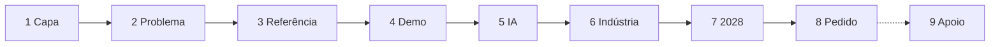

# Guião de slides

Pronto a passar para o deck. Oito slides para cinco minutos mais um slide de apoio, **uma ideia por slide, título que diz a conclusão**, fonte no rodapé de cada um. Cada slide declara o critério de avaliação que serve e o seu peso (inovação 25%, viabilidade 25%, impacto 30%, apresentação e continuidade 20%; ver [Critérios de avaliação](criterios-de-avaliacao.md)). A história e as falas completas estão na [narrativa do pitch](narrativa-do-pitch.md); os números, no [registo de afirmações](../pesquisa/registo-de-afirmacoes.md).

## Regras do deck

| Regra | Detalhe |
| --- | --- |
| Identidade | Fundo **linho**, texto **tinta**, **floresta** como cor principal, **areia** só como detalhe; Newsreader nos títulos, Inter no texto ([guia de marca](../marca/guia-de-marca.md)) |
| Densidade | Um número grande por slide (corpo 96 pt ou mais), o resto em segundo plano |
| Rodapé | Fonte de cada número, em letra pequena, com o ano |
| Estimativas | Palavra "estimativa" no próprio número ou ao lado |
| Imagens | Capturas reais da app (claro), nunca ilustrações genéricas; usar [os diagramas existentes](../img/diagrama-do-saco-ao-fio.png) |
| Notas do orador | Em cada slide, 2 ou 3 linhas; o slide não repete o que se diz |

## Mapa do deck

## Slides

### 1. Capa · 0:00 a 0:20

| | |
| --- | --- |
| **Critério e peso** | Apresentação e continuidade (20%): gancho e clareza, 20 s |
| **Título** | Do saco ao fio |
| **Subtítulo** | Novelo: a decisão da recolha de têxteis de Guimarães |
| **Visual** | Símbolo e logótipo Novelo sobre linho; uma linha: "Hack4Guimarães 2035 · Desafio TexVitrus" |
| **Número** | 72% dos têxteis descartados na Europa acabam no lixo indiferenciado |
| **Nota do orador** | Abre com o 72%. Passa logo ao problema local, sem apresentar a equipa. |
| **Rodapé** | AEA, Briefing 03/2024 (dados de 2020) |
| **Registo** | C10 |

### 2. Problema · 0:20 a 0:45

| | |
| --- | --- |
| **Critério e peso** | Impacto e relevância (30%), 25 s |
| **Título** | A recolha é obrigatória desde 2025 e o município paga-a sozinho |
| **Visual** | Linha do tempo horizontal: 1 jan 2025 (município obrigado) · 17 jun 2027 (transposição) · **17 abr 2028 (regime criado; os produtores pagam as peças postas à venda a partir daí)**. Faixa a vermelho entre 2025 e 2028: "paga o município"; depois, a faixa vai clareando: "as peças antigas ainda pesam no município" |
| **Número** | 17 de abril de 2028 |
| **Nota do orador** | "Não há entidade gestora nem regime aprovado, diz a APA." Não digas "metas". Não digas "em 2028 os produtores pagam a recolha": pagam a das peças vendidas pela primeira vez depois da lei nacional (o mais tardar 17 abr 2028). Leitura a confirmar com a APA. |
| **Rodapé** | APA, FAQ têxteis, dez 2025; Diretiva 2008/98/CE, art. 11.º (2018) e RGGR; Diretiva (UE) 2025/1892, art. 22.º-A, n.º 11 e 14 |
| **Registo** | B1, B4, B11, B12, B17 |

### 3. Referência · 0:45 a 1:00

| | |
| --- | --- |
| **Critério e peso** | Impacto e relevância (30%), 15 s |
| **Título** | Guimarães recolhe menos de metade do que a França recolheria |
| **Visual** | Barras horizontais: Guimarães 1,9 · Catalunha 2,7 · França 4,27 · UE 4,4 (kg/hab/ano). Tracejado "à nossa escala: ≈ 670 t" |
| **Número** | 1,9 kg contra 4,27 kg por habitante |
| **Nota do orador** | "É uma referência, não uma meta." Menciona Sintra a retirar contentores. |
| **Rodapé** | Vitrus e INE, 2025; Refashion, 2024; ARC, 2024; AEA, 2020 |
| **Registo** | A2, C1, C8, C11, C14, C21 |

### 4. Demo · 1:00 a 3:00

| | |
| --- | --- |
| **Critério e peso** | Os quatro, 120 s: viabilidade 40 s, impacto 40 s, inovação 40 s (ver [roteiro](narrativa-do-pitch.md#roteiro-da-demo)) |
| **Título** | Do orçamento ao relatório, em dois minutos |
| **Visual** | Captura do simulador com cenários A e B lado a lado; o resto é a app ao vivo |
| **Número** | O do cenário B: 431,1 t por ano a 101,9 €/t (60 000 €/ano, rotas pela estrada), "estimativa" |
| **Nota do orador** | Seguir o [roteiro da demo](narrativa-do-pitch.md#roteiro-da-demo). Um jurado faz a pergunta "E se...?". O QR é lido no telemóvel do jurado. |
| **Rodapé** | Cenários calculados pelo Novelo; pressupostos em "Pressupostos" |
| **Plano B** | Vídeo de 60 s e PDF RAP pré-gerado, num ficheiro local |

### 5. IA · 3:00 a 3:30

| | |
| --- | --- |
| **Critério e peso** | Viabilidade técnica (25%), 30 s |
| **Título** | A IA conduz o otimizador; nunca faz contas |
| **Visual** | Diagrama em 4 passos: pergunta em português → alteração estruturada → otimizador → verificador de números |
| **Número** | Zero números calculados pelo modelo |
| **Nota do orador** | Responde às perguntas que o júri vai fazer: "e se a IA se engana?" e "e se a IA falha?". Dizer: sem IA, o simulador e o relatório continuam a funcionar |
| **Rodapé** | Verificador: todo o número da resposta tem de existir no resultado calculado |
| **Registo** | — |

### 6. Indústria · 3:30 a 3:55

| | |
| --- | --- |
| **Critério e peso** | Inovação e originalidade (25%), 25 s |
| **Título** | A indústria tem capacidade; faltam lotes limpos |
| **Visual** | Lote com QR e composição ao lado do passaporte; ao lado, "Sasia ≈ 2 000 t/mês, pré-consumo" |
| **Número** | 2 000 t por mês, sobretudo pré-consumo (C16). A comparação com o têxtil por desviar de Guimarães (9,7%, C17) só com "estimativa" |
| **Nota do orador** | "A foto não vê a fibra; a etiqueta sim. O operador confirma." "A qualidade depende de quem recolhe: em 2025, 72,9% reutilizado na Ultriplo, 9,2% no têxtil recolhido pela Vitrus. Por isso medimos toneladas reutilizáveis." Dizer a exatidão medida se existir (D4). |
| **Rodapé** | Público/Lusa, dez 2024; Vitrus, destinos de 2025; avaliação da triagem do Novelo |
| **Registo** | C16, C17, D3, D4, A19, H1 |

### 7. 2028 · 3:55 a 4:20

| | |
| --- | --- |
| **Critério e peso** | Impacto e relevância (30%), 25 s |
| **Título** | A lei põe a câmara na mesa onde se fixa o custo; o Novelo leva o número |
| **Visual** | Captura do relatório RAP: custo por tipo de território (predominantemente urbana, mediamente urbana, predominantemente rural) |
| **Número** | "economicamente eficiente" (artigo 22.º-A, n.º 12) e "As autoridades locais" (n.º 7, d)) |
| **Nota do orador** | O custo eficiente é determinado "entre os intervenientes relevantes", e a lei nomeia as autoridades locais; a entidade gestora não pode recusar o município (artigo 22.º-C, n.º 10). As peças antigas continuam a pesar na câmara durante anos: mais uma razão para medir o custo. Menciona a economia social como parceira. Se houver tempo: a rede não fica só onde é barato (art. 22.º-C, n.º 9, b)); fora das freguesias urbanas o cenário serve 55,5% da população, contra 72,8% nas urbanas (estimativa, separador Cobertura). |
| **Rodapé** | Diretiva (UE) 2025/1892, artigo 22.º-A, n.º 7, 11 e 12; artigo 22.º-C, n.º 9, b) e n.º 10 |
| **Registo** | B6, B8, B10, B17, B18, H4 |

### 8. Pedido · 4:20 a 5:00

| | |
| --- | --- |
| **Critério e peso** | Apresentação e potencial de continuidade (20%), 40 s |
| **Título** | Peço um piloto de três meses em duas freguesias |
| **Visual** | As duas freguesias recomendadas no mapa, três KPIs (toneladas, €/t, taxa de rejeito) e uma linha do tempo: 26 a 28 out feedback · 48 h plano · 3 meses piloto · depois dados medidos |
| **Número** | A frase-âncora: "Com 60 000 €/ano, 431,1 toneladas por ano a 101,9 € por tonelada; o tratamento evitado (45 542 €) paga a operação". Piloto: Aldão e Arosa e Castelões, piso de 1,71 t em 3 meses, previsão de 2,43 t |
| **Nota do orador** | Frase-âncora, pedido, replicabilidade ("outro município precisa dos seus dados", ainda não testado) e roadmap pós-26 out (proposta nossa). Parceiros só como "em conversa" se já falámos. Agradece e para. |
| **Rodapé** | Cenário de 60 000 €/ano, estimativa a validar no piloto (registo H3, H10, H13) |
| **Registo** | H3, H10, H13 |

### 9. Slide de apoio: checklist critério e prova

Fora dos cinco minutos. Cola-se no fim do deck e abre-se nas perguntas ou se sobrar tempo.

| | |
| --- | --- |
| **Título** | Os quatro critérios, cada um com a sua prova |
| **Visual** | A tabela abaixo, quatro linhas, um visto por prova mostrada |
| **Nota do orador** | Só para o Q&A: "Se quiserem ver a prova de um critério, abrimos agora." |
| **Rodapé** | Pesos: Hack4Guimarães 2035, FAQ de avaliação, 2026 |

| Critério (peso) | Prova mostrada | Onde |
| --- | --- | --- |
| **Inovação e originalidade (25%)** | A IA conduz o otimizador e o verificador recusa números inventados; do saco ao fio num lote com QR | "E se...?" (passo 6) e lote (passo 8) |
| **Viabilidade técnica (25%)** | Dados reais da Vitrus; custos como pressupostos à vista com intervalo; produção e plano B | Ponto de partida (passo 1) e sensibilidade (passo 5) |
| **Impacto e relevância (30%)** | 431,1 t por ano a 101,9 €/t, com 45 542 € de tratamento evitado (estimativa); quem paga hoje e em 2028 | Cenário A contra B (passo 3) e relatório RAP (passo 10) |
| **Apresentação e potencial de continuidade (20%)** | Pedido do piloto de 3 meses com KPIs; replicabilidade; roadmap pós-26 out | Slide 8 |

## Checklist final do deck

- [ ] Cada número do deck tem linha no [registo](../pesquisa/registo-de-afirmacoes.md) com estado Dado Vitrus, Primária, Secundária ou Cálculo.
- [ ] Nenhum número "Por verificar" aparece (4 de 27, 228 €, 304 €, Humana 2025, Catalunha 75 €). O 5,86% só com a fonte (APA, RARU 2025, indicado pela Vitrus; A10). Nenhum slide diz "0 km novos", "sem viaturas novas" ou "saco no camião do porta a porta" (A21, A22).
- [ ] Frase-âncora com 431,1 t e 101,9 €/t (cenário de 60 000 €/ano por freguesia, rotas pela estrada, 23 de outubro) igual em slide, demo, vídeo e relatório (tabela "Números oficiais" no fim deste guião).
- [ ] Rodapés de fonte em todos os slides.
- [ ] Vídeo de 60 s e PDF RAP guardados fora da rede.
- [ ] Os passos "em construção" só aparecem na demo se ensaiados a 25 de outubro.
- [ ] Cada critério tem uma frase dita e uma prova aberta ([frases](narrativa-do-pitch.md#a-frase-e-a-prova-de-cada-critério)); o slide de apoio 9 está no fim do deck.
- [ ] O texto das Regras foi lido e a repartição do tempo foi revista (ou está registado que ainda não o temos).
- [ ] Três ensaios cronometrados e dentro de 5 minutos.

## Números oficiais (23 out 2026)

Um só conjunto de números para o deck, a demo, o vídeo, o relatório e as respostas ao júri. Vêm do cenário de referência por freguesia de 60 000 €/ano (`GET /planning/scenarios/reference`, chave `parish:60000`; rotas medidas pela estrada, `routing = road`; determinístico, igual em dev e em produção), da sensibilidade (`POST /planning/scenarios/{id}/sensitivity`, 500 amostras, semente 7, ±30%) e do piloto (`POST /planning/pilot`, k = 2, 3 meses). Todos são **estimativa**, salvo os dados da Vitrus (301,3 t; 59,4%, 26,5%, 14,1%) e do INE (156 830 hab.). Cada linha tem o registo em [Registo de afirmações](../pesquisa/registo-de-afirmacoes.md). Antes (22 out, km em linha reta × 1,3): 445,8 t, 102,8 €/t, 45 828 €, 47 093 €, 264,9 t, P10/P50/P90 82,0/104,4/141,3: já **não se usam**.

**Frase-âncora (a mesma em slide, demo, vídeo e relatório):** "Com 60 000 €/ano, uma só viatura nova e nenhum contentor, Guimarães desvia 431,1 toneladas por ano do aterro a 101,9 € por tonelada; o tratamento evitado (45 542 €) paga a operação. Estimativa."

| Número | Valor | Fonte (cenário ou endpoint) | Onde se usa |
| --- | --- | --- | --- |
| Têxtil recolhido em 2025 | 301,3 t (0,16 kg/hab/mês) | `dados_textil.xlsx` (Vitrus); A1, A2 | Slides 1, 2; vídeo; README |
| Têxtil por desviar | ≈ 3 003,3 t/ano | 51 250,6 t × 5,86% (Vitrus, APA); A8 | Slide 2; landing; vídeo |
| Captura atual | 9,1% | 301,3 ÷ 3 304,6; A9 | Slides 2, 8; README |
| Toneladas por ano, cenário de 60 000 €/ano | 431,1 t (431,105) | `parish:60000`, `kpis.tonnes_year`; H3 | Slide 8 (frase-âncora), demo, vídeo, relatório RAP, README, visão geral |
| Custo anual da rede | 43 914 € (operação 35 702 €; viatura 5 312,50 €/ano) | `kpis.annual_cost_eur`, `opex_eur_year`, `vehicle_annual_eur`; H3 | Demo, vídeo, README, visão geral |
| € por tonelada | 101,9 €/t | `kpis.eur_per_tonne`; H3 | Slide 8 (frase-âncora), demo, vídeo, relatório |
| Intervalo do €/t (P10, P50, P90) | 81,6 · 103,4 · 139,7 €/t (500 amostras, semente 7) | Sensibilidade do cenário `parish:60000`; H3 | Demo (passo 5), guião, perguntas do júri |
| Toneladas P10 e P90 | 330,6 t e 537,4 t | idem | Perguntas do júri |
| Tratamento evitado | 45 542 € por ano (431,1 t × 105,64 €/t) | `kpis.avoided_treatment_eur`; A25, H10 | Slide 8 (frase-âncora), demo, vídeo, README |
| Custo líquido | −1 628 € por ano (−3,8 €/t): cobre a operação e, por pouco (3,7%), o custo total | `kpis.net_annual_cost_eur`, `net_eur_per_tonne`; H10 | Perguntas do júri (quem paga), demo |
| Captura com o cenário | 22,2% ((301,3 + 431,1) ÷ 3 304,6) | Cálculo sobre H3 e A12 | README, visão geral, vídeo |
| Têxtil reutilizável | 256,1 t por ano (215,6 a 314,1 t); 171,5 €/t reutilizável (139,8 a 203,7) | `kpis.reusable_t` e extremos com 50,0% e 72,9%; A4, A19, H1, H2 | Slide 6, narrativa, relatório |
| Investimento | 57 000 € (viatura 42 500 € + 58 pontos) | `kpis.capex_eur`, `vehicle_capex_eur`; H3 | README, visão geral, perguntas do júri |
| Pontos, canais e viatura | 58 pontos em 43 freguesias (359,9 t) + saco à porta em 3 (71,2 t); 1 viatura, 1,66 dias por semana (605 h por ano); 7 543 km por ano | `result.modes`, `kpis.vehicles`, `vehicle_days_week`, `vehicle_hours_year`, `km_year`; H3, H5 | Guião, visão geral, demo |
| Cobertura | 70,4% da população; 72,8% nas 36 freguesias urbanas e 55,5% nas 12 restantes; Arosa e Castelões (APR) com 0% | `GET /planning/scenarios/{id}/coverage`; H4 | Slide 7 (nota), perguntas do júri, relatório RAP |
| Curva de custo (por freguesia) | 20 000 €: 238,7 t, 66,4 €/t · 40 000 €: 364,3 t, 66,0 · 60 000 €: 431,1 t, 101,9 · 100 000 €: 555,3 t, 147,9 · 150 000 €: 676,6 t, 186,7 | `POST /planning/scenarios` (`max_tonnes`, `parish`); H11 | Vídeo, README, visão geral |
| E se 40 000 € passar a 60 000 € | +66,8 t e +19 872 € por ano | Curva acima (431,1 − 364,3 t; 43 914 − 24 042 €) | Copiloto, visão geral |
| Meta francesa e teto | meta 669,7 t (4,27 kg/hab/ano, por verificar); teto sem contentores 772,1 t a 176 734 € (228,9 €/t, 2 viaturas); com contentor de rua 1 282,6 t a 221 809 € | `GET /planning/benchmarks`; `POST /planning/scenarios` (10 000 000 €/ano); H6 | Slide 3, perguntas do júri |
| Rede por locais reais (referência) | 60 000 €: 477,0 t a 124,5 €/t, 88,2% servida (produção, recalculado a 23 out); varia cerca de ±1% por execução | `GET /planning/scenarios/reference` (`sites:60000`); H12 | Só em conversa; `dados-e-modelo.md` secção 8 |
| Piloto | Aldão e Arosa e Castelões; piso 1,71 t em 3 meses, previsão 2,43 t (P10 1,87, P90 2,99); 538 €/t (424 a 706) | `POST /planning/pilot`; H13 | Slide 8, perguntas do júri |
