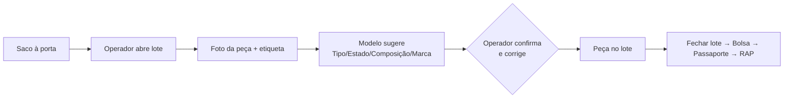
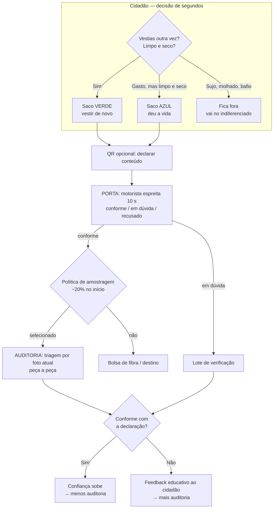

# Triagem do lado do consumidor — análise

Estado: proposta em discussão (branch `analise/triagem-lado-consumidor`). Não há código novo; este doc analisa a sugestão da Vitrus de 4 nov 2026 — *a triagem passar a ser feita pelo munícipe, em casa, antes de entregar o saco* — e propõe um caminho.

## 1. Resumo e recomendação

A intuição da Vitrus é correta na direção, mas levada à letra destrói o valor que a rede existe para proteger. A triagem por peça, feita pelo operador, não escala (secção 3) e o têxtil entregue sem nenhum controlo contamina (secção 4: 56,9% de rejeito no canal mais parecido com "o cidadão entrega e pronto"). Mas a solução não é o cidadão fazer em casa, peça a peça, o trabalho do operador — é **nenhum dos lados fazer tudo**.

**Recomendação: triagem partilhada em camadas.**

1. **Física**: dois sacos de cor no dia fixo da freguesia — "vestir de novo" e "deu a vida". O cidadão separa ao nível do saco, com uma regra de decisão de 3 perguntas. Nunca peça a peça.
2. **Declaração** (opcional, sem app também funciona): o saco tem QR; quem quiser declara conteúdo e vê o destino.
3. **Porta**: o motorista faz uma verificação de 10 segundos ao apanhar o saco (espreitar, pesar ou não). É o controlo de contaminação, embutido numa paragem que já acontece.
4. **Amostragem**: uma fração dos sacos (começando alta, ~20%) vai a auditoria com a triagem por foto que já existe. Serve para calibrar a fiabilidade da declaração e produzir a evidência RAP com intervalos de confiança.
5. **Feedback**: o resultado da auditoria volta ao cidadão (mensagem educativa, nunca multa) e ajusta o nível de confiança — sacos de quem declara bem são menos auditados, como o "viajante confiável" das alfândegas.

Isto corta a carga do operador em ~90% (estimativa, secção 3), mantém a contaminação sob controlo com um gargalo humano de segundos em vez de minutos por peça, e transforma o passaporte — que hoje é evidência do lote — no canal de adesão do cidadão.

## 2. Como a triagem funciona hoje

Retrato técnico completo em [`features.md`](../engenharia/features.md) e [`ia.md`](../engenharia/ia.md); aqui o essencial para a decisão.

- Quem tria é o papel `operator` (não há "árbitros" no código; é o operador da Vitrus com conta na app). Fluxo: abrir lote → **fotografar a peça** → fotografar a etiqueta (opcional) → analisar (modelo de visão, prompt `triage_v3`) → **rever e corrigir a sugestão** → confirmar → (opcional) guardar miniatura. São **7 a 8 passos por peça** medidos em utilização real ([`uso-diario.md`](../engenharia/uso-diario.md)).
- O modelo devolve tipo, estado (reutilização/reciclagem/rejeito), composição e marca; **o peso é tabela** (150–900 g por tipo, pressuposto da equipa) e a peça só entra no lote depois de confirmada por um humano. Nada é gravado antes da confirmação.
- O resultado alimenta: o passaporte público do lote, a bolsa de fibra, a evidência por marca (base da ecomodulação RAP) e o relatório RAP.
- Custo por peça: ~2 200 tokens de entrada + 250 de saída (valores típicos de [`ia.md`](../engenharia/ia.md)); limite de 20 análises/minuto.

A triagem por foto foi desenhada como **controlo de qualidade na entrega**: o problema da Vitrus é a contaminação, e a foto confirma o estado no momento em que o saco chega. É um *instrumento de medição*, não um processo de triagem industrial. A sugestão de 4 nov é sobre o *processo* — e as duas coisas não competem: a segunda precisa da primeira como auditoria (secção 9).

## 3. Porque é que a pergunta muda com a escala

Hoje a rede captura **301,27 t/ano** (Vitrus e 3 entidades licenciadas, 2025). A procura do modelo é **3 003,3 t/ano** — 1,596 kg/hab/mês, estimativa (51 250,6 t de indiferenciado × 5,86%, APA RARU 2025). Passar de 301 t para 3 003 t muda a ordem de grandeza de tudo:

| | Hoje (301,27 t) | Alvo (3 003,3 t) | Fonte |
| --- | --- | --- | --- |
| Peças por ano (média 0,3 kg/peça, tabela de pesos da equipa) | ≈ 1 milhão (estimativa) | ≈ 10 milhões (estimativa) | cálculo sobre pesos da equipa |
| Tempo do operador a 20–30 s/peça (7–8 passos, `uso-diario.md`) | ≈ 5 500–8 300 h/ano ≈ 3–5 ETC (estimativa) | ≈ 55 000–83 000 h/ano ≈ **30–48 ETC** (estimativa) | cálculo |
| Custo de IA por peça (2 450 tokens × gama 1–4 €/M tokens) | 2 500–10 000 €/ano (estimativa) | **25 000–100 000 €/ano** (estimativa) | cálculo sobre tokens de `ia.md` |
| Verificação à porta, 10 s/saco de ~3 kg (estimativa) | ≈ 280 h/ano | ≈ 2 800 h/ano ≈ 1,6 ETC, embutida na recolha (estimativa) | cálculo |
| Auditoria por amostragem (secção 9) | — | ~8 000 peças/ano → 67 h + 20–80 € de IA (estimativa) | cálculo |

ETC = equivalente a tempo completo (~1 750 h/ano). As gamas de preço de tokens são estimativas de gama de modelos de visão atuais, não cotações.

Conclusões:

- **A triagem por peça, seja de quem for, não escala para o alvo.** Nem com operadores (30–48 ETC) nem com cidadãos (a fricção de fotografar 10 milhões de peças em casa mataria a participação — secção 8).
- A pergunta certa não é "quem faz a triagem por peça" mas **"a que granularidade é que cada decisão tem de ser tomada"**. Resposta: o cidadão separa *fluxos* (saco), o motorista valida *à porta* (segundos), o sistema audita *amostras* (estatística).
- A verificação à porta e a auditoria somam **~2–3 ETC para todo o concelho** (estimativa) contra 30–48 ETC da triagem exaustiva. É esta ordem de grandeza que interessa à Vitrus.

## 4. O que os dados da Vitrus já dizem sobre triagem sem controlo

Os dados de 2025 já contêm a experiência "o cidadão entrega sem triagem":

| Canal | Rejeito | Nota |
| --- | --- | --- |
| Contentores escolares recolhidos via To Be Green (amostra de 5,6 t da Vitrus) | **56,9%** (DOAR 9,16%; reciclagem 33,96%; LIXO+DESPERDÍCIOS 56,88%) | Relatório To Be Green, percentagens aplicadas ao total; estimativa |
| H Sarah Trading (contentores próprios, triagem profissional) | 13,0% | kg exatos |
| Ultriplo (contentores próprios, triagem profissional) | 14,5% | kg exatos |
| Nova Etapa | 10,0% | percentagens de relatório; estimativa |

Fonte: `data/processed/textile_flows.csv` e [`dados-e-modelo.md`](../engenharia/dados-e-modelo.md).

O canal em que o têxtil chega "como vier" destrói **56,9%** do valor — e o valor da rede está na reutilização (a reciclagem custa mais que a fibra virgem, segundo a Vitrus). Os canais com triagem profissional na entrada (Sarah, Ultriplo) perdem 10–14,5%. Ou seja:

> Tirar o controlo da entrada sem pôr nada no lugar reproduz o cenário de 56,9% à escala das 3 003 t — desperdiçaria ~1 700 t/ano de material (estimativa) que a rede existe para salvar.

Nuance importante: os contentores escolares estão expostos (chuva, transbordo, remoções), não é só erro do cidadão. A evidência europeia diz o mesmo: pontos de entrega sem pessoal têm **mais contaminação** que recolha coberta/com pessoal (van Duijn et al. 2022, citado no relatório da AEA de 2024). A recolha porta a porta com verificação à porta é precisamente um momento "com pessoal" — é a diferença entre os 56,9% e os ~13%.

## 5. O que outros já fizeram

| Caso | O que mostra | Fonte |
| --- | --- | --- |
| **Siptex** (Malmö, Suécia) | Primeira centrob de triagem automática por NIR (4,5 t/h; 20 000 t/ano). Trabalha com têxtil **pré-triaged** — a pré-triagem a montante é condição para triagem industrial barata. | Comissão Europeia (Reset the Trend); Sysav; retur.dk |
| **SorTex** (Interreg Alemanha–Dinamarca) | Projeto dedicado a **guiar o cidadão para pré-triager corretamente**: quanto melhor a pré-triagem, mais alto o lugar na hierarquia de resíduos. | sortexprojekt.org |
| **AEA** (Agência Europeia do Ambiente, 2024) | Pontos de entrega ao ar livre recolhem muito mas contaminam mais; recolha coberta/com pessoal contamina menos. | EEA, *Management of used and waste textiles*; van Duijn et al. 2022 |
| **Refashion** (França) | Ferramentas públicas de orientação ("o que entra, o que não entra", mapa de pontos) como interface entre cidadão e ecossistema RAP. | refashion.fr |
| **Bower** (Suécia) | App de reciclagem com recompensas por digitalizar: gamificação de massa (~700 mil utilizadores) muda hábitos de separação; já sem código de barras para pilhas. | getbower.com; impakter.com; batterytechonline.com |
| **Sorting for Circularity Europe** (Fashion for Good) | 494 000 t/ano = 74% do têxtil pós-consumo de baixo valor nos países estudados está disponível para reciclagem de fibra — o gargalo é casar oferta e procura, e a fase 2 financia plataformas digitais que o façam. A bolsa de fibra do Novelo é isso a escala local. | relatório Fashion for Good, 2025 |
| **Zero Waste Europe** (guia local, 2023) | Recolha e triagem locais: separação na origem + comunicação clara + triagem próxima do cidadão maximizam reutilização. | zwe.org, dez 2023 |
| Literatura de comportamento | Comodidade é o preditor mais consistente da separação correta; feedback e normas sociais aumentam a adesão; recompensas pequenas certas perdem efeito. | revisão sistemática *J. Air & Waste Manage. Assoc.* 2020; White & Trudel 2018 (saber em que o resíduo se transforma aumenta a reciclagem) |

Nenhum sistema conhecido pede ao cidadão a triagem por peça em casa. Os que funcionam fazem: **separação simples em fluxos + momento de controlo com pessoas + medição por amostragem**. É a arquitetura que se recomenda aqui.

## 6. As abordagens possíveis — crítica de cada uma

| # | Abordagem | Carga no operador | Risco de contaminação | Evidência RAP | Veredicto |
| --- | --- | --- | --- | --- | --- |
| A | **Status quo**: operador tria cada peça na entrega | 30–48 ETC no alvo (estimativa) | Baixo (é o QC) | Censo por peça | Não escala; fica como **instrumento de auditoria** |
| B | **Cidadão tria peça a peça em casa** com fotos na app | ~0 | Médio — e sem correção | Riqueza aparente, fiabilidade desconhecida | **Não**: fricção mata a participação (7–8 passos × dezenas de peças por saco); quem adere é quem já separava bem |
| C | **Cidadão declara o saco, sem verificação** | ~0 | Alto — replica os 56,9% | Fraca (autorreporte) | **Não**: remove o QC que é a razão de ser da triagem |
| D | **Triagem partilhada em camadas** (física + porta + amostragem + feedback) | ~2–3 ETC (estimativa) | Controlado (porta + amostragem) | Amostragem estratificada com IC 95% | **Recomendada** (secção 7) |
| E | Variante mínima: **dois sacos físicos + motorista espreita**, sem app, com estudo de composição trimestral | ~2 ETC | Controlado | Só estatística de agregado | Plano B sólido; perde passaporte, feedback e confiança graduada |
| F | **Pontos de triagem comunitários** (escolas/juntas com voluntários) | Voluntariado (não escala sozinho) | Médio | Fraca | Complemento de educação, não processo |
| G | **Externalizar tudo nos licenciados** (Sarah/Ultriplo) como hoje | 0 na Vitrus; custo de tratamento nas entidades | Baixo (triagem profissional) | Fora do Novelo | É o contrafacto: sem dados, sem evidência RAP municipal, sem bolsa |

Sobre B, o argumento sedutor é "o mesmo modelo, outro utilizador". Falha por três lados: (1) fricção — cada peça exige 2 fotos e revisão, e o saco médio tem dezenas; (2) seleção — só participa quem já tem o hábito, logo mede mal a população; (3) confiança — sem verificação, os dados valem para orientar, não para provar. O que B tem de bom (educação pelo making, sentimento de agência) obtém-se na camada 2 de D com uma fração da fricção.

Sobre C, há ainda o problema do incentivo perverso: se a declaração tiver qualquer consequência (recompensa, estatuto), sem auditoria o sistema ensina a declarar bem, não a separar bem.

## 7. A recomendada: triagem partilhada em camadas

As cinco camadas:

1. **Física (o produto é o saco).** Dois sacos de cor distintos, grátis, entregues em casa/na junta/nas escolas, com ícone grande e a regra de 3 perguntas impressa. O dia de recolha é fixo por freguesia (já é assim no modelo de rede). Se houver saco único, o cidadão decide mal por preguiça; se houver mais de dois fluxos, ninguém acerta. Dois é o número.
2. **Declaração (opcional, 30 segundos).** QR no saco → página sem registo: indica o que vai no saco (contagem grosseira ou só o fluxo) e, se quiser, fotografa uma etiqueta. Sempre funciona sem este passo — a rede física é o serviço, a app é a camada de relação.
3. **Porta (o QC de 10 segundos).** O motorista abre o saco um segundo, confirma/recusa/encaminha para verificação. Recusar com uma nota educativa ("vinha molhado") é a consequência mais eficaz que existe — e o saco recusado não contamina os outros.
4. **Amostragem (o QC estatístico).** Política inicial ~20% dos sacos a auditoria por peça com a triagem por foto atual; estratificada por freguesia. Conformidade alta → percentagem desce (adaptativa). A auditoria acontece no depósito (Polvoreira), não à porta — o motorista não fica a esperar.
5. **Feedback (o motor da adesão).** O resultado volta ao cidadão por SMS/notificação (se declarou) ou no painel da freguesia. Passaporte do saco: peso, destino, quanto a freguesia já desviou. Erro → mensagem educativa com a regra que falhou, nunca multa.

## 8. Como garantir adesão e uso correto

Da literatura de comportamento (secção 5) e do que os dados locais mostram, nove princípios:

1. **Comodidade por omissão.** O caminho mais fácil tem de ser o correto: sacos grátis entregues, dia fixo conhecido, regra de 3 perguntas. Quem não tem app, não instala nada e participa na mesma.
2. **Em caso de dúvida, reutilização.** Erro para o lado verde custa pouco (o a jusante — Sarah/Ultriplo — demove peças gasta, como já fazem); erro para o lado azul destrói valor. A regra escrita no saco deve ser "na dúvida, saco verde".
3. **Mostrar o que acontece a seguir.** O passaporte do saco faz pelo têxtil o que a investigação chama *transformation salience*: saber em que se transforma aumenta a separação correta (White & Trudel 2018). O QR que hoje prova o lote ao reciclador passa também a contar a história ao cidadão.
4. **Normas sociais visíveis.** Painel por freguesia (kg desviados, % conformidade) e desafio entre escolas — as escolas já são locais de entrega na rede proposta. Ninguém quer ser a freguesia de baixo.
5. **Confiança graduada, à alfândega.** Novo participante: auditoria frequente. Histórico conforme: quase nenhuma. O incentivo para declarar bem é menos atrito, não dinheiro.
6. **Nunca pagar por kg nem por peça.** Pagamento direto incentiva encher sacos com lixo (o precedente de fraude em fluxos de resíduos com prémio é longo). Se houver recompensa, que seja leve e não proporcional ao peso (pontos de freguesia, sorteio trimestral).
7. **Sanidade automática.** Peso do saco vs. declaração, densidade, histórico: discrepâncias sobem a probabilidade de auditoria sem ninguém decidir. Gaming vira caso estatístico.
8. **Acessível a todos.** SMS para quem não tem smartphone; balcão da junta para quem não quer; sacos com pictogramas para quem não lê. As escolas levam a regra a casa pelos filhos.
9. **Medir e iterar.** As métricas do piloto (secção 11) decidem o escalonamento — adesão e conformidade são variáveis do sistema, não esperanças.

## 9. Evidência para a RAP com amostragem

A Diretiva 2025/1892 põe o produtor a pagar até 17 abr 2028; a ecomodulação precisa de evidência por marca e composição — hoje produzida pela triagem por peça. Sem triagem exaustiva, a evidência passa a **amostragem estratificada**, como os estudos de composição de resíduos fazem há décadas:

- **n ≈ 385 sacos por trimestre** para ±5 p.p. a 95% de confiança na taxa de conformidade (pior caso, p = 0,5); ~1 000 peças/trimestre para composição e marcas. Custo: ~8 000 peças/ano ≈ 67 h de operador + 20–80 € de IA (estimativa, secção 3) — três ordens de grandeza abaixo do censo.
- O relatório RAP ganha uma nota de metodologia (n, estratos por freguesia, intervalos) que o torna **auditável** — melhor que um censo impossível de verificar.
- A auditoria corre com o fluxo que já existe (`/triage` → confirmação → lote); a amostra é escolhida pela política de amostragem (aleatória + risco).

A triagem por foto, que hoje parece um processo, revela-se o que sempre foi: **o instrumento de medição**. Passa a medir a rede em vez de mover a rede.

## 10. Implementação no Novelo

Sem perder o que existe; a triagem por foto e os lotes ficam como estão e ganham o papel de auditoria.

### Vocabulário (`domain/vocab.py`)
- `BagStream`: `reuse | recycle` (os dois fluxos físicos).
- `BagState`: `declared | collected | audited | flagged`.
- `PeekOutcome`: `ok | doubt | refused` (à porta).
- `AuditOutcome`: `match | mismatch` (+ gravidade).

### API (`features/bags/` novo, `models/router/service/schemas`)
- `POST /bags` — o cidadão (ou convidado com limites) declara o saco: freguesia, fluxo, contagem grosseira, etiqueta opcional. Gera código com o mesmo alfabeto legível dos lotes.
- `POST /bags/{code}/peek` — o motorista regista `ok/doubt/refused` (+ peso se houver balança).
- `POST /bags/{code}/audit` — lote de auditoria: reusa `/triage` + `add_lot_item` sem mudanças.
- `GET /public/bags/{code}` — passaporte do saco (público como o do lote).
- `GET /bags/{code}/qr` — generalizar o gerador de QR dos lotes.
- `GET /admin/sampling` — política (percentagem base, fator de risco por histórico) e KPIs: conformidade por freguesia, confiança por utilizador, kg por fluxo.

### Web
- PWA novo: **"O meu saco"** (cidadão: declarar, ver passaporte, receber feedback) — o atalho "Triagem" atual é do operador e fica.
- Ecrã do motorista: scan do saco → três botões grandes (`conforme | em dúvida | recusado`), telemóvel primeiro, funciona sujo/luvas/sol.
- Admin: painel de amostragem e confiança.

### Relatórios e seed
- RAP: secção de metodologia de amostragem com IC 95%; KPIs de conformidade.
- `demo_seed.py`: ~50 sacos declarados, ~10 auditados, 1–2 em não conformidade, para o piloto ter painel desde o primeiro dia.
- E2E: cidadão declara → motorista recolhe → auditoria apanha divergência → feedback aparece.

### Fases
1. **Fase 0 — decidir com a Vitrus (curta).** Validar os dois sacos, o dia fixo, o texto da regra e quem imprime o que. Sem código novo além do doc.
2. **Fase 1 — piloto.** 2–3 freguesias piloto + 2 de controlo semelhantes; 8–12 semanas; `features/bags/` completo; métricas semanais.
3. **Fase 2 — escalonar.** Política adaptativa (conformidade alta → menos auditoria), SMS, desafio de escolas.
4. **Fase 3 — fechar o ciclo.** Amostras alimentam a bolsa de fibra e o relatório RAP com a nota de metodologia.

## 11. Piloto e métricas de sucesso

| Métrica | Alvo do piloto | Como medir |
| --- | --- | --- |
| Participação (fogos/famílias aderentes) | subida sustentada semana a semana | sacos recolhidos por freguesia vs. fogos (INE) |
| Captura adicional | piloto > controlo em kg/hab/mês | peso à porta |
| Conformidade da declaração | ≥ 80% `match` nas auditorias | auditoria vs. declaração |
| Rejeito do fluxo verde (vestir de novo) | ≤ 15% (nível Sarah/Ultriplo) | auditoria por peça |
| Sujidade/molhado recusado à porta | < 5% das recolhas | `peek refused` |
| Custo operacional | €/t abaixo do status quo projetado | horas de operador + IA por tonelada |

Critério de decisão para escalar: duas métricas de qualidade (conformidade, rejeito) no alvo **e** captura a subir. Se a conformidade falhar, sobe-se a amostragem e reforça-se o feedback antes de crescer — o desenho degrada-se para mais controlo, nunca para menos.

## 12. Riscos e mitigações

| Risco | Mitigação |
| --- | --- |
| Poucos sacos declarados (a app fica vazia) | A rede física funciona sem declaração; o QR do saco é opcional e o SMS cobre o resto |
| Cidadão mete lixo no saco para se livrar dele | Peso/declaração dispara risco; recusa à porta com nota; sem pagamento por kg |
| Idosos e não digitalizados excluídos | Junta/escola como balcão; pictogramas; dia fixo como o PAP que já conhecem |
| Amostra não representativa (quem declara não é a população) | Estratos por freguesia; auditoria também de sacos não declarados (aleatória à porta) |
| Motorista recusa pouco por constrangimento social | Recusa é um toque, não um conflito: botão único + nota impressa padrão; a recusa volta sempre como mensagem da Vitrus, não do motorista |
| Evidência RAP contestada por ser amostral | Nota de metodologia com n e IC; publicar a composição por freguesia como os estudos de composição de RU |
| Custo de IA da auditoria dispara | Amostragem é tectada por desenho (percentagem configurável); `/triage` já tem limite por minuto |
| Inverno: roupa molhada à porta | Saco fechado + dia fixo + regra "molhado fica fora"; verificação à porta apanha o que escapar |

## 13. O que não fazer

- Não pagar por kg ou por peça.
- Não exigir app para participar na rede física.
- Não pedir fotos peça a peça ao cidadão.
- Não remover a verificação à porta enquanto a conformidade estiver abaixo do alvo.
- Não apresentar números de amostra como se fossem censo.

## 14. Fontes

- Dados Vitrus 2025 e decisões de 21–22 out 2026: `data/processed/`, [`analise-dados-recebidos.md`](../dados/analise-dados-recebidos.md), skill `novelo-context`.
- Triagem atual: [`features.md`](../engenharia/features.md), [`ia.md`](../engenharia/ia.md), [`uso-diario.md`](../engenharia/uso-diario.md), código em `apps/api/src/novelo/features/lots/`.
- AEA (2024), *Management of used and waste textiles in Europe's circular economy* (contaminação de pontos de entrega vs. recolha com pessoal; van Duijn et al. 2022).
- Comissão Europeia / Sysav / retur.dk sobre a Siptex (triagem automática com pré-triagem a montante); sortexprojekt.org (SorTex).
- Fashion for Good (2025), *Sorting for Circularity Europe* (494 kt/ano, 74% disponível; plataformas digitais na fase 2).
- Zero Waste Europe (dez 2023), guia de recolha e triagem local de têxteis.
- Bower (getbower.com; impakter.com) — gamificação de separação com recompensas.
- Revisão sistemática de comportamento em resíduos, *J. Air & Waste Manage. Assoc.* (2020); White & Trudel (2018), *Knowing What It Makes*, JMR.
- Diretiva (UE) 2025/1892 (RAP têxtil, prazo 17 abr 2028).
