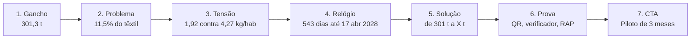

# Visualizações por página

Como transformar o Novelo, hoje correto mas "aborrecido e confuso", num produto que o júri percebe em dez segundos e recorda. Cada página passa a ter **uma mensagem**, **duas a quatro visualizações** com os dados de onde vêm, **um momento "uau"** e uma prioridade. No fim há a **home** em detalhe, o mapa de **reaproveitamento** (app, relatório RAP, slides) e a lista do que **falta na API e nos dados**.

Escrito a 19 de outubro de 2026. Submissão a **23 de outubro às 17h30**; código congelado às 15h00 ([estratégia](estrategia-para-ganhar.md#calendário-dia-a-dia-19-a-28-de-outubro)). Os critérios e pesos estão em [Critérios de avaliação](criterios-de-avaliacao.md): inovação 25%, viabilidade técnica 25%, impacto e relevância 30%, apresentação e potencial de continuidade 20% (fonte oficial [F61], registo E4).

**Estado deste documento: proposta de design.** Nada aqui está implementado, exceto onde a coluna "Estado" diz "Existe". Atualização de 20 de outubro de 2026: o ponto de partida (`/`) já conta a história com `get_overview`, mas **exige sessão**; a home pública e a rota `/baseline` desta proposta não existem (a rota `/` é a home autenticada). O diagnóstico parte do código e da estrutura da app, sem testes com utilizadores; valida-se com três pessoas fora da equipa antes de congelar (hipótese).

## Resumo em dois minutos

**Porque parece aborrecido e confuso (diagnóstico, hipótese).**

1. **22 páginas no menu, sem percurso.** Todas pedem atenção por igual. O júri não sabe por onde começar nem em que ordem ver a prova.
2. **Tabelas à frente, conclusões escondidas.** Os ecrãs de dados abrem com quadros e KPIs soltos. A conclusão (por exemplo, "só captamos 11,5% do têxtil que se gera") tem de ser deduzida.
3. **Sem referência nem incerteza à vista.** Um número sem "comparado com quê" não diz nada. Os pressupostos e os intervalos existem na API, mas não estão no primeiro olhar.
4. **Sem home que conte a história.** O ponto de partida é um painel, não um argumento. A história (problema, tensão, relógio de 2028, solução, prova) só existe no pitch.

**O que propomos.**

1. Uma **home pública** que conta a história em sete passos, com animações que têm função ([secção 3](#3-a-home-em-detalhe)).
2. **Reordenar o menu pelo percurso do júri** em quatro atos: Entender, Decidir, Provar, Sistema ([secção 2.1](#21-antes-das-páginas-reordenar-o-menu-pelo-percurso)).
3. **Título-conclusão em todas as páginas**, gerado a partir dos dados por modelos de texto, nunca escrito à mão.
4. **Seis visuais-estrela** que o júri nunca viu juntos: cascata "de 301 t para X t", fronteira orçamento→toneladas, intervalo P10–P90 com tornado, lacuna de cobertura face à referência, lote com passaporte por QR, relógio regulatório.
5. **Cada visual serve três sítios**: app, relatório RAP em PDF e slides do pitch ([secção 4](#4-mapa-de-reaproveitamento-app-relatório-rap-e-slides)).

**O que fazer antes das 15h00 de 23 de outubro (P0).** Seis entregas, por ordem de ganho ponderado:

| # | Entrega | Critério que sobe | Esforço |
| --- | --- | --- | --- |
| 1 | Alinhar a procura (2 324,8 t por desviar, 43 051 t × 5,4%) em toda a API e no ecrã ([D02](#5-dependências-de-dados-e-api-em-falta)) | Impacto, viabilidade | S |
| 2 | Home pública com gancho, captura e relógio ([secção 3](#3-a-home-em-detalhe)) | Apresentação, impacto | M |
| 3 | Cascata "301 t → X t" no detalhe do cenário | Impacto | M |
| 4 | Intervalo P10–P90 e tornado com origem dos pressupostos à vista | Viabilidade | S |
| 5 | Comparar: veredicto + inclinação A→B + robustez | Impacto (nunca se corta) | M |
| 6 | Passaporte público a 390 px com selo "dados de demonstração" | Inovação, apresentação | S |

Tudo o resto fica atrás de **E2E verde** (regra de corte da [estratégia](estrategia-para-ganhar.md#regras-de-corte-em-função-dos-pesos)). Esforço: S = até meio dia, M = até um dia, L = mais de um dia.

## Números usados neste documento

Todo o número tem fonte ou a palavra "estimativa". As linhas do registo estão em [Registo de afirmações](../pesquisa/registo-de-afirmacoes.md).

| Número | Valor | Fonte | Estado |
| --- | --- | --- | --- |
| Têxtil recolhido em 2025 | 301,3 t | Vitrus (`dados_textil.xlsx`), registo A1 | Dado Vitrus |
| População | 156 830 habitantes, 48 freguesias | INE, Censos 2021, registo A3 | Primária |
| Recolha por habitante | 0,16 kg/hab/mês = 1,92 kg/hab/ano | 301,3 t ÷ 156 830 (A2) | Cálculo |
| Têxtil ainda no lixo (por captar) | ≈ 2 324,8 t/ano (1,235 kg/hab/mês) | 43 051 t de RSU (Vitrus) × 5,4% (APA), registo A8 | Cálculo, estimativa |
| Têxtil gerado | ≈ 2 626,0 t/ano | 2 324,8 + 301,3 (A12) | Cálculo, estimativa |
| Captura atual | 11,5% | 301,3 ÷ 2 626,0 (A9) | Cálculo, estimativa |
| Destino | 59,4% reutilização, 26,5% reciclagem, 14,1% rejeito | Vitrus, registo A4 (duas entidades estimadas, A5) | Dado Vitrus |
| Operação atual | 40 circuitos, 29 viaturas, 82 localidades (71 geocodificadas), 101 turnos, 9 circuitos sem viatura, 2 viaturas nunca atribuídas | Vitrus (`Circuitos_Viaturas_Guimaraes.xlsx`), registo A6, A7 | Dado Vitrus |
| Alertas de qualidade | 12 | Vitrus, registo A13 | Dado Vitrus |
| Referência francesa | 4,27 kg/hab/ano; 1 ponto por 1 414 habitantes | Refashion via imprensa, registo C1, C2 | **Por verificar** (secundária) |
| Meta francesa e teto do modelo | 669,7 t; 562,6 t (107,1 t de distância) | Cálculo nosso ([dados e modelo](../engenharia/dados-e-modelo.md#cenário-de-referência-desempenho-francês)) | Cálculo, depende da França |
| Obrigação do município | Desde 1 de janeiro de 2025 | Diretiva 2008/98/CE, art. 11.º, n.º 1 (alterada pela Diretiva (UE) 2018/851) e RGGR, art. 36.º [F81] [F69] [F2]; **não** vem da Diretiva (UE) 2025/1892 | Primária |
| Prazo para criar a RAP em Portugal | 17 de abril de 2028; cobre as peças postas à venda a partir da lei nacional, o mais tardar dessa data | Diretiva (UE) 2025/1892, art. 22.º-A, n.º 11 e 14 [F1] (registo B4, B17) | Primária; leitura do n.º 11 a confirmar com a APA |
| Dias até 17 de abril de 2028 | 543 (a 22 de outubro de 2026); 539 (a 26 de outubro). Mede o prazo para o regime existir, não o dia em que os produtores pagam tudo | Cálculo | Cálculo |
| Exemplo de €/t | 122,7 €/t; P10 92,5, P50 123,8, P90 164,7 (cenário de 60 000 €/ano) | Modelo ([dados e modelo](../engenharia/dados-e-modelo.md#sensibilidade-tornado-e-monte-carlo)) | **Estimativa** |
| Piso de sinal do piloto | 1,71 t em 3 meses (2 freguesias × 2 modos) | Modelo (`domain/pilot.py`) | **Estimativa** |
| Cenário B: X t a Y €/t | por preencher a 22 de outubro | Otimizador | **Estimativa** |

Onde o texto usa "[X]" ou "[Y]", o valor vem do cenário fixado a 22 de outubro e não se escreve à mão.

---

## 1. Princípios de data storytelling para decisores

Um decisor (a câmara, a Vitrus, o júri) não lê gráficos: **procura uma resposta e a confiança para agir**. Estes doze princípios vêm da prática de quem estuda isto e são traduzidos para regras do Novelo, cada uma com um teste que se faz em dez segundos.

| # | Princípio | Origem | Regra no Novelo | Teste de 10 segundos |
| --- | --- | --- | --- | --- |
| 1 | **Uma mensagem por visual** | Knaflic: começar pela audiência e pelo que ela deve fazer; escolher o gráfico depois [R2] | Cada visual responde a uma só pergunta e acaba numa grandeza de impacto (t, €/t, cobertura) | Alguém lê o título e diz a conclusão sem olhar para o gráfico |
| 2 | **Título-conclusão** | Prática de redações como o FT e o OWID: o título afirma, o subtítulo explica [R3] [R4] | Título = frase com número ("Captamos 11,5% do têxtil"); subtítulo = o que se mede e o ano; nunca "Gráfico de captura" | O título contém um verbo e um número |
| 3 | **Comparar com algo** | Tufte: "Compared to what?" [R1] | Todo o valor leva uma referência: têxtil gerado (2 626 t), França (4,27 kg/hab), cenário A, limiar, ano anterior | Há uma linha, uma marca ou uma sombra de referência |
| 4 | **Anotar no gráfico** | Knaflic: focar a atenção com cor e anotações [R2] | Máximo de três anotações por visual, junto ao ponto, em Inter 13 px; a seta aponta o que mudou | Não é preciso procurar a legenda |
| 5 | **Retirar tinta inútil** | Tufte: razão dados-tinta e *chartjunk* [R1] [R5] | Sem grelhas pesadas, sem 3D, sem sombras, sem legendas se a rotulagem direta couber | Apagar um elemento não muda a leitura |
| 6 | **Pequenos múltiplos para comparar** | Tufte: mesmas escalas e eixos, vistas lado a lado [R1] [R6] | Comparar freguesias, modos e cenários com painéis iguais, não com cores a mais num só gráfico | Os painéis partilham a escala |
| 7 | **Incerteza visível** | Prática de fan charts e intervalos (hipótese: Bank of England, por verificar) [R12] | P10–P50–P90, tornado e a etiqueta "estimativa" aparecem no primeiro olhar, não num separador | O leitor vê quanto se pode enganar |
| 8 | **Cor com função** | Knaflic; FT Visual Vocabulary [R2] [R3]; WCAG 1.4.1 [R7] | A cor distingue papéis (observado, proposto, referência, estimativa), nunca decora; nunca só cor, sempre também forma, padrão ou rótulo | Em escala de cinzentos continua legível |
| 9 | **Gráfico certo para a pergunta** | FT Visual Vocabulary: desvio, correlação, ordenação, distribuição, evolução, magnitude, parte do todo, espacial, fluxo [R3] | Tabela da [secção 1.2](#12-escolha-do-gráfico) | Existe um motivo por escrito para o tipo escolhido |
| 10 | **Painel de decisão, não painel de números** | Few: substituir mostradores por *bullet graphs* [R8] | KPI = valor + meta + intervalo, num só traço (bullet), nunca um mostrador | O KPI diz se está bem ou mal |
| 11 | **Acessível e móvel** | WCAG 2.2: contraste 3:1 em gráficos (1.4.11), alvos de 24 px (2.5.8), movimento (2.2.2, 2.3.3) [R7] | Contraste ≥ 3:1, alvos ≥ 24 px (ideal 44), `prefers-reduced-motion`, tabela alternativa de cada gráfico | Funciona com teclado, a 390 px e sem cor |
| 12 | **Honestidade antes de impacto** | Regra da casa ([AGENTS.md](../../AGENTS.md)) | Nenhum número sem fonte ou "estimativa"; eixos a zero em barras; nada de dados de demonstração sem selo | Cada número clicado abre a sua origem |

### 1.1 Linguagem visual do Novelo

Sobre os tokens do [guia de marca](../marca/guia-de-marca.md): Linho `#F4F1EA`, Tinta `#14211D`, Floresta `#2E6B57`, Pedra `#5E6B66`, Areia `#C4A06A`, Floresta clara `#7FB39C`.

**Cores com função**

| Papel | Cor | Como se desenha | Nota de acessibilidade |
| --- | --- | --- | --- |
| **Observado** (dado Vitrus, INE) | Tinta | Traço e preenchimento sólidos | 14,7:1 sobre Linho |
| **Proposto** (o que o Novelo recomenda) | Floresta | Sólido, com rótulo "Cenário B" | 5,6:1 |
| **Referência / hoje** | Pedra | Linha fina, ponto vazado | 4,9:1 |
| **Estimativa / incerteza** | Areia só como preenchimento suave **com contorno tracejado em Pedra** | Banda, hachura, etiqueta "estimativa" | A Areia tem 2,2:1 sobre Linho e **não cumpre 3:1** para elementos gráficos essenciais (WCAG 1.4.11) [R7]; por isso nunca é o único portador da informação |
| **Alerta** | A definir no guia de marca | Ícone + texto, não só cor | O guia não tem token de alerta; pedir um com contraste ≥ 3:1 sobre Linho (D21) |
| **Fundo escuro** | Floresta clara sobre Tinta | Slides e home | 7,0:1 |

**Regras de desenho**

- **Números grandes em Newsreader 500** com algarismos alinhados; texto de interface em Inter. Unidade sempre ao lado (`301,3 t`, `122,7 €/t`), formatada por `lib/format.ts`.
- **Estimativa tem sempre três sinais**: etiqueta "estimativa", contorno tracejado e, na tabela alternativa, uma coluna "origem".
- **Categorias**: para fibras (11 valores na API) usa-se rotulagem direta e textura, com paleta categórica testada para daltonismo (por escolher; a Okabe–Ito é a candidata, por verificar [R11]). Nunca mais de seis cores num só gráfico.
- **Movimento** só quando revela uma relação (cascata, fio que engrossa, relógio). Nunca decorativo. Respeita `prefers-reduced-motion`; qualquer animação automática com mais de cinco segundos tem botão de pausa (WCAG 2.2.2) [R7].
- **Mobile**: um gráfico por ecrã de 390 px; rótulos diretos em vez de legenda; toque (não *hover*) abre o detalhe numa folha inferior; tabela alternativa por baixo.
- **Cada visual traz três coisas**: título-conclusão, nota de fonte ("Fonte: Vitrus, 2025. Cálculo Novelo") e botão "Ver dados" (a tabela alternativa e o cartão de proveniência).

### 1.2 Escolha do gráfico

| Pergunta | Gráfico | Quando usar | Quando **não** usar |
| --- | --- | --- | --- |
| Como se chega de A a B? | **Cascata** (*waterfall*) | De 301,3 t a X t por contributo; do custo total às suas parcelas | Mais de oito degraus; valores sem soma |
| Para onde vai cada tonelada? | **Sankey** | Freguesia → modo → destino; 3 a 5 colunas | Mais de ~25 ligações; comparação de valores finos |
| Estamos perto da meta? | **Bullet** | Valor atual, meta e intervalos num traço | Mostradores semicirculares |
| Quem fica à frente? | **Lollipop** ou barras ordenadas | Ordenar 48 freguesias por uma métrica | Barras 3D; ordem alfabética sem motivo |
| Antes e depois, A e B | **Gráfico de inclinação** (*slope*) | Dois momentos, até ~8 linhas | Mais de dois momentos (usar linhas) |
| Quanto pesa cada fator? | **Tornado** | Sensibilidade de €/t a pressupostos | Menos de três fatores |
| Quão certo é o resultado? | **Intervalo P10–P50–P90** / *fan chart* | Resultado da simulação Monte Carlo | Uma só amostra |
| Onde está o problema? | **Coroplético** (*choropleth*) | Taxa por freguesia (kg/hab, % coberta) | Totais absolutos por área (usar círculos proporcionais) |
| Onde concentrar esforço? | **Pareto** (barras + acumulado) | Lacuna por freguesia: poucas explicam muito | Categorias do mesmo tamanho |
| Que cenário compensa? | **Dispersão com fronteira** (Pareto de eficiência) | Custo × toneladas, tamanho = cobertura | Menos de quatro cenários |
| Quando acontece? | **Linha do tempo** / Gantt | Relógio regulatório, piloto de 13 semanas, eventos do lote | Dados sem datas |
| Quando está cheia a viatura? | **Mapa de calor** (*heatmap*) | Viaturas × dia × turno; circuitos × dia | Mais de ~60 linhas sem agrupar |
| Que fibra domina? | **Treemap** | Parte do todo com mais de seis categorias (há 11 fibras) | Até seis categorias: barra empilhada a 100% |
| Compara-se muito de uma vez? | **Pequenos múltiplos** | Mesmo gráfico por freguesia, modo ou cenário | Escalas diferentes |
| Vários eixos? | **Radar** | **Só** para comparar o perfil de 2 ou 3 cenários em 5 indicadores já normalizados e com o mesmo sentido (menos é melhor em todos). Hoje **não se justifica**: a inclinação A→B lê-se melhor | Qualquer outro caso |

---

## 2. Página a página

Legenda de **Estado**: *Existe* = há um componente em `apps/web/src/features/` (a forma pode ser revista); *Parcial* = existe parte; *Novo* = por construir. Os códigos **D01 a D24** remetem para a [lista de dependências](#5-dependências-de-dados-e-api-em-falta). Prioridade: P0 antes do congelamento de 23 de outubro às 15h00; P1 se houver E2E verde; P2 depois do hackathon.

### 2.1 Antes das páginas: reordenar o menu pelo percurso

O menu atual lista tudo. Propomos **quatro atos** que seguem a pergunta do júri, e fundir três páginas numa só.

| Ato | Pergunta | Páginas (por ordem) |
| --- | --- | --- |
| **Entender** | "Qual é o problema e quão grande?" | Ponto de partida, Mapa, Cobertura, **Operação atual** (Circuitos, Frota e Localidades como separadores), Qualidade dos dados |
| **Decidir** | "O que devemos fazer, quanto custa e quão certo é?" | Simulador, Cenários, Comparar, Piloto, Pressupostos |
| **Provar** | "Funciona do saco ao fio?" | Triagem, Lotes, Bolsa de fibra, Evidência por marca, Relatório RAP |
| **Sistema** | "Quem opera isto?" | Copiloto (painel flutuante), Painel de IA, Utilizadores, Conta |

Os destinos passam a quatro grupos com nome de pergunta, e três páginas (Circuitos, Frota, Localidades) viram separadores de uma só (menos duas entradas). As rotas atuais mantêm-se; muda o menu e os separadores. Esforço S. Prioridade **P0** porque é o que mais reduz a confusão por menos horas.

### 2.2 Entender

#### 2.2.1 Ponto de partida (`/`, passa a `/baseline`)

| | |
| --- | --- |
| **Objetivo / pergunta do júri** | "Qual é o problema e que dados reais o provam?" |
| **Critérios** | Impacto (30%), viabilidade (dados reais) |
| **Mensagem** | "Guimarães recolheu 301,3 t em 2025. Ficaram no lixo cerca de 2 324,8 t: captamos 11,5%." |
| **Prioridade / esforço** | **P0** / M |

| # | Visual | Tipo | Dados | Estado |
| --- | --- | --- | --- | --- |
| 1 | **Captura face ao potencial**: barra única, 11,5% cheia a Tinta, o resto hachurado ("≈ 2 324,8 t ainda no lixo"), marca da meta francesa (669,7 t, "referência, por verificar") | Bullet | `GET /textile/baseline` (`total_t`, `estimated_demand_t`, `capture_of_demand_pct`); meta de `GET /planning/benchmarks` | Parcial (`capture-bar`), D02 |
| 2 | **Para onde vai cada tonelada**: entidades → reutilização, reciclagem, rejeito; fios das duas entidades estimadas a tracejado | Sankey | `GET /textile/flows` | Existe (`flows-sankey`) |
| 3 | **Composição do indiferenciado**: onde está o têxtil que não recolhemos | Barra empilhada a 100% | `GET /textile/waste` | Existe (`waste-composition`) |
| 4 | **Recolha por entidade e método**: pesado contra percentagem | Lollipop ordenado | `EntityBaseline.method` em `GET /textile/baseline` | Parcial (tabela) |

- **Momento "uau":** a barra de captura enche até 11,5% e o resto aparece hachurado com "≈ 2 324,8 t ainda no lixo". Dez segundos para perceber o problema.
- **Interações:** passar o rato num destino do Sankey destaca as entidades de origem e filtra a tabela (cross-highlight); clicar numa entidade mostra o método (pesado ou estimado) e a origem do ficheiro.
- **Estado vazio inteligente:** "Os ficheiros da Vitrus ainda não foram importados" com botão "Correr importação" para administradores; para os restantes, "Dados em atualização. Última importação: [data]".
- **Microcópia:** título "Captamos 11,5% do têxtil que Guimarães produz". Subtítulo "301,3 t recolhidas em 2025; ≈ 2 324,8 t ainda no lixo (43 051 t de RSU × 5,4% da APA, estimativa)".
- **Não pôr:** cinco KPIs sem hierarquia; a tabela de entidades à frente (vai para o separador); o 5,4% do indiferenciado (por verificar, A10).

#### 2.2.2 Mapa (`/map`)

| | |
| --- | --- |
| **Pergunta do júri** | "Onde está a recolha e onde falta?" |
| **Critérios** | Impacto no território, apresentação |
| **Mensagem** | "40 circuitos passam por 82 localidades; os contentores atuais entram a 20 de outubro." |
| **Prioridade / esforço** | **P0** (coroplético + contentores) / M; **P1** (cursor entre hoje e cenário) / M |

| # | Visual | Tipo | Dados | Estado |
| --- | --- | --- | --- | --- |
| 1 | **Procura por freguesia** (kg/hab/ano ou t), com legenda sequencial de uma só cor | Coroplético | `GET /planning/zones` (`demand_t`, `population`, `geometry`) | Existe (`choropleth`) |
| 2 | **Contentores atuais**, agrupados ao afastar, cor por tipo | Pontos com *clustering* | `GET /network/containers` | Parcial (`containers.ts`), D06 |
| 3 | **Cursor entre "Hoje" e "Cenário B"** sobre o mesmo mapa | Comparação por cursor (*swipe*) | `result.allocations` de dois cenários | Novo, D22 |
| 4 | **Painel da freguesia** com mini-barras: população, procura, contentores, cobertura | Pequenos múltiplos | `ZoneOut` + `GET /network/coverage` | Existe (`parish-panel`) |

- **Momento "uau":** puxar o cursor e ver as freguesias mudarem de cor: onde o Cenário B apanha toneladas que hoje se perdem.
- **Interações:** passar o rato numa freguesia mostra o painel; clicar fixa-a e liga as restantes páginas (`?parish=`); *brush* de seleção por área; o filtro de variável vive na URL.
- **Estado vazio:** "Sem contentores de têxteis: a rede proposta usa locais existentes e recolha a pedido" (o inventário municipal de 20 de outubro tem camadas próprias), com a contagem dos 71 locais já geocodificados de 82.
- **Microcópia:** "11 localidades sem coordenadas: não aparecem no mapa" (82 − 71, cálculo).
- **Não pôr:** mais de duas camadas ligadas por defeito; paleta arco-íris; legenda com mais de cinco classes.

#### 2.2.3 Cobertura (`/coverage`)

| | |
| --- | --- |
| **Pergunta do júri** | "Quanta gente tem um contentor perto e quanto falta para o padrão de referência?" |
| **Critérios** | Impacto, inovação ("um número que o júri nunca viu") |
| **Mensagem** | "Hoje [N]% da população tem um contentor a menos de [R] m. Para 1 ponto por 1 414 habitantes faltam [M] pontos." |
| **Prioridade / esforço** | **P0** / M |

| # | Visual | Tipo | Dados | Estado |
| --- | --- | --- | --- | --- |
| 1 | **Onde está a lacuna**: 48 freguesias ordenadas por `gap_points`, com percentagem acumulada ("10 freguesias explicam [P]% da lacuna") | Pareto | `GET /network/coverage` (`ParishCoverage.gap_points`) | Parcial (tabela), D08 |
| 2 | **Contentores por 1 000 habitantes** face à referência, por freguesia | Bullet repetido (pequenos múltiplos) | `containers_per_1000`, `reference.people_per_point` | Parcial (`reference-card`) |
| 3 | **Desertos de recolha**: anéis do raio a pé sobre o mapa, freguesias coloridas por `covered_pct` | Coroplético + círculos | `radius_m`, `covered_pct`, `GET /network/containers` | Parcial (`coverage-map`), D06 |

- **Momento "uau":** o cursor do raio (200, 300, 500 m) faz os anéis crescerem e a percentagem coberta sobe em direto. O `radius_m` já é parâmetro da API.
- **Interações:** clicar numa barra do Pareto fixa a freguesia no mapa; *brush* sobre o acumulado seleciona o grupo.
- **Estado vazio (`awaiting_data`):** manter o painel de espera, mas mostrar a referência já calculada ("com a densidade francesa seriam ≈ 111 pontos: 156 830 ÷ 1 414, cálculo; referência por verificar") e a data de chegada, 20 de outubro.
- **Microcópia:** "A referência francesa é um espelho, não uma promessa."
- **Não pôr:** a referência sem a etiqueta "por verificar"; um único número de cobertura sem o raio usado; mapa de calor contínuo (engana: a cobertura é por ponto).

#### 2.2.4 Operação atual: Circuitos (`/circuits`)

| | |
| --- | --- |
| **Pergunta do júri** | "A operação existente aguenta recolha a pedido sem km novos?" |
| **Critérios** | Viabilidade, impacto |
| **Mensagem** | "40 circuitos já passam por 82 localidades; 9 não têm viatura atribuída." |
| **Prioridade / esforço** | P1 / S |

| # | Visual | Tipo | Dados | Estado |
| --- | --- | --- | --- | --- |
| 1 | **Semana dos circuitos**: 40 linhas × 7 dias, cor pela tipologia, as linhas sem viatura com contorno | Mapa de calor | `GET /network/circuits` (`weekdays`, `typology`, `vehicles`) | Novo (hoje tabela) |
| 2 | **Circuitos por tipologia**, com a parte sem viatura | Barra empilhada | `CircuitsSummary` | Existe (`typology-summary`) |
| 3 | **Localidades candidatas a recolha a pedido** (≥ 2 passagens por semana, parâmetro `piggyback_min_days`) | Pontos sobre mapa | `GET /network/localities` (`days_per_week`) | Novo |

- **Momento "uau":** acender no mapa as localidades onde o camião já passa duas vezes por semana: "aqui a recolha a pedido não custa km novos".
- **Interações:** clicar num circuito destaca as suas localidades no mapa; filtro por tipologia partilhado com Frota e Localidades.
- **Estado vazio:** "Sem circuitos importados" com ligação à Qualidade dos dados.
- **Não pôr:** a tabela completa à frente (vai para "Ver dados").

#### 2.2.5 Operação atual: Frota (`/fleet`)

| | |
| --- | --- |
| **Pergunta do júri** | "Há viaturas e equipas para absorver a recolha a pedido?" |
| **Critérios** | Viabilidade |
| **Mensagem** | "29 viaturas e 101 turnos por semana; 2 viaturas nunca foram atribuídas." |
| **Prioridade / esforço** | P1 / S |

| # | Visual | Tipo | Dados | Estado |
| --- | --- | --- | --- | --- |
| 1 | **Semana das viaturas**: viaturas × (dia, turno), cor pela equipa | Mapa de calor semanal | `GET /network/fleet` (`SlotCount`, `crew`) | Existe (`occupancy-heatmap`) |
| 2 | **Circuitos contra viaturas por tipologia** | Haltere (*dumbbell*) | `TypologyFleet` | Parcial (`typology-table`) |
| 3 | **Capacidade livre estimada** por turno | Barra com sombra de estimativa | `fleet_capacity.csv`, D23 | Novo |

- **Momento "uau":** as duas viaturas que nunca foram atribuídas aparecem a tracejado: capacidade parada que o modelo pode usar (se o dado se confirmar).
- **Interações:** clicar numa célula lista os circuitos desse turno; cursor sobre a viatura realça-a em toda a semana.
- **Estado vazio:** "Sem turnos importados."
- **Não pôr:** matrículas como protagonistas (são identificadores, não mensagem).

#### 2.2.6 Operação atual: Localidades (`/localities`)

| | |
| --- | --- |
| **Pergunta do júri** | "Que localidades têm passagem frequente e quais ficam de fora?" |
| **Critérios** | Impacto (território) |
| **Mensagem** | "[N] das 82 localidades têm pelo menos duas passagens por semana." |
| **Prioridade / esforço** | P2 / S |

| # | Visual | Tipo | Dados | Estado |
| --- | --- | --- | --- | --- |
| 1 | **Distribuição de dias por semana** | Histograma com *brush* | `LocalityOut.days_per_week` | Parcial (`frequency-summary`) |
| 2 | **Mapa ligado** ao histograma | Pontos | `latitude`, `longitude` (71 de 82) | Novo |

- **Momento "uau":** selecionar a barra "≥ 2 dias" e ver os pontos acenderem no mapa.
- **Estado vazio:** "11 localidades sem coordenadas" com a lista.
- **Não pôr:** tabela como primeiro elemento.

#### 2.2.7 Qualidade dos dados (`/data-quality`)

| | |
| --- | --- |
| **Pergunta do júri** | "Podemos confiar nestes números?" |
| **Critérios** | Viabilidade, apresentação (honestidade) |
| **Mensagem** | "12 alertas nos dados da Vitrus: [N] resolvidos, [M] abertos, nenhum esconde o número-âncora." Confirmar a última parte antes de escrever. |
| **Prioridade / esforço** | P1 / M |

| # | Visual | Tipo | Dados | Estado |
| --- | --- | --- | --- | --- |
| 1 | **Alertas por tipo e estado** | Barra empilhada | `GET /datasets/quality` (`AlertKind`, `AlertStatus`) | Parcial (`alerts-panel`) |
| 2 | **Cobertura temporal das fontes** | Linha do tempo (Gantt) | `DataSourceOut.period_start/end`, `received_on` | Novo |
| 3 | **Proveniência de cada número do ecrã**: Dado Vitrus, Cálculo, Estimativa, Por verificar | Matriz de etiquetas | Registo de afirmações, D16 | Novo |

- **Momento "uau":** clicar num alerta salta para o ponto afetado (circuito, viatura) e a IA propõe a resolução, com decisão humana (`suggest`).
- **Estado vazio (zero alertas abertos):** "Sem alertas abertos. Última verificação: [data]" com o histórico de resolvidos.
- **Não pôr:** os 12 alertas numa lista plana; ordenar por impacto no número-âncora.

### 2.3 Decidir

#### 2.3.1 Simulador (`/simulator`)

| | |
| --- | --- |
| **Pergunta do júri** | "Com X € por ano, quantas toneladas capto e a que custo por tonelada?" |
| **Critérios** | Inovação, impacto, viabilidade |
| **Mensagem** | "Com [orçamento] € por ano captam-se [T] t a [Y] €/t (estimativa)." |
| **Prioridade / esforço** | **P0** (resultado ao vivo) / M; P1 (fronteira) / L |

| # | Visual | Tipo | Dados | Estado |
| --- | --- | --- | --- | --- |
| 1 | **Fronteira orçamento → toneladas** com o ponto atual a deslizar e o "joelho" assinalado ("a partir daqui cada 10 000 € rende menos") | Linha com ponto | Novo `POST /planning/frontier` ou grelha pré-calculada (20 a 200 mil €), D03 | Novo |
| 2 | **Para onde vai o dinheiro**: investimento anualizado + recolhas + quilómetros | Cascata | `Kpis` (`capex_eur`, `opex_eur_year`, `km_year`), D04 | Parcial |
| 3 | **Toneladas por modo** (locais existentes, a pedido; rua só como referência) | Barras horizontais com `ModeSummary` | `ScenarioResult.modes` | Existe (`mode-summary`) |

- **Momento "uau":** arrastar o orçamento e ver o ponto deslizar na fronteira, o mapa e os €/t responderem em menos de um segundo (resultados pré-calculados numa grelha com `SOLVER_TIME_LIMIT_S`; fora da grelha, "a calcular" com tempo máximo à vista).
- **Interações:** controlo de orçamento com teclas de seta; botão "Comparar com o cenário A"; restrições avançadas num painel fechado.
- **Estado vazio / erro:** "Define um orçamento para ver o resultado". Objetivo inviável: "A meta está acima do teto do modelo (562,6 t). Experimenta fixar o orçamento."
- **Microcópia:** botão "Calcular o melhor plano"; aviso "Custos unitários: pressupostos até a Vitrus enviar os reais".
- **Não pôr:** doze campos à frente; "solver status" em linguagem técnica (traduzir: "ótimo", "melhor encontrado em 20 s").

#### 2.3.2 Cenários (`/scenarios`)

| | |
| --- | --- |
| **Pergunta do júri** | "Que alternativas estudámos?" |
| **Critérios** | Impacto, apresentação |
| **Mensagem** | "[N] cenários: o B capta [T] t a [Y] €/t; o A [..]." |
| **Prioridade / esforço** | P1 / S |

| # | Visual | Tipo | Dados | Estado |
| --- | --- | --- | --- | --- |
| 1 | **Mapa de cenários**: custo anual × toneladas, tamanho = cobertura, rótulo = €/t, fronteira ligada | Dispersão com fronteira | `GET /planning/scenarios` | Novo |
| 2 | **Cartões** com mini-barras (investimento, custo, toneladas, cobertura) | Pequenos múltiplos | Mesmo endpoint | Existe (`scenario-list`) |
| 3 | **Árvore de derivação** ("E se...?" nasceu de qual cenário) | Árvore | `ScenarioOut.parent_id` | Novo (P2) |

- **Momento "uau":** clicar em dois pontos da dispersão e abrir a comparação.
- **Estado vazio:** "Ainda não há cenários" com dois botões: "Criar com 60 000 €/ano" e "Carregar A e B de demonstração (selo de demonstração)".
- **Não pôr:** a lista como única vista; apagar sem confirmação.

#### 2.3.3 Detalhe do cenário (`/scenarios/$scenarioId`)

| | |
| --- | --- |
| **Pergunta do júri** | "O que propõe exatamente, quanto custa e quão certo é?" |
| **Critérios** | Impacto, viabilidade |
| **Mensagem** | "O cenário B capta [T] t por ano a [Y] €/t (entre [P10] e [P90]); [Z]% das simulações ficam abaixo de [limiar] €/t." |
| **Prioridade / esforço** | **P0** / M |

| # | Visual | Tipo | Dados | Estado |
| --- | --- | --- | --- | --- |
| 1 | **De 301,3 t para [T] t**: hoje, mais locais existentes sem contentor novo, mais recolha a pedido nos circuitos | Cascata | `Kpis.baseline_observed_t`, `ModeSummary.tonnes`, D05 | Novo |
| 2 | **Quão certo é o €/t**: P10–P50–P90 numa linha, com o limiar e `prob_below_threshold` | Intervalo | `POST /planning/scenarios/{id}/sensitivity` (`eur_per_tonne`, `QuantilesOut`) | Existe (`uncertainty-panel`) |
| 3 | **O que mais pesa**: barras do tornado, cor pela origem (plano, Vitrus, pressuposto), "3 dos 5 maiores são pressupostos sem dado" | Tornado | `tornado[]` (`swing_eur_per_tonne`, `source`) | Existe (`tornado-chart`) |
| 4 | **Mapa do cenário e fluxo previsto** | Coroplético + Sankey | `allocations`, `GET /planning/scenarios/{id}/flows` | Existe (`scenario-map`) |

- **Momento "uau":** a cascata revela-se degrau a degrau (301 → +locais existentes → +a pedido) e termina no intervalo. É o slide 4 da demo.
- **Interações:** passar o rato numa barra do tornado mostra "se este pressuposto subir 30%, o €/t passa de [A] para [B]"; clicar numa freguesia no mapa destaca a linha da tabela de alocações; *brush* sobre o intervalo escolhe o limiar.
- **Estado vazio / em cálculo:** "O otimizador está a trabalhar (máximo [N] s)". Sem sensibilidade: botão "Calcular incerteza (500 amostras)".
- **Microcópia:** "Estimativa: custos unitários são pressupostos até a Vitrus enviar os reais."
- **Não pôr:** tabela de rotas e de alocações acima da dobra; barras sem a origem do pressuposto.

#### 2.3.4 Comparar (`/scenarios/compare`)

| | |
| --- | --- |
| **Pergunta do júri** | "O cenário B é mesmo melhor do que o A? Com que certeza?" |
| **Critérios** | Impacto (**nunca se corta**), inovação |
| **Mensagem** | "O B é melhor do que o A em [S]% das simulações." |
| **Prioridade / esforço** | **P0** / M |

| # | Visual | Tipo | Dados | Estado |
| --- | --- | --- | --- | --- |
| 1 | **Veredicto**: frase por modelo de texto (não IA) com o número e o limiar de 80% (`min_share`) | Texto + barra a 100% | `GET /planning/compare-robustness` (`share_recommended_better`, `holds`) | Parcial (`robustness-card`) |
| 2 | **De A para B**, cinco indicadores: investimento, custo anual, toneladas, €/t, cobertura | Inclinação (*slope*) | `ScenarioOut.params`/`Kpis` de ambos | Parcial (`compare-view`) |
| 3 | **Porque o B capta mais**: diferença em toneladas por modo e por freguesia | Cascata de diferenças | `Allocation` de ambos | Novo |
| 4 | **Mapa de diferença entre A e B** | Coroplético divergente | `allocations` | Novo |

- **Momento "uau":** o veredicto: "O B é melhor em 87% das simulações" (valor ilustrativo, a calcular), com a barra a passar o traço dos 80%.
- **Interações:** escolher A e B por URL (`?a=&b=`); clicar numa linha da inclinação ordena o mapa por esse indicador.
- **Estado vazio:** "Escolhe dois cenários para comparar" com sugestão "A e B de demonstração".
- **Não pôr:** radar (ver [secção 1.2](#12-escolha-do-gráfico)); mais de dois cenários ao mesmo tempo.

#### 2.3.5 Piloto (`/pilot`)

| | |
| --- | --- |
| **Pergunta do júri** | "Por onde começamos e o que medimos?" |
| **Critérios** | Apresentação e continuidade (20%), impacto |
| **Mensagem** | "Piloto de 3 meses em [freguesia 1] e [freguesia 2]: mede [1,71 t] (estimativa), o mínimo para ver a taxa de rejeito." |
| **Prioridade / esforço** | **P1** / M (é o pedido final do pitch) |

| # | Visual | Tipo | Dados | Estado |
| --- | --- | --- | --- | --- |
| 1 | **13 semanas**: arranque, calibração, medição, decisão; "hipótese de calendário" | Linha do tempo | Conteúdo + `PilotOut.months` | Novo, D17 |
| 2 | **Toneladas esperadas contra o piso de sinal** | Bullet | `SignalFloorOut` (`tonnes_pilot`, `min_tonnes_pilot`, `floor_met`) | Parcial (`pilot-result`) |
| 3 | **Três KPIs com intervalo** (toneladas, €/t, taxa de rejeito) | Pontos com barras de erro | `PilotKpiOut` (`value`, `p10`, `p90`) | Parcial |
| 4 | **Porque estas freguesias**: quatro componentes do valor de aprendizagem | Barras horizontais pequenas (4) | `PilotScoreOut` | Parcial |

- **Momento "uau":** cartão "Se... então": regra de decisão no fim do piloto (por exemplo, "se o €/t em regime ficar abaixo de [limiar] e o rejeito abaixo de 14,1%, escalar"). Os limiares são **proposta da equipa**, a validar com a Vitrus (D17).
- **Interações:** escolher 2, 3 ou 4 freguesias recalcula; cursor sobre cada componente explica o peso (0,25; 0,15; 0,30; 0,30, pressupostos da equipa).
- **Estado vazio:** "Escolhe o número de freguesias".
- **Microcópia:** "Estimativa. Sem confirmação de nenhum parceiro" até haver confirmação (regra: parceiros só "em conversa" depois de falar).
- **Não pôr:** nomes de parceiros como confirmados; pesos sem a etiqueta "pressuposto".

#### 2.3.6 Pressupostos (`/assumptions`)

| | |
| --- | --- |
| **Pergunta do júri** | "O que assumiram e quanto pesa?" |
| **Critérios** | Viabilidade |
| **Mensagem** | "[N] pressupostos; [K] dos 5 que mais pesam não têm dado." |
| **Prioridade / esforço** | P1 / S |

| # | Visual | Tipo | Dados | Estado |
| --- | --- | --- | --- | --- |
| 1 | **Parâmetros ordenados por impacto** com a origem (plano, Vitrus, pressuposto) e uma mini-barra do efeito em €/t | Lollipop + etiqueta | `GET /planning/parameters` (`ParamMeta.source`) + tornado | Parcial (`parameters-form`) |
| 2 | **Origem dos parâmetros** | Barra a 100% | Mesmo endpoint | Novo |

- **Momento "uau":** botão "Lista de dados a pedir à Vitrus" que gera a lista dos pressupostos sem dado, por impacto, pronta a enviar. Transforma a falta de dados em plano.
- **Interações:** editar um campo mostra "o €/t do cenário B passa de [A] para [B]" sem gravar.
- **Estado vazio:** não aplicável; valores por omissão sempre à vista.
- **Não pôr:** ordem alfabética; valores sem origem.

### 2.4 Provar

#### 2.4.1 Triagem (`/triage`)

| | |
| --- | --- |
| **Pergunta do júri** | "Como se classifica uma peça em segundos e com que fiabilidade?" |
| **Critérios** | Inovação, viabilidade |
| **Mensagem** | "Foto da peça e da etiqueta: tipo, composição lida na etiqueta e estado, para o operador confirmar." |
| **Prioridade / esforço** | P1 / M |

| # | Visual | Tipo | Dados | Estado |
| --- | --- | --- | --- | --- |
| 1 | **Cartão de passaporte a nascer**, com barra de confiança por campo | Cartão + barras | `POST /triage` (`TriageAnalysis.confidence`, `composition`) | Parcial (`review-form`) |
| 2 | **Fiabilidade medida**: matriz de confusão e exatidão | Mapa de calor | `GET /ai/eval/triage` | Existe no Painel de IA; D12 (medição por fazer) |
| 3 | **A peça entra no lote e o fio do Sankey engrossa** | Sankey animado | `POST /lots/{code}/items`, `GET /textile/flows` | Novo, D19 |

- **Momento "uau":** confirmar a peça e vê-la voar para o lote, engrossando um fio. É o momento da demo (passo 8 do [roteiro](narrativa-do-pitch.md#roteiro-da-demo)).
- **Estado vazio:** "Tira uma foto da peça e da etiqueta". Sem chave de IA (503): "A triagem por IA está desligada. Podes preencher à mão".
- **Microcópia honesta:** "Composição lida da etiqueta, confirmada por ti." Sem medição: "Estamos a medir a exatidão; resultados a [data]".
- **Não pôr:** "a IA identifica a fibra" ou "substitui a triagem" (lista do que nunca dizer).

#### 2.4.2 Lotes (`/lots`, `/lots/$code`)

| | |
| --- | --- |
| **Pergunta do júri** | "Onde está cada saco, do ponto de recolha à fábrica?" |
| **Critérios** | Inovação, apresentação |
| **Mensagem** | "O lote [código]: [W] kg, [F]% [fibra], [estado]." |
| **Prioridade / esforço** | P1 / S |

| # | Visual | Tipo | Dados | Estado |
| --- | --- | --- | --- | --- |
| 1 | **Lotes por estado** (recolhido, triado, reservado, entregue) | Barra empilhada ou funil | `GET /lots` (`LotState`) | Parcial |
| 2 | **Vida do lote**: eventos no tempo | Linha do tempo | `LotDetail.events` (`LotEventKind`) | Parcial (`lot-parts`) |
| 3 | **Composição e destino** (reutilização, reciclagem, rejeito em kg) | Barras a 100% | `LotDetail.composition`, `reuse_kg`, `recycle_kg`, `reject_kg` | Parcial |

- **Momento "uau":** o QR grande ao lado do lote, com "Lê no telemóvel".
- **Estado vazio:** "Ainda não há lotes. Abre o primeiro" ou "Ver o lote de demonstração (selo de demonstração)".
- **Não pôr:** fotografias das peças (apagadas depois de processadas); dados de quem entregou.

#### 2.4.3 Passaporte público (`/passport/$code`)

| | |
| --- | --- |
| **Pergunta do júri** | "Quem lê o QR vê o quê?" (a prova que o jurado faz com o telemóvel) |
| **Critérios** | Inovação, apresentação |
| **Mensagem** | "Este lote: [W] kg, [F]% [fibra], de [freguesia], reciclável." |
| **Prioridade / esforço** | **P0** / S |

| # | Visual | Tipo | Dados | Estado |
| --- | --- | --- | --- | --- |
| 1 | **Composição**: barra a 100% com rótulo direto e textura por fibra | Barra empilhada | `GET /public/lots/{code}` (`composition`) | Parcial |
| 2 | **Percurso**: eventos na vertical, a "desenhar-se" ao entrar | Linha do tempo vertical | `events` | Parcial |
| 3 | **Destino previsto**: reutilização, reciclagem, rejeito | Barra a 100% | `reuse_pct`, `recycle_pct`, `reject_pct` | Parcial |
| 4 | **Marcas** como etiquetas | Chips | `brands` | Parcial |

- **Momento "uau":** abre em menos de um segundo no telemóvel de um jurado, a 390 px, sem login. Meta interna, ainda por medir.
- **Obrigatório:** selo "Dados de demonstração" em lotes de demonstração (D19). Mostrar um lote de demonstração como real é o maior risco de credibilidade.
- **Estado de erro:** "Este código não existe. Verifica o QR."
- **Não pôr:** dados pessoais, fotografias, preço.

#### 2.4.4 Bolsa de fibra (`/market`)

| | |
| --- | --- |
| **Pergunta do júri** | "Que material há para os recicladores do Vale do Ave?" |
| **Critérios** | Inovação, impacto (ligação à indústria) |
| **Mensagem** | "[W] kg de [fibra] em [N] lotes, disponíveis em [freguesias]." |
| **Prioridade / esforço** | P1 / S |

| # | Visual | Tipo | Dados | Estado |
| --- | --- | --- | --- | --- |
| 1 | **Material por fibra** (11 categorias) | Treemap | `GET /market` (`MarketEntry.fibre`, `weight_kg`) | Parcial |
| 2 | **Pureza de cada lote** (fibra dominante, %) | Barras a 100% em cartões | `MarketLot.composition` | Parcial |
| 3 | **Origem** dos lotes | Mapa pequeno | `parishes` | Novo (P2) |

- **Momento "uau":** reservar um lote e o retângulo do treemap passar a hachurado, com o histórico do lote atualizado.
- **Estado vazio:** "Ainda não há material disponível. Cada peça triada enche esta bolsa."
- **Não pôr:** preços ou pagamentos (fora do MVP); um treemap com menos de seis categorias.

#### 2.4.5 Evidência por marca (`/brands`)

| | |
| --- | --- |
| **Pergunta do júri** | "Que dados próprios tem o município para a discussão da ecomodulação?" |
| **Critérios** | Impacto (2028) |
| **Mensagem** | "Em [n] peças, as [k] marcas mais frequentes somam [P]% do peso." |
| **Prioridade / esforço** | P2 / S |

| # | Visual | Tipo | Dados | Estado |
| --- | --- | --- | --- | --- |
| 1 | **Marcas por peso** com percentagem acumulada | Pareto | `GET /brands` (`BrandStat.share_pct`) | Parcial |
| 2 | **Marca × fibra** | Mapa de calor | D09 (falta a matriz) | Novo |

- **Momento "uau":** não há; é a honestidade: o ecrã mostra o tamanho da amostra à frente e esbate marcas com poucas peças.
- **Estado vazio:** "Ainda não há marcas identificadas na triagem."
- **Não pôr:** ranking de "culpados" com amostra pequena; só agregado e com o tamanho da amostra (também no PDF). Rever o risco de nomear marcas.

#### 2.4.6 Relatório RAP (`/reports`)

| | |
| --- | --- |
| **Pergunta do júri** | "Que dossiê entrega o município em 2028 e quem paga?" |
| **Critérios** | Impacto (**nunca se corta**), continuidade |
| **Mensagem** | "O dossiê do cenário B: [T] t a [Y] €/t, por tipo de território." |
| **Prioridade / esforço** | **P0** / M |

| # | Visual | Tipo | Dados | Estado |
| --- | --- | --- | --- | --- |
| 1 | **Pré-visualização do PDF**, página a página | Miniaturas | `POST /reports/rap`, D13 | Novo |
| 2 | **€/t por tipo de território** (urbano, mediamente urbano, rural) com intervalo | Pontos com barras de erro | Dados do relatório (TIPAU) | Parcial (só no PDF, em tabela) |
| 3 | **Quem paga em 2028**: hoje o município paga sozinho; com a RAP, os produtores pagam o custo eficiente das peças postas à venda a partir da lei nacional e o município uma parte que vai descendo; o custo eficiente fixa-se com as autoridades locais | Diagrama de três estados | Texto jurídico (art. 22.º-A n.º 7, 11 e 12), sem números | Novo (P1) |

- **Momento "uau":** um clique, e o PDF desenha-se página a página; ao lado, o `sha256` e a data dos parâmetros: reproduzível.
- **Estado vazio:** "Ainda não geraste nenhum relatório" com botão "Gerar com o cenário B".
- **Microcópia:** "Isto é o que a câmara leva à mesa em 2028."
- **Não pôr:** a promessa de valores a receber dos produtores (não existe modelo; D24).

### 2.5 Sistema

#### 2.5.1 Copiloto (painel flutuante)

| | |
| --- | --- |
| **Pergunta do júri** | "A IA decide ou calcula?" (resposta: nem uma coisa nem outra, conduz o otimizador) |
| **Critérios** | Inovação, viabilidade (verificador) |
| **Mensagem** | "Perguntei em português; o otimizador calculou; [N] números confirmados." |
| **Prioridade / esforço** | P1 (a regra de corte põe-no em 3.º a sair do palco) / S |

| # | Visual | Tipo | Dados | Estado |
| --- | --- | --- | --- | --- |
| 1 | **Cartão de cenário com variações** (▲▼ face à base) | Cartões com *chips* de variação | `CopilotReply.cards` (`CardKpis`) | Existe (`scenario-card`) |
| 2 | **Selo "N números verificados"** | Etiqueta | `verified`; D10 (falta a contagem) | Parcial |
| 3 | **Passos usados** (ferramentas) | Chips | `tools_used` / `ToolTrace` | Parcial |

- **Momento "uau":** mostrar o verificador a **recusar** um número que não existe no cálculo. É a prova de "a IA não faz contas".
- **Interações:** clicar num número da resposta abre a sua origem no cenário.
- **Estado vazio:** três perguntas sugeridas, com a sua alteração esperada. Sem chave: "O copiloto está desligado (503)".
- **Não pôr:** prosa longa sem números ligados; "a IA identifica".

#### 2.5.2 Painel de IA (`/admin/ai`)

| | |
| --- | --- |
| **Pergunta do júri** | "Quanto custa a IA e podemos trocar de modelo?" |
| **Critérios** | Viabilidade |
| **Mensagem** | "A IA custou [US$] este mês, [P]% do orçamento." |
| **Prioridade / esforço** | P2 / S (2.º a sair da demo) |

| # | Visual | Tipo | Dados | Estado |
| --- | --- | --- | --- | --- |
| 1 | **Custo diário** com linha de orçamento | Barras + linha | `GET /ai/usage` (`UsageDay`), `BudgetOut` | Existe (`daily-cost-chart`) |
| 2 | **Modelo certo**: custo × exatidão × latência p95 | Dispersão | `GET /ai/eval/triage` (`TriageEvalModel`) | Novo |

- **Momento "uau":** não há; é uma página de controlo. Não vai ao palco.
- **Estado vazio:** "Sem chamadas ainda".
- **Não pôr:** chaves ou segredos; custos sem moeda.

#### 2.5.3 Utilizadores e Conta (`/users`, `/account`)

| | |
| --- | --- |
| **Pergunta do júri** | Nenhuma. |
| **Critérios** | Nenhum diretamente (serve a viabilidade: autenticação) |
| **Prioridade / esforço** | P2 / S |

- **Visual recomendado: nenhum.** Só os quatro estados (a carregar, vazio, erro, sucesso) e microcópia clara ("Email por confirmar"). Não investir horas aqui.
- **Não pôr:** gráficos de utilização (as [métricas de ecrã não contam](estrategia-para-ganhar.md#regras-de-corte-em-função-dos-pesos)).

### 2.6 Quadro de prioridades

| Página | Visual-estrela | Critério principal | Prioridade | Esforço |
| --- | --- | --- | --- | --- |
| Menu por percurso | 4 atos | Apresentação | **P0** | S |
| Home | Gancho, captura, relógio | Apresentação, impacto | **P0** | M |
| Ponto de partida | Bullet de captura | Impacto | **P0** | M |
| Mapa | Coroplético + contentores | Impacto | **P0** | M |
| Cobertura | Pareto da lacuna | Impacto, inovação | **P0** | M |
| Simulador | Resultado ao vivo; fronteira (P1) | Inovação | **P0** / P1 | M / L |
| Detalhe do cenário | Cascata 301 → [T] t | Impacto | **P0** | M |
| Comparar | Veredicto + inclinação | Impacto | **P0** | M |
| Passaporte público | Lote a 390 px | Inovação | **P0** | S |
| Relatório RAP | Pré-visualização | Impacto | **P0** | M |
| Piloto | Linha do tempo + "se... então" | Continuidade | P1 | M |
| Qualidade dos dados | Proveniência | Viabilidade | P1 | M |
| Cenários | Dispersão com fronteira | Impacto | P1 | S |
| Pressupostos | Lista por impacto | Viabilidade | P1 | S |
| Triagem, Lotes, Bolsa | Fio que engrossa; treemap | Inovação | P1 | M / S / S |
| Circuitos, Frota | Mapas de calor semanais | Viabilidade | P1 | S |
| Copiloto | Selo de verificação | Inovação | P1 | S |
| Localidades, Marcas, Painel de IA, Utilizadores, Conta | Ver cada página | Vários | P2 | S |

---

## 3. A home em detalhe

### 3.1 Decisão

A rota `/` passa a ser uma **home pública e de leitura**, que conta a história com números reais agregados (sem dados pessoais). O painel atual passa a `/baseline` (redirecionamento a partir de `/` para quem está autenticado e já viu a história, opcional). Hoje todas as rotas de dados exigem sessão (a dependência `protected`, que exige sessão, aplicada no `main.py`), por isso a home precisa de um **endpoint público agregado** (D01).

**Quem a vê:** o jurado que abre a ligação de produção a 26 de outubro, a Vitrus, a câmara. Tem de funcionar sem login, a 390 px e a 1440 px, e carregar o primeiro número em menos de 2,5 s numa ligação 4G (meta interna, por medir).

### 3.2 Ordem narrativa



| # | Secção | Título-conclusão | Visual | Dados | Fonte |
| --- | --- | --- | --- | --- | --- |
| 1 | **Gancho** | "Recolhemos 301 toneladas de têxtil em 2025." Subtítulo: "1,92 kg por habitante, por ano." | Contador grande (Newsreader) + símbolo de três fios | 301,3 t; 156 830 hab. | Vitrus; INE (A1, A2, A3) |
| 2 | **Problema** | "Era cerca de um nono do têxtil que Guimarães gera." | Barra de captura 11,5% + barra de destino 59,4 / 26,5 / 14,1% | 2 324,8 t; 11,5%; destino | A8, A9 (estimativa), A4 |
| 3 | **Tensão** | "Mais contentores não chegam: sem custo por tonelada, a conta não fecha." | Duas barras: 1,92 contra 4,27 kg/hab/ano ("referência francesa, por verificar"); o teto do modelo 562,6 t contra a meta 669,7 t | Cálculo do modelo | C1 (por verificar), C14, cálculo |
| 4 | **Relógio regulatório** | "Desde 2025 paga o município. Em 543 dias a RAP tem de existir, e só cobre as peças postas à venda a partir daí." | Linha do tempo 1 jan 2025 → hoje → 17 abr 2028; depois, a faixa do município vai clareando (sem número: a idade das peças não se conhece) | Datas | Diretiva 2008/98/CE e RGGR [F81] [F69]; Diretiva (UE) 2025/1892, art. 22.º-A, n.º 11 e 14 [F1] [F2] |
| 5 | **Solução** | "Novelo diz onde investir, como recolher e quanto custa cada tonelada." | Cascata 301,3 t → [X] t, com intervalo de €/t | Cenário B | Otimizador (estimativa) |
| 6 | **Prova** | "Aberto, não prometido." | Três cartões: QR do lote, verificador de números, relatório RAP | Lote de demonstração (com selo), cenário B | Produto |
| 7 | **CTA** | "Pedimos três meses e duas freguesias." | Botões: "Abrir o simulador" e "Ver o relatório RAP"; linha do piloto (piso de 1,71 t, estimativa) | `PilotOut` | Modelo |

Rodapé: fontes, ferramentas de IA identificadas (Claude Code, GLM/Z.ai, OpenRouter, OR-Tools, OSRM, regra E11) e aviso "protótipo funcional" (a organização espera um protótipo, não um produto acabado [F61]).

### 3.3 Wireframe a 1440 px

Grelha de 12 colunas, largura útil de 1200 px, margens de 120 px. Secções com altura mínima de 100 vh no gancho e de 80 vh nas restantes.

```text
┌──────────────────────────────────────────────────────────────────────────────────────────────┐
│ [símbolo] Novelo        Problema  Relógio  Solução  Prova           [Entrar] [Abrir simulador]│  64 px, fixo
├──────────────────────────────────────────────────────────────────────────────────────────────┤
│ 1 GANCHO                                                                              (100vh)│
│                                                                                              │
│   GUIMARÃES · TÊXTIL · 2025                          ╭───╮ ╭───╮                            │
│                                                       │ ◯ │ │   │   símbolo: 3 fios que     │
│   301,3 t                  ◄ contador 0 → 301,3       ╰───╯ ╰───╯   se desenham, abertos      │
│   (Newsreader, 168 px)                                              em cima                  │
│   Recolhemos 301 toneladas de têxtil em 2025.                                                │
│   1,92 kg por habitante, por ano.        Fonte: Vitrus; INE ⓘ                                │
│                                                                    ↓ Role                    │
├──────────────────────────────────────────────────────────────────────────────────────────────┤
│ 2 PROBLEMA                                                                            (80vh) │
│   Era cerca de um nono do têxtil que Guimarães gera.                                         │
│   ██████████▒▒▒▒▒▒▒▒▒▒▒▒▒▒▒▒▒▒▒▒▒▒▒▒▒▒▒▒▒▒▒▒▒▒▒▒▒▒▒▒▒▒▒▒▒▒▒▒▒▒▒▒▒▒▒▒▒▒▒▒▒▒▒▒▒▒▒▒▒▒▒▒▒▒▒▒▒▒▒   │
│   301,3 t (11,5%)            ≈ 2 324,8 t ainda no lixo (gerado ≈ 2 626 t, estimativa)        │
│   Destino do que recolhemos:  ████ Reutilização 59,4% │ ███ Reciclagem 26,5% │ ▌Rejeito 14,1%│
├──────────────────────────────────────────────────────────────────────────────────────────────┤
│ 3 TENSÃO                                                                              (80vh) │
│   Mais contentores não chegam.            ┌────────────────────────────────────────────┐     │
│   Sem custo por tonelada a conta          │ Guimarães   ██████ 1,92 kg/hab/ano         │     │
│   não fecha.                              │ França      ██████████████ 4,27 (por verificar)    │
│                                           │ Meta 669,7 t ┊ teto do modelo 562,6 t      │     │
│                                           └────────────────────────────────────────────┘     │
├──────────────────────────────────────────────────────────────────────────────────────────────┤
│ 4 RELÓGIO                                                                             (80vh) │
│   Em 543 dias a RAP tem de existir. Os produtores pagam o custo eficiente das peças novas.   │
│   1 jan 2025 ●━━━━━━━━━━━━━━━━━━━━ hoje ◉ ─ ─ ─ ─ ─ ─ ─ ─ ─ ─ ─ ─ ─ ─ ─ ● 17 abr 2028        │
│   obrigação do município              543 dias                      RAP criada               │
│   Quem prova o custo eficiente? Novelo.   Fonte: Dir. (UE) 2025/1892, art. 22.º-A n.º 11, 14 │
├──────────────────────────────────────────────────────────────────────────────────────────────┤
│ 5 SOLUÇÃO                                                                             (90vh) │
│   Onde investir, como recolher e quanto custa cada tonelada.                                 │
│   ┌─────────────────────────────────────────┐   ┌─────────────────────────────────────┐   │
│   │ Cascata (t):                            │   │ €/t [Y] (estimativa)                │   │
│   │ hoje 301,3 ▌+existentes ▌+a pedido      │   │ P10 ────●──── P90                   │   │
│   │ = [X] t                                 │   │ ex.: 92,5 … 123,8 … 164,7           │   │
│   └─────────────────────────────────────────┘   └─────────────────────────────────────┘   │
│   Orçamento [━━━━●━━━━] 60 000 €/ano        [Experimentar no simulador]                      │
├──────────────────────────────────────────────────────────────────────────────────────────────┤
│ 6 PROVA                                                                               (70vh) │
│   Aberto, não prometido.                                                                     │
│   ┌──────────────┐ ┌───────────────────────┐ ┌─────────────────────┐                         │
│   │ QR ▓▓▓▓      │ │ "7 números verificados"│ │ Relatório RAP (PDF) │                         │
│   │ Lote DEMO    │ │ ✕ número recusado      │ │ miniaturas p.1 a 6  │                         │
│   └──────────────┘ └───────────────────────┘ └─────────────────────┘                         │
│   40 circuitos · 29 viaturas · 82 localidades · 48 freguesias · dados reais da Vitrus        │
├──────────────────────────────────────────────────────────────────────────────────────────────┤
│ 7 CTA                                                                                 (60vh) │
│   Pedimos três meses e duas freguesias.     Piso de sinal: 1,71 t (estimativa)               │
│   [Abrir o simulador]   [Ver o relatório RAP]   [Ler o passaporte de um lote]                │
│   Protótipo funcional · IA: Claude Code, GLM/Z.ai, OpenRouter · Fontes · Pressupostos        │
└──────────────────────────────────────────────────────────────────────────────────────────────┘
```

Valores ilustrativos do cenário (92,5 a 164,7 €/t) vêm do exemplo do modelo de 60 000 €/ano (estimativa); na versão final lêem-se do cenário B fixado.

### 3.4 Wireframe a 390 px

Coluna única, margens de 20 px, barra de CTA fixa em baixo (56 px). Números grandes a 56 px. Gráficos a 350 px de largura, rótulos diretos, toque abre folha inferior.

```text
┌────────────────────────────┐
│ ◌ Novelo           ☰   [▶] │  48 px
├────────────────────────────┤
│ GUIMARÃES · TÊXTIL · 2025  │
│                            │
│ 301,3 t                    │  56 px, contador
│ Recolhemos 301 toneladas   │
│ de têxtil em 2025.         │
│ 1,92 kg por habitante,     │
│ por ano.                   │
│ Fonte: Vitrus; INE ⓘ       │
│            ↓               │
├────────────────────────────┤
│ Era cerca de um nono do    │
│ têxtil que se gera.        │
│ ███▒▒▒▒▒▒▒▒▒▒▒▒▒▒▒▒▒▒▒▒▒   │
│ 301,3 t · 11,5%            │
│ ≈ 2 325 t ainda no lixo    │
│ Destino: 59,4 reutiliz.    │
│ 26,5 reciclagem 14,1 rejeit│
├────────────────────────────┤
│ Mais contentores não       │
│ chegam.                    │
│ Guimarães ██▌ 1,92         │
│ França    ████▌ 4,27 *     │
│ * por verificar            │
├────────────────────────────┤
│ Em 543 dias a RAP tem de   │
│ existir (peças novas).     │
│ ● 1 jan 2025               │
│ ┃  obrigação do município  │
│ ◉ hoje                     │
│ ┊  543 dias                │
│ ● 17 abr 2028  RAP         │
├────────────────────────────┤
│ Onde investir e quanto     │
│ custa cada tonelada.       │
│ 301 ▐ +existentes ▐        │
│ +a pedido = [X] t          │
│ [Y] €/t · estimativa       │
├────────────────────────────┤
│ Aberto, não prometido.     │
│ [QR lote DEMO] ›           │
│ [7 números verificados] ›  │
│ [Relatório RAP] ›          │
├────────────────────────────┤
│ [ Abrir o simulador ]      │  fixo
└────────────────────────────┘
```

Em 390 px: o relógio passa a **vertical**; a cascata passa a **barras horizontais empilhadas por degrau**; a comparação França/Guimarães fica em duas barras com asterisco; o menu abre numa folha lateral.

### 3.5 Animações com propósito

Princípio: **animar só quando o movimento revela uma relação ou uma ordem**. Tudo respeita `prefers-reduced-motion` (mostra o estado final) e nenhuma animação automática dura mais de cinco segundos sem controlo de pausa (WCAG 2.2.2) [R7].

| Animação | O que revela | Duração e gatilho | Em movimento reduzido | Esforço |
| --- | --- | --- | --- | --- |
| **Contador** 0 → 301,3 t | A grandeza do ponto de partida | 1,2 s, uma vez, ao entrar no ecrã | Valor final | S |
| **Enchimento da barra de captura** até 11,5% | A fração que captamos; depois o resto hachurado aparece | 0,8 s, uma vez | Barra final | S |
| **Fios do símbolo** a desenhar-se | A marca (três fios, abertos em cima) | 1,5 s, uma vez, no gancho | Símbolo final | S |
| **Revelação da cascata** | Cada degrau (+locais existentes, +a pedido) é um modo de recolha; a ordem é a ordem do raciocínio | 0,4 s por degrau, ligada ao *scroll* | Cascata completa | M |
| **Relógio regulatório** | Distância entre hoje e 17 de abril de 2028: a linha avança de 1 de janeiro de 2025 até hoje; o número de dias muda **uma vez por dia**, sem segundos a contar | 1,5 s, uma vez | Estado final | S |
| **Fio do Sankey que engrossa** (triagem) | Cada peça confirmada contribui para o fluxo | 0,6 s por peça, funcional | Sem animação, valor atualizado | M |
| **Intervalo P10–P90 a abrir** a partir do valor central | Quanto se pode enganar | 0,6 s, uma vez | Intervalo final | S |

**O que não se faz:** partículas decorativas, *parallax*, carrosséis automáticos, contadores em tempo real de segundos, sons.

### 3.6 Critérios de aceitação da home

- [ ] Todos os números têm fonte à vista (ícone ⓘ abre a fonte e o estado: Dado Vitrus, Cálculo, Estimativa, Por verificar).
- [ ] Nenhuma afirmação "por verificar" aparece sem a etiqueta (a França e o potencial).
- [ ] Funciona sem login, só com teclado, a 390 px e com `prefers-reduced-motion`.
- [ ] O contador de dias é calculado a partir da data do dia, não escrito à mão.
- [ ] Os valores de [X] e [Y] vêm do cenário fixado; antes de 22 de outubro a cascata mostra "a calcular" em vez de um valor inventado.

---

## 4. Mapa de reaproveitamento: app, relatório RAP e slides

Um visual construído **uma vez**, com dados e título-conclusão num só módulo, serve três saídas: o ecrã, o PDF e o slide. Os slides são os do [guião](pitch-slides.md) (1 Capa, 2 Problema, 3 Referência, 4 Demo, 5 IA, 6 Indústria, 7 2028, 8 Pedido, 9 Apoio). As secções do PDF são as do `rap.html` (Resumo, Custo por tipo de território, Material recolhido, Cenários comparados, Quem polui paga, Método e fontes).

| Visual | App | Relatório RAP (secção) | Slide | Formato de exportação | Esforço |
| --- | --- | --- | --- | --- | --- |
| Contador 301,3 t | Home, Ponto de partida | Resumo | 1, 2 | Número em SVG de texto | S |
| Bullet de captura 11,5% | Home, Ponto de partida | Resumo | 2 | SVG | S |
| Sankey do saco ao fio | Ponto de partida, Triagem | Material recolhido | 4, 5 | SVG | M |
| 1,92 contra 4,27 kg/hab | Home, Cobertura | Resumo (nota de referência) | 3 | SVG | S |
| Cascata 301 → [T] t | Detalhe do cenário, Home | Resumo | 4, 8 | SVG | M |
| Intervalo P10–P90 | Detalhe do cenário | Cenários comparados | 4 | SVG | S |
| Tornado | Detalhe do cenário, Pressupostos | Método e fontes | 4 | SVG | S |
| Inclinação A→B + veredicto | Comparar | Cenários comparados | 4 | SVG | M |
| Pareto da lacuna de cobertura | Cobertura | Resumo (nota de cobertura) | 3 | SVG | M |
| Coroplético por freguesia | Mapa, Cobertura | Custo por tipo de território | 2, 8 | SVG estático (a partir de `ZoneOut.geometry`) | M |
| €/t por tipo de território | Relatório RAP | Custo por tipo de território | 7 | SVG | S |
| Relógio regulatório | Home | Resumo | 7 | SVG | S |
| Linha do tempo do piloto | Piloto | Resumo (próximos passos) | 8 | SVG | S |
| Passaporte do lote e QR | Passaporte, Lotes | Material recolhido | 5, 6 | PNG do cartão e do QR (`GET /public/lots/{code}/qr`) | S |
| Treemap por fibra | Bolsa de fibra | Material recolhido | 6 | SVG | S |
| Pareto de marcas | Evidência por marca | Quem polui paga | 7 | SVG | S |

**Como se constrói uma vez.**

1. **Um módulo por visual** em `apps/web/src/features/<nome>/charts/`, que recebe os dados e devolve a **configuração do gráfico** (ECharts, já instalado na versão 6.1.0 e usado hoje no Sankey e no custo diário da IA).
2. **Título, subtítulo, fonte e nota** vivem no mesmo módulo, por modelo de texto.
3. **Exportar para slide:** botão "Copiar como SVG/PNG" no ecrã (front-end, S).
4. **Exportar para PDF:** hoje o `rap.html` só tem tabelas e o logótipo em SVG (sem gráficos). Duas vias: (a) o front gera o SVG e o envia ao pedido do relatório; (b) renderização de servidor do ECharts em SVG (modo `ssr`, existe nos tipos instalados; o método exato **por verificar** na versão 6.1.0) e inclusão no modelo HTML do WeasyPrint. Ver D14.
5. **Mapas:** o MapLibre não exporta SVG. Para PDF e slides desenha-se um **coroplético estático** a partir das geometrias da API (D15).

---

## 5. Dependências de dados e API em falta

Cada linha diz o que falta, onde, e se **bloqueia um P0**. Os campos já existentes estão verificados em `openapi.json` a 19 de outubro de 2026.

| ID | Visual que depende | O que falta | Onde | Bloqueia P0? | Esforço |
| --- | --- | --- | --- | --- | --- |
| **D01** | Home | Endpoint **público** agregado (301,3 t, 156 830 hab., destino, potencial, número de circuitos, viaturas, localidades, freguesias). Hoje todas as rotas de dados exigem sessão | API nova, `GET /public/story` | **Sim** | S |
| **D02** | Ponto de partida, Home, Cobertura | **Harmonizar a procura** com a nova base (21 out 2026): 43 051 t × 5,4% = 2 324,8 t por desviar, derivada de constantes num só sítio no ETL e na API (antes havia 1 312,7 t na API e 1 317 t nos docs) | ETL / `dados-e-modelo.md` | **Sim** (o júri compara números) | S |
| **D03** | Simulador (fronteira) | Curva orçamento → toneladas: grelha pré-calculada de orçamentos com sementes fixas, ou endpoint | API, `POST /planning/frontier` | Não (P1) | L |
| **D04** | Simulador (cascata de custos) | Separar o custo anual em investimento anualizado, recolhas e quilómetros. Hoje há `capex_eur`, `opex_eur_year` e `km_year` | `Kpis` / `domain/costs.py` | Não | S |
| **D05** | Detalhe do cenário (cascata de toneladas) | Confirmar se `tonnes_year` **inclui** as 301,3 t atuais; sem isso a cascata engana. Contribuição incremental por modo | `ScenarioResult.modes` | **Sim** | S |
| **D06** | Mapa, Cobertura | ~~Contentores atuais de têxteis~~: não existem (Vitrus, 21 out 2026) | | Não se aplica | |
| **D07** | Cobertura | Já existe `radius_m` em `GET /network/coverage`; falta só o controlo no ecrã | Web | Não | S |
| **D08** | Cobertura (Pareto) | Percentagem acumulada: calcula-se no cliente a partir de `gap_points` | Web | Não | S |
| **D09** | Evidência por marca | Matriz marca × fibra (hoje só `top_fibre`) | API, `GET /brands` | Não | S |
| **D10** | Copiloto, "E se...?" | Contagem de números verificados e recusados (hoje só `verified`) | `CopilotReply`, `WhatIfOut` | Não | S |
| **D11** | Triagem | Confiança **por campo** (hoje `confidence` único) | `TriageAnalysis` | Não | S |
| **D12** | Triagem, Painel de IA | **Medir** a exatidão (30 a 50 peças): a matriz só vale com amostra real | Dados | Não (fica "estamos a medir") | M |
| **D13** | Relatório RAP | Pré-visualização/miniaturas do PDF | API, `GET /reports/{id}/preview` | Não | M |
| **D14** | Relatório RAP, slides | SVG dos gráficos dentro do PDF (SSR ECharts ou envio do cliente) | `reports/builder.py` | Não | L |
| **D15** | Mapa, Relatório, slides | Coroplético estático em SVG a partir de `ZoneOut.geometry` (projeção própria) | Web | Não | M |
| **D16** | Qualidade dos dados | Proveniência por número (Dado Vitrus / Cálculo / Estimativa / Por verificar), a partir do [registo](../pesquisa/registo-de-afirmacoes.md) | API, `GET /datasets/provenance` | Não | M |
| **D17** | Piloto | Limiares da regra "se... então" e calendário de 13 semanas: **decisão da equipa**, validar com a Vitrus | Conteúdo | Não | S |
| **D18** | Ponto de partida (opcional) | Série **mensal** por entidade (os Excel têm kg por mês em pelo menos uma entidade; o ETL guarda só o ano): pequenos múltiplos e *sparklines* | ETL, **por verificar** nos ficheiros | Não | M |
| **D19** | Passaporte, Lotes, Triagem | Campo `is_demo` no lote e selo "Dados de demonstração" | Modelo `lots` + migração + schema | **Sim** (honestidade) | S |
| **D20** | Todos | Estado partilhado na URL (`?parish=`, `?a=&b=`, `?radius=`) para ligar páginas | Web | Não | S |
| **D21** | Todos | Tokens de **alerta** e **paleta categórica** (fibras) no guia de marca e no Tailwind; textura/hachura como utilitário | `docs/marca/guia-de-marca.md`, `styles.css` | Não | S |
| **D22** | Mapa | Cursor entre hoje e cenário: duas camadas com `allocations` de dois cenários | Web | Não (P1) | M |
| **D23** | Frota | Capacidade livre por turno: usar `fleet_capacity.csv` (estimativa) e dizer como se calcula | API, `GET /network/fleet` | Não | M |
| **D24** | Relatório RAP | Modelo de "quem paga": **não existe nem se inventa**; fica como texto jurídico sem números até haver custos da Vitrus | Conteúdo | Não | S |

**Bloqueios de P0 (por esta ordem):** D02 (um só número de procura), D05 (a cascata só é honesta se `tonnes_year` incluir o que já recolhemos), D19 (selo de demonstração), D01 (home pública).

---

## 6. Plano e aceitação

### 6.1 Ordem de execução até ao congelamento

Alinhada com o [calendário](estrategia-para-ganhar.md#calendário-dia-a-dia-19-a-28-de-outubro). H = Hélder, F = Flávio (proposta).

| Dia | Entregas | Quem |
| --- | --- | --- |
| Seg 19 | D02 (procura única), D05 (cascata honesta), menu por percurso | F |
| Ter 20 | D01 e home com gancho, captura e relógio; contentores (D06) | F, H |
| Qua 21 | Cascata no detalhe, intervalo e tornado com origem; Comparar com veredicto | F |
| Qui 22 | Passaporte a 390 px e D19; Relatório RAP com pré-visualização; cenários A e B fixos | F, H |
| Sex 23 | E2E; **congelar às 15h00**; submeter até 16h30 | H, F |
| Sáb 24 a seg 26 | Só correções; exportar os visuais para os slides (secção 4) | H |

### 6.2 Aceitação de cada visual

Antes de dar um visual por pronto, todos têm de ser "sim":

- [ ] **Teste de entrada:** nomeia o critério que sobe e a prova que se abre (regra de corte da estratégia).
- [ ] Título-conclusão com número, gerado por modelo de texto.
- [ ] Referência (potencial, França, cenário A, limiar) visível.
- [ ] Estimativa e incerteza identificadas por etiqueta, tracejado e coluna "origem".
- [ ] Quatro estados: a carregar, vazio, erro, sucesso.
- [ ] Contraste ≥ 3:1, alvos ≥ 24 px, teclado, tabela alternativa, `prefers-reduced-motion`.
- [ ] Legível a 390 px, em escala de cinzentos e sem *hover*.
- [ ] Exportável como SVG ou PNG quando a [secção 4](#4-mapa-de-reaproveitamento-app-relatório-rap-e-slides) o pede.
- [ ] `just check` verde, contrato regenerado, E2E do ecrã verde.

### 6.3 O que fica de fora, de propósito

- **Radar, mostradores semicirculares, 3D, torta com mais de quatro fatias:** não servem nenhuma pergunta do júri.
- **Animação decorativa:** partículas, *parallax*, carrosséis automáticos.
- **Gráficos em Utilizadores e Conta:** não sobem nenhum critério.
- **Números sem fonte** e **percentagens do plano municipal por verificar** (5,4%, "4 de 27") em qualquer visual de página pública.

---

## Referências

Consultadas a **19 de outubro de 2026**, por ligação direta (HTTP 200). "Verificada" quer dizer que li a página e confirmei o que se cita. "Por verificar" quer dizer que o conteúdo vem do conhecimento prévio ou a página não foi localizada; não vai para slide.

| Ref. | Fonte | Para quê | Estado |
| --- | --- | --- | --- |
| R1 | Edward Tufte, *The Visual Display of Quantitative Information*, 2.ª ed., Graphics Press, 2001 (1.ª ed., 1983); definição de *small multiples* e "Compared to what?" citada em [Wikipédia, Small multiple](https://en.wikipedia.org/wiki/Small_multiple); *sparkline* (termo de 2006) em [Wikipédia, Sparkline](https://en.wikipedia.org/wiki/Sparkline) | Princípios 3, 5 e 6 | Verificada na Wikipédia; o livro não foi aberto (o sítio de Tufte bloqueia pedidos automáticos) |
| R2 | Cole Nussbaumer Knaflic, *storytelling with data* (Wiley), [página dos livros](https://www.storytellingwithdata.com/books): processo "simples" para um gráfico claro; aplicar cor e anotações; narrativas que levam à ação | Princípios 1, 4 e 8 | Verificada (página); os capítulos exatos **por verificar** na edição |
| R3 | [Financial Times, Visual Vocabulary](https://github.com/Financial-Times/chart-doctor/tree/main/visual-vocabulary): categorias de gráficos por relação nos dados (desvio, correlação, ordenação, distribuição, evolução, magnitude, parte do todo, espacial, fluxo) | Princípios 2, 8, 9 e [secção 1.2](#12-escolha-do-gráfico) | Verificada (categorias); a prática de título como afirmação no FT **por verificar** |
| R4 | Our World in Data, plataforma de gráficos [owid-grapher](https://github.com/owid/owid-grapher) ("a platform for creating interactive data visualizations") | Princípio 2 (título, fonte, nota) | Verificada a existência da plataforma; as **diretrizes de desenho do OWID não foram localizadas** (as ligações tentadas devolveram 404). **Por verificar** |
| R5 | [Wikipédia, Chartjunk e razão dados-tinta](https://en.wikipedia.org/wiki/Data-ink_ratio) (Tufte, 1983) | Princípio 5 | Verificada |
| R6 | [Wikipédia, Small multiple](https://en.wikipedia.org/wiki/Small_multiple) | Princípio 6 | Verificada |
| R7 | W3C, WCAG 2.2: [1.4.1 Uso da cor](https://www.w3.org/WAI/WCAG22/Understanding/use-of-color.html), [1.4.11 Contraste de elementos não textuais (3:1)](https://www.w3.org/WAI/WCAG22/Understanding/non-text-contrast.html), [2.2.2 Pausar, parar, ocultar (5 s)](https://www.w3.org/WAI/WCAG22/Understanding/pause-stop-hide.html), [2.3.3 Animação por interação](https://www.w3.org/WAI/WCAG22/Understanding/animation-from-interactions.html), [2.5.8 Tamanho do alvo (24 × 24 px)](https://www.w3.org/WAI/WCAG22/Understanding/target-size-minimum.html) | Princípio 11; animações; cores | Verificada |
| R8 | Stephen Few, *bullet graph*, descrito em [Wikipédia, Bullet graph](https://en.wikipedia.org/wiki/Bullet_graph): substitui mostradores por barras com meta e faixas | Princípio 10 | Verificada na Wikipédia; a especificação original de Few **por verificar** |
| R9 | [Wikipédia, Cartograma e coroplético](https://en.wikipedia.org/wiki/Choropleth_map) | Escolha do gráfico (mapas) | Verificada (definição) |
| R10 | [Wikipédia, Waterfall chart](https://en.wikipedia.org/wiki/Waterfall_chart), [Tornado diagram](https://en.wikipedia.org/wiki/Tornado_diagram), [Sankey diagram](https://en.wikipedia.org/wiki/Sankey_diagram) | Escolha do gráfico | Páginas existem; conteúdo usado só como definição |
| R11 | Okabe e Ito, paleta de cores acessível a daltonismo (Color Universal Design) | Paleta categórica das fibras | **Por verificar**: não foi consultada |
| R12 | Bank of England, *fan charts* de inflação, e literatura sobre visualização de incerteza | Princípio 7 | **Por verificar**: não foi consultada |

**Fontes do projeto usadas:** [Critérios de avaliação](criterios-de-avaliacao.md), [Estratégia para ganhar](estrategia-para-ganhar.md), [Guião de slides](pitch-slides.md), [Narrativa do pitch](narrativa-do-pitch.md), [Registo de afirmações](../pesquisa/registo-de-afirmacoes.md), [Dados e modelo](../engenharia/dados-e-modelo.md), [Funcionalidades](../engenharia/features.md), [Análise dos dados recebidos](../dados/analise-dados-recebidos.md) e [Guia de marca](../marca/guia-de-marca.md).
